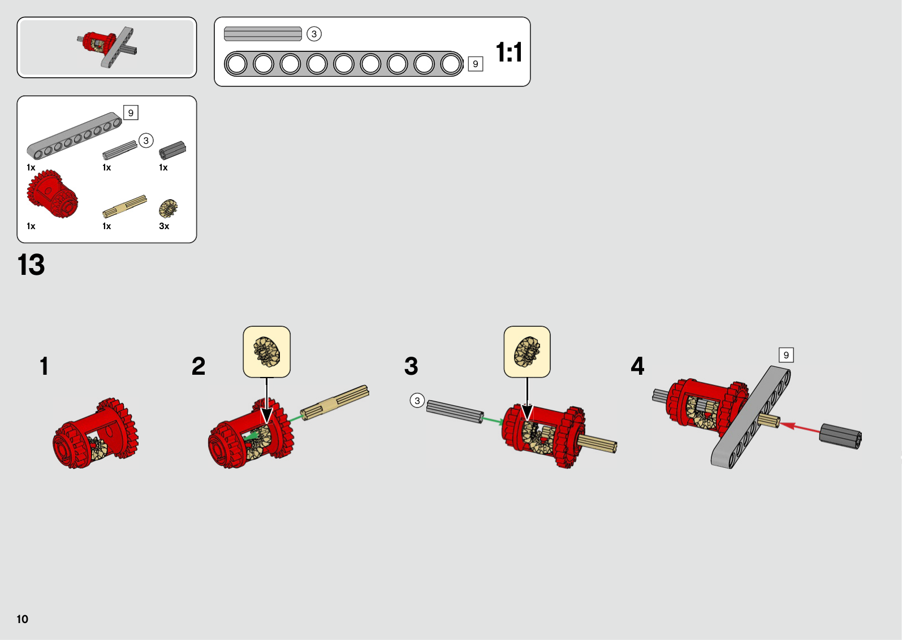

# LEGO Technic 42129 - 1 labeled steps

## 42129-step-01 (page 10) - high

**New parts:** beam3-1 (32523, black) - at center frame origin; pin-1 (2780, black) - in beam3-1 hole 1; pin-2 (2780, black) - in beam3-1 hole 3

**Touches:** pin-1's pin1 goes into beam3-1's hole1 (stiff); pin-2's pin1 goes into beam3-1's hole3 (stiff)

**Exact joins:** pin-1.pin1 into beam3-1.hole1 (0.9 hole deep, held stiff by friction); pin-2.pin1 into beam3-1.hole3 (0.9 hole deep, held stiff by friction)

**Who does what:** beam3-1 holds pin-1; beam3-1 holds pin-2

**After:** beam3-1, pin-1, pin-2 connected at front frame base; everything else: no change

**Why:** Establishes base anchor beam for front frame section 3-hole beam with friction pins provides rigid two-point mounting *Next:* Allows perpendicular side beams to attach in step 2 *Pattern:* two-pin mount

**Big picture:**
- **beam3-1** (Chassis frame): Front cross-member beam
- **pin-1** (Chassis frame): Structural connector pin
- **pin-2** (Chassis frame): Structural connector pin

**Mechanisms:**
- adds **beam3-1** to the steering linkage (linkage) as structural support
- steering_linkage: 1/1 parts - complete

**Review:** Initial step created and annotated in style of repo.
