# LEGO Technic 42175 Volvo EC230 Electric Excavator (excavator booklet, bags 12-17) - 163 labeled steps

## 42175-step-001 (page 2) - medium - NEEDS REVIEW

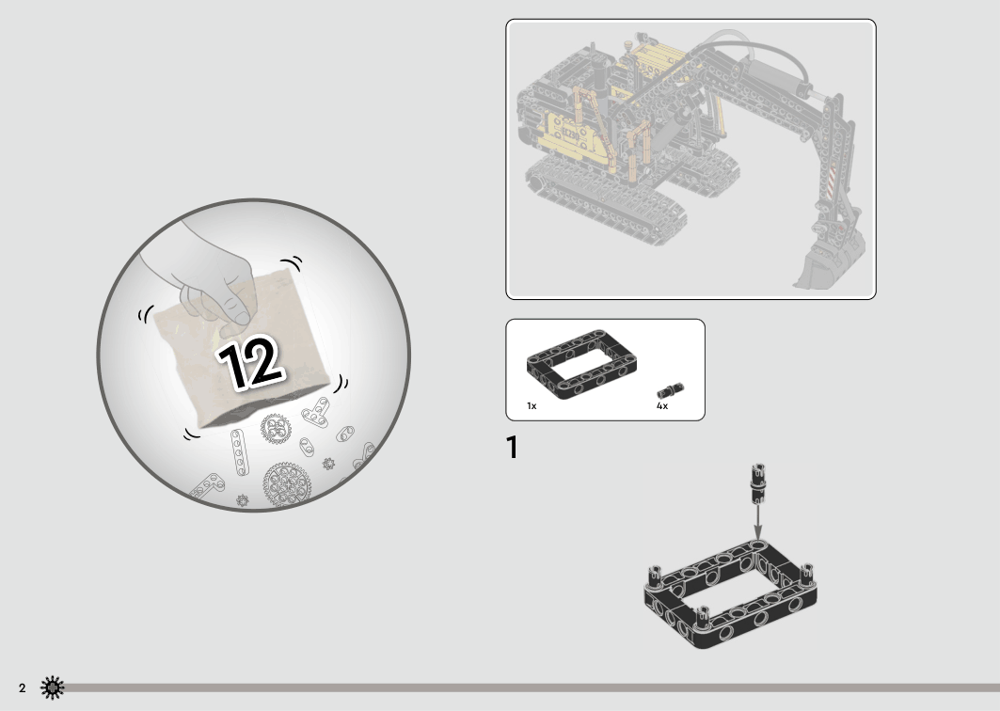

**New parts:** uc-frame-1 (64179, black) - lying flat with its big 3 x 5 opening facing up; uc-pin-1 (65304, black) - one long stop-bush pin standing up in each corner hole of the frame; uc-pin-2 (65304, black) - one long stop-bush pin standing up in each corner hole of the frame; uc-pin-3 (65304, black) - one long stop-bush pin standing up in each corner hole of the frame; uc-pin-4 (65304, black) - one long stop-bush pin standing up in each corner hole of the frame

**Touches:** Each pin is pushed down (green arrow) into one of the four corner holes of the frame, so it stands straight up.

**Exact joins:** uc-pin-1.pin1 into uc-frame-1.hole1 (0.9 hole deep, held stiff by friction, estimated from the picture); uc-pin-2.pin1 into uc-frame-1.hole5 (0.9 hole deep, held stiff by friction, estimated from the picture); uc-pin-3.pin1 into uc-frame-1.hole16 (0.9 hole deep, held stiff by friction, estimated from the picture); uc-pin-4.pin1 into uc-frame-1.hole20 (0.9 hole deep, held stiff by friction, estimated from the picture)

**Who does what:** uc-pin-1 holds uc-frame-1

**After:** uc-frame-1 with a pin standing in each of its four corners; everything else: no change

**Why:** Starts the undercarriage with a stiff rectangular base and four posts to hang the next beams on. A closed 5 x 7 frame stays square without extra bracing; long pins stick up far enough to carry two layers of beams. *Next:* Steps 2-4 slide the long beams onto these four posts. *Pattern:* pins in the corners

**Big picture:**
- **uc-frame-1** (Undercarriage frame): placeholder Later: 42175-step-002 `DOES uc-beam9-1 SUPPORTS uc-frame-1`; 42175-step-015 `CONNECT uc-lpin-5.pin1 -> uc-frame-1.hole?`; 42175-step-015 `CONNECT uc-lpin-6.pin1 -> uc-frame-1.hole?`; 42175-step-015 `CONNECT uc-lpin-7.pin1 -> uc-frame-1.hole?`; 42175-step-015 `CONNECT uc-lpin-8.pin1 -> uc-frame-1.hole?`; 42175-step-015 `DOES uc-lpin-5 HOLDS uc-frame-1`; 42175-step-032 `CONNECT sd-fpin-1.pin1 -> uc-frame-1.hole?`; 42175-step-032 `DOES uc-frame-1 HOLDS sd-fpin-1`; 42175-step-047 `CONNECT cb-beam11-1.hole? -> uc-frame-1.hole?`; 42175-step-047 `DOES uc-frame-1 HOLDS cb-beam11-1`.
- **uc-pin-1** (Undercarriage frame): placeholder Later: 42175-step-002 `CONNECT uc-pin-1.pin2 -> uc-beam9-1.hole2~ STIFF`.
- **uc-pin-2** (Undercarriage frame): placeholder Later: 42175-step-002 `CONNECT uc-pin-2.pin2 -> uc-beam9-2.hole2~ STIFF`.
- **uc-pin-3** (Undercarriage frame): placeholder Later: 42175-step-002 `CONNECT uc-pin-3.pin2 -> uc-beam9-1.hole8~ STIFF`.
- **uc-pin-4** (Undercarriage frame): placeholder Later: 42175-step-002 `CONNECT uc-pin-4.pin2 -> uc-beam9-2.hole8~ STIFF`.

**Review:** The pin type is read from the small parts-box picture (black pin with a stop ring); the corner holes are named from the frame's catalog point list, not counted on the picture.

## 42175-step-002 (page 3) - medium - NEEDS REVIEW

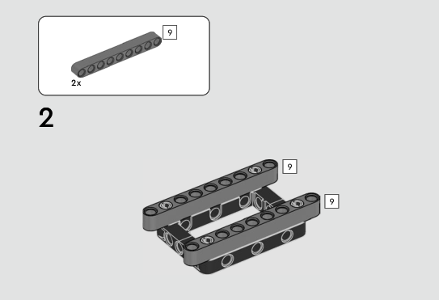

**New parts:** uc-beam9-1 (40490, dark bluish gray) - one 9-hole beam over each long side of the frame, sitting on the corner pins; uc-beam9-2 (40490, dark bluish gray) - one 9-hole beam over each long side of the frame, sitting on the corner pins

**Touches:** Each 9-hole beam drops onto two of the corner pins (2nd and 8th hole), leaving one hole of beam hanging out past each end.

**Exact joins:** uc-pin-1.pin2 into uc-beam9-1.hole2 (0.9 hole deep, held stiff by friction, estimated from the picture); uc-pin-3.pin2 into uc-beam9-1.hole8 (0.9 hole deep, held stiff by friction, estimated from the picture); uc-pin-2.pin2 into uc-beam9-2.hole2 (0.9 hole deep, held stiff by friction, estimated from the picture); uc-pin-4.pin2 into uc-beam9-2.hole8 (0.9 hole deep, held stiff by friction, estimated from the picture)

**Who does what:** uc-beam9-1 supports uc-frame-1

**After:** the two beams lie parallel on top of the frame's long sides, one hole overhanging at each end; everything else: no change

**Why:** Doubles the thickness of the frame's long sides and gives free end holes for the next pins. A 9-hole beam is two holes longer than the 7-hole frame side, so the corner pins land in holes 2 and 8 and the end holes stay free. *Next:* Step 3 puts pins into those free end holes. *Pattern:* beams on posts

**Big picture:**
- **uc-beam9-1** (Undercarriage frame): placeholder Later: 42175-step-003 `CONNECT uc-apin-1.pin1 -> uc-beam9-1.hole1~ STIFF`; 42175-step-003 `CONNECT uc-apin-2.pin1 -> uc-beam9-1.hole9~ STIFF`; 42175-step-003 `DOES uc-apin-1 HOLDS uc-beam9-1`; 42175-step-004 `DOES uc-beam11-1 SUPPORTS uc-beam9-1`.
- **uc-beam9-2** (Undercarriage frame): placeholder Later: 42175-step-003 `CONNECT uc-apin-3.pin1 -> uc-beam9-2.hole1~ STIFF`; 42175-step-003 `CONNECT uc-apin-4.pin1 -> uc-beam9-2.hole9~ STIFF`.

**Mechanisms:**
- **uc-beam9-1** builds on uc-pin-1 (42175-step-001), which rests on uc-frame-1 (42175-step-001); uc-pin-3 (42175-step-001), which rests on uc-frame-1 (42175-step-001)
- **uc-beam9-2** builds on uc-pin-2 (42175-step-001), which rests on uc-frame-1 (42175-step-001); uc-pin-4 (42175-step-001), which rests on uc-frame-1 (42175-step-001)

**Review:** Which beam holes sit on the pins is worked out from the 1:1 beam picture (9 holes) and the 7-hole frame; the picture does not label them.

## 42175-step-003 (page 3) - medium - NEEDS REVIEW

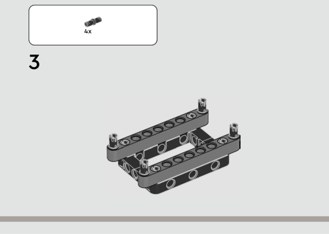

**New parts:** uc-apin-1 (18651, black) - one pin pushed into each free end hole of the two 9-hole beams, pointing up; uc-apin-2 (18651, black) - one pin pushed into each free end hole of the two 9-hole beams, pointing up; uc-apin-3 (18651, black) - one pin pushed into each free end hole of the two 9-hole beams, pointing up; uc-apin-4 (18651, black) - one pin pushed into each free end hole of the two 9-hole beams, pointing up

**Touches:** Four pins go into the four end holes of the two 9-hole beams and stick up on top.

**Exact joins:** uc-apin-1.pin1 into uc-beam9-1.hole1 (0.9 hole deep, held stiff by friction, estimated from the picture); uc-apin-2.pin1 into uc-beam9-1.hole9 (0.9 hole deep, held stiff by friction, estimated from the picture); uc-apin-3.pin1 into uc-beam9-2.hole1 (0.9 hole deep, held stiff by friction, estimated from the picture); uc-apin-4.pin1 into uc-beam9-2.hole9 (0.9 hole deep, held stiff by friction, estimated from the picture)

**Who does what:** uc-apin-1 holds uc-beam9-1

**After:** four new pins stand up at the ends of the two 9-hole beams; everything else: no change

**Why:** Adds the posts that the long outer beams will sit on. A pin with a collar keeps the sides rigid and is long enough to carry a further beam. *Next:* Step 4 lays the 11-hole beams over these pins. *Pattern:* end pins

**Big picture:**
- **uc-apin-1** (Undercarriage frame): placeholder Later: 42175-step-004 `CONNECT uc-apin-1.pin1 -> uc-beam11-1.hole1~ STIFF`.
- **uc-apin-2** (Undercarriage frame): placeholder Later: 42175-step-004 `CONNECT uc-apin-2.pin1 -> uc-beam11-1.hole3~ STIFF`.
- **uc-apin-3** (Undercarriage frame): placeholder Later: 42175-step-004 `CONNECT uc-apin-3.pin1 -> uc-beam11-2.hole1~ STIFF`.
- **uc-apin-4** (Undercarriage frame): placeholder Later: 42175-step-004 `CONNECT uc-apin-4.pin1 -> uc-beam11-2.hole3~ STIFF`.

**Mechanisms:**
- **uc-apin-1** builds on uc-beam9-1 (42175-step-002), which rests on uc-pin-1 (42175-step-001), uc-pin-3 (42175-step-001)
- **uc-apin-2** builds on uc-beam9-1 (42175-step-002), which rests on uc-pin-1 (42175-step-001), uc-pin-3 (42175-step-001)
- **uc-apin-3** builds on uc-beam9-2 (42175-step-002), which rests on uc-pin-2 (42175-step-001), uc-pin-4 (42175-step-001)
- **uc-apin-4** builds on uc-beam9-2 (42175-step-002), which rests on uc-pin-2 (42175-step-001), uc-pin-4 (42175-step-001)

**Review:** Which end hole each pin takes (hole1 or hole9) is not important for the shape; marked as an estimate.

## 42175-step-004 (page 3) - medium - NEEDS REVIEW

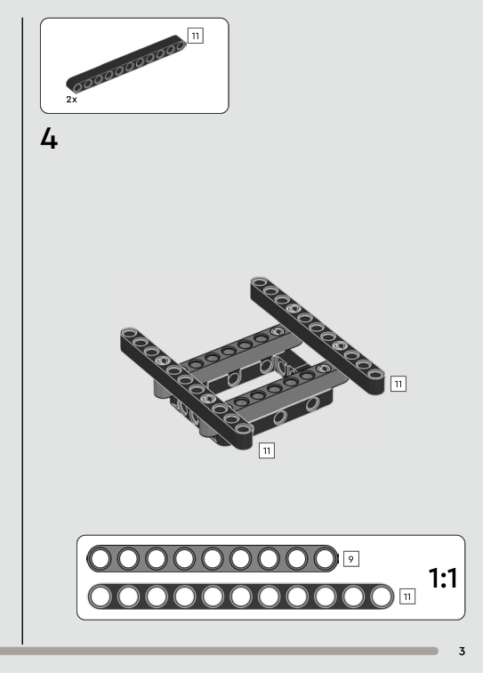

**New parts:** uc-beam11-1 (32525, black) - one long 11-hole beam on each side, lying along the outside on the end pins; uc-beam11-2 (32525, black) - one long 11-hole beam on each side, lying along the outside on the end pins

**Touches:** The two 11-hole beams are lowered onto the four end pins, so they lie flat on top of the 9-hole beams but reach further out.

**Exact joins:** uc-apin-1.pin1 into uc-beam11-1.hole1 (0.9 hole deep, held stiff by friction, estimated from the picture); uc-apin-2.pin1 into uc-beam11-1.hole3 (0.9 hole deep, held stiff by friction, estimated from the picture); uc-apin-3.pin1 into uc-beam11-2.hole1 (0.9 hole deep, held stiff by friction, estimated from the picture); uc-apin-4.pin1 into uc-beam11-2.hole3 (0.9 hole deep, held stiff by friction, estimated from the picture)

**Who does what:** uc-beam11-1 supports uc-beam9-1

**After:** the 11-hole beams form the outer rails of the base, longer than the frame on both ends; everything else: no change

**Why:** Widens and lengthens the base so it can carry the track rails later. 11 holes is long enough to stick out past the 9-hole beams at both ends; thick black beams are stiff. *Next:* Later steps hang the track wheels and the turntable parts off these rails. *Pattern:* long rails

**Big picture:**
- **uc-beam11-1** (Undercarriage frame): placeholder Later: 42175-step-007 `CONNECT uc-pin-5.pin1 -> uc-beam11-1.hole2~ STIFF`; 42175-step-007 `CONNECT uc-pin-6.pin1 -> uc-beam11-1.hole4~ STIFF`; 42175-step-007 `CONNECT uc-pin-7.pin1 -> uc-beam11-1.hole8~ STIFF`; 42175-step-007 `CONNECT uc-pin-8.pin1 -> uc-beam11-1.hole10~ STIFF`; 42175-step-007 `DOES uc-pin-5 HOLDS uc-beam11-1`; 42175-step-008 `CONNECT uc-tpin-1.pin1 -> uc-beam11-1.hole3~ TURNS`; 42175-step-008 `CONNECT uc-tpin-2.pin1 -> uc-beam11-1.hole9~ TURNS`; 42175-step-008 `CONNECT uc-tpin-3.pin1 -> uc-beam11-1.hole6~ TURNS`; 42175-step-008 `DOES uc-tpin-1 HOLDS uc-beam11-1`; 42175-step-010 `CONNECT trk-axle5-1.axle1 -> uc-beam11-1.hole1~ TURNS`; 42175-step-011 `CONNECT trk-axle4-1.axle1 -> uc-beam11-1.hole11~ TURNS`.
- **uc-beam11-2** (Undercarriage frame): placeholder Later: 42175-step-007 `CONNECT uc-pin-9.pin1 -> uc-beam11-2.hole2~ STIFF`; 42175-step-007 `CONNECT uc-pin-10.pin1 -> uc-beam11-2.hole4~ STIFF`; 42175-step-007 `CONNECT uc-pin-11.pin1 -> uc-beam11-2.hole8~ STIFF`; 42175-step-007 `CONNECT uc-pin-12.pin1 -> uc-beam11-2.hole10~ STIFF`; 42175-step-008 `CONNECT uc-tpin-4.pin1 -> uc-beam11-2.hole3~ TURNS`; 42175-step-008 `CONNECT uc-tpin-5.pin1 -> uc-beam11-2.hole9~ TURNS`; 42175-step-008 `CONNECT uc-tpin-6.pin1 -> uc-beam11-2.hole6~ TURNS`; 42175-step-010 `CONNECT trk-axle5-2.axle1 -> uc-beam11-2.hole1~ TURNS`; 42175-step-011 `CONNECT trk-axle4-2.axle1 -> uc-beam11-2.hole11~ TURNS`.

**Mechanisms:**
- **uc-beam11-1** builds on uc-apin-1 (42175-step-003), which rests on uc-beam9-1 (42175-step-002); uc-apin-2 (42175-step-003), which rests on uc-beam9-1 (42175-step-002)
- **uc-beam11-2** builds on uc-apin-3 (42175-step-003), which rests on uc-beam9-2 (42175-step-002); uc-apin-4 (42175-step-003), which rests on uc-beam9-2 (42175-step-002)

**Review:** Exact pin-to-hole pairing is an estimate: the picture only shows the beams resting on the pins.

## 42175-step-005 (page 4) - low - NEEDS REVIEW

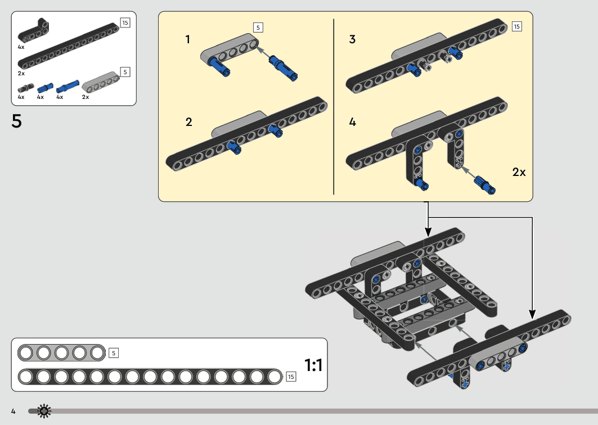

**New parts:** uc-lbeam-1 (32526, black) - four black L-shaped beams (3 x 5), two per side build, hanging down; uc-lbeam-2 (32526, black) - four black L-shaped beams (3 x 5), two per side build, hanging down; uc-lbeam-3 (32526, black) - four black L-shaped beams (3 x 5), two per side build, hanging down; uc-lbeam-4 (32526, black) - four black L-shaped beams (3 x 5), two per side build, hanging down; uc-beam15-1 (32278, black) - one long 15-hole beam per side build; uc-beam15-2 (32278, black) - one long 15-hole beam per side build; uc-beam5-1 (32316, light bluish gray) - one light-grey 5-hole beam per side build; uc-beam5-2 (32316, light bluish gray) - one light-grey 5-hole beam per side build; uc-bpin-1 (43093, blue) - short blue pins used inside the two side builds; uc-bpin-2 (43093, blue) - short blue pins used inside the two side builds; uc-bpin-3 (43093, blue) - short blue pins used inside the two side builds; uc-bpin-4 (43093, blue) - short blue pins used inside the two side builds; uc-lpin-1 (42924, blue) - long blue pins used inside the two side builds; uc-lpin-2 (42924, blue) - long blue pins used inside the two side builds; uc-lpin-3 (42924, blue) - long blue pins used inside the two side builds; uc-lpin-4 (42924, blue) - long blue pins used inside the two side builds; uc-apin-5 (18651, black) - black pins in the side builds; uc-apin-6 (18651, black) - black pins in the side builds; uc-apin-7 (18651, black) - black pins in the side builds; uc-apin-8 (18651, black) - black pins in the side builds

**Touches:** Inside the yellow box (sub-steps 1-4, built twice) a light-grey 5-hole beam gets two blue pins, a 15-hole beam is laid on top, and two L-beams with a blue pin each are hung under it.; The two finished side builds (arrows) are then lowered on the left and right of the base.

**Exact joins:** uc-bpin-1.pin1 into uc-beam5-1.hole1 (0.9 hole deep, held stiff by friction, estimated from the picture); uc-bpin-2.pin1 into uc-beam5-1.hole5 (0.9 hole deep, held stiff by friction, estimated from the picture); uc-bpin-3.pin1 into uc-beam5-2.hole1 (0.9 hole deep, held stiff by friction, estimated from the picture); uc-bpin-4.pin1 into uc-beam5-2.hole5 (0.9 hole deep, held stiff by friction, estimated from the picture)

**Who does what:** uc-bpin-1 holds uc-beam15-1

**After:** two side builds, each a 15-hole beam on a grey 5-hole beam with two L-beams hanging down, sit on the left and right of the base; everything else: no change

**Why:** Builds the two long side members that will carry the track wheels. Each side needs a very long 15-hole beam; the grey 5-hole beam and L-beams give it depth and hold the wheel axles. *Next:* Steps 6-12 add cross beams and the turntable base between these sides. *Pattern:* mirrored side builds

**Big picture:**
- **uc-lbeam-1** (Undercarriage frame): placeholder
- **uc-lbeam-2** (Undercarriage frame): placeholder
- **uc-lbeam-3** (Undercarriage frame): placeholder
- **uc-lbeam-4** (Undercarriage frame): placeholder
- **uc-beam15-1** (Undercarriage frame): placeholder
- **uc-beam15-2** (Undercarriage frame): placeholder
- **uc-beam5-1** (Undercarriage frame): placeholder
- **uc-beam5-2** (Undercarriage frame): placeholder
- **uc-bpin-1** (Undercarriage frame): placeholder
- **uc-bpin-2** (Undercarriage frame): placeholder
- **uc-bpin-3** (Undercarriage frame): placeholder
- **uc-bpin-4** (Undercarriage frame): placeholder
- **uc-lpin-1** (Undercarriage frame): placeholder Later: 42175-step-017 `CONNECT uc-lpin-1.pin1 -> sw-base-1.hole1~ STIFF`; 42175-step-017 `DOES uc-lpin-1 HOLDS sw-base-1`.
- **uc-lpin-2** (Undercarriage frame): placeholder Later: 42175-step-017 `CONNECT uc-lpin-2.pin1 -> sw-base-1.hole2~ STIFF`.
- **uc-lpin-3** (Undercarriage frame): placeholder Later: 42175-step-017 `CONNECT uc-lpin-3.pin1 -> sw-base-1.hole4~ STIFF`; 42175-step-017 `DOES uc-lpin-3 HOLDS sw-base-1`.
- **uc-lpin-4** (Undercarriage frame): placeholder Later: 42175-step-017 `CONNECT uc-lpin-4.pin1 -> sw-base-1.hole5~ STIFF`.
- **uc-apin-5** (Undercarriage frame): placeholder
- **uc-apin-6** (Undercarriage frame): placeholder
- **uc-apin-7** (Undercarriage frame): placeholder
- **uc-apin-8** (Undercarriage frame): placeholder

**Review:** The sub-steps in the yellow box are listed as one step here. Part kinds are read from the parts box (4 L-beams, 2 x 15-beams, 2 grey 5-beams, 4 + 4 + 4 pins); only a few joins are listed (all are 'estimated'): the picture is too small to count the holes. A CONNECT between two beams without a pin (first join) is only a sketch of where they meet.

## 42175-step-006 (page 5) - medium - NEEDS REVIEW

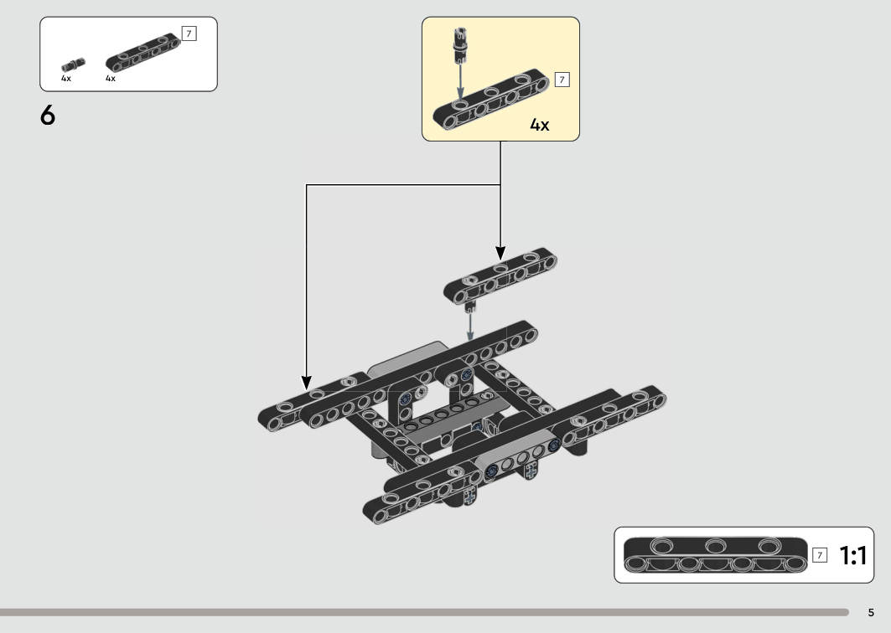

**New parts:** uc-beam7-1 (32524, black) - four 7-hole beams, each with a pin pushed in underneath, laid across the base; uc-beam7-2 (32524, black) - four 7-hole beams, each with a pin pushed in underneath, laid across the base; uc-beam7-3 (32524, black) - four 7-hole beams, each with a pin pushed in underneath, laid across the base; uc-beam7-4 (32524, black) - four 7-hole beams, each with a pin pushed in underneath, laid across the base; uc-apin-9 (18651, black) - one pin under each 7-hole beam; uc-apin-10 (18651, black) - one pin under each 7-hole beam; uc-apin-11 (18651, black) - one pin under each 7-hole beam; uc-apin-12 (18651, black) - one pin under each 7-hole beam

**Touches:** Each 7-hole beam first gets a pin in its middle hole (yellow box, 4x), then the beam is pressed onto the base at one of four marked spots.

**Exact joins:** uc-apin-9.pin1 into uc-beam7-1.hole4 (0.9 hole deep, held stiff by friction, estimated from the picture); uc-apin-10.pin1 into uc-beam7-2.hole4 (0.9 hole deep, held stiff by friction, estimated from the picture); uc-apin-11.pin1 into uc-beam7-3.hole4 (0.9 hole deep, held stiff by friction, estimated from the picture); uc-apin-12.pin1 into uc-beam7-4.hole4 (0.9 hole deep, held stiff by friction, estimated from the picture)

**Who does what:** uc-apin-9 holds uc-beam7-1

**After:** four 7-hole cross beams span the base; everything else: no change

**Why:** Ties the left and right sides together so the base can't spread. Short pins in the middle hole of a 7-hole beam centre it on the spot; four of them make the frame rigid. *Next:* Step 7 onward builds the turntable seat on top of these. *Pattern:* cross ties

**Big picture:**
- **uc-beam7-1** (Undercarriage frame): placeholder
- **uc-beam7-2** (Undercarriage frame): placeholder
- **uc-beam7-3** (Undercarriage frame): placeholder
- **uc-beam7-4** (Undercarriage frame): placeholder
- **uc-apin-9** (Undercarriage frame): placeholder
- **uc-apin-10** (Undercarriage frame): placeholder
- **uc-apin-11** (Undercarriage frame): placeholder
- **uc-apin-12** (Undercarriage frame): placeholder

**Review:** Where exactly the four cross beams land on the base is shown by the two black arrows; their pin holes are not countable in the picture.

## 42175-step-007 (page 6) - medium - NEEDS REVIEW

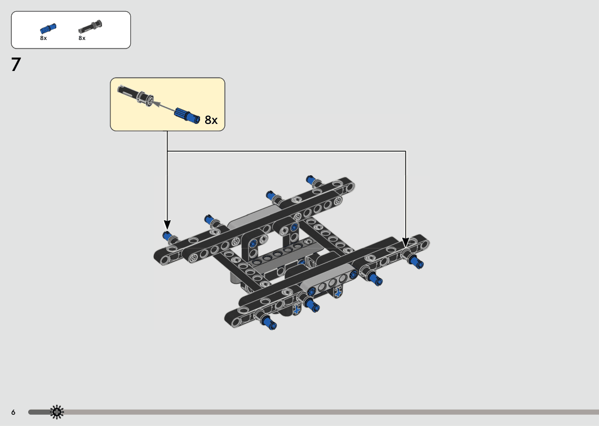

**New parts:** uc-axpin-1 (43093, blue) - short blue axle pins, each pushed into the end of a black long pin to make a longer peg; uc-axpin-2 (43093, blue) - short blue axle pins, each pushed into the end of a black long pin to make a longer peg; uc-axpin-3 (43093, blue) - short blue axle pins, each pushed into the end of a black long pin to make a longer peg; uc-axpin-4 (43093, blue) - short blue axle pins, each pushed into the end of a black long pin to make a longer peg; uc-axpin-5 (43093, blue) - short blue axle pins, each pushed into the end of a black long pin to make a longer peg; uc-axpin-6 (43093, blue) - short blue axle pins, each pushed into the end of a black long pin to make a longer peg; uc-axpin-7 (43093, blue) - short blue axle pins, each pushed into the end of a black long pin to make a longer peg; uc-axpin-8 (43093, blue) - short blue axle pins, each pushed into the end of a black long pin to make a longer peg; uc-pin-5 (65304, black) - long stop-bush pins that take a blue axle pin in their cross hole, then go into the outer rails; uc-pin-6 (65304, black) - long stop-bush pins that take a blue axle pin in their cross hole, then go into the outer rails; uc-pin-7 (65304, black) - long stop-bush pins that take a blue axle pin in their cross hole, then go into the outer rails; uc-pin-8 (65304, black) - long stop-bush pins that take a blue axle pin in their cross hole, then go into the outer rails; uc-pin-9 (65304, black) - long stop-bush pins that take a blue axle pin in their cross hole, then go into the outer rails; uc-pin-10 (65304, black) - long stop-bush pins that take a blue axle pin in their cross hole, then go into the outer rails; uc-pin-11 (65304, black) - long stop-bush pins that take a blue axle pin in their cross hole, then go into the outer rails; uc-pin-12 (65304, black) - long stop-bush pins that take a blue axle pin in their cross hole, then go into the outer rails

**Touches:** Eight times: a blue axle pin is pushed into the cross hole of a black long pin (yellow box). The eight finished pegs then go into the two outer 11-hole rails, four per rail, pointing out.

**Exact joins:** uc-axpin-1.axle1 into uc-pin-5.axlehole1 (1 hole deep, locked (turn together)); uc-axpin-2.axle1 into uc-pin-6.axlehole1 (1 hole deep, locked (turn together)); uc-axpin-3.axle1 into uc-pin-7.axlehole1 (1 hole deep, locked (turn together)); uc-axpin-4.axle1 into uc-pin-8.axlehole1 (1 hole deep, locked (turn together)); uc-axpin-5.axle1 into uc-pin-9.axlehole1 (1 hole deep, locked (turn together)); uc-axpin-6.axle1 into uc-pin-10.axlehole1 (1 hole deep, locked (turn together)); uc-axpin-7.axle1 into uc-pin-11.axlehole1 (1 hole deep, locked (turn together)); uc-axpin-8.axle1 into uc-pin-12.axlehole1 (1 hole deep, locked (turn together)); uc-pin-5.pin1 into uc-beam11-1.hole2 (0.9 hole deep, held stiff by friction, estimated from the picture); uc-pin-6.pin1 into uc-beam11-1.hole4 (0.9 hole deep, held stiff by friction, estimated from the picture); uc-pin-7.pin1 into uc-beam11-1.hole8 (0.9 hole deep, held stiff by friction, estimated from the picture); uc-pin-8.pin1 into uc-beam11-1.hole10 (0.9 hole deep, held stiff by friction, estimated from the picture); uc-pin-9.pin1 into uc-beam11-2.hole2 (0.9 hole deep, held stiff by friction, estimated from the picture); uc-pin-10.pin1 into uc-beam11-2.hole4 (0.9 hole deep, held stiff by friction, estimated from the picture); uc-pin-11.pin1 into uc-beam11-2.hole8 (0.9 hole deep, held stiff by friction, estimated from the picture); uc-pin-12.pin1 into uc-beam11-2.hole10 (0.9 hole deep, held stiff by friction, estimated from the picture)

**Who does what:** uc-pin-5 holds uc-beam11-1

**After:** eight pegs stick out sideways from the two outer rails; everything else: no change

**Why:** Gives the track rollers and wheel carriers something to hang on. A blue axle pin in a long pin's cross hole makes a peg that is longer than any single pin and still friction-tight. *Next:* Step 8 and 9 put tan pins and the wheel carriers between and on these pegs. *Pattern:* extended pegs

**Big picture:**
- **uc-axpin-1** (Undercarriage frame): placeholder
- **uc-axpin-2** (Undercarriage frame): placeholder
- **uc-axpin-3** (Undercarriage frame): placeholder
- **uc-axpin-4** (Undercarriage frame): placeholder
- **uc-axpin-5** (Undercarriage frame): placeholder
- **uc-axpin-6** (Undercarriage frame): placeholder
- **uc-axpin-7** (Undercarriage frame): placeholder
- **uc-axpin-8** (Undercarriage frame): placeholder
- **uc-pin-5** (Undercarriage frame): placeholder
- **uc-pin-6** (Undercarriage frame): placeholder
- **uc-pin-7** (Undercarriage frame): placeholder
- **uc-pin-8** (Undercarriage frame): placeholder
- **uc-pin-9** (Undercarriage frame): placeholder
- **uc-pin-10** (Undercarriage frame): placeholder
- **uc-pin-11** (Undercarriage frame): placeholder
- **uc-pin-12** (Undercarriage frame): placeholder

**Mechanisms:**
- **uc-pin-5** builds on uc-beam11-1 (42175-step-004), which rests on uc-apin-1 (42175-step-003), uc-apin-2 (42175-step-003)
- **uc-pin-6** builds on uc-beam11-1 (42175-step-004), which rests on uc-apin-1 (42175-step-003), uc-apin-2 (42175-step-003)
- **uc-pin-7** builds on uc-beam11-1 (42175-step-004), which rests on uc-apin-1 (42175-step-003), uc-apin-2 (42175-step-003)
- **uc-pin-8** builds on uc-beam11-1 (42175-step-004), which rests on uc-apin-1 (42175-step-003), uc-apin-2 (42175-step-003)
- **uc-pin-9** builds on uc-beam11-2 (42175-step-004), which rests on uc-apin-3 (42175-step-003), uc-apin-4 (42175-step-003)
- **uc-pin-10** builds on uc-beam11-2 (42175-step-004), which rests on uc-apin-3 (42175-step-003), uc-apin-4 (42175-step-003)
- **uc-pin-11** builds on uc-beam11-2 (42175-step-004), which rests on uc-apin-3 (42175-step-003), uc-apin-4 (42175-step-003)
- **uc-pin-12** builds on uc-beam11-2 (42175-step-004), which rests on uc-apin-3 (42175-step-003), uc-apin-4 (42175-step-003)

**Review:** Which holes of the outer rails take the pegs is an estimate (spacing read by eye); the exact hole count can't be read at this size.

## 42175-step-008 (page 7) - medium - NEEDS REVIEW

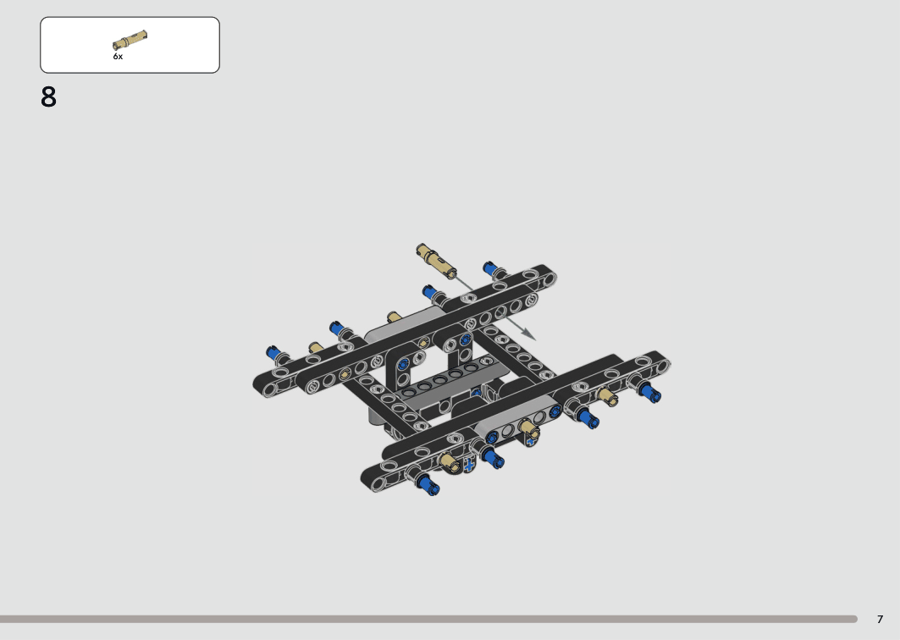

**New parts:** uc-tpin-1 (39888, tan) - tan long pins pushed into the rails between the blue pegs; uc-tpin-2 (39888, tan) - tan long pins pushed into the rails between the blue pegs; uc-tpin-3 (39888, tan) - tan long pins pushed into the rails between the blue pegs; uc-tpin-4 (39888, tan) - tan long pins pushed into the rails between the blue pegs; uc-tpin-5 (39888, tan) - tan long pins pushed into the rails between the blue pegs; uc-tpin-6 (39888, tan) - tan long pins pushed into the rails between the blue pegs

**Touches:** Six tan pins (green arrow shows one going in) are pressed into the rails, three per side, in the gaps between the blue pegs.

**Exact joins:** uc-tpin-1.pin1 into uc-beam11-1.hole3 (0.9 hole deep, turns freely, estimated from the picture); uc-tpin-2.pin1 into uc-beam11-1.hole9 (0.9 hole deep, turns freely, estimated from the picture); uc-tpin-3.pin1 into uc-beam11-1.hole6 (0.9 hole deep, turns freely, estimated from the picture); uc-tpin-4.pin1 into uc-beam11-2.hole3 (0.9 hole deep, turns freely, estimated from the picture); uc-tpin-5.pin1 into uc-beam11-2.hole9 (0.9 hole deep, turns freely, estimated from the picture); uc-tpin-6.pin1 into uc-beam11-2.hole6 (0.9 hole deep, turns freely, estimated from the picture)

**Who does what:** uc-tpin-1 holds uc-beam11-1

**After:** three tan pins and four blue pegs alternate along each outer rail; everything else: no change

**Why:** Adds the spindles on which free-turning track rollers will run. Tan pins have no friction ridges, so a wheel on them spins freely. *Next:* Step 9 builds the roller carriers that hang on these. *Pattern:* free-spinning spindles

**Big picture:**
- **uc-tpin-1** (Undercarriage frame): placeholder Later: 42175-step-012 `DOES trk-roller-1 SPINS_ON uc-tpin-1`.
- **uc-tpin-2** (Undercarriage frame): placeholder Later: 42175-step-012 `DOES trk-roller-2 SPINS_ON uc-tpin-2`.
- **uc-tpin-3** (Undercarriage frame): placeholder Later: 42175-step-012 `DOES trk-roller-3 SPINS_ON uc-tpin-3`.
- **uc-tpin-4** (Undercarriage frame): placeholder Later: 42175-step-012 `DOES trk-roller-4 SPINS_ON uc-tpin-4`.
- **uc-tpin-5** (Undercarriage frame): placeholder Later: 42175-step-012 `DOES trk-roller-5 SPINS_ON uc-tpin-5`.
- **uc-tpin-6** (Undercarriage frame): placeholder Later: 42175-step-012 `DOES trk-roller-6 SPINS_ON uc-tpin-6`.

**Mechanisms:**
- **uc-tpin-1** builds on uc-beam11-1 (42175-step-004), which rests on uc-apin-1 (42175-step-003), uc-apin-2 (42175-step-003)
- **uc-tpin-2** builds on uc-beam11-1 (42175-step-004), which rests on uc-apin-1 (42175-step-003), uc-apin-2 (42175-step-003)
- **uc-tpin-3** builds on uc-beam11-1 (42175-step-004), which rests on uc-apin-1 (42175-step-003), uc-apin-2 (42175-step-003)
- **uc-tpin-4** builds on uc-beam11-2 (42175-step-004), which rests on uc-apin-3 (42175-step-003), uc-apin-4 (42175-step-003)
- **uc-tpin-5** builds on uc-beam11-2 (42175-step-004), which rests on uc-apin-3 (42175-step-003), uc-apin-4 (42175-step-003)
- **uc-tpin-6** builds on uc-beam11-2 (42175-step-004), which rests on uc-apin-3 (42175-step-003), uc-apin-4 (42175-step-003)

**Review:** Pin hole numbers are estimates read off the row spacing.

## 42175-step-009 (page 8) - low - NEEDS REVIEW

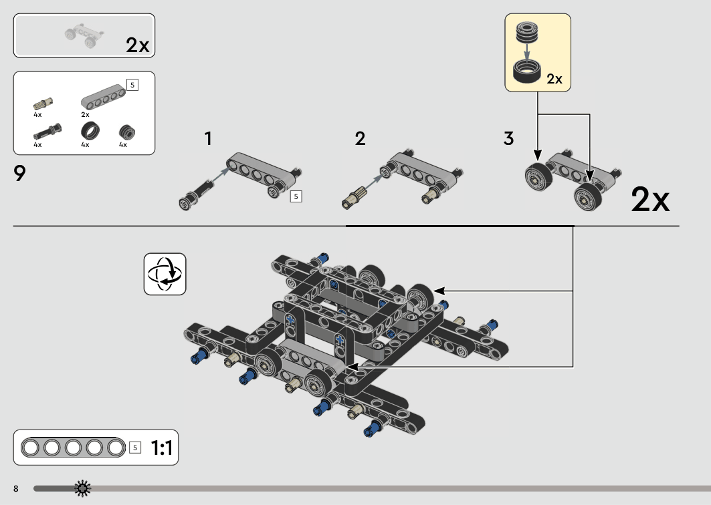

**New parts:** trk-beam5-1 (32316, light bluish gray) - one light-grey 5-hole beam per roller carrier; trk-beam5-2 (32316, light bluish gray) - one light-grey 5-hole beam per roller carrier; trk-axpin-1 (18651, black) - black 3L axle pins, one at each end of a carrier; trk-axpin-2 (18651, black) - black 3L axle pins, one at each end of a carrier; trk-axpin-3 (18651, black) - black 3L axle pins, one at each end of a carrier; trk-axpin-4 (18651, black) - black 3L axle pins, one at each end of a carrier; trk-tpin-1 (3749, tan) - tan axle pins (no friction) at the other holes of a carrier; trk-tpin-2 (3749, tan) - tan axle pins (no friction) at the other holes of a carrier; trk-tpin-3 (3749, tan) - tan axle pins (no friction) at the other holes of a carrier; trk-tpin-4 (3749, tan) - tan axle pins (no friction) at the other holes of a carrier; trk-wheel-1 (42610, black) - small grooved wheels, two per carrier; trk-wheel-2 (42610, black) - small grooved wheels, two per carrier; trk-wheel-3 (42610, black) - small grooved wheels, two per carrier; trk-wheel-4 (42610, black) - small grooved wheels, two per carrier; trk-tyre-1 (50951, black) - solid tyre pressed on each wheel; trk-tyre-2 (50951, black) - solid tyre pressed on each wheel; trk-tyre-3 (50951, black) - solid tyre pressed on each wheel; trk-tyre-4 (50951, black) - solid tyre pressed on each wheel

**Touches:** Sub-steps 1-3 (built twice): a black pin and a tan pin go into the end holes of a light-grey 5-hole beam, then a tyre goes on each wheel (yellow box) and the two wheels slide onto the pins.; The two finished carriers are attached to the undercarriage with the black arrows (the model is turned over first).

**Exact joins:** trk-axpin-1.pin1 into trk-beam5-1.hole1 (0.9 hole deep, held stiff by friction, estimated from the picture); trk-axpin-3.pin1 into trk-beam5-1.hole5 (0.9 hole deep, held stiff by friction, estimated from the picture); trk-axpin-2.pin1 into trk-beam5-2.hole1 (0.9 hole deep, held stiff by friction, estimated from the picture); trk-axpin-4.pin1 into trk-beam5-2.hole5 (0.9 hole deep, held stiff by friction, estimated from the picture); trk-tpin-1.pin1 into trk-beam5-1.hole2 (0.9 hole deep, turns freely, estimated from the picture); trk-tpin-2.pin1 into trk-beam5-1.hole4 (0.9 hole deep, turns freely, estimated from the picture); trk-tpin-3.pin1 into trk-beam5-2.hole2 (0.9 hole deep, turns freely, estimated from the picture); trk-tpin-4.pin1 into trk-beam5-2.hole4 (0.9 hole deep, turns freely, estimated from the picture)

**Who does what:** trk-wheel-1 spins on trk-tpin-1; trk-wheel-2 spins on trk-tpin-2; trk-wheel-3 spins on trk-tpin-3; trk-wheel-4 spins on trk-tpin-4

**After:** two roller carriers (a 5-hole beam with two small tyred wheels each) are attached to the undercarriage; everything else: no change

**Why:** Adds the small rollers that the track will run on. Free-spinning wheels on pins keep friction low; the grey 5-hole beam is the right length to hold two wheels one track-link apart. *Next:* Steps 10 onward build the track wheels and the track loop around these rollers. *Pattern:* roller carrier

**Big picture:**
- **trk-beam5-1** (None): None
- **trk-beam5-2** (None): None
- **trk-axpin-1** (None): None
- **trk-axpin-2** (None): None
- **trk-axpin-3** (None): None
- **trk-axpin-4** (None): None
- **trk-tpin-1** (None): None
- **trk-tpin-2** (None): None
- **trk-tpin-3** (None): None
- **trk-tpin-4** (None): None
- **trk-wheel-1** (None): None
- **trk-wheel-2** (None): None
- **trk-wheel-3** (None): None
- **trk-wheel-4** (None): None
- **trk-tyre-1** (None): None
- **trk-tyre-2** (None): None
- **trk-tyre-3** (None): None
- **trk-tyre-4** (None): None

**Review:** The parts box shows tan x4, black x4 (pin with axle), 2 grey beams, 4 tyres and 4 wheels. Which of the two pin types goes in which hole was read from sub-steps 1-2 and is an estimate. The attachment holes on the undercarriage are not shown.

## 42175-step-010 (page 9) - medium - NEEDS REVIEW

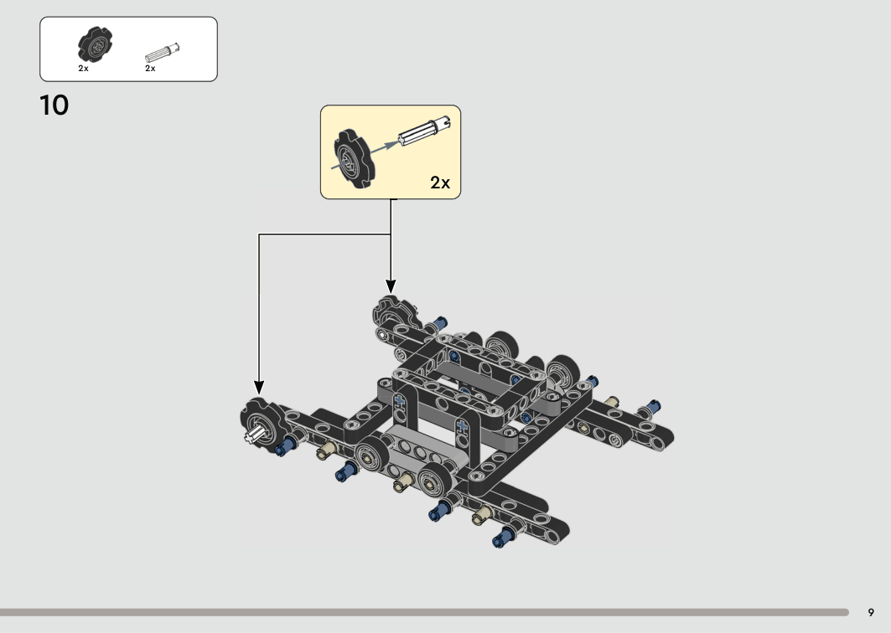

**New parts:** trk-axle5-1 (32073, light bluish gray) - grey 5-long axle pushed through the front end of each rail and into a sprocket wheel; trk-axle5-2 (32073, light bluish gray) - grey 5-long axle pushed through the front end of each rail and into a sprocket wheel; trk-sprocket-1 (57520, black) - 6-tooth black sprocket wheel on the end of each axle; trk-sprocket-2 (57520, black) - 6-tooth black sprocket wheel on the end of each axle

**Touches:** In the yellow box (2x) the axle is pushed into the sprocket's centre; the two sprockets then go onto the front end of each rail (arrows).

**Exact joins:** trk-axle5-1.axle1 into uc-beam11-1.hole1 (1 hole deep, turns freely, estimated from the picture); trk-axle5-2.axle1 into uc-beam11-2.hole1 (1 hole deep, turns freely, estimated from the picture); trk-axle5-1.axle3 into trk-sprocket-1.axlehole1 (1 hole deep, locked (turn together), estimated from the picture); trk-axle5-2.axle3 into trk-sprocket-2.axlehole1 (1 hole deep, locked (turn together), estimated from the picture)

**Who does what:** trk-axle5-1 carries trk-sprocket-1; trk-axle5-2 carries trk-sprocket-2

**After:** one sprocket sits at the front end of each rail on its own axle; everything else: no change

**Why:** Starts the drive end of the track: the sprockets are the wheels whose teeth will grab the track links. The axle locks into the sprocket's cross hole but turns freely in the round beam hole, so the sprocket can spin. *Next:* Step 11 does the same at the other end. *Pattern:* sprocket on axle

**Big picture:**
- **trk-axle5-1** (None): None
- **trk-axle5-2** (None): None
- **trk-sprocket-1** (None): None
- **trk-sprocket-2** (None): None

**Mechanisms:**
- **trk-axle5-1** builds on uc-beam11-1 (42175-step-004), which rests on uc-apin-1 (42175-step-003), uc-apin-2 (42175-step-003)
- **trk-axle5-2** builds on uc-beam11-2 (42175-step-004), which rests on uc-apin-3 (42175-step-003), uc-apin-4 (42175-step-003)

**Review:** Which rail hole holds the axle is an estimate. The booklet part is a light grey axle with a ridge; read as Technic Axle 5 (1:1 callout not shown for this step).

## 42175-step-011 (page 10) - medium - NEEDS REVIEW

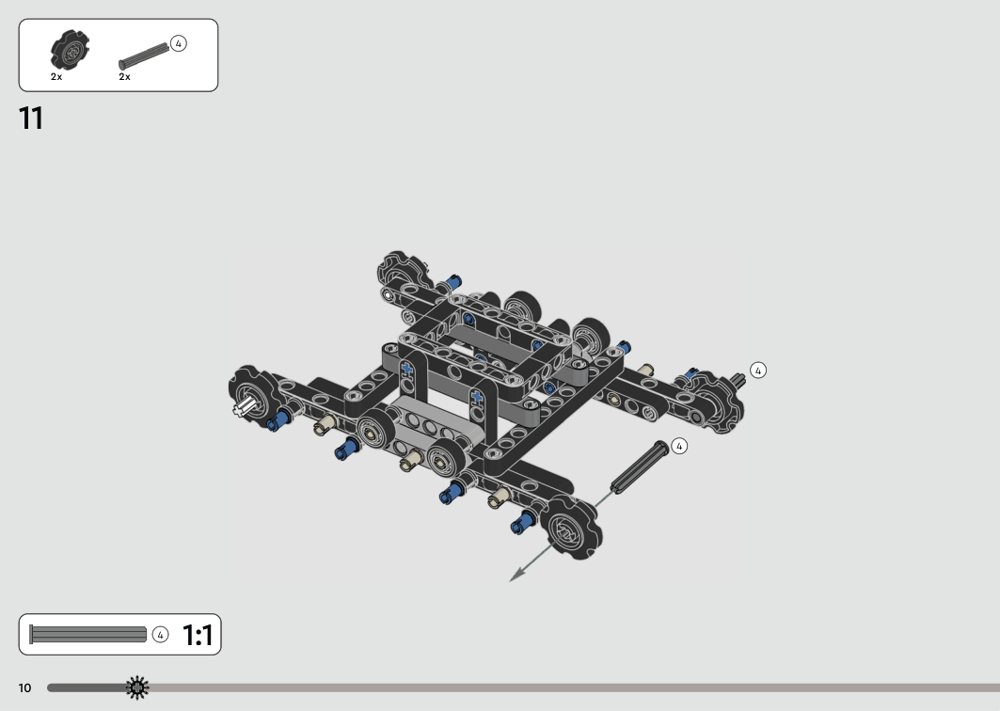

**New parts:** trk-axle4-1 (87083, dark bluish gray) - dark grey 4-long axle with a stop, pushed through the back end of each rail from outside; trk-axle4-2 (87083, dark bluish gray) - dark grey 4-long axle with a stop, pushed through the back end of each rail from outside; trk-sprocket-3 (57520, black) - 6-tooth sprocket wheel on the end of each axle; trk-sprocket-4 (57520, black) - 6-tooth sprocket wheel on the end of each axle

**Touches:** The two stop axles (numbered 4 in the booklet, shown 1:1 bottom left) go through the back end of the rails and into the sprockets.

**Exact joins:** trk-axle4-1.axle1 into uc-beam11-1.hole11 (1 hole deep, turns freely, estimated from the picture); trk-axle4-2.axle1 into uc-beam11-2.hole11 (1 hole deep, turns freely, estimated from the picture); trk-axle4-1.axle3 into trk-sprocket-3.axlehole1 (1 hole deep, locked (turn together), estimated from the picture); trk-axle4-2.axle3 into trk-sprocket-4.axlehole1 (1 hole deep, locked (turn together), estimated from the picture)

**Who does what:** trk-axle4-1 carries trk-sprocket-3; trk-axle4-2 carries trk-sprocket-4

**After:** sprockets at both ends of both rails; everything else: no change

**Why:** Gives each track loop a sprocket at the front and at the back. A stop axle can't slide out of the sprocket from the inside. *Next:* Steps 12-20 add the middle rollers, then the track links wrap around all of them. *Pattern:* sprocket on axle

**Big picture:**
- **trk-axle4-1** (None): None
- **trk-axle4-2** (None): None
- **trk-sprocket-3** (None): None
- **trk-sprocket-4** (None): None

**Mechanisms:**
- **trk-axle4-1** builds on uc-beam11-1 (42175-step-004), which rests on uc-apin-1 (42175-step-003), uc-apin-2 (42175-step-003)
- **trk-axle4-2** builds on uc-beam11-2 (42175-step-004), which rests on uc-apin-3 (42175-step-003), uc-apin-4 (42175-step-003)

**Review:** Hole numbers are estimates.

## 42175-step-012 (page 11) - medium - NEEDS REVIEW

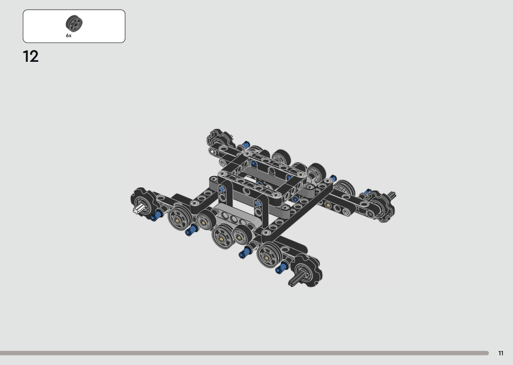

**New parts:** trk-roller-1 (55982, light bluish gray) - grey roller wheel on each tan spindle, three per side; trk-roller-2 (55982, light bluish gray) - grey roller wheel on each tan spindle, three per side; trk-roller-3 (55982, light bluish gray) - grey roller wheel on each tan spindle, three per side; trk-roller-4 (55982, light bluish gray) - grey roller wheel on each tan spindle, three per side; trk-roller-5 (55982, light bluish gray) - grey roller wheel on each tan spindle, three per side; trk-roller-6 (55982, light bluish gray) - grey roller wheel on each tan spindle, three per side

**Touches:** Six grey wheels are pushed onto the six tan pins that stick out from the rails.

**Exact joins:** none

**Who does what:** trk-roller-1 spins on uc-tpin-1; trk-roller-2 spins on uc-tpin-2; trk-roller-3 spins on uc-tpin-3; trk-roller-4 spins on uc-tpin-4; trk-roller-5 spins on uc-tpin-5; trk-roller-6 spins on uc-tpin-6

**After:** three roller wheels on each side; everything else: no change

**Why:** Adds the lower rollers that carry the weight on the track. Tan pins have no friction ridges, so the wheel spins freely. *Next:* The track loop (steps 13-14) runs under and over these. *Pattern:* free-spinning roller

**Big picture:**
- **trk-roller-1** (None): None
- **trk-roller-2** (None): None
- **trk-roller-3** (None): None
- **trk-roller-4** (None): None
- **trk-roller-5** (None): None
- **trk-roller-6** (None): None

**Review:** The wheels have no catalog entry (not in the Technic parts list), so no point names are given.

## 42175-step-013 (page 12) - low - NEEDS REVIEW

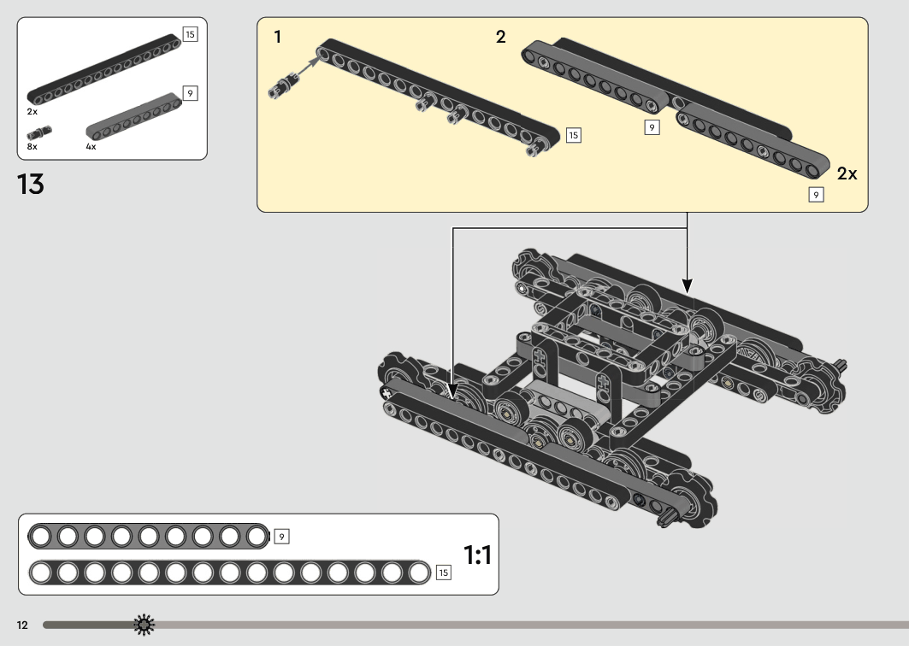

**New parts:** trk-beam15-1 (32278, black) - one long 15-hole beam per side build; trk-beam15-2 (32278, black) - one long 15-hole beam per side build; trk-beam9-1 (40490, dark bluish gray) - two grey 9-hole beams per side build, side by side under the 15-hole beam; trk-beam9-2 (40490, dark bluish gray) - two grey 9-hole beams per side build, side by side under the 15-hole beam; trk-beam9-3 (40490, dark bluish gray) - two grey 9-hole beams per side build, side by side under the 15-hole beam; trk-beam9-4 (40490, dark bluish gray) - two grey 9-hole beams per side build, side by side under the 15-hole beam; trk-pin-1 (65304, black) - four black pins per side build, pushed through the 15-hole beam; trk-pin-2 (65304, black) - four black pins per side build, pushed through the 15-hole beam; trk-pin-3 (65304, black) - four black pins per side build, pushed through the 15-hole beam; trk-pin-4 (65304, black) - four black pins per side build, pushed through the 15-hole beam; trk-pin-5 (65304, black) - four black pins per side build, pushed through the 15-hole beam; trk-pin-6 (65304, black) - four black pins per side build, pushed through the 15-hole beam; trk-pin-7 (65304, black) - four black pins per side build, pushed through the 15-hole beam; trk-pin-8 (65304, black) - four black pins per side build, pushed through the 15-hole beam

**Touches:** Yellow box (built twice): four black pins go into a 15-hole beam, then two grey 9-hole beams are laid under it on the pins. Each finished side build is lowered along one side of the undercarriage (two black arrows).

**Exact joins:** trk-pin-1.pin1 into trk-beam15-1.hole1 (0.9 hole deep, held stiff by friction, estimated from the picture); trk-pin-2.pin1 into trk-beam15-1.hole8 (0.9 hole deep, held stiff by friction, estimated from the picture); trk-pin-3.pin1 into trk-beam15-1.hole10 (0.9 hole deep, held stiff by friction, estimated from the picture); trk-pin-4.pin1 into trk-beam15-1.hole15 (0.9 hole deep, held stiff by friction, estimated from the picture); trk-pin-5.pin1 into trk-beam15-2.hole1 (0.9 hole deep, held stiff by friction, estimated from the picture); trk-pin-6.pin1 into trk-beam15-2.hole8 (0.9 hole deep, held stiff by friction, estimated from the picture); trk-pin-7.pin1 into trk-beam15-2.hole10 (0.9 hole deep, held stiff by friction, estimated from the picture); trk-pin-8.pin1 into trk-beam15-2.hole15 (0.9 hole deep, held stiff by friction, estimated from the picture); trk-pin-1.pin2 into trk-beam9-1.hole2 (0.9 hole deep, held stiff by friction, estimated from the picture); trk-pin-5.pin2 into trk-beam9-3.hole2 (0.9 hole deep, held stiff by friction, estimated from the picture)

**Who does what:** trk-pin-1 holds trk-beam15-1; trk-pin-5 holds trk-beam15-2

**After:** a long track rail (15-hole beam over two 9-hole beams) lies along each side of the undercarriage; everything else: no change

**Why:** Builds the long track frames that hold the wheels in line and give the track something to slide on. A 15-hole beam spans from sprocket to sprocket; two 9-hole beams under it add height so the track links ride flat. *Next:* Steps 14-16 cap the axle ends and wrap the track links around the whole assembly. *Pattern:* track rail

**Big picture:**
- **trk-beam15-1** (None): None
- **trk-beam15-2** (None): None
- **trk-beam9-1** (None): None
- **trk-beam9-2** (None): None
- **trk-beam9-3** (None): None
- **trk-beam9-4** (None): None
- **trk-pin-1** (None): None
- **trk-pin-2** (None): None
- **trk-pin-3** (None): None
- **trk-pin-4** (None): None
- **trk-pin-5** (None): None
- **trk-pin-6** (None): None
- **trk-pin-7** (None): None
- **trk-pin-8** (None): None

**Review:** Pin positions along the 15-hole beam are read by eye from sub-step 1 (pins near holes 1, 8, 10, 15) and are estimates. Which pin holds which 9-hole beam is not shown.

## 42175-step-014 (page 13) - medium - NEEDS REVIEW

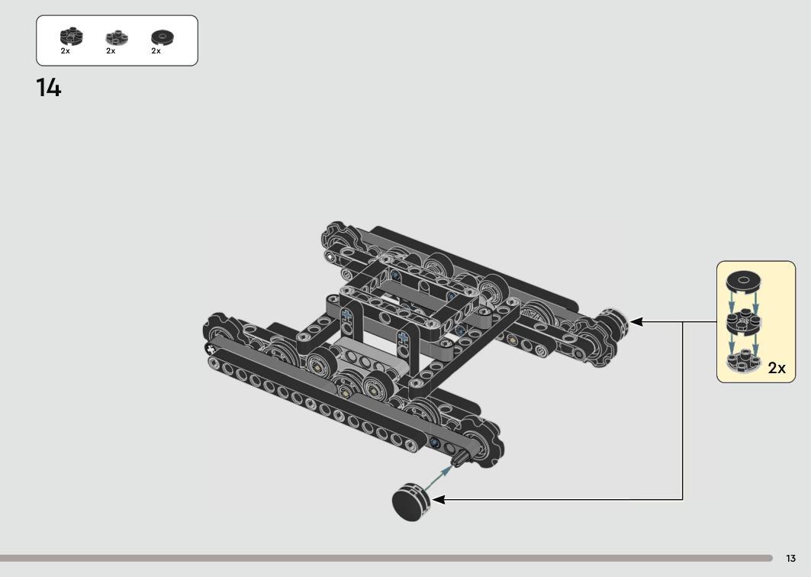

**New parts:** trk-capplate-1 (2476a, light bluish gray) - light-grey 2 x 2 plate with a pin underneath; the base of an axle cap; trk-capplate-2 (2476a, light bluish gray) - light-grey 2 x 2 plate with a pin underneath; the base of an axle cap; trk-capdisc-1 (4032a, black) - black round 2 x 2 plate stacked on the grey one; trk-capdisc-2 (4032a, black) - black round 2 x 2 plate stacked on the grey one; trk-captile-1 (15535, black) - black round 2 x 2 tile on top; trk-captile-2 (15535, black) - black round 2 x 2 tile on top

**Touches:** Yellow box (2x): the black tile goes on the black round plate, which goes on the grey pin plate. The two finished caps are pushed onto the outer axle ends of the front sprockets (arrows).

**Exact joins:** none

**Who does what:** trk-capplate-1 holds trk-capdisc-1; trk-capplate-1 holds trk-captile-1

**After:** round black caps cover the outer sprocket axle ends on both sides; everything else: no change

**Why:** Covers the bare axle ends so they look finished and can't catch. Stacked round plates make a flat cap that matches the sprocket size. *Next:* Nothing else attaches here. *Pattern:* stacked cap

**Big picture:**
- **trk-capplate-1** (None): None
- **trk-capplate-2** (None): None
- **trk-capdisc-1** (None): None
- **trk-capdisc-2** (None): None
- **trk-captile-1** (None): None
- **trk-captile-2** (None): None

**Review:** Part numbers are matched by look and count (grey plate with a pin = 2476a, black round plate = 4032a, black round tile = 15535). Which sprocket axle (front or rear) takes the caps is shown by the arrows but not named.

## 42175-step-015 (page 14) - low - NEEDS REVIEW

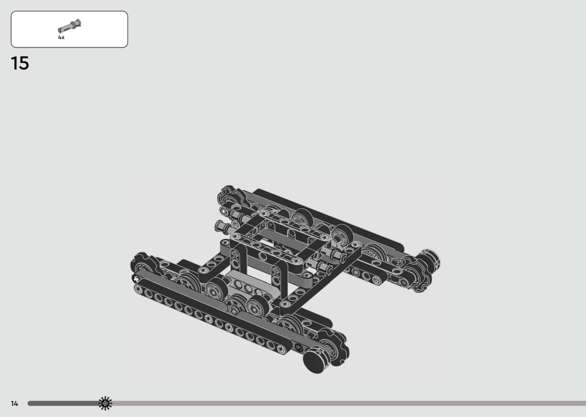

**New parts:** uc-lpin-5 (65304, light bluish gray) - four light-grey long pins standing in the middle frame, two on each side; uc-lpin-6 (65304, light bluish gray) - four light-grey long pins standing in the middle frame, two on each side; uc-lpin-7 (65304, light bluish gray) - four light-grey long pins standing in the middle frame, two on each side; uc-lpin-8 (65304, light bluish gray) - four light-grey long pins standing in the middle frame, two on each side

**Touches:** Four light-grey long pins are pushed into the centre frame, sticking out to the sides near its four corners.

**Exact joins:** uc-lpin-5.pin1 into uc-frame-1.hole? (not shown in booklet); uc-lpin-6.pin1 into uc-frame-1.hole? (not shown in booklet); uc-lpin-7.pin1 into uc-frame-1.hole? (not shown in booklet); uc-lpin-8.pin1 into uc-frame-1.hole? (not shown in booklet)

**Who does what:** uc-lpin-5 holds uc-frame-1

**After:** four light-grey pins stick out of the centre frame; everything else: no change

**Why:** Adds the posts the next layer (the turntable base) will hang from. Long pins with a stop bush reach through two layers. *Next:* The turntable base in the next bag sits on these. *Pattern:* posts

**Big picture:**
- **uc-lpin-5** (Undercarriage frame): placeholder
- **uc-lpin-6** (Undercarriage frame): placeholder
- **uc-lpin-7** (Undercarriage frame): placeholder
- **uc-lpin-8** (Undercarriage frame): placeholder

**Mechanisms:**
- **uc-lpin-5** builds on uc-frame-1 (42175-step-001), which rests on uc-pin-1 (42175-step-001), uc-pin-2 (42175-step-001)
- **uc-lpin-6** builds on uc-frame-1 (42175-step-001), which rests on uc-pin-1 (42175-step-001), uc-pin-2 (42175-step-001)
- **uc-lpin-7** builds on uc-frame-1 (42175-step-001), which rests on uc-pin-1 (42175-step-001), uc-pin-2 (42175-step-001)
- **uc-lpin-8** builds on uc-frame-1 (42175-step-001), which rests on uc-pin-1 (42175-step-001), uc-pin-2 (42175-step-001)

**Review:** The picture shows four grey pins on the frame but the holes they use are not countable at this size, so the holes are marked ? (not shown).

## 42175-step-016 (page 15) - medium - NEEDS REVIEW

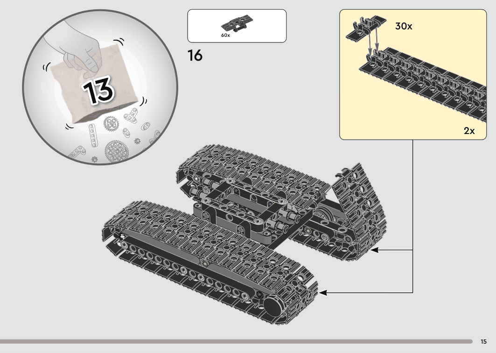

**New parts:** trk-link-1 (88323, black) - 60 track links; 30 per track; trk-link-2 (88323, black) - 60 track links; 30 per track; trk-link-3 (88323, black) - 60 track links; 30 per track; trk-link-4 (88323, black) - 60 track links; 30 per track; trk-link-5 (88323, black) - 60 track links; 30 per track; trk-link-6 (88323, black) - 60 track links; 30 per track; trk-link-7 (88323, black) - 60 track links; 30 per track; trk-link-8 (88323, black) - 60 track links; 30 per track; trk-link-9 (88323, black) - 60 track links; 30 per track; trk-link-10 (88323, black) - 60 track links; 30 per track; trk-link-11 (88323, black) - 60 track links; 30 per track; trk-link-12 (88323, black) - 60 track links; 30 per track; trk-link-13 (88323, black) - 60 track links; 30 per track; trk-link-14 (88323, black) - 60 track links; 30 per track; trk-link-15 (88323, black) - 60 track links; 30 per track; trk-link-16 (88323, black) - 60 track links; 30 per track; trk-link-17 (88323, black) - 60 track links; 30 per track; trk-link-18 (88323, black) - 60 track links; 30 per track; trk-link-19 (88323, black) - 60 track links; 30 per track; trk-link-20 (88323, black) - 60 track links; 30 per track; trk-link-21 (88323, black) - 60 track links; 30 per track; trk-link-22 (88323, black) - 60 track links; 30 per track; trk-link-23 (88323, black) - 60 track links; 30 per track; trk-link-24 (88323, black) - 60 track links; 30 per track; trk-link-25 (88323, black) - 60 track links; 30 per track; trk-link-26 (88323, black) - 60 track links; 30 per track; trk-link-27 (88323, black) - 60 track links; 30 per track; trk-link-28 (88323, black) - 60 track links; 30 per track; trk-link-29 (88323, black) - 60 track links; 30 per track; trk-link-30 (88323, black) - 60 track links; 30 per track; trk-link-31 (88323, black) - 60 track links; 30 per track; trk-link-32 (88323, black) - 60 track links; 30 per track; trk-link-33 (88323, black) - 60 track links; 30 per track; trk-link-34 (88323, black) - 60 track links; 30 per track; trk-link-35 (88323, black) - 60 track links; 30 per track; trk-link-36 (88323, black) - 60 track links; 30 per track; trk-link-37 (88323, black) - 60 track links; 30 per track; trk-link-38 (88323, black) - 60 track links; 30 per track; trk-link-39 (88323, black) - 60 track links; 30 per track; trk-link-40 (88323, black) - 60 track links; 30 per track; trk-link-41 (88323, black) - 60 track links; 30 per track; trk-link-42 (88323, black) - 60 track links; 30 per track; trk-link-43 (88323, black) - 60 track links; 30 per track; trk-link-44 (88323, black) - 60 track links; 30 per track; trk-link-45 (88323, black) - 60 track links; 30 per track; trk-link-46 (88323, black) - 60 track links; 30 per track; trk-link-47 (88323, black) - 60 track links; 30 per track; trk-link-48 (88323, black) - 60 track links; 30 per track; trk-link-49 (88323, black) - 60 track links; 30 per track; trk-link-50 (88323, black) - 60 track links; 30 per track; trk-link-51 (88323, black) - 60 track links; 30 per track; trk-link-52 (88323, black) - 60 track links; 30 per track; trk-link-53 (88323, black) - 60 track links; 30 per track; trk-link-54 (88323, black) - 60 track links; 30 per track; trk-link-55 (88323, black) - 60 track links; 30 per track; trk-link-56 (88323, black) - 60 track links; 30 per track; trk-link-57 (88323, black) - 60 track links; 30 per track; trk-link-58 (88323, black) - 60 track links; 30 per track; trk-link-59 (88323, black) - 60 track links; 30 per track; trk-link-60 (88323, black) - 60 track links; 30 per track

**Touches:** Yellow box (30x, built twice): each link clips onto the end of the last link; the two chains of 30 form a closed belt each.; The two finished track loops are wrapped around the track rails, sprockets and rollers (arrows).

**Exact joins:** trk-link-1.bar1 into trk-link-2.clip1 (0.3 hole deep, turns freely); trk-link-2.bar1 into trk-link-3.clip1 (0.3 hole deep, turns freely); trk-link-3.bar1 into trk-link-4.clip1 (0.3 hole deep, turns freely); trk-link-4.bar1 into trk-link-5.clip1 (0.3 hole deep, turns freely); trk-link-5.bar1 into trk-link-6.clip1 (0.3 hole deep, turns freely); trk-link-6.bar1 into trk-link-7.clip1 (0.3 hole deep, turns freely); trk-link-7.bar1 into trk-link-8.clip1 (0.3 hole deep, turns freely); trk-link-8.bar1 into trk-link-9.clip1 (0.3 hole deep, turns freely); trk-link-9.bar1 into trk-link-10.clip1 (0.3 hole deep, turns freely); trk-link-10.bar1 into trk-link-11.clip1 (0.3 hole deep, turns freely); trk-link-11.bar1 into trk-link-12.clip1 (0.3 hole deep, turns freely); trk-link-12.bar1 into trk-link-13.clip1 (0.3 hole deep, turns freely); trk-link-13.bar1 into trk-link-14.clip1 (0.3 hole deep, turns freely); trk-link-14.bar1 into trk-link-15.clip1 (0.3 hole deep, turns freely); trk-link-15.bar1 into trk-link-16.clip1 (0.3 hole deep, turns freely); trk-link-16.bar1 into trk-link-17.clip1 (0.3 hole deep, turns freely); trk-link-17.bar1 into trk-link-18.clip1 (0.3 hole deep, turns freely); trk-link-18.bar1 into trk-link-19.clip1 (0.3 hole deep, turns freely); trk-link-19.bar1 into trk-link-20.clip1 (0.3 hole deep, turns freely); trk-link-20.bar1 into trk-link-21.clip1 (0.3 hole deep, turns freely); trk-link-21.bar1 into trk-link-22.clip1 (0.3 hole deep, turns freely); trk-link-22.bar1 into trk-link-23.clip1 (0.3 hole deep, turns freely); trk-link-23.bar1 into trk-link-24.clip1 (0.3 hole deep, turns freely); trk-link-24.bar1 into trk-link-25.clip1 (0.3 hole deep, turns freely); trk-link-25.bar1 into trk-link-26.clip1 (0.3 hole deep, turns freely); trk-link-26.bar1 into trk-link-27.clip1 (0.3 hole deep, turns freely); trk-link-27.bar1 into trk-link-28.clip1 (0.3 hole deep, turns freely); trk-link-28.bar1 into trk-link-29.clip1 (0.3 hole deep, turns freely); trk-link-29.bar1 into trk-link-30.clip1 (0.3 hole deep, turns freely); trk-link-30.bar1 into trk-link-1.clip1 (0.3 hole deep, turns freely); trk-link-31.bar1 into trk-link-32.clip1 (0.3 hole deep, turns freely); trk-link-32.bar1 into trk-link-33.clip1 (0.3 hole deep, turns freely); trk-link-33.bar1 into trk-link-34.clip1 (0.3 hole deep, turns freely); trk-link-34.bar1 into trk-link-35.clip1 (0.3 hole deep, turns freely); trk-link-35.bar1 into trk-link-36.clip1 (0.3 hole deep, turns freely); trk-link-36.bar1 into trk-link-37.clip1 (0.3 hole deep, turns freely); trk-link-37.bar1 into trk-link-38.clip1 (0.3 hole deep, turns freely); trk-link-38.bar1 into trk-link-39.clip1 (0.3 hole deep, turns freely); trk-link-39.bar1 into trk-link-40.clip1 (0.3 hole deep, turns freely); trk-link-40.bar1 into trk-link-41.clip1 (0.3 hole deep, turns freely); trk-link-41.bar1 into trk-link-42.clip1 (0.3 hole deep, turns freely); trk-link-42.bar1 into trk-link-43.clip1 (0.3 hole deep, turns freely); trk-link-43.bar1 into trk-link-44.clip1 (0.3 hole deep, turns freely); trk-link-44.bar1 into trk-link-45.clip1 (0.3 hole deep, turns freely); trk-link-45.bar1 into trk-link-46.clip1 (0.3 hole deep, turns freely); trk-link-46.bar1 into trk-link-47.clip1 (0.3 hole deep, turns freely); trk-link-47.bar1 into trk-link-48.clip1 (0.3 hole deep, turns freely); trk-link-48.bar1 into trk-link-49.clip1 (0.3 hole deep, turns freely); trk-link-49.bar1 into trk-link-50.clip1 (0.3 hole deep, turns freely); trk-link-50.bar1 into trk-link-51.clip1 (0.3 hole deep, turns freely); trk-link-51.bar1 into trk-link-52.clip1 (0.3 hole deep, turns freely); trk-link-52.bar1 into trk-link-53.clip1 (0.3 hole deep, turns freely); trk-link-53.bar1 into trk-link-54.clip1 (0.3 hole deep, turns freely); trk-link-54.bar1 into trk-link-55.clip1 (0.3 hole deep, turns freely); trk-link-55.bar1 into trk-link-56.clip1 (0.3 hole deep, turns freely); trk-link-56.bar1 into trk-link-57.clip1 (0.3 hole deep, turns freely); trk-link-57.bar1 into trk-link-58.clip1 (0.3 hole deep, turns freely); trk-link-58.bar1 into trk-link-59.clip1 (0.3 hole deep, turns freely); trk-link-59.bar1 into trk-link-60.clip1 (0.3 hole deep, turns freely); trk-link-60.bar1 into trk-link-31.clip1 (0.3 hole deep, turns freely)

**Who does what:** trk-link-1 carries trk-link-2

**After:** a closed track loop of 30 links runs round each side of the undercarriage; everything else: no change

**Why:** Makes the tracks that the machine rolls on. Wide links with two clips each can be snapped together by hand; 30 links is the right length to go round the sprockets and rollers. *Next:* Everything above is built on the finished undercarriage. *Pattern:* track loop

**Big picture:**
- **trk-link-1** (None): None
- **trk-link-2** (None): None
- **trk-link-3** (None): None
- **trk-link-4** (None): None
- **trk-link-5** (None): None
- **trk-link-6** (None): None
- **trk-link-7** (None): None
- **trk-link-8** (None): None
- **trk-link-9** (None): None
- **trk-link-10** (None): None
- **trk-link-11** (None): None
- **trk-link-12** (None): None
- **trk-link-13** (None): None
- **trk-link-14** (None): None
- **trk-link-15** (None): None
- **trk-link-16** (None): None
- **trk-link-17** (None): None
- **trk-link-18** (None): None
- **trk-link-19** (None): None
- **trk-link-20** (None): None
- **trk-link-21** (None): None
- **trk-link-22** (None): None
- **trk-link-23** (None): None
- **trk-link-24** (None): None
- **trk-link-25** (None): None
- **trk-link-26** (None): None
- **trk-link-27** (None): None
- **trk-link-28** (None): None
- **trk-link-29** (None): None
- **trk-link-30** (None): None
- **trk-link-31** (None): None
- **trk-link-32** (None): None
- **trk-link-33** (None): None
- **trk-link-34** (None): None
- **trk-link-35** (None): None
- **trk-link-36** (None): None
- **trk-link-37** (None): None
- **trk-link-38** (None): None
- **trk-link-39** (None): None
- **trk-link-40** (None): None
- **trk-link-41** (None): None
- **trk-link-42** (None): None
- **trk-link-43** (None): None
- **trk-link-44** (None): None
- **trk-link-45** (None): None
- **trk-link-46** (None): None
- **trk-link-47** (None): None
- **trk-link-48** (None): None
- **trk-link-49** (None): None
- **trk-link-50** (None): None
- **trk-link-51** (None): None
- **trk-link-52** (None): None
- **trk-link-53** (None): None
- **trk-link-54** (None): None
- **trk-link-55** (None): None
- **trk-link-56** (None): None
- **trk-link-57** (None): None
- **trk-link-58** (None): None
- **trk-link-59** (None): None
- **trk-link-60** (None): None

**Review:** The link join is the bar of one link in the clip of the next (as in set 8047). The exact way the loops sit on the sprocket teeth is not shown in detail. Looks complete: 2 x 30 links as the callout says.

## 42175-step-017 (page 17) - medium - NEEDS REVIEW

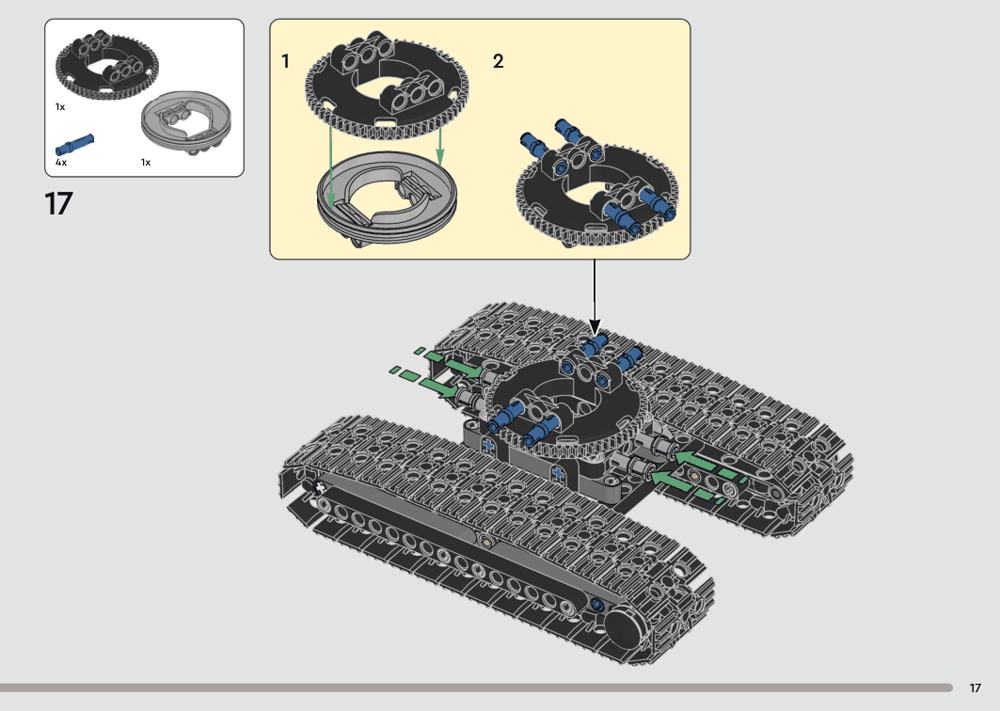

**New parts:** sw-top-1 (88738, black) - black 60-tooth turntable top ring with three 3-hole blocks; sw-base-1 (18939, light bluish gray) - light-grey turntable base ring, snapped under the top ring; sw-bpin-1 (42924, blue) - four long blue pins pushed into the holes of the black blocks on the turntable top; sw-bpin-2 (42924, blue) - four long blue pins pushed into the holes of the black blocks on the turntable top; sw-bpin-3 (42924, blue) - four long blue pins pushed into the holes of the black blocks on the turntable top; sw-bpin-4 (42924, blue) - four long blue pins pushed into the holes of the black blocks on the turntable top

**Touches:** Yellow box 1: the black turntable top is pressed onto the grey base ring. Yellow box 2: four blue pins go into the blocks on the top ring. The finished turntable is lowered onto the middle of the undercarriage (arrow) and the four grey pins (green arrows, two from each side) are pushed in through the base ring to lock it.

**Exact joins:** uc-lpin-1.pin1 into sw-base-1.hole1 (0.9 hole deep, held stiff by friction, estimated from the picture); uc-lpin-2.pin1 into sw-base-1.hole2 (0.9 hole deep, held stiff by friction, estimated from the picture); uc-lpin-3.pin1 into sw-base-1.hole4 (0.9 hole deep, held stiff by friction, estimated from the picture); uc-lpin-4.pin1 into sw-base-1.hole5 (0.9 hole deep, held stiff by friction, estimated from the picture)

**Who does what:** sw-top-1 spins on sw-base-1; uc-lpin-1 holds sw-base-1; uc-lpin-3 holds sw-base-1

**After:** the turntable sits on the middle of the undercarriage with its base locked by the four grey pins; the top ring can turn on it; everything else: no change

**Why:** Gives the machine a ring that lets the whole upper body swing round on the tracks. A slewing ring (grey base + black top) is the Technic version of a real excavator's swing bearing; the four long pins already waiting in the frame lock the base without extra parts. *Next:* Everything from step 18 onward that is part of the upper body is built on the black top ring. *Pattern:* turntable on pins

**Big picture:**
- **sw-top-1** (None): None Later: 42175-step-019 `CONNECT up-lpin-5.pin1 -> sw-top-1.hole?`.
- **sw-base-1** (None): None
- **sw-bpin-1** (None): None Later: 42175-step-018 `CONNECT sw-bpin-1.pin2 -> pm-beam15-1.hole3~ STIFF`; 42175-step-018 `DOES sw-bpin-1 HOLDS pm-beam15-1`.
- **sw-bpin-2** (None): None Later: 42175-step-018 `CONNECT sw-bpin-2.pin2 -> pm-beam15-2.hole3~ STIFF`.
- **sw-bpin-3** (None): None Later: 42175-step-018 `CONNECT sw-bpin-3.pin2 -> pm-beam15-1.hole12~ STIFF`.
- **sw-bpin-4** (None): None Later: 42175-step-018 `CONNECT sw-bpin-4.pin2 -> pm-beam15-2.hole12~ STIFF`.

**Mechanisms:**
- **sw-base-1** builds on uc-lpin-1 (42175-step-005); uc-lpin-2 (42175-step-005); uc-lpin-3 (42175-step-005); uc-lpin-4 (42175-step-005)

**Review:** The four pins that lock the base are the grey pins of step 15. Which of the base's six side holes (hole1-3 left, hole4-6 right) each one takes is an estimate (two per side). The blue pins go into the top ring's blocks; their exact holes are not named.

## 42175-step-018 (page 18) - low - NEEDS REVIEW

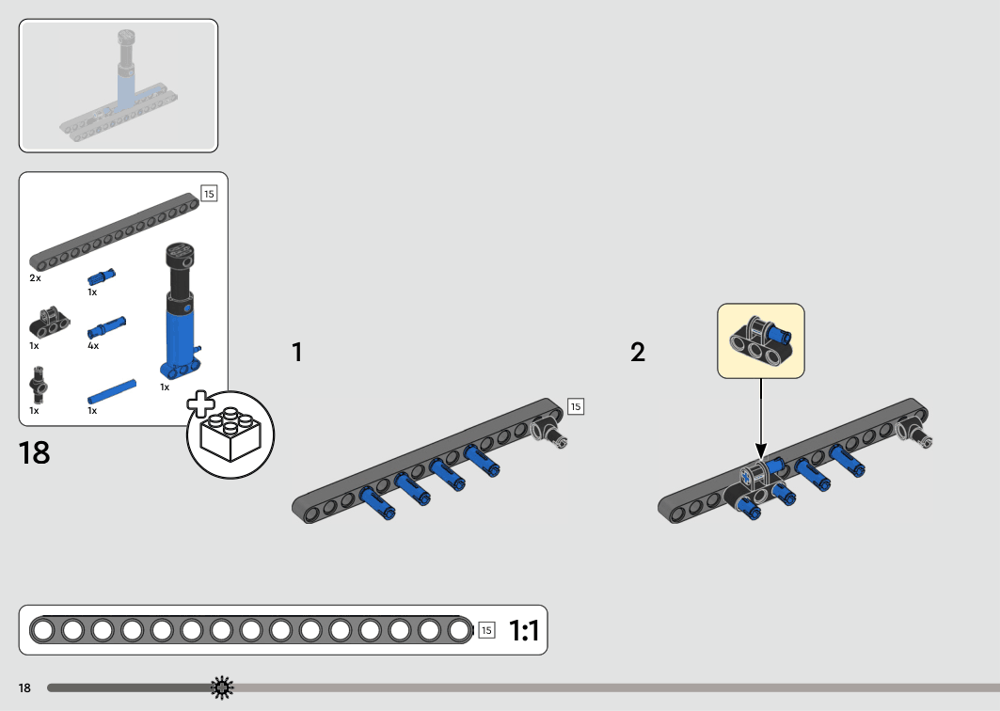

**New parts:** pm-beam15-1 (32278, dark bluish gray) - two 15-hole dark-grey beams that carry the pump; pm-beam15-2 (32278, dark bluish gray) - two 15-hole dark-grey beams that carry the pump; pm-lpin-1 (42924, blue) - four long blue pins pushed into the first beam; pm-lpin-2 (42924, blue) - four long blue pins pushed into the first beam; pm-lpin-3 (42924, blue) - four long blue pins pushed into the first beam; pm-lpin-4 (42924, blue) - four long blue pins pushed into the first beam; pm-apin-1 (43093, blue) - one short blue axle pin; pm-hub-1 (44874, black) - black pin hub with two pins; pm-conn-1 (6536, black) - black perpendicular axle-and-pin connector at the end of the beam; pm-hose-1 (5102c04, blue) - short blue pneumatic hose (3.2 cm), length checked 1:1 on page 19; pm-pump-1 (26288, blue) - blue pneumatic pump with black plunger top and a 1 x 3 base

**Touches:** Sub-step 1: four blue long pins go into the first 15-hole beam, with a black connector at its far end. Sub-step 2: a black hub with a blue pin goes onto the beam (yellow box).; Sub-step 3: the blue pump stands on three of the pins by its 1 x 3 base and the short blue hose is pushed onto its side nozzle (yellow box). Sub-step 4: the second 15-hole beam is pressed on under the pin ends. Page 20: the finished deck is placed on the turntable and the four blue pins of step 17 are pushed in from the sides (green arrows, two per side) to lock it.

**Exact joins:** pm-lpin-1.pin1 into pm-beam15-1.hole6 (0.9 hole deep, held stiff by friction, estimated from the picture); pm-lpin-2.pin1 into pm-beam15-1.hole7 (0.9 hole deep, held stiff by friction, estimated from the picture); pm-lpin-3.pin1 into pm-beam15-1.hole8 (0.9 hole deep, held stiff by friction, estimated from the picture); pm-lpin-4.pin1 into pm-beam15-1.hole9 (0.9 hole deep, held stiff by friction, estimated from the picture); pm-conn-1.hole1 into pm-beam15-1.hole? (not shown in booklet); pm-hub-1.pin1 into pm-beam15-1.hole3 (0.9 hole deep, held stiff by friction, estimated from the picture); pm-apin-1.pin1 into pm-hub-1.hole1 (0.9 hole deep, held stiff by friction, estimated from the picture); pm-lpin-1.pin2 into pm-beam15-2.hole6 (0.9 hole deep, held stiff by friction, estimated from the picture); pm-lpin-2.pin2 into pm-beam15-2.hole7 (0.9 hole deep, held stiff by friction, estimated from the picture); pm-lpin-3.pin2 into pm-beam15-2.hole8 (0.9 hole deep, held stiff by friction, estimated from the picture); pm-lpin-4.pin2 into pm-beam15-2.hole9 (0.9 hole deep, held stiff by friction, estimated from the picture); sw-bpin-1.pin2 into pm-beam15-1.hole3 (0.9 hole deep, held stiff by friction, estimated from the picture); sw-bpin-2.pin2 into pm-beam15-2.hole3 (0.9 hole deep, held stiff by friction, estimated from the picture); sw-bpin-3.pin2 into pm-beam15-1.hole12 (0.9 hole deep, held stiff by friction, estimated from the picture); sw-bpin-4.pin2 into pm-beam15-2.hole12 (0.9 hole deep, held stiff by friction, estimated from the picture)

**Who does what:** pm-beam15-1 supports pm-pump-1; sw-bpin-1 holds pm-beam15-1; pm-lpin-2 holds pm-pump-1; pm-hose-1 carries pm-pump-1

**After:** the pump deck (two 15-hole beams with the blue pump standing on it) sits on the turntable top and is held by the four blue pins pushed in from the sides; everything else: no change

**Why:** Builds the air pump that will later power the arm's air cylinders. A pump with a plunger pushed by hand pushes air through hoses; the two beams make a light frame for it. *Next:* Steps 19-21 build the side frames and cross beam around the pump on the turntable. *Pattern:* pneumatic pump deck

**Big picture:**
- **pm-beam15-1** (None): None
- **pm-beam15-2** (None): None
- **pm-lpin-1** (None): None
- **pm-lpin-2** (None): None
- **pm-lpin-3** (None): None
- **pm-lpin-4** (None): None
- **pm-apin-1** (None): None
- **pm-hub-1** (None): None
- **pm-conn-1** (None): None
- **pm-hose-1** (None): None
- **pm-pump-1** (None): None

**Mechanisms:**
- **pm-beam15-1** builds on sw-bpin-1 (42175-step-017); sw-bpin-3 (42175-step-017)
- **pm-beam15-2** builds on sw-bpin-2 (42175-step-017); sw-bpin-4 (42175-step-017)

**Review:** Part numbers are likely (pump = 26288, hose 5102c04 from the 1:1 length check). Pin holes along the beams are rough estimates read from the picture. The pump's own points aren't in the catalog, so no join to the pump is written. Red box on page 19: pushing the black top up and down must move it; confirmation check only.

## 42175-step-019 (page 21) - low - NEEDS REVIEW

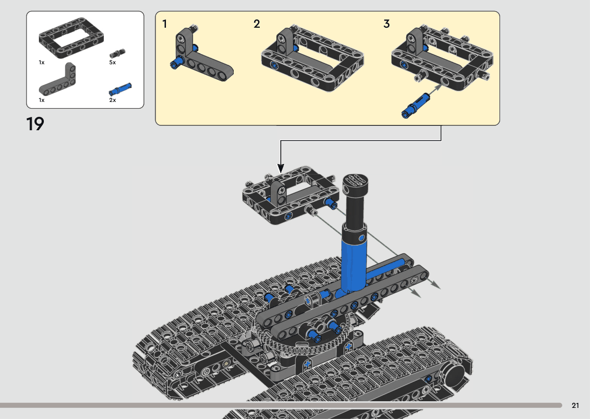

**New parts:** up-frame-1 (64179, black) - black 5 x 7 frame, built in the yellow box and placed beside the pump; up-lbeam-1 (32526, dark bluish gray) - dark-grey 3 x 5 L-beam standing upright inside the frame; up-lpin-1 (65304, light bluish gray) - five light-grey long pins; four stick out of the frame sides and one is spare for the arrow; up-lpin-2 (65304, light bluish gray) - five light-grey long pins; four stick out of the frame sides and one is spare for the arrow; up-lpin-3 (65304, light bluish gray) - five light-grey long pins; four stick out of the frame sides and one is spare for the arrow; up-lpin-4 (65304, light bluish gray) - five light-grey long pins; four stick out of the frame sides and one is spare for the arrow; up-lpin-5 (65304, light bluish gray) - five light-grey long pins; four stick out of the frame sides and one is spare for the arrow; up-bpin-1 (42924, blue) - two long blue pins that hold the L-beam to the frame; up-bpin-2 (42924, blue) - two long blue pins that hold the L-beam to the frame

**Touches:** Yellow box 1-3: an L-beam gets a blue pin, stands inside the 5 x 7 frame, and two more pins go through the frame and L-beam; long grey pins are pushed into the frame sides.; The frame is lowered next to the pump and the grey pins slide through the pump deck's beams (green arrows).

**Exact joins:** up-bpin-1.pin1 into up-lbeam-1.hole1 (0.9 hole deep, held stiff by friction, estimated from the picture); up-bpin-1.pin3 into up-frame-1.hole? (not shown in booklet); up-bpin-2.pin1 into up-lbeam-1.hole5 (0.9 hole deep, held stiff by friction, estimated from the picture); up-bpin-2.pin3 into up-frame-1.hole? (not shown in booklet); up-lpin-1.pin1 into up-frame-1.hole? (not shown in booklet); up-lpin-2.pin1 into up-frame-1.hole? (not shown in booklet); up-lpin-3.pin1 into up-frame-1.hole? (not shown in booklet); up-lpin-4.pin1 into up-frame-1.hole? (not shown in booklet); up-lpin-5.pin1 into sw-top-1.hole? (not shown in booklet)

**Who does what:** up-bpin-1 holds up-lbeam-1; up-lpin-1 holds up-frame-1

**After:** a black side frame with an upright L-beam is fixed next to the pump on one side of the turntable; everything else: no change

**Why:** Starts the walls of the upper body around the pump. A 5 x 7 frame is stiff and its many holes take pins for the next layers; the L-beam is a tall post. *Next:* Step 20 builds the same on the other side; step 21 joins the two with a long beam. *Pattern:* side frame

**Big picture:**
- **up-frame-1** (None): None Later: 42175-step-021 `DOES up-beam15-1 SUPPORTS up-frame-1`.
- **up-lbeam-1** (None): None Later: 42175-step-024 `DOES up-axle5-1 HOLDS up-lbeam-1`; 42175-step-112 `CONNECT up-gb13-1.hole? -> up-lbeam-1.hole?`.
- **up-lpin-1** (None): None Later: 42175-step-022 `CONNECT hy-valve-1.hole? -> up-lpin-1.pin1`.
- **up-lpin-2** (None): None
- **up-lpin-3** (None): None
- **up-lpin-4** (None): None
- **up-lpin-5** (None): None
- **up-bpin-1** (None): None
- **up-bpin-2** (None): None

**Mechanisms:**
- **up-lpin-5** builds on sw-top-1 (42175-step-017)

**Review:** Which frame holes take each pin is not countable in the picture, so most joins are marked ? (not shown). The fifth grey pin (parts box 5x) goes through the pump deck; see the green arrows.

## 42175-step-020 (page 22) - low - NEEDS REVIEW

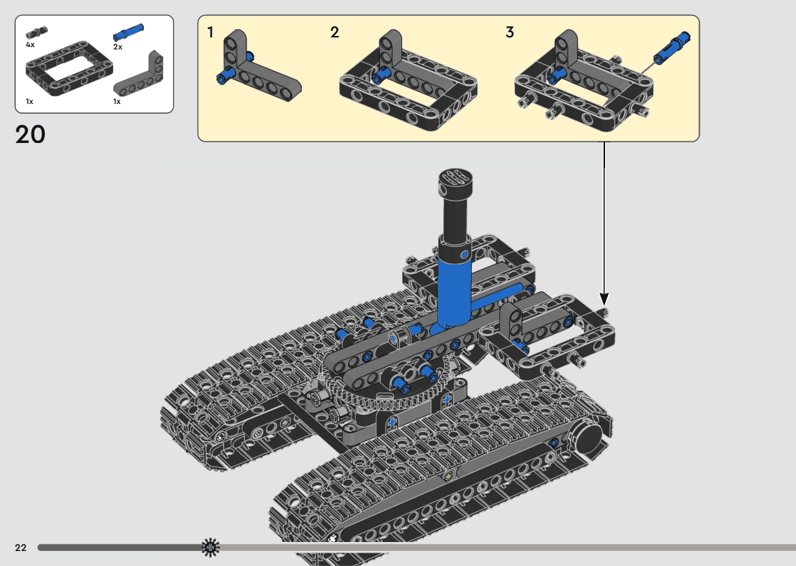

**New parts:** up-frame-2 (64179, black) - second black 5 x 7 frame for the other side; up-lbeam-2 (32526, dark bluish gray) - dark-grey 3 x 5 L-beam standing upright in the frame; up-lpin-6 (65304, light bluish gray) - four light-grey long pins pushed into the frame sides; up-lpin-7 (65304, light bluish gray) - four light-grey long pins pushed into the frame sides; up-lpin-8 (65304, light bluish gray) - four light-grey long pins pushed into the frame sides; up-lpin-9 (65304, light bluish gray) - four light-grey long pins pushed into the frame sides; up-bpin-3 (42924, blue) - two long blue pins; up-bpin-4 (42924, blue) - two long blue pins

**Touches:** Same three sub-steps as step 19 (mirrored): L-beam, frame, pins. The finished frame is placed on the other side of the pump (arrow).

**Exact joins:** up-bpin-3.pin1 into up-lbeam-2.hole1 (0.9 hole deep, held stiff by friction, estimated from the picture); up-bpin-3.pin3 into up-frame-2.hole? (not shown in booklet); up-bpin-4.pin1 into up-lbeam-2.hole5 (0.9 hole deep, held stiff by friction, estimated from the picture); up-bpin-4.pin3 into up-frame-2.hole? (not shown in booklet); up-lpin-6.pin1 into up-frame-2.hole? (not shown in booklet); up-lpin-7.pin1 into up-frame-2.hole? (not shown in booklet); up-lpin-8.pin1 into up-frame-2.hole? (not shown in booklet); up-lpin-9.pin1 into up-frame-2.hole? (not shown in booklet)

**Who does what:** up-bpin-3 holds up-lbeam-2; up-lpin-6 holds up-frame-2

**After:** a second black side frame stands on the opposite side of the pump deck; everything else: no change

**Why:** Gives the upper body a wall on both sides of the pump. Mirror of step 19 so the two walls match. *Next:* Step 21 ties the two frames together across the top. *Pattern:* mirrored side frame

**Big picture:**
- **up-frame-2** (None): None Later: 42175-step-028 `CONNECT up-spin-1.pin1 -> up-frame-2.hole?`; 42175-step-028 `CONNECT up-spin-2.pin1 -> up-frame-2.hole?`; 42175-step-028 `DOES up-spin-1 HOLDS up-frame-2`; 42175-step-150 `CONNECT rs-bp-3.pin1 -> up-frame-2.hole?`; 42175-step-150 `CONNECT rs-b11-1.hole? -> up-frame-2.hole?`; 42175-step-150 `DOES up-frame-2 HOLDS rs-b11-1`.
- **up-lbeam-2** (None): None Later: 42175-step-112 `CONNECT up-gb13-1.hole? -> up-lbeam-2.hole?`.
- **up-lpin-6** (None): None Later: 42175-step-022 `CONNECT hy-valve-2.hole? -> up-lpin-6.pin1`.
- **up-lpin-7** (None): None
- **up-lpin-8** (None): None
- **up-lpin-9** (None): None
- **up-bpin-3** (None): None
- **up-bpin-4** (None): None

**Review:** Joins are marked ? because the pin holes are hidden. The model is shown from a new angle (turned round) in this step.

## 42175-step-021 (page 23) - low - NEEDS REVIEW

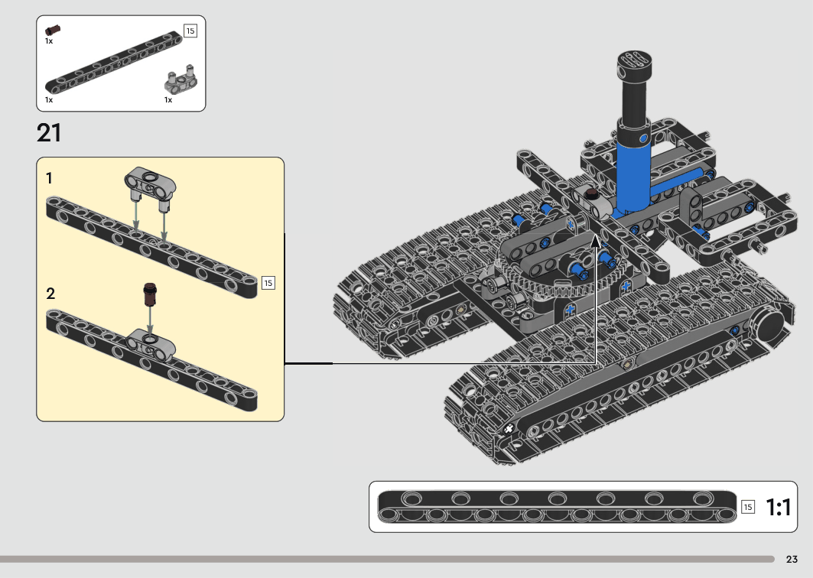

**New parts:** up-beam15-1 (32278, black) - long black 15-hole cross beam bridging the two side frames; up-hub-1 (44874, light bluish gray) - light-grey pin connector hub with two pins, pressed into the beam; up-rpin-1 (89678, red) - short red pin in the hub's centre hole

**Touches:** Yellow box 1: the grey hub is pushed onto two holes of the 15-hole beam. Yellow box 2: a red pin is pressed into the hub's middle hole. The finished beam is placed across the model (arrow) over the two side frames.

**Exact joins:** up-hub-1.pin1 into up-beam15-1.hole5 (0.9 hole deep, held stiff by friction, estimated from the picture); up-hub-1.pin2 into up-beam15-1.hole7 (0.9 hole deep, held stiff by friction, estimated from the picture); up-rpin-1.pin1 into up-hub-1.hole1 (0.9 hole deep, held stiff by friction, estimated from the picture)

**Who does what:** up-hub-1 holds up-beam15-1; up-beam15-1 supports up-frame-1

**After:** a 15-hole beam with a grey hub and red pin lies across the pump deck, tying the two side frames; everything else: no change

**Why:** Ties the two upright frames into one rigid structure over the pump. A long beam reaches from one frame to the other; the hub and red pin add a mounting point for the next parts. *Next:* The cab frame is built on this beam. *Pattern:* cross beam

**Big picture:**
- **up-beam15-1** (None): None
- **up-hub-1** (None): None
- **up-rpin-1** (None): None

**Review:** The beam rests on the pins sticking out of both side frames; exactly which pins it sits on is not labeled. Hub holes are estimates.

## 42175-step-022 (page 24) - low - NEEDS REVIEW

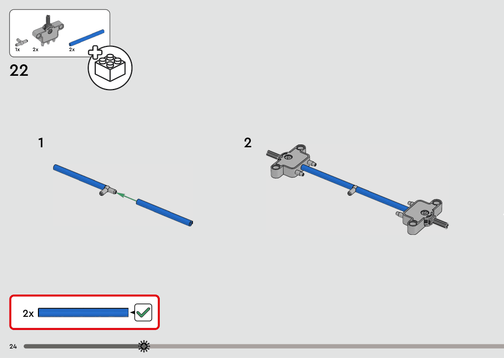

**New parts:** hy-tee-1 (4697b, light bluish gray) - grey air T-piece that joins two hoses; hy-valve-1 (19474, light bluish gray) - two grey pneumatic switch blocks, one on each end of the hose line; hy-valve-2 (19474, light bluish gray) - two grey pneumatic switch blocks, one on each end of the hose line; hy-hose-1 (5102c06, blue) - two blue 6-long air hoses (length checked 1:1 on page 24); hy-hose-2 (5102c06, blue) - two blue 6-long air hoses (length checked 1:1 on page 24)

**Touches:** Sub-step 1: the two blue hoses are pushed onto the two ends of the grey T-piece. Sub-step 2: the free hose ends go onto a nozzle of each grey switch block, one block at each end of the line.; Page 25: the finished air line is laid across the model; each switch block sits on pins sticking out of the two side frames (arrow).

**Exact joins:** hy-valve-1.hole? into up-lpin-1.pin1 (not shown in booklet); hy-valve-2.hole? into up-lpin-6.pin1 (not shown in booklet)

**Who does what:** hy-tee-1 holds hy-hose-1; hy-tee-1 holds hy-hose-2; hy-valve-1 holds hy-hose-1; hy-valve-2 holds hy-hose-2

**After:** a blue air line runs from one side frame to the other with a switch block at each end; the T-piece's third nozzle is still free for the pump hose; everything else: no change

**Why:** Starts the air plumbing: this line will carry air from the pump to the two air cylinders. A T-piece splits the pump's air into two branches; a switch block on each branch lets the driver choose which cylinder moves. *Next:* Steps 24 and later fit the cylinders and the pump hose. *Pattern:* air line with switches

**Big picture:**
- **hy-tee-1** (None): None Later: 42175-step-027 `DOES hy-hose-1 CARRIES hy-tee-1`; 42175-step-111 `CONNECT hy-hose-7.end? -> hy-tee-1.nozzle?`.
- **hy-valve-1** (None): None Later: 42175-step-026 `DOES hy-valve-1 HOLDS hy-hose-3`; 42175-step-110 `DOES hy-valve-1 DRIVES hy-hose-7`.
- **hy-valve-2** (None): None Later: 42175-step-111 `CONNECT hy-hose-8.end? -> hy-valve-2.nozzle?`.
- **hy-hose-1** (None): None Later: 42175-step-027 `DOES hy-hose-1 CARRIES hy-tee-1`.
- **hy-hose-2** (None): None Later: 42175-step-027 `DOES hy-hose-2 CARRIES hy-cyl-1`; 42175-step-029 `DOES up-panel-1 SUPPORTS hy-hose-2`.

**Mechanisms:**
- **hy-valve-1** builds on up-lpin-1 (42175-step-019), which rests on up-frame-1 (42175-step-019)
- **hy-valve-2** builds on up-lpin-6 (42175-step-020), which rests on up-frame-2 (42175-step-020)

**Review:** Switch blocks have no connection data in the catalog, so their joins to the frame pins are marked ? (not shown). Hoses are matched by the 1:1 length check (6L, 4.8 cm).

## 42175-step-023 (page 26) - low - NEEDS REVIEW

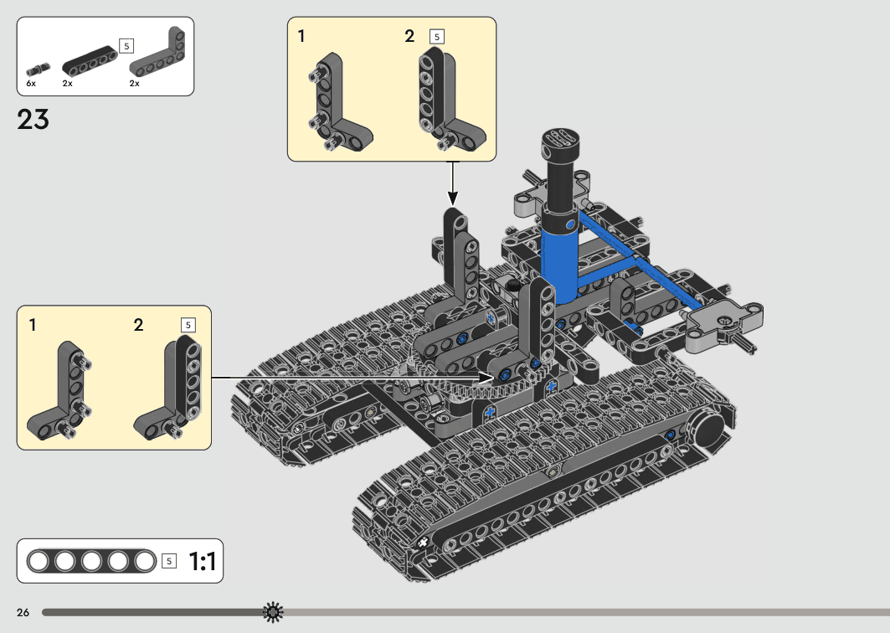

**New parts:** up-pin-1 (4274, light bluish gray) - six short light-grey pins used inside the two post builds; up-pin-2 (4274, light bluish gray) - six short light-grey pins used inside the two post builds; up-pin-3 (4274, light bluish gray) - six short light-grey pins used inside the two post builds; up-pin-4 (4274, light bluish gray) - six short light-grey pins used inside the two post builds; up-pin-5 (4274, light bluish gray) - six short light-grey pins used inside the two post builds; up-pin-6 (4274, light bluish gray) - six short light-grey pins used inside the two post builds; up-beam5-1 (32316, black) - two black 5-hole beams, one per post build; up-beam5-2 (32316, black) - two black 5-hole beams, one per post build; up-lbeam-3 (32526, dark bluish gray) - two dark-grey 3 x 5 L-beams, the base of each post; up-lbeam-4 (32526, dark bluish gray) - two dark-grey 3 x 5 L-beams, the base of each post

**Touches:** Two small yellow-box builds (sub-steps 1-2, same for both): three small pins go into an L-beam and a black 5-hole beam is pressed on to stand upright.; The two finished posts are set on top of the left side frame (arrows).

**Exact joins:** up-pin-1.pin1 into up-lbeam-3.hole1 (0.2 hole deep, turns freely, estimated from the picture); up-pin-2.pin1 into up-lbeam-3.hole3 (0.2 hole deep, turns freely, estimated from the picture); up-pin-3.pin1 into up-lbeam-3.hole5 (0.2 hole deep, turns freely, estimated from the picture); up-pin-4.pin1 into up-lbeam-4.hole1 (0.2 hole deep, turns freely, estimated from the picture); up-pin-5.pin1 into up-lbeam-4.hole3 (0.2 hole deep, turns freely, estimated from the picture); up-pin-6.pin1 into up-lbeam-4.hole5 (0.2 hole deep, turns freely, estimated from the picture); up-pin-1.pin2 into up-beam5-1.hole1 (0.9 hole deep, turns freely, estimated from the picture); up-pin-4.pin2 into up-beam5-2.hole1 (0.9 hole deep, turns freely, estimated from the picture)

**Who does what:** up-pin-1 holds up-beam5-1; up-pin-4 holds up-beam5-2

**After:** two upright posts, each an L-beam with a black 5-hole beam, stand on the left side; everything else: no change

**Why:** Builds the two tall supports that the air cylinder will hang between. An L-beam with a 5-hole beam on its tall leg gives a post two pin holes wide, so a cylinder pivot pin can pass through. *Next:* Step 24 puts the cylinder between these posts. *Pattern:* twin posts

**Big picture:**
- **up-pin-1** (None): None
- **up-pin-2** (None): None
- **up-pin-3** (None): None
- **up-pin-4** (None): None
- **up-pin-5** (None): None
- **up-pin-6** (None): None
- **up-beam5-1** (None): None
- **up-beam5-2** (None): None
- **up-lbeam-3** (None): None
- **up-lbeam-4** (None): None

**Review:** Small pins are read from the parts box as light-grey short pins (6x). Hole numbers are estimates.

## 42175-step-024 (page 27) - low - NEEDS REVIEW

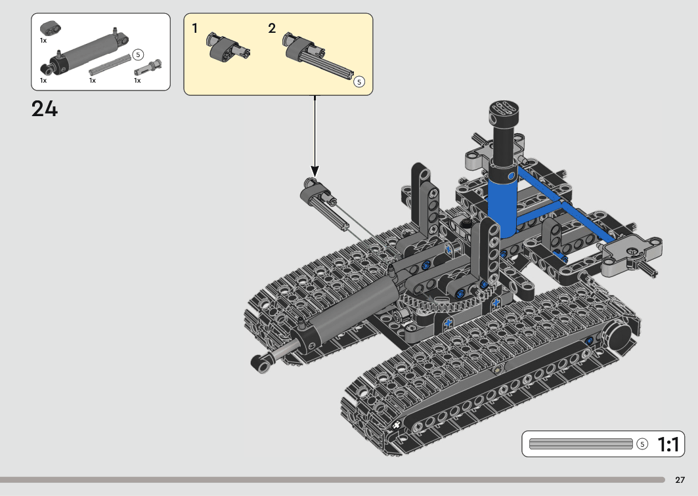

**New parts:** hy-cyl-1 (19478, dark bluish gray) - dark-grey air cylinder with a piston rod; up-beam2-1 (43857, dark bluish gray) - dark-grey 1 x 2 beam on the cylinder's fixed end; up-axle5-1 (32073, light bluish gray) - light-grey 5-long axle through the cylinder end and the posts; hy-pin-1 (77765, light bluish gray) - grey 3L pin with stop at the cylinder's rod end

**Touches:** Sub-step 1: a dark-grey 1 x 2 beam is clipped to the cylinder's fixed end. Sub-step 2: the 5-long axle is pushed through it.; The cylinder is then lowered between the two posts and the axle slides through the post holes (green arrows).

**Exact joins:** none

**Who does what:** up-beam2-1 holds hy-cyl-1; up-axle5-1 carries hy-cyl-1; up-axle5-1 holds up-lbeam-1

**After:** the air cylinder lies along the left side with its fixed end pinned between the two posts and its rod pointing forward; everything else: no change

**Why:** Adds the first air cylinder. A cylinder with a pivot axle can swing up and down as air pushes the rod. *Next:* It will drive the upper body's arm later. *Pattern:* pivoting cylinder

**Big picture:**
- **hy-cyl-1** (None): None Later: 42175-step-026 `DOES hy-cyl-1 HOLDS hy-hose-4`; 42175-step-027 `DOES hy-hose-2 CARRIES hy-cyl-1`.
- **up-beam2-1** (None): None
- **up-axle5-1** (None): None Later: 42175-step-025 `CONNECT up-conn-1.axlehole? -> up-axle5-1.axle5`; 42175-step-025 `DOES up-conn-1 LOCKS up-axle5-1`.
- **hy-pin-1** (None): None

**Review:** The cylinder has no catalog points, so joins to it are only shown in DOES lines. The loose grey pin (5th part of the parts box) is used near the rod end; where is not visible here.

## 42175-step-025 (page 28) - low - NEEDS REVIEW

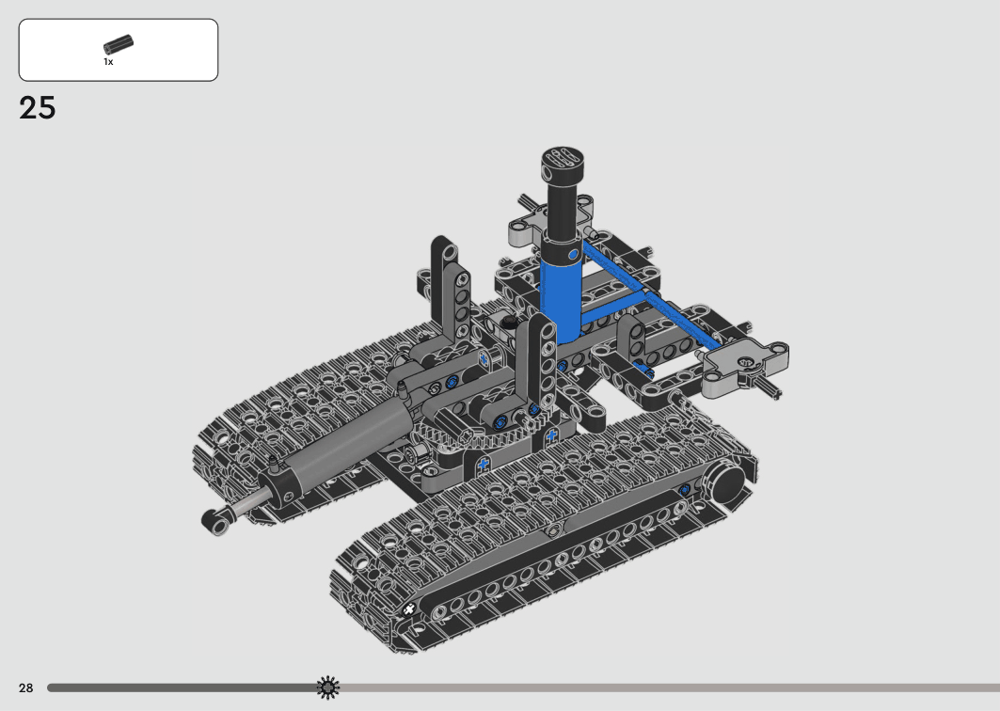

**New parts:** up-conn-1 (59443, black) - black axle connector, pushed onto the end of the axle

**Touches:** One black axle connector is pushed onto the free end of the cylinder axle so it can't slide out.

**Exact joins:** up-conn-1.axlehole? into up-axle5-1.axle5 (not shown in booklet)

**Who does what:** up-conn-1 locks up-axle5-1 in place

**After:** the cylinder axle is held in place on both sides; everything else: no change

**Why:** Stops the cylinder pivot axle from slipping out. A smooth axle connector with a cross hole grips the axle end. *Next:* The model is ready for the cab frame in the next step. *Pattern:* axle stop

**Big picture:**
- **up-conn-1** (None): None

**Mechanisms:**
- **up-conn-1** builds on up-axle5-1 (42175-step-024)

**Review:** The new part is small and its place is not circled in the picture; read as the end stop of the step-24 axle. The picture shows no other change.

## 42175-step-026 (page 29) - medium - NEEDS REVIEW

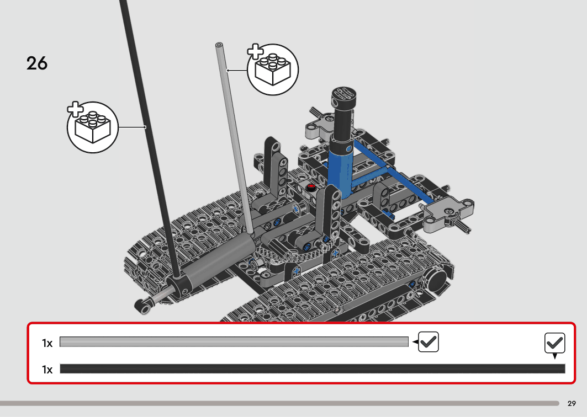

**New parts:** hy-hose-3 (5102c20, light bluish gray) - long light-grey air hose (16 cm, length checked 1:1 in the red box); hy-hose-4 (5102c29, black) - long black air hose (23 cm, length checked 1:1 in the red box)

**Touches:** The two hoses are shown hanging above the model (plus-brick icons): they are just added to the model here, one light grey and one black.

**Exact joins:** none

**Who does what:** hy-valve-1 holds hy-hose-3; hy-cyl-1 holds hy-hose-4

**After:** two loose hoses (one grey, one black) are added to the model; they are connected in step 27; everything else: no change

**Why:** Brings the two long hoses into the model before they are plugged in. The two lengths were checked 1:1 so the right one goes to each nozzle. *Next:* Step 27 plugs them onto the cylinder, switch blocks and T-piece. *Pattern:* air hoses

**Big picture:**
- **hy-hose-3** (None): None
- **hy-hose-4** (None): None

**Review:** Hose lengths come from the 1:1 length bars (grey 16 cm = 5102c20, black 23 cm = 5102c29). No picture shows the join yet, so the DOES lines are the planned ones from step 27.

## 42175-step-027 (page 30) - medium - NEEDS REVIEW

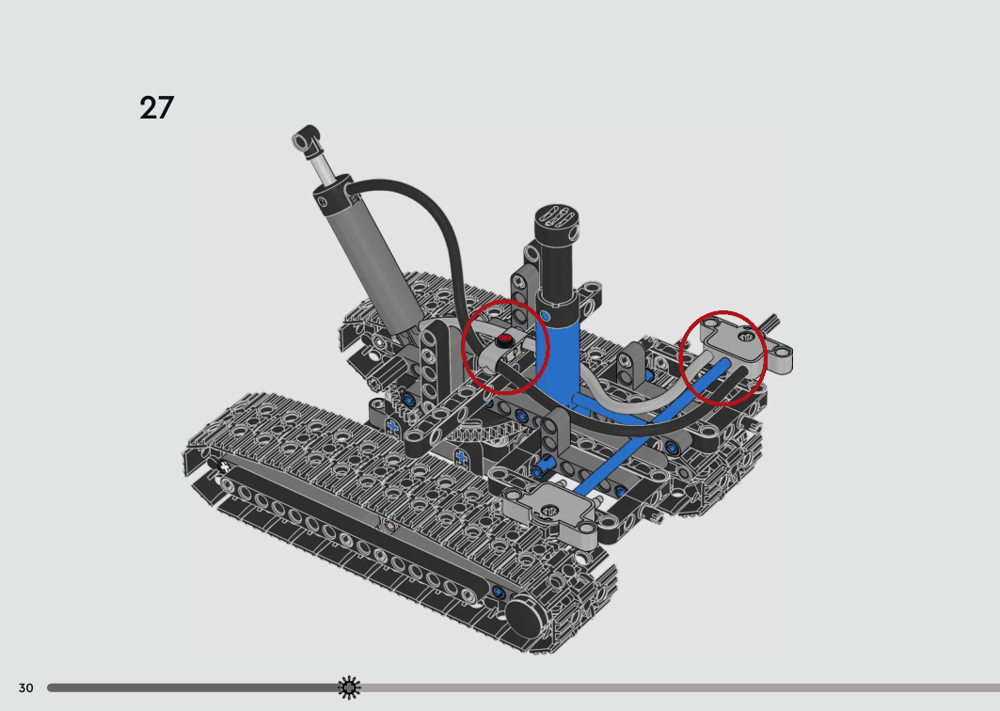

**New parts:** 

**Touches:** The black hose is plugged onto the cylinder's nozzle and its other end goes to a nozzle of the left switch block (red circle left). The grey hose is plugged onto the T-piece and the right switch block (red circle right).

**Exact joins:** none

**Who does what:** hy-hose-2 carries hy-cyl-1; hy-hose-1 carries hy-tee-1

**After:** the black hose runs from the air cylinder to the left switch; the grey hose runs from a switch to the T-piece; the pump line is closed; everything else: no change

**Why:** Connects the pump, switches and cylinder into one air circuit. Pressing the pump pushes air through the T-piece and the switches into the cylinder. *Next:* Steps 28 onward continue on the top of the frame. *Pattern:* air circuit

**Big picture:**

**Review:** No new parts in this step (hoses were added in step 26). Which nozzle each hose end takes is shown only by the two red circles.

## 42175-step-028 (page 31) - medium - NEEDS REVIEW

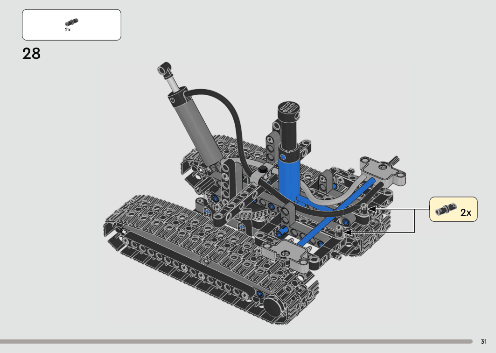

**New parts:** up-spin-1 (65304, black) - two black pins pushed into the right rear frame, pointing up (arrows); up-spin-2 (65304, black) - two black pins pushed into the right rear frame, pointing up (arrows)

**Touches:** Two black pins are pressed into the frame at the right rear (yellow box 2x).

**Exact joins:** up-spin-1.pin1 into up-frame-2.hole? (not shown in booklet); up-spin-2.pin1 into up-frame-2.hole? (not shown in booklet)

**Who does what:** up-spin-1 holds up-frame-2

**After:** two pins stand up from the right rear frame; everything else: no change

**Why:** Adds the posts for the next cover panel. The pins are the same type used elsewhere in the model. *Next:* Step 29 lowers a panel onto them. *Pattern:* posts for panel

**Big picture:**
- **up-spin-1** (None): None
- **up-spin-2** (None): None

**Mechanisms:**
- **up-spin-1** builds on up-frame-2 (42175-step-020), which rests on up-bpin-3 (42175-step-020), up-bpin-4 (42175-step-020)
- **up-spin-2** builds on up-frame-2 (42175-step-020), which rests on up-bpin-3 (42175-step-020), up-bpin-4 (42175-step-020)

**Review:** Which frame holes are used is not countable; the picture only shows two pins standing up.

## 42175-step-029 (page 32) - medium - NEEDS REVIEW

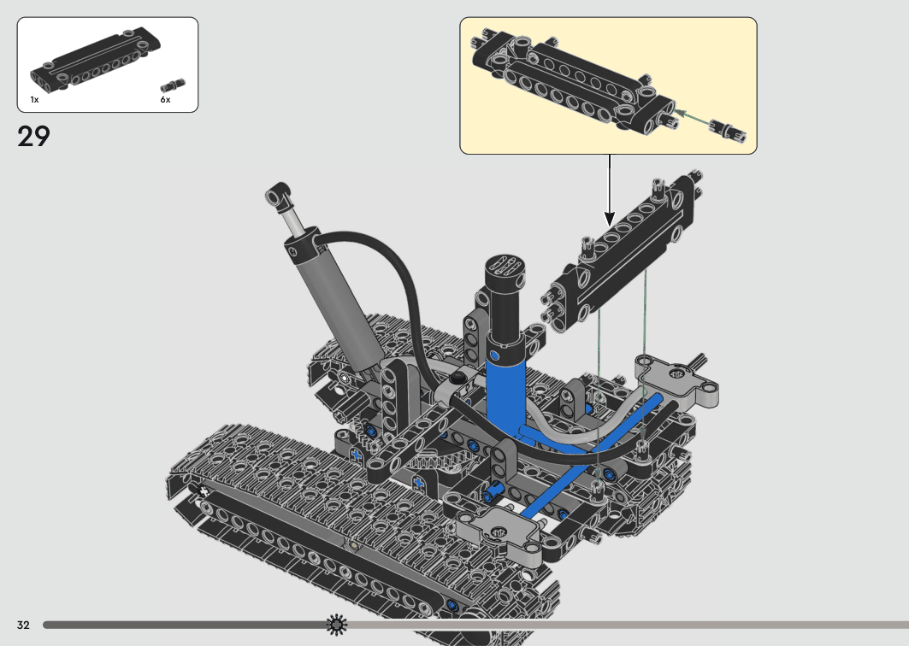

**New parts:** up-panel-1 (15458, black) - black 3 x 11 panel built in the yellow box and placed on the rear frame; up-spin-3 (65304, black) - six black pins pushed through the panel holes; up-spin-4 (65304, black) - six black pins pushed through the panel holes; up-spin-5 (65304, black) - six black pins pushed through the panel holes; up-spin-6 (65304, black) - six black pins pushed through the panel holes; up-spin-7 (65304, black) - six black pins pushed through the panel holes; up-spin-8 (65304, black) - six black pins pushed through the panel holes

**Touches:** Yellow box: pins go into the panel's end holes (green arrow shows the last one). The panel is lowered onto the two pins standing on the rear frame (arrows).

**Exact joins:** up-spin-3.pin1 into up-panel-1.hole? (not shown in booklet); up-spin-4.pin1 into up-panel-1.hole? (not shown in booklet); up-spin-5.pin1 into up-panel-1.hole? (not shown in booklet); up-spin-6.pin1 into up-panel-1.hole? (not shown in booklet)

**Who does what:** up-panel-1 supports hy-hose-2; up-spin-3 holds up-panel-1

**After:** a black 3 x 11 panel lies across the rear of the frame, covering the hoses; everything else: no change

**Why:** Closes the top of the rear section and gives a flat base for the cab. A panel is wide and flat, so it covers hoses and adds stiffness. *Next:* The cab frame in steps 30 onward sits on it. *Pattern:* panel on pins

**Big picture:**
- **up-panel-1** (None): None Later: 42175-step-112 `DOES up-gb13-1 SUPPORTS up-panel-1`.
- **up-spin-3** (None): None
- **up-spin-4** (None): None
- **up-spin-5** (None): None
- **up-spin-6** (None): None
- **up-spin-7** (None): None
- **up-spin-8** (None): None

**Review:** The panel has 3 x 11 holes on its top; pin holes used are not countable so joins are marked ?.

## 42175-step-030 (page 33) - low - NEEDS REVIEW

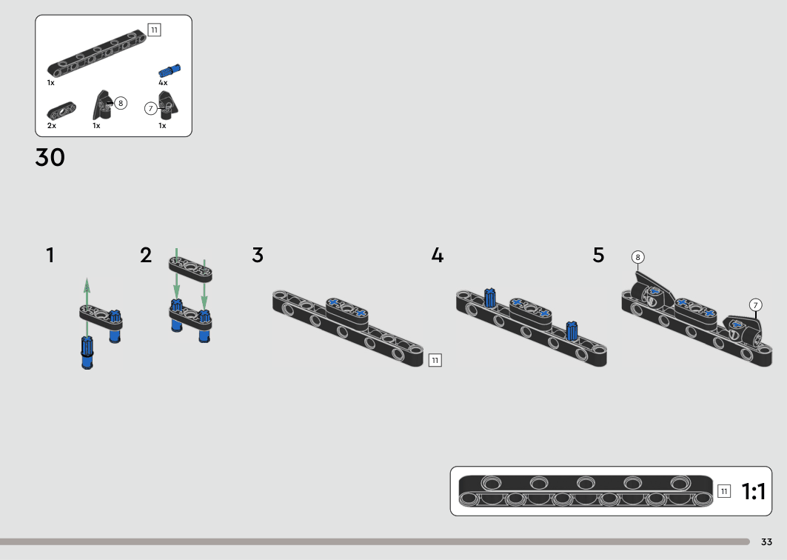

**New parts:** up-beam11-1 (32525, black) - black 11-hole beam, base of this small build; up-tbeam-1 (41677, black) - two small black 1 x 2 thin beams slid on top; up-tbeam-2 (41677, black) - two small black 1 x 2 thin beams slid on top; up-bpin-5 (43093, blue) - four blue pins used as fasteners in sub-steps 1-4; up-bpin-6 (43093, blue) - four blue pins used as fasteners in sub-steps 1-4; up-bpin-7 (43093, blue) - four blue pins used as fasteners in sub-steps 1-4; up-bpin-8 (43093, blue) - four blue pins used as fasteners in sub-steps 1-4; fr-fair7-1 (2387, black) - black side fairing no. 7 (circled 7 in the booklet); fr-fair8-1 (2389, black) - black side fairing no. 8 (circled 8 in the booklet)

**Touches:** Sub-steps 1-5: blue pins go into thin beams, the thin beams are pressed on the 11-hole beam, and the two numbered fairings (7 and 8) are clipped on the beam's ends.

**Exact joins:** up-bpin-5.axle1 into up-tbeam-1.axlehole1 (0.5 hole deep, locked (turn together), estimated from the picture); up-bpin-6.axle1 into up-tbeam-1.axlehole2 (0.5 hole deep, locked (turn together), estimated from the picture); up-bpin-7.axle1 into up-tbeam-2.axlehole1 (0.5 hole deep, locked (turn together), estimated from the picture); up-bpin-8.axle1 into up-tbeam-2.axlehole2 (0.5 hole deep, locked (turn together), estimated from the picture); up-bpin-5.pin1 into up-beam11-1.hole5 (0.9 hole deep, held stiff by friction, estimated from the picture); up-bpin-6.pin1 into up-beam11-1.hole7 (0.9 hole deep, held stiff by friction, estimated from the picture)

**Who does what:** up-tbeam-1 holds fr-fair7-1; up-tbeam-2 holds fr-fair8-1

**After:** a finished 11-hole beam with two thin beams and two small black fairings is ready to be fitted next; everything else: no change

**Why:** Builds the first side-body piece with its cosmetic fairings. A long beam with pins gives mounting points; fairings 7 and 8 round off the shape. *Next:* Step 31 fits it to the model. *Pattern:* beam with fairings

**Big picture:**
- **up-beam11-1** (None): None
- **up-tbeam-1** (None): None
- **up-tbeam-2** (None): None
- **up-bpin-5** (None): None
- **up-bpin-6** (None): None
- **up-bpin-7** (None): None
- **up-bpin-8** (None): None
- **fr-fair7-1** (None): None
- **fr-fair8-1** (None): None

**Review:** The booklet circles 7 and 8 refer to fairing part numbers. The pin type (43093 vs 42924) cannot be told apart in the sub-step pictures; both blue pins are read as 43093 from the parts box. This sub-build is not attached yet; attachment is in step 31.

## 42175-step-031 (page 35) - low - NEEDS REVIEW

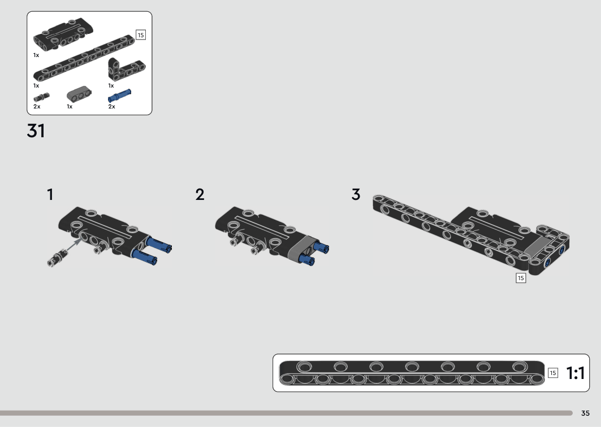

**New parts:** sd-panel-1 (71709, black) - black 3 x 7 panel, base of this small build; sd-gpin-1 (4274, light bluish gray) - two small grey pins pushed into the panel's end holes (sub-step 1, green arrow); sd-gpin-2 (4274, light bluish gray) - two small grey pins pushed into the panel's end holes (sub-step 1, green arrow); sd-gbeam-1 (43857, dark bluish gray) - grey 1 x 2 thick beam slid over the blue pins (sub-step 2); sd-bpin-1 (43093, blue) - two blue pins standing out of the panel end; sd-bpin-2 (43093, blue) - two blue pins standing out of the panel end; sd-lbeam-1 (32140, black) - black 2 x 4 L-beam at the end of the long beam (sub-step 3); sd-beam15-1 (71710, black) - black 15-hole beam laid along the panel (sub-step 3, 1:1 length check)

**Touches:** Sub-steps 1-3: grey pins go into the panel, a grey beam is pressed over the two blue pins, then the 15-hole beam and the L-beam are laid on and locked by the blue pins. A 1:1 box confirms the 15-hole beam.

**Exact joins:** sd-gpin-1.pin1 into sd-panel-1.hole1 (0.2 hole deep, turns freely, estimated from the picture); sd-gpin-2.pin1 into sd-panel-1.hole2 (0.2 hole deep, turns freely, estimated from the picture); sd-bpin-1.pin1 into sd-panel-1.hole4 (0.9 hole deep, held stiff by friction, estimated from the picture); sd-bpin-2.pin1 into sd-panel-1.hole5 (0.9 hole deep, held stiff by friction, estimated from the picture); sd-bpin-1.axle1 into sd-gbeam-1.hole1 (1 hole deep, turns freely, estimated from the picture); sd-bpin-2.axle1 into sd-gbeam-1.hole2 (1 hole deep, turns freely, estimated from the picture); sd-lbeam-1.hole1 into sd-bpin-1.axle1? (not shown in booklet); sd-beam15-1.hole1? into sd-panel-1.hole3? (not shown in booklet)

**Who does what:** sd-panel-1 supports sd-beam15-1; sd-gbeam-1 holds sd-lbeam-1; sd-beam15-1 carries sd-lbeam-1

**After:** a long black side beam with a panel, an L-beam end and two blue pins is ready to be fitted next; everything else: no change

**Why:** Builds the long side piece that rides along the cab frame. A 15-hole beam spans the whole side; the panel and L-beam add stiffness and mounting points. *Next:* Step 32 and 33 add pins and a small yellow part to the model before this piece is fitted. *Pattern:* side beam

**Big picture:**
- **sd-panel-1** (None): None
- **sd-gpin-1** (None): None
- **sd-gpin-2** (None): None
- **sd-gbeam-1** (None): None
- **sd-bpin-1** (None): None
- **sd-bpin-2** (None): None
- **sd-lbeam-1** (None): None
- **sd-beam15-1** (None): None

**Review:** Exact holes are not countable from the picture. The small grey part in the box is read as a thick 1 x 2 beam (43857); it could be a different grey part.

## 42175-step-032 (page 37) - medium - NEEDS REVIEW

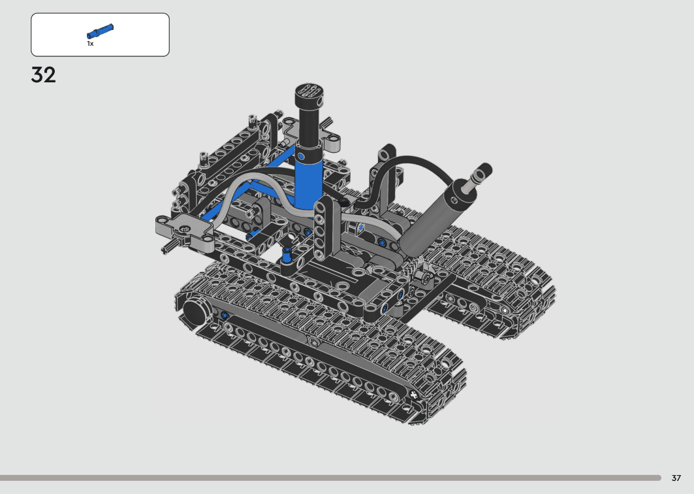

**New parts:** sd-fpin-1 (43093, blue) - one blue pin pushed into the front frame hole

**Touches:** A single blue pin is pushed into the frame next to the front (green highlight only shows the pin).

**Exact joins:** sd-fpin-1.pin1 into uc-frame-1.hole? (not shown in booklet)

**Who does what:** uc-frame-1 holds sd-fpin-1

**After:** one blue pin stands up from the frame at the front; everything else: no change

**Why:** Adds a post for a part that is fitted in step 33. A friction pin holds a part firmly without extra pieces. *Next:* Step 33 places a small yellow assembly over it. *Pattern:* post pin

**Big picture:**
- **sd-fpin-1** (None): None Later: 42175-step-033 `CONNECT sd-conn-1.axlehole1 -> sd-fpin-1.axle1?`; 42175-step-034 `CONNECT sd-fpin-1.pin1 -> cb-ybeam-1.hole4?`; 42175-step-034 `DOES sd-fpin-1 HOLDS cb-ybeam-1`.

**Mechanisms:**
- **sd-fpin-1** builds on uc-frame-1 (42175-step-001), which rests on uc-pin-1 (42175-step-001), uc-pin-2 (42175-step-001)

**Review:** Which frame hole receives the pin is not countable.

## 42175-step-033 (page 38) - low - NEEDS REVIEW

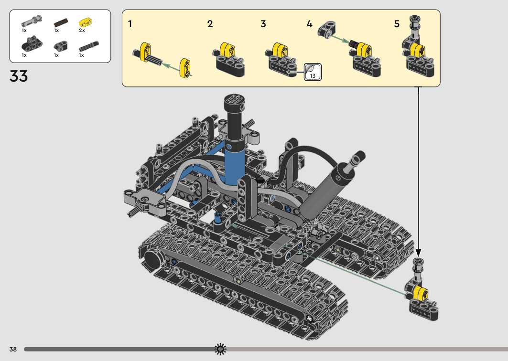

**New parts:** sd-hub-1 (22961, light bluish gray) - grey hub with one axle (sub-step 1); sd-rpin-1 (89678, red) - short red friction pin (sub-step 4); sd-ybeam-1 (41677, yellow) - two yellow thin 1 x 2 beams (sub-steps 1-4); sd-ybeam-2 (41677, yellow) - two yellow thin 1 x 2 beams (sub-steps 1-4); sd-conn-1 (42003, black) - black perpendicular connector (sub-step 2); sd-hub2-1 (44874, light bluish gray) - grey hub with two pins (sub-step 4); sd-lpin-1 (65304, black) - black long pin (sub-step 5 stack)

**Touches:** Yellow box sub-steps 1-5: a hub with an axle goes through two yellow beams, the pair is set on a black connector (a page-13 callout is a reference), a red pin joins the hub and the stack gets a long pin. It is then placed over the blue pin (green arrow).

**Exact joins:** sd-hub-1.axle1 into sd-ybeam-1.axlehole1 (0.5 hole deep, locked (turn together), estimated from the picture); sd-ybeam-2.axlehole1 into sd-hub-1.axle1 (0.5 hole deep, locked (turn together), estimated from the picture); sd-conn-1.hole1? into sd-ybeam-1.axlehole2? (not shown in booklet); sd-rpin-1.pin1 into sd-hub2-1.hole1? (not shown in booklet); sd-conn-1.axlehole1 into sd-fpin-1.axle1? (not shown in booklet)

**Who does what:** sd-ybeam-1 holds sd-hub-1; sd-conn-1 carries sd-ybeam-1

**After:** a small yellow pivot assembly stands on the blue pin at the front of the frame; everything else: no change

**Why:** Builds the pivot for a moving link at the front. Yellow beams are used for the visible, moving part. *Next:* Later steps hang a link on the long pin. *Pattern:* pivot

**Big picture:**
- **sd-hub-1** (None): None
- **sd-rpin-1** (None): None
- **sd-ybeam-1** (None): None
- **sd-ybeam-2** (None): None
- **sd-conn-1** (None): None
- **sd-hub2-1** (None): None
- **sd-lpin-1** (None): None

**Mechanisms:**
- **sd-conn-1** builds on sd-fpin-1 (42175-step-032), which rests on uc-frame-1 (42175-step-001)

**Review:** Part identities in the small box are read from icons only; the sub-step stacking order is estimated. Check carefully.

## 42175-step-034 (page 39) - medium - NEEDS REVIEW

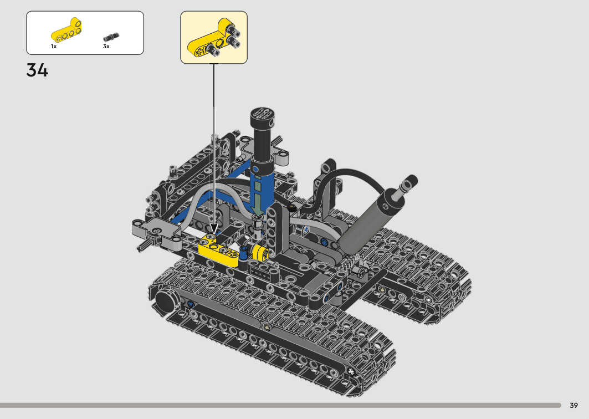

**New parts:** cb-ybeam-1 (32140, yellow) - yellow 2 x 4 L-beam placed over the front pin (yellow box shows it with three pins); cb-pin-1 (4274, light bluish gray) - three small grey pins pushed into the yellow beam's holes (yellow box); cb-pin-2 (4274, light bluish gray) - three small grey pins pushed into the yellow beam's holes (yellow box); cb-pin-3 (4274, light bluish gray) - three small grey pins pushed into the yellow beam's holes (yellow box)

**Touches:** Yellow box: three grey pins stand in the yellow L-beam. Arrow: the beam is lowered onto the blue pin at the front of the frame.

**Exact joins:** cb-pin-1.pin1 into cb-ybeam-1.hole1 (0.2 hole deep, turns freely, estimated from the picture); cb-pin-2.pin1 into cb-ybeam-1.hole2 (0.2 hole deep, turns freely, estimated from the picture); cb-pin-3.pin1 into cb-ybeam-1.hole3 (0.2 hole deep, turns freely, estimated from the picture); sd-fpin-1.pin1 into cb-ybeam-1.hole4? (not shown in booklet)

**Who does what:** cb-ybeam-1 carries cb-pin-1; sd-fpin-1 holds cb-ybeam-1

**After:** a yellow L-beam with three posts sits on the blue pin at the front of the frame; everything else: no change

**Why:** Makes three posts for the front hinge parts built next. An L-beam with pins gives several mounting points in one piece. *Next:* Later side beams fit onto these posts. *Pattern:* posts on beam

**Big picture:**
- **cb-ybeam-1** (None): None
- **cb-pin-1** (None): None
- **cb-pin-2** (None): None
- **cb-pin-3** (None): None

**Mechanisms:**
- **cb-ybeam-1** builds on sd-fpin-1 (42175-step-032), which rests on uc-frame-1 (42175-step-001), sd-conn-1 (42175-step-033)

**Review:** Which beam hole sits on the blue pin is not countable. The yellow part is read as a 2 x 4 L-beam from its icon.

## 42175-step-035 (page 40) - low - NEEDS REVIEW

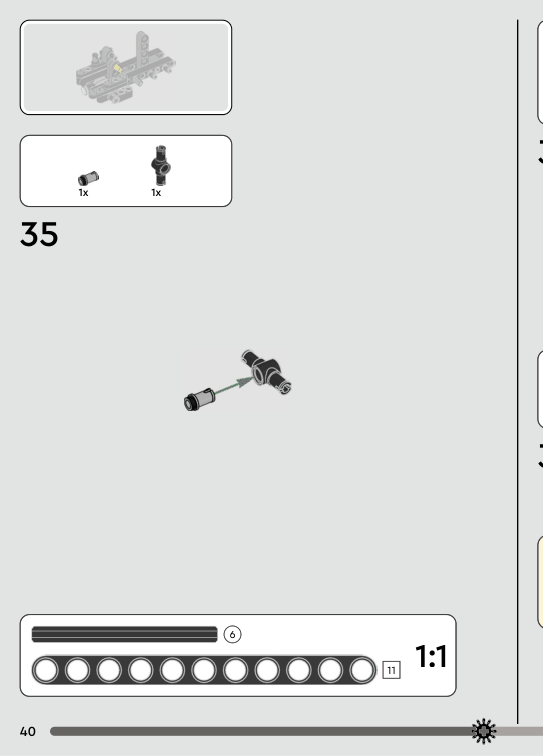

**New parts:** cb-bush-1 (3713, light bluish gray) - grey bush pushed onto the connector's axle end (green arrow); cb-conn-1 (6536, black) - black perpendicular axle and pin connector

**Touches:** A grey bush is pushed onto the end of a black connector (green arrow).

**Exact joins:** cb-bush-1.axlehole1 into cb-conn-1.axlehole? (not shown in booklet)

**Who does what:** cb-conn-1 carries cb-bush-1

**After:** a black connector with a grey bush on it is ready for step 36; everything else: no change

**Why:** Starts the pivot end of the long arm-like beam in the next step. A bush keeps parts from sliding along a shaft. *Next:* Step 36 fits it to an 11-hole beam. *Pattern:* bush spacer

**Big picture:**
- **cb-bush-1** (None): None
- **cb-conn-1** (None): None Later: 42175-step-036 `CONNECT cb-conn-1.axlehole1 -> cb-beam11-1.hole?`; 42175-step-036 `CONNECT cb-disc-1.stud? -> cb-conn-1.hole?`; 42175-step-036 `DOES cb-beam11-1 CARRIES cb-conn-1`; 42175-step-036 `DOES cb-conn-1 HOLDS cb-disc-1`; 42175-step-037 `CONNECT cb-conn-1.axlehole1 -> cb-axle6-1.axle6?`.

**Review:** The small grey part is read as a bush from its picture; it could be a pin. Join points are not shown.

## 42175-step-036 (page 40) - low - NEEDS REVIEW

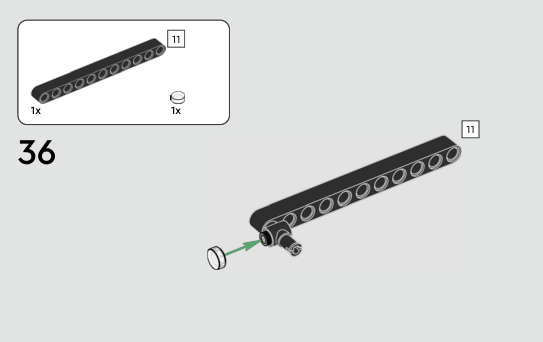

**New parts:** cb-beam11-1 (32525, black) - black 11-hole beam (1:1 length box, circled 11); cb-disc-1 (98138, trans-clear) - small round trans-clear tile pressed into the connector end (green arrow)

**Touches:** The connector from step 35 sits at the end of the 11-hole beam. A round white-looking tile is pushed into its open end (green arrow).

**Exact joins:** cb-conn-1.axlehole1 into cb-beam11-1.hole? (not shown in booklet); cb-disc-1.stud? into cb-conn-1.hole? (not shown in booklet)

**Who does what:** cb-beam11-1 carries cb-conn-1; cb-conn-1 holds cb-disc-1

**After:** an 11-hole black beam has a connector, bush and round cap at one end; everything else: no change

**Why:** Gives the long beam a rounded end with a pivot. The cap closes the open end of the connector. *Next:* Steps 37-40 add more parts to the same beam. *Pattern:* beam end

**Big picture:**
- **cb-beam11-1** (None): None Later: 42175-step-038 `CONNECT cb-bpin-1.pin1 -> cb-beam11-1.hole2~ STIFF`; 42175-step-038 `DOES cb-beam11-1 CARRIES cb-bpin-1`; 42175-step-039 `CONNECT cb-conn3-1.hole1 -> cb-beam11-1.hole1?`; 42175-step-040 `CONNECT cb-tbeam-1.hole1 -> cb-beam11-1.hole3?`; 42175-step-042 `CONNECT cb-lb-1.hole5? -> cb-beam11-1.hole?`; 42175-step-047 `CONNECT cb-beam11-1.hole? -> uc-frame-1.hole?`; 42175-step-047 `DOES uc-frame-1 HOLDS cb-beam11-1`; 42175-step-048 `DOES cb-b15-1 SUPPORTS cb-beam11-1`.
- **cb-disc-1** (None): None

**Mechanisms:**
- **cb-beam11-1** builds on cb-conn-1 (42175-step-035), which rests on cb-bush-1 (42175-step-035)
- **cb-disc-1** builds on cb-conn-1 (42175-step-035), which rests on cb-bush-1 (42175-step-035)

**Review:** The round tile looks white in the picture; trans-clear 1 x 1 tile (98138) is the only round tile that fits that colour group. Colour not confirmed.

## 42175-step-037 (page 40) - low - NEEDS REVIEW

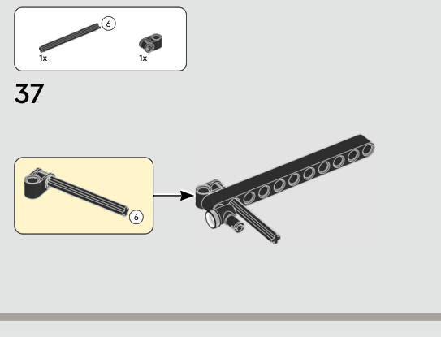

**New parts:** cb-axle6-1 (3706, black) - black 6-long axle (1:1 box, circled 6); cb-conn2-1 (32013, black) - black angled connector at the axle's end (yellow box)

**Touches:** Yellow box: the axle is pushed through the connector. Arrow: the pair is attached beside the connector at the beam end.

**Exact joins:** cb-axle6-1.axle1 into cb-conn2-1.axlehole1 (1 hole deep, locked (turn together), estimated from the picture); cb-conn-1.axlehole1 into cb-axle6-1.axle6? (not shown in booklet)

**Who does what:** cb-conn2-1 holds cb-axle6-1

**After:** a 6-long axle sticks out from the end of the beam; everything else: no change

**Why:** Adds the shaft that the beam will turn on. An axle through a connector gives a stiff shaft. *Next:* Steps 38-39 lock parts onto this shaft. *Pattern:* shaft

**Big picture:**
- **cb-axle6-1** (None): None Later: 42175-step-038 `CONNECT cb-gbeam-1.axlehole1 -> cb-axle6-1.axle5~ LOCKED`; 42175-step-038 `CONNECT cb-gbeam-2.axlehole1 -> cb-axle6-1.axle4?`; 42175-step-038 `DOES cb-gbeam-1 HOLDS cb-axle6-1`.
- **cb-conn2-1** (None): None

**Mechanisms:**
- **cb-axle6-1** builds on cb-conn-1 (42175-step-035), which rests on cb-bush-1 (42175-step-035), cb-beam11-1 (42175-step-036)

**Review:** The 6-long length is checked by the 1:1 box. The connector type is read from the icon.

## 42175-step-038 (page 41) - low - NEEDS REVIEW

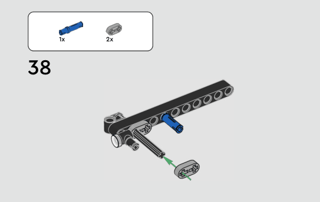

**New parts:** cb-bpin-1 (42924, blue) - long blue pin pushed into the beam (shown already in place); cb-gbeam-1 (41677, light bluish gray) - two small grey thin beams; one is slid onto the axle (green arrow); cb-gbeam-2 (41677, light bluish gray) - two small grey thin beams; one is slid onto the axle (green arrow)

**Touches:** A blue pin sits in the beam; a thin grey beam is pressed onto the axle (green arrow). The box says 2 of them.

**Exact joins:** cb-bpin-1.pin1 into cb-beam11-1.hole2 (0.9 hole deep, held stiff by friction, estimated from the picture); cb-gbeam-1.axlehole1 into cb-axle6-1.axle5 (0.5 hole deep, locked (turn together), estimated from the picture); cb-gbeam-2.axlehole1 into cb-axle6-1.axle4? (not shown in booklet)

**Who does what:** cb-gbeam-1 holds cb-axle6-1; cb-beam11-1 carries cb-bpin-1

**After:** a blue pin and grey thin beams are on the beam beside the axle; everything else: no change

**Why:** Adds a fixing pin and spacers next to the shaft. Thin beams work as washers/stops. *Next:* Step 39 adds a longer axle next. *Pattern:* stops

**Big picture:**
- **cb-bpin-1** (None): None
- **cb-gbeam-1** (None): None
- **cb-gbeam-2** (None): None

**Mechanisms:**
- **cb-bpin-1** builds on cb-beam11-1 (42175-step-036), which rests on cb-conn-1 (42175-step-035)
- **cb-gbeam-1** builds on cb-axle6-1 (42175-step-037), which rests on cb-conn2-1 (42175-step-037), cb-conn-1 (42175-step-035)
- **cb-gbeam-2** builds on cb-axle6-1 (42175-step-037), which rests on cb-conn2-1 (42175-step-037), cb-conn-1 (42175-step-035)

**Review:** Only one grey beam is clearly shown; the second one is probably used next to it.

## 42175-step-039 (page 41) - low - NEEDS REVIEW

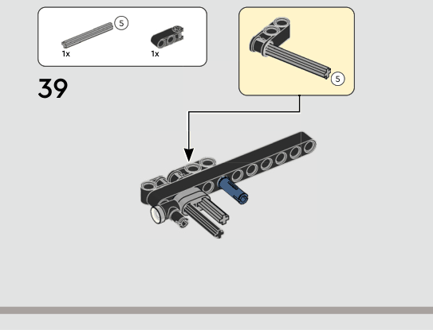

**New parts:** cb-axle5-1 (32073, light bluish gray) - grey 5-long axle (1:1 box, circled 5); cb-conn3-1 (60483, black) - black connector holding the axle (yellow box)

**Touches:** Yellow box: the axle is pushed through the connector. Arrow: the pair goes on the end of the beam beside the first axle.

**Exact joins:** cb-axle5-1.axle1 into cb-conn3-1.axlehole1 (1 hole deep, locked (turn together), estimated from the picture); cb-conn3-1.hole1 into cb-beam11-1.hole1? (not shown in booklet)

**Who does what:** cb-conn3-1 holds cb-axle5-1

**After:** a 5-long axle with a connector is on the beam end next to the 6-long axle; everything else: no change

**Why:** Adds a second shaft for the next mechanism. Two parallel shafts make a pair of pivots. *Next:* Step 40 builds a plate on top. *Pattern:* second shaft

**Big picture:**
- **cb-axle5-1** (None): None
- **cb-conn3-1** (None): None

**Mechanisms:**
- **cb-conn3-1** builds on cb-beam11-1 (42175-step-036), which rests on cb-conn-1 (42175-step-035), cb-bpin-1 (42175-step-038)

**Review:** Length checked by the 1:1 box.

## 42175-step-040 (page 41) - low - NEEDS REVIEW

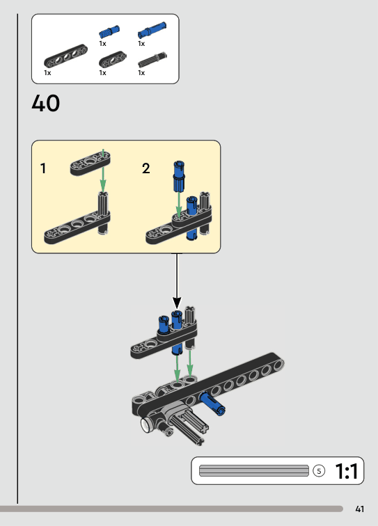

**New parts:** cb-tbeam-1 (11478, black) - black thin beam with axle holes at the ends; cb-bp1-1 (43093, blue) - short blue pin; cb-bp2-1 (42924, blue) - long blue pin; cb-tb2-1 (41677, black) - small black thin beam (oval with holes); cb-gax-1 (18651, black) - black axle pin (rib on axle end)

**Touches:** Yellow box sub-steps 1-2: a thin beam goes on top of an upright axle, then pins are pushed into the beam. The finished piece is pressed onto the long beam (green arrows, two places).

**Exact joins:** cb-gax-1.axle1 into cb-tbeam-1.axlehole1 (0.5 hole deep, locked (turn together), estimated from the picture); cb-bp1-1.axle1 into cb-tb2-1.axlehole1 (0.5 hole deep, locked (turn together), estimated from the picture); cb-bp2-1.pin1 into cb-tbeam-1.hole2 (0.5 hole deep, held stiff by friction, estimated from the picture); cb-tbeam-1.hole1 into cb-beam11-1.hole3? (not shown in booklet)

**Who does what:** cb-tbeam-1 carries cb-bp1-1; cb-tbeam-1 holds cb-gax-1

**After:** a thin beam with three posts sits on the long beam; everything else: no change

**Why:** Adds posts on the beam for linking the next parts. A thin beam on top of pins locks everything flat. *Next:* Step 41 onward continues this arm piece. *Pattern:* posts

**Big picture:**
- **cb-tbeam-1** (None): None
- **cb-bp1-1** (None): None
- **cb-bp2-1** (None): None
- **cb-tb2-1** (None): None
- **cb-gax-1** (None): None

**Mechanisms:**
- **cb-tbeam-1** builds on cb-beam11-1 (42175-step-036), which rests on cb-conn-1 (42175-step-035), cb-bpin-1 (42175-step-038)

**Review:** Icons were hard to read; all five part identities are estimates and the box has 5 parts.

## 42175-step-041 (page 42) - low - NEEDS REVIEW

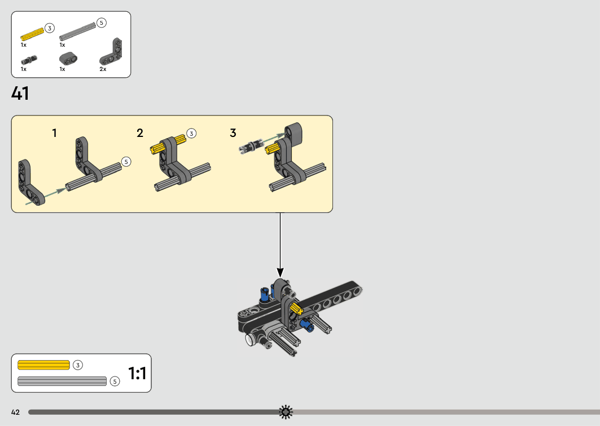

**New parts:** cb-ll-1 (32056, dark bluish gray) - two dark grey 3 x 3 thin L-beams, one goes on each end of the grey axle (yellow box sub-step 1); cb-ll-2 (32056, dark bluish gray) - two dark grey 3 x 3 thin L-beams, one goes on each end of the grey axle (yellow box sub-step 1); cb-ax5-1 (32073, light bluish gray) - grey 5-long axle (1:1 box, circled 5); cb-ax3-1 (4519, yellow) - yellow 3-long axle through both L-beams (sub-step 2, 1:1 box, circled 3); cb-gp-1 (4274, light bluish gray) - small grey pin pushed into the top L-beam hole (sub-step 3); cb-ob-1 (43857, dark bluish gray) - grey 1 x 2 beam slid over the yellow axle end

**Touches:** Yellow box sub-steps 1-3: the grey axle goes through two L-beams, a yellow axle locks them, a pin and grey beam finish the top. The unit is then lowered onto the long beam (black arrow).

**Exact joins:** cb-ax5-1.axle2 into cb-ll-1.axlehole1 (0.5 hole deep, locked (turn together), estimated from the picture); cb-ax5-1.axle4 into cb-ll-2.axlehole1 (0.5 hole deep, locked (turn together), estimated from the picture); cb-ax3-1.axle1 into cb-ll-1.axlehole2 (0.5 hole deep, locked (turn together), estimated from the picture); cb-ax3-1.axle3 into cb-ll-2.axlehole2 (0.5 hole deep, locked (turn together), estimated from the picture); cb-gp-1.pin1 into cb-ll-2.hole1 (0.2 hole deep, turns freely, estimated from the picture); cb-ob-1.hole1 into cb-ax3-1.axle3? (not shown in booklet)

**Who does what:** cb-ax5-1 carries cb-ll-1; cb-ax3-1 holds cb-ll-2; cb-ll-1 supports cb-gp-1

**After:** two tall L-beams stand on the long beam, tied together by a grey and a yellow axle; everything else: no change

**Why:** Builds the tall double post that will carry the boom later. Two L-beams tied by two axles make a stiff frame that can pivot. *Next:* The following steps add the beams on both sides of it. *Pattern:* double post

**Big picture:**
- **cb-ll-1** (None): None
- **cb-ll-2** (None): None
- **cb-ax5-1** (None): None Later: 42175-step-044 `CONNECT cb-pc-1.axlehole1 -> cb-ax5-1.axle5?`; 42175-step-044 `CONNECT cb-pc-2.axlehole1 -> cb-ax5-1.axle1?`; 42175-step-045 `CONNECT cb-t1-1.axlehole1 -> cb-ax5-1.axle3?`; 42175-step-046 `CONNECT cb-tb5-1.axlehole1 -> cb-ax5-1.axle?`.
- **cb-ax3-1** (None): None
- **cb-gp-1** (None): None Later: 42175-step-048 `CONNECT cb-b15-1.hole? -> cb-gp-1.pin1?`.
- **cb-ob-1** (None): None

**Review:** The booklet checks the axle lengths 1:1 (yellow = 3, grey = 5). Which beam holes hold each axle is estimated.

## 42175-step-042 (page 43) - low - NEEDS REVIEW

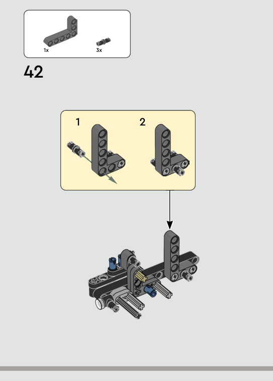

**New parts:** cb-lb-1 (32526, dark bluish gray) - dark grey 3 x 5 L-beam, 5-hole side upright; cb-lp-1 (4274, light bluish gray) - three small grey pins in the L-beam's lower holes (yellow box); cb-lp-2 (4274, light bluish gray) - three small grey pins in the L-beam's lower holes (yellow box); cb-lp-3 (4274, light bluish gray) - three small grey pins in the L-beam's lower holes (yellow box)

**Touches:** Yellow box: three small grey pins are pushed into the foot of the L-beam. The finished piece stands on the long beam (arrow).

**Exact joins:** cb-lp-1.pin1 into cb-lb-1.hole1 (0.2 hole deep, turns freely, estimated from the picture); cb-lp-2.pin1 into cb-lb-1.hole2 (0.2 hole deep, turns freely, estimated from the picture); cb-lp-3.pin1 into cb-lb-1.hole3 (0.2 hole deep, turns freely, estimated from the picture); cb-lb-1.hole5? into cb-beam11-1.hole? (not shown in booklet)

**Who does what:** cb-lb-1 supports cb-lp-1

**After:** a tall dark grey L-beam stands on the long beam with three pins on its foot; everything else: no change

**Why:** Adds a tall rigid post on the beam's end. An L-shape stands upright and gives a tall mount. *Next:* Step 43 lays a second beam against it. *Pattern:* tall post

**Big picture:**
- **cb-lb-1** (None): None Later: 42175-step-043 `DOES cb-b11b-1 SUPPORTS cb-lb-1`; 42175-step-108 `CONNECT cb-rax10-1.axle1 -> cb-lb-1.axlehole?`.
- **cb-lp-1** (None): None Later: 42175-step-043 `CONNECT cb-lp-1.pin1 -> cb-b11b-1.hole1?`.
- **cb-lp-2** (None): None Later: 42175-step-043 `CONNECT cb-lp-2.pin1 -> cb-b11b-1.hole2?`.
- **cb-lp-3** (None): None Later: 42175-step-043 `CONNECT cb-lp-3.pin1 -> cb-b11b-1.hole3?`.

**Mechanisms:**
- **cb-lb-1** builds on cb-beam11-1 (42175-step-036), which rests on cb-conn-1 (42175-step-035), cb-bpin-1 (42175-step-038)

**Review:** Pin holes not countable.

## 42175-step-043 (page 43) - low - NEEDS REVIEW

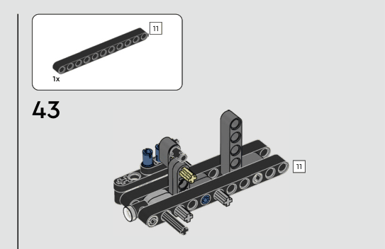

**New parts:** cb-b11b-1 (32525, black) - black 11-hole beam (1:1 box, circled 11)

**Touches:** The new 11-hole beam is pressed onto the three pins of step 42 and lies parallel to the first beam.

**Exact joins:** cb-lp-1.pin1 into cb-b11b-1.hole1? (not shown in booklet); cb-lp-2.pin1 into cb-b11b-1.hole2? (not shown in booklet); cb-lp-3.pin1 into cb-b11b-1.hole3? (not shown in booklet)

**Who does what:** cb-b11b-1 supports cb-lb-1

**After:** two parallel 11-hole beams carry the tall post and twin posts between them; everything else: no change

**Why:** Doubles the beam so the unit is wide and stiff. A second beam locked on pins makes a sandwich. *Next:* Later steps fit the pins and connectors along it. *Pattern:* beam pair

**Big picture:**
- **cb-b11b-1** (None): None

**Mechanisms:**
- **cb-b11b-1** builds on cb-lp-1 (42175-step-042), which rests on cb-lb-1 (42175-step-042); cb-lp-2 (42175-step-042), which rests on cb-lb-1 (42175-step-042); cb-lp-3 (42175-step-042), which rests on cb-lb-1 (42175-step-042)

**Review:** Which three beam holes hold the pins is not countable.

## 42175-step-044 (page 43) - low - NEEDS REVIEW

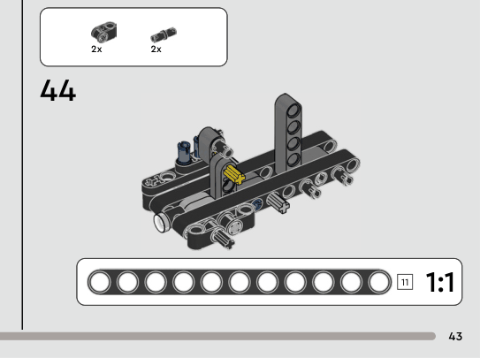

**New parts:** cb-pc-1 (60483, black) - two black 1 x 2 thick beams with pin and axle hole; cb-pc-2 (60483, black) - two black 1 x 2 thick beams with pin and axle hole; cb-gp2-1 (4274, light bluish gray) - two small grey pins; cb-gp2-2 (4274, light bluish gray) - two small grey pins

**Touches:** Two black connectors are pressed onto the axle ends under the beams and each gets a grey pin (the pictures show them on the lower side of the assembly).

**Exact joins:** cb-gp2-1.pin1 into cb-pc-1.hole1 (0.2 hole deep, turns freely, estimated from the picture); cb-gp2-2.pin1 into cb-pc-2.hole1 (0.2 hole deep, turns freely, estimated from the picture); cb-pc-1.axlehole1 into cb-ax5-1.axle5? (not shown in booklet); cb-pc-2.axlehole1 into cb-ax5-1.axle1? (not shown in booklet)

**Who does what:** cb-pc-1 holds cb-gp2-1; cb-pc-2 holds cb-gp2-2

**After:** two connectors with pins sit at the lower side of the beam pair; everything else: no change

**Why:** Makes anchor points on the underside. The pin and axle holes lock onto the axle and give a pin point. *Next:* Later steps hang links from them. *Pattern:* anchors

**Big picture:**
- **cb-pc-1** (None): None
- **cb-pc-2** (None): None
- **cb-gp2-1** (None): None
- **cb-gp2-2** (None): None

**Mechanisms:**
- **cb-pc-1** builds on cb-ax5-1 (42175-step-041), which rests on cb-ll-1 (42175-step-041), cb-ll-2 (42175-step-041)
- **cb-pc-2** builds on cb-ax5-1 (42175-step-041), which rests on cb-ll-1 (42175-step-041), cb-ll-2 (42175-step-041)

**Review:** Their exact place is not countable.

## 42175-step-045 (page 44) - low - NEEDS REVIEW

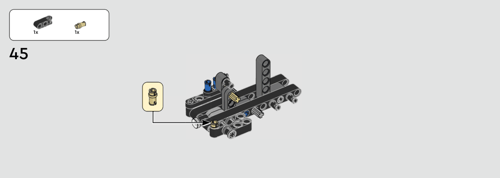

**New parts:** cb-t1-1 (60483, black) - black 1 x 2 thick beam with pin and axle hole; cb-tp-1 (32002, tan) - tan 3/4 pin pushed into the model (arrow in the small box)

**Touches:** A black connector is added to the lower end and a tan pin is pushed into it (arrow).

**Exact joins:** cb-tp-1.pin1 into cb-t1-1.hole1 (0.4 hole deep, held stiff by friction, estimated from the picture); cb-t1-1.axlehole1 into cb-ax5-1.axle3? (not shown in booklet)

**Who does what:** cb-t1-1 holds cb-tp-1

**After:** a tan pin sits in a connector on the underside of the beam pair; everything else: no change

**Why:** Adds a smooth free-turning pin for a link. A tan pin has no friction so a link can swing on it. *Next:* A later link hangs on this pin. *Pattern:* free pin

**Big picture:**
- **cb-t1-1** (None): None
- **cb-tp-1** (None): None

**Mechanisms:**
- **cb-t1-1** builds on cb-ax5-1 (42175-step-041), which rests on cb-ll-1 (42175-step-041), cb-ll-2 (42175-step-041)

**Review:** Part reading from the icon only; likely.

## 42175-step-046 (page 44) - low - NEEDS REVIEW

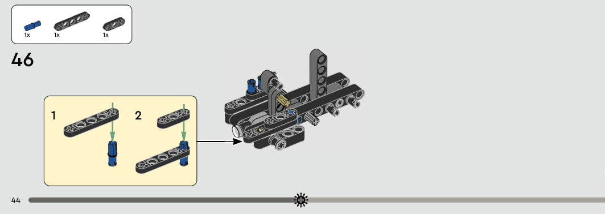

**New parts:** cb-bp-1 (43093, blue) - blue pin (yellow box); cb-tb5-1 (11478, black) - black thin beam, 5 holes (yellow box sub-step 1); cb-tb3-1 (6632, black) - black thin 1 x 3 beam (sub-step 2)

**Touches:** Yellow box: a blue pin goes through a thin 5-hole beam, then the small thin beam goes on top. The finished piece is pressed onto the lower side of the assembly (arrow).

**Exact joins:** cb-bp-1.pin1 into cb-tb5-1.hole1 (0.5 hole deep, held stiff by friction, estimated from the picture); cb-bp-1.axle1 into cb-tb3-1.axlehole1 (0.5 hole deep, locked (turn together), estimated from the picture); cb-tb5-1.axlehole1 into cb-ax5-1.axle? (not shown in booklet)

**Who does what:** cb-bp-1 holds cb-tb5-1; cb-tb5-1 carries cb-tb3-1

**After:** thin beams are pinned to the underside of the beam pair; everything else: no change

**Why:** Adds a plate that ties the underside together. Thin beams on a pin lock in flat. *Next:* Step 47 attaches the whole assembly to the machine. *Pattern:* underside plate

**Big picture:**
- **cb-bp-1** (None): None Later: 42175-step-048 `CONNECT cb-b15-1.hole? -> cb-bp-1.pin1?`; 42175-step-137 `CONNECT cb-yb3-1.hole2 -> cb-bp-1.pin?`.
- **cb-tb5-1** (None): None
- **cb-tb3-1** (None): None

**Mechanisms:**
- **cb-tb5-1** builds on cb-ax5-1 (42175-step-041), which rests on cb-ll-1 (42175-step-041), cb-ll-2 (42175-step-041)

**Review:** Hole numbers not countable.

## 42175-step-047 (page 45) - medium - NEEDS REVIEW

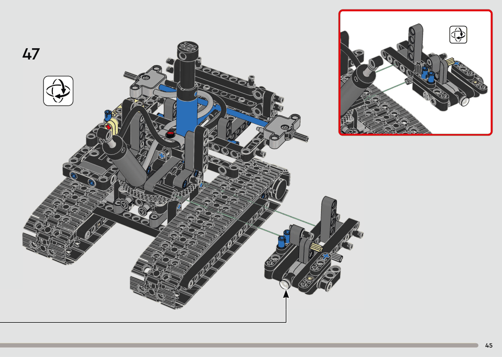

**New parts:** 

**Touches:** The assembly built in steps 35-46 is attached to the front of the frame (two green arrows, magnified red box): its beam pushes onto the grey pin of the frame side and its yellow-end post goes to the cylinder side.

**Exact joins:** cb-beam11-1.hole? into uc-frame-1.hole? (not shown in booklet)

**Who does what:** uc-frame-1 holds cb-beam11-1

**After:** the beam assembly is fixed to the front of the frame; everything else: no change

**Why:** Joins the new front unit to the machine. Two pins (green arrows) give a firm, square fit. *Next:* Step 48 puts a 15-hole beam across the front. *Pattern:* attach

**Big picture:**

**Review:** The picture shows two arrows but not which holes they use.

## 42175-step-048 (page 46) - low - NEEDS REVIEW

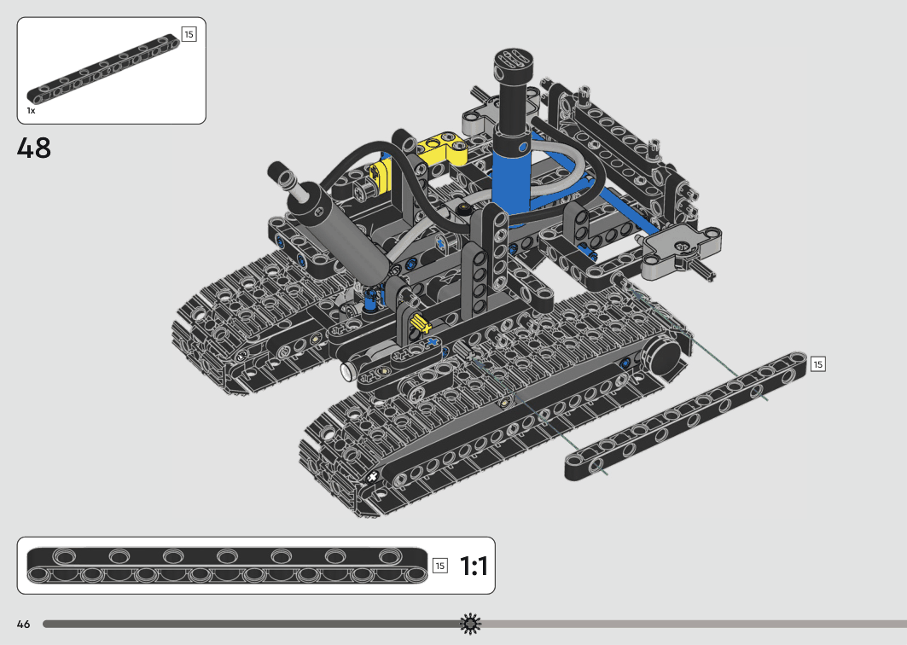

**New parts:** cb-b15-1 (71710, black) - black 15-hole beam (1:1 box, circled 15)

**Touches:** The long beam is laid along the side of the machine; two green arrows show where it meets pins at the front and the middle of the frame.

**Exact joins:** cb-b15-1.hole? into cb-gp-1.pin1? (not shown in booklet); cb-b15-1.hole? into cb-bp-1.pin1? (not shown in booklet)

**Who does what:** cb-b15-1 supports cb-beam11-1

**After:** a 15-hole beam runs along the side of the machine; everything else: no change

**Why:** Ties the front unit to the frame along the whole side. A long beam spans between the pins to make a rigid side. *Next:* Following steps add the same on the other side. *Pattern:* side beam

**Big picture:**
- **cb-b15-1** (None): None Later: 42175-step-049 `CONNECT fs-pin-1.pin1 -> cb-b15-1.hole?`; 42175-step-049 `DOES cb-b15-1 HOLDS fs-pin-1`; 42175-step-051 `CONNECT fs-yl-1.hole4? -> cb-b15-1.hole?`; 42175-step-052 `CONNECT fs-bl-1.hole5? -> cb-b15-1.hole?`.

**Mechanisms:**
- **cb-b15-1** builds on cb-gp-1 (42175-step-041), which rests on cb-ll-2 (42175-step-041); cb-bp-1 (42175-step-046), which rests on cb-tb5-1 (42175-step-046), cb-tb3-1 (42175-step-046)

**Review:** Pins hit are not named in the picture.

## 42175-step-049 (page 47) - medium - NEEDS REVIEW

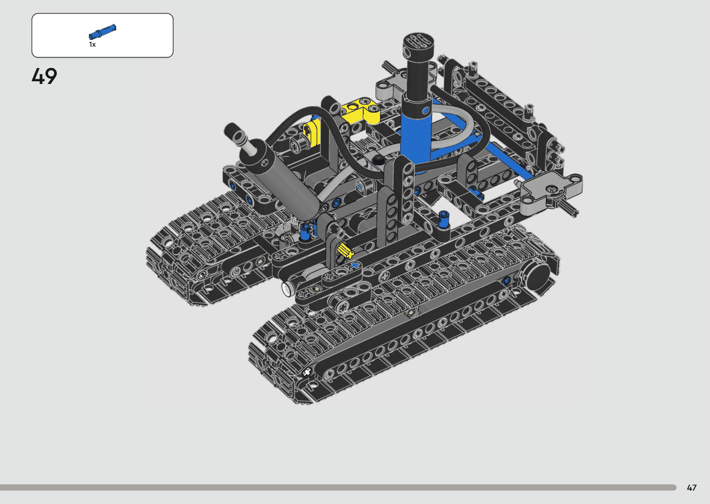

**New parts:** fs-pin-1 (43093, blue) - one blue pin pushed into the 15-hole beam

**Touches:** One blue pin is pushed into the new side beam near the front.

**Exact joins:** fs-pin-1.pin1 into cb-b15-1.hole? (not shown in booklet)

**Who does what:** cb-b15-1 holds fs-pin-1

**After:** a blue pin stands up from the 15-hole beam; everything else: no change

**Why:** Adds a post for the small build placed in step 50. A pin gives a fixing point without extra parts. *Next:* Step 50 sets the yellow assembly over it. *Pattern:* post pin

**Big picture:**
- **fs-pin-1** (None): None

**Mechanisms:**
- **fs-pin-1** builds on cb-b15-1 (42175-step-048), which rests on cb-gp-1 (42175-step-041), cb-bp-1 (42175-step-046)

**Review:** Which beam hole is not countable.

## 42175-step-050 (page 48) - low - NEEDS REVIEW

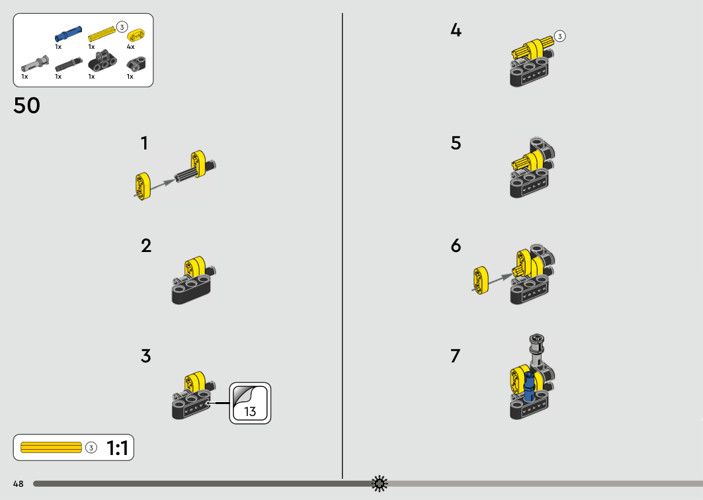

**New parts:** fs-bp-1 (42924, blue) - long blue pin (sub-step 7); fs-ax3-1 (4519, yellow) - yellow 3-long axle (1:1 box, circled 3, sub-step 4); fs-yb-1 (41677, yellow) - four yellow thin 1 x 2 beams (sub-steps 1, 2, 5, 6); fs-yb-2 (41677, yellow) - four yellow thin 1 x 2 beams (sub-steps 1, 2, 5, 6); fs-yb-3 (41677, yellow) - four yellow thin 1 x 2 beams (sub-steps 1, 2, 5, 6); fs-yb-4 (41677, yellow) - four yellow thin 1 x 2 beams (sub-steps 1, 2, 5, 6); fs-gp-1 (77765, light bluish gray) - grey long pin (sub-step 7); fs-ap-1 (18651, black) - black axle pin (sub-step 1); fs-vb-1 (32523, black) - black 1 x 3 beam with the VOLVO print (base of the build); fs-gb-1 (60483, dark bluish gray) - small grey beam with pin and axle hole

**Touches:** 7 sub-steps: yellow thin beams sit on a black axle pin, are pushed onto the VOLVO beam, a yellow axle goes through them, more yellow beams are added and a blue and a grey pin finish the top. The whole piece is lowered onto the blue pin of step 49.

**Exact joins:** fs-ap-1.axle1 into fs-yb-1.axlehole1 (0.5 hole deep, locked (turn together), estimated from the picture); fs-ap-1.axle2 into fs-yb-2.axlehole1 (0.5 hole deep, locked (turn together), estimated from the picture); fs-ax3-1.axle1 into fs-yb-3.axlehole1 (0.5 hole deep, locked (turn together), estimated from the picture); fs-ax3-1.axle3 into fs-yb-4.axlehole1 (0.5 hole deep, locked (turn together), estimated from the picture); fs-bp-1.pin1 into fs-vb-1.hole2 (0.9 hole deep, held stiff by friction, estimated from the picture); fs-gp-1.pin1 into fs-gb-1.hole1? (not shown in booklet); fs-ap-1.pin1 into fs-vb-1.hole1 (0.9 hole deep, held stiff by friction, estimated from the picture)

**Who does what:** fs-vb-1 carries fs-yb-1; fs-ax3-1 holds fs-yb-3; fs-gb-1 holds fs-gp-1

**After:** a yellow double-beam pivot stack with a blue pin and a grey pin stands on a VOLVO beam on the side beam; everything else: no change

**Why:** Builds the pivot block that will carry a link or an arm. Yellow thin beams on an axle form a stiff yet turning pivot. *Next:* The yellow L-beam in step 51 sits beside it. *Pattern:* pivot block

**Big picture:**
- **fs-bp-1** (None): None
- **fs-ax3-1** (None): None
- **fs-yb-1** (None): None
- **fs-yb-2** (None): None
- **fs-yb-3** (None): None
- **fs-yb-4** (None): None
- **fs-gp-1** (None): None
- **fs-ap-1** (None): None
- **fs-vb-1** (None): None
- **fs-gb-1** (None): None

**Review:** Sub-step stacking order and exact holes are estimated; the icons are small. Seven items in the box (one 4x group).

## 42175-step-051 (page 50) - medium - NEEDS REVIEW

**New parts:** fs-yl-1 (32140, yellow) - yellow 2 x 4 L-beam with three grey pins (yellow box); fs-yp-1 (4274, light bluish gray) - three small grey pins in the yellow L-beam; fs-yp-2 (4274, light bluish gray) - three small grey pins in the yellow L-beam; fs-yp-3 (4274, light bluish gray) - three small grey pins in the yellow L-beam

**Touches:** Yellow box: three small grey pins stand in the yellow L-beam. The beam is pressed onto the side beam beside the pivot block (arrow).

**Exact joins:** fs-yp-1.pin1 into fs-yl-1.hole1 (0.2 hole deep, turns freely, estimated from the picture); fs-yp-2.pin1 into fs-yl-1.hole2 (0.2 hole deep, turns freely, estimated from the picture); fs-yp-3.pin1 into fs-yl-1.hole3 (0.2 hole deep, turns freely, estimated from the picture); fs-yl-1.hole4? into cb-b15-1.hole? (not shown in booklet)

**Who does what:** fs-yl-1 carries fs-yp-1

**After:** a yellow L-beam with three posts lies on the side beam; everything else: no change

**Why:** Adds the yellow L bracket that the next links hang on. The same piece as in step 34 on the other side. *Next:* Step 52 adds a black L-beam. *Pattern:* L bracket

**Big picture:**
- **fs-yl-1** (None): None
- **fs-yp-1** (None): None
- **fs-yp-2** (None): None
- **fs-yp-3** (None): None

**Mechanisms:**
- **fs-yl-1** builds on cb-b15-1 (42175-step-048), which rests on cb-gp-1 (42175-step-041), cb-bp-1 (42175-step-046)

**Review:** Beam holes not countable.

## 42175-step-052 (page 51) - medium - NEEDS REVIEW

**New parts:** fs-bl-1 (32526, black) - black 3 x 5 L-beam (yellow box); fs-bp3-1 (4274, light bluish gray) - three small grey pins in the L-beam's holes; fs-bp3-2 (4274, light bluish gray) - three small grey pins in the L-beam's holes; fs-bp3-3 (4274, light bluish gray) - three small grey pins in the L-beam's holes

**Touches:** Yellow box 1-2: three small grey pins are pushed into the L-beam. The finished piece is placed on the model next to the tall upright (arrow).

**Exact joins:** fs-bp3-1.pin1 into fs-bl-1.hole1 (0.2 hole deep, turns freely, estimated from the picture); fs-bp3-2.pin1 into fs-bl-1.hole2 (0.2 hole deep, turns freely, estimated from the picture); fs-bp3-3.pin1 into fs-bl-1.hole3 (0.2 hole deep, turns freely, estimated from the picture); fs-bl-1.hole5? into cb-b15-1.hole? (not shown in booklet)

**Who does what:** fs-bl-1 carries fs-bp3-1

**After:** a black L-beam with three pins is on the side next to the tall upright; everything else: no change

**Why:** Adds a black bracket beside the tall upright. An L shape bridges the two side beams. *Next:* Step 53 lays a beam across. *Pattern:* bracket

**Big picture:**
- **fs-bl-1** (None): None Later: 42175-step-053 `DOES fs-b5-1 SUPPORTS fs-bl-1`.
- **fs-bp3-1** (None): None Later: 42175-step-053 `CONNECT fs-b5-1.hole1 -> fs-bp3-1.pin1?`.
- **fs-bp3-2** (None): None Later: 42175-step-053 `CONNECT fs-b5-1.hole3 -> fs-bp3-2.pin1?`.
- **fs-bp3-3** (None): None

**Mechanisms:**
- **fs-bl-1** builds on cb-b15-1 (42175-step-048), which rests on cb-gp-1 (42175-step-041), cb-bp-1 (42175-step-046)

**Review:** Holes not countable.

## 42175-step-053 (page 52) - medium - NEEDS REVIEW

**New parts:** fs-b5-1 (32316, black) - black 5-hole thick beam (1:1 box, circled 5)

**Touches:** The 5-hole beam is lowered onto the pins of step 52 (arrow in the yellow box).

**Exact joins:** fs-b5-1.hole1 into fs-bp3-1.pin1? (not shown in booklet); fs-b5-1.hole3 into fs-bp3-2.pin1? (not shown in booklet)

**Who does what:** fs-b5-1 supports fs-bl-1

**After:** a 5-hole beam lies over the black L-beam's pins; everything else: no change

**Why:** Closes the bracket and ties it into the frame. A beam on pins locks them. *Next:* Next steps continue with parts for the other side. *Pattern:* tie beam

**Big picture:**
- **fs-b5-1** (None): None Later: 42175-step-054 `CONNECT fs-bp4-1.pin1 -> fs-b5-1.hole?`; 42175-step-054 `CONNECT fs-bp4-2.pin1 -> fs-b5-1.hole?`; 42175-step-054 `DOES fs-b5-1 HOLDS fs-bp4-1`.

**Mechanisms:**
- **fs-b5-1** builds on fs-bp3-1 (42175-step-052), which rests on fs-bl-1 (42175-step-052); fs-bp3-2 (42175-step-052), which rests on fs-bl-1 (42175-step-052)

**Review:** Which three of the five holes are used is not countable.

## 42175-step-054 (page 53) - medium - NEEDS REVIEW

**New parts:** fs-bp4-1 (43093, blue) - two blue pins pushed into the model beside the pivot stack; fs-bp4-2 (43093, blue) - two blue pins pushed into the model beside the pivot stack

**Touches:** Two blue pins are pushed into the side beam next to the pivot stack (pictured, no arrows).

**Exact joins:** fs-bp4-1.pin1 into fs-b5-1.hole? (not shown in booklet); fs-bp4-2.pin1 into fs-b5-1.hole? (not shown in booklet)

**Who does what:** fs-b5-1 holds fs-bp4-1

**After:** two blue pins stand beside the pivot stack; everything else: no change

**Why:** Adds posts for the beam fitted in step 55. Pins give fixing points at no cost in space. *Next:* Step 55 slides a beam over them. *Pattern:* posts

**Big picture:**
- **fs-bp4-1** (None): None Later: 42175-step-055 `CONNECT fs-b7-1.hole1~ -> fs-bp4-1.pin1?`.
- **fs-bp4-2** (None): None Later: 42175-step-055 `CONNECT fs-b7-1.hole3~ -> fs-bp4-2.pin1?`.

**Mechanisms:**
- **fs-bp4-1** builds on fs-b5-1 (42175-step-053), which rests on fs-bp3-1 (42175-step-052), fs-bp3-2 (42175-step-052)
- **fs-bp4-2** builds on fs-b5-1 (42175-step-053), which rests on fs-bp3-1 (42175-step-052), fs-bp3-2 (42175-step-052)

**Review:** The pin type is read from the icon; where they go is not countable.

## 42175-step-055 (page 54) - low - NEEDS REVIEW

**New parts:** fs-bh-1 (42003, black) - black connector with two pin holes and a cross hole (yellow box 1); fs-gp5-1 (4274, light bluish gray) - two small grey pins in the connector; fs-gp5-2 (4274, light bluish gray) - two small grey pins in the connector; fs-b7-1 (32524, black) - black 7-hole beam (1:1 box, circled 7); fs-rax-1 (32062, red) - red 2-long notched axle (sub-step 1, goes into the connector's cross hole)

**Touches:** Yellow box 1-2: the red axle goes in the black connector, two grey pins join, then the connector is pressed onto a 7-hole beam. The unit is placed on the two blue pins (green arrows) with the red axle pointing up (arrow).

**Exact joins:** fs-gp5-1.pin1 into fs-bh-1.hole1 (0.2 hole deep, turns freely); fs-gp5-2.pin1 into fs-bh-1.hole2 (0.2 hole deep, turns freely); fs-rax-1.axle1 into fs-bh-1.axlehole1 (1 hole deep, locked (turn together)); fs-bh-1.hole? into fs-b7-1.hole? (not shown in booklet); fs-b7-1.hole1 into fs-bp4-1.pin1? (not shown in booklet); fs-b7-1.hole3 into fs-bp4-2.pin1? (not shown in booklet)

**Who does what:** fs-bh-1 holds fs-rax-1; fs-b7-1 carries fs-bh-1

**After:** a 7-hole beam lies on the blue pins, with a red axle standing up from it; everything else: no change

**Why:** Builds the seat mount: the red axle will carry the seat. A cross axle in a connector locks and gives a vertical post. *Next:* Step 56 puts the seat on it. *Pattern:* seat mount

**Big picture:**
- **fs-bh-1** (None): None
- **fs-gp5-1** (None): None
- **fs-gp5-2** (None): None
- **fs-b7-1** (None): None
- **fs-rax-1** (None): None Later: 42175-step-056 `CONNECT fs-seat-1.hole1 -> fs-rax-1.axle2?`; 42175-step-056 `DOES fs-rax-1 HOLDS fs-seat-1`.

**Mechanisms:**
- **fs-b7-1** builds on fs-bp4-1 (42175-step-054), which rests on fs-b5-1 (42175-step-053); fs-bp4-2 (42175-step-054), which rests on fs-b5-1 (42175-step-053)

**Review:** Which beam holes the two blue pins use is not countable.

## 42175-step-056 (page 55) - medium - NEEDS REVIEW

**New parts:** fs-seat-1 (24116, dark bluish gray) - dark grey curved panel that works as the seat back/seat

**Touches:** The curved panel is pushed onto the red axle so it stands as a seat.

**Exact joins:** fs-seat-1.hole1 into fs-rax-1.axle2? (not shown in booklet)

**Who does what:** fs-rax-1 holds fs-seat-1

**After:** a curved dark grey seat stands on the red axle; everything else: no change

**Why:** Adds the operator's seat of the excavator. A bent panel has the shape of a seat. *Next:* Step 57 locks it with a small beam. *Pattern:* seat

**Big picture:**
- **fs-seat-1** (None): None Later: 42175-step-057 `CONNECT fs-sb-1.hole1 -> fs-seat-1.hole?`; 42175-step-057 `DOES fs-sb-1 HOLDS fs-seat-1`; 42175-step-058 `DOES fs-sx-1 HOLDS fs-seat-1`.

**Mechanisms:**
- **fs-seat-1** builds on fs-rax-1 (42175-step-055), which rests on fs-bh-1 (42175-step-055)

**Review:** Which panel hole is on the axle is not countable.

## 42175-step-057 (page 56) - medium - NEEDS REVIEW

**New parts:** fs-sb-1 (43857, dark bluish gray) - grey 1 x 2 thick beam added at the seat's lower end (yellow box)

**Touches:** The small grey beam is pressed onto the seat's foot (arrow).

**Exact joins:** fs-sb-1.hole1 into fs-seat-1.hole? (not shown in booklet)

**Who does what:** fs-sb-1 holds fs-seat-1

**After:** the seat is held at its foot by a grey beam; everything else: no change

**Why:** Holds the seat's foot so it doesn't pop off. A beam clamps the foot. *Next:* Step 58 adds a shaft through it. *Pattern:* seat lock

**Big picture:**
- **fs-sb-1** (None): None Later: 42175-step-058 `CONNECT fs-sx-1.axle1 -> fs-sb-1.hole?`.

**Mechanisms:**
- **fs-sb-1** builds on fs-seat-1 (42175-step-056), which rests on fs-rax-1 (42175-step-055)

**Review:** Part read from the icon.

## 42175-step-058 (page 57) - medium - NEEDS REVIEW

**New parts:** fs-sx-1 (3706, black) - black 6-long axle pushed through the seat foot (yellow box)

**Touches:** The black axle is pushed through the seat foot and beam (arrow).

**Exact joins:** fs-sx-1.axle1 into fs-sb-1.hole? (not shown in booklet)

**Who does what:** fs-sx-1 holds fs-seat-1

**After:** the seat foot has a black axle through it; everything else: no change

**Why:** Adds the shaft the seat turns or tilts on. An axle through a beam is a pivot. *Next:* Later steps hang parts off the shaft. *Pattern:* seat pivot

**Big picture:**
- **fs-sx-1** (None): None Later: 42175-step-059 `CONNECT fs-clip-1.bar? -> fs-sx-1.axle?`; 42175-step-059 `CONNECT fs-clip-2.bar? -> fs-sx-1.axle?`; 42175-step-059 `DOES fs-sx-1 CARRIES fs-clip-1`.

**Mechanisms:**
- **fs-sx-1** builds on fs-sb-1 (42175-step-057), which rests on fs-seat-1 (42175-step-056)

**Review:** Length read as 6; hard to verify from the picture.

## 42175-step-059 (page 58) - medium - NEEDS REVIEW

**New parts:** fs-clip-1 (3484, black) - two small black bars with a clip, added to the model (icon only, no arrow); fs-clip-2 (3484, black) - two small black bars with a clip, added to the model (icon only, no arrow)

**Touches:** Two small clip bars are listed in the box; the picture shows the model without any visible change, so where they go is not shown.

**Exact joins:** fs-clip-1.bar? into fs-sx-1.axle? (not shown in booklet); fs-clip-2.bar? into fs-sx-1.axle? (not shown in booklet)

**Who does what:** fs-sx-1 carries fs-clip-1

**After:** two small clip bars are added at the seat (positions not shown); everything else: no change

**Why:** Clips will later hold hoses or lines. A bar with a clip snaps a thin hose in place. *Next:* Step 60 builds a hose piece that clips here. *Pattern:* hose clips

**Big picture:**
- **fs-clip-1** (None): None
- **fs-clip-2** (None): None

**Mechanisms:**
- **fs-clip-1** builds on fs-sx-1 (42175-step-058), which rests on fs-sb-1 (42175-step-057)
- **fs-clip-2** builds on fs-sx-1 (42175-step-058), which rests on fs-sb-1 (42175-step-057)

**Review:** Position is not shown in the picture; joins are open. Part identity read from the icon.

## 42175-step-060 (page 59) - low - NEEDS REVIEW

**New parts:** hs-hose-1 (32580, black) - black 7-long soft axle hose (sub-step 1); hs-rax-1 (32062, red) - two red 2-long notched axles at the two ends of the hose (sub-steps 1-2); hs-rax-2 (32062, red) - two red 2-long notched axles at the two ends of the hose (sub-steps 1-2); hs-conn-1 (99021, dark bluish gray) - two grey hose connectors (sub-step 2 and 4); hs-conn-2 (99021, dark bluish gray) - two grey hose connectors (sub-step 2 and 4); hs-bp-1 (43093, blue) - blue pin (sub-step 3); hs-tile-1 (3069b, black) - black 1 x 2 tile with a sticker (sub-step 5, sticker no. 29 in the yellow box); hs-plate-1 (18677, black) - black 1 x 2 plate with a pin hole underneath (sub-step 4)

**Touches:** Sub-steps 1-5: red axles go into the ends of the black hose, a grey connector and a blue pin are added at one end, and a black tile with a sticker goes on the plate (yellow box). The whole piece is fitted next to the seat (arrow).

**Exact joins:** hs-rax-1.axle1 into hs-hose-1.axlehole? (not shown in booklet); hs-rax-2.axle1 into hs-hose-1.axlehole? (not shown in booklet); hs-conn-1.axle? into hs-rax-1.axle2? (not shown in booklet); hs-bp-1.pin1 into hs-conn-1.hole? (not shown in booklet); hs-conn-2.hole? into hs-hose-1.axlehole? (not shown in booklet); hs-tile-1.stud? into hs-plate-1.stud? (not shown in booklet)

**Who does what:** hs-hose-1 carries hs-rax-1; hs-conn-1 holds hs-bp-1; hs-plate-1 supports hs-tile-1

**After:** a black soft hose link with red end axles, connectors and a sticker tile is fitted at the seat; everything else: no change

**Why:** Builds a stiff rod link with end fittings (a Volvo-style label tile). A soft axle hose is a bendable shaft; the red axles are its end fittings. *Next:* It becomes a link in the cab area. *Pattern:* hose link

**Big picture:**
- **hs-hose-1** (None): None
- **hs-rax-1** (None): None
- **hs-rax-2** (None): None
- **hs-conn-1** (None): None
- **hs-conn-2** (None): None
- **hs-bp-1** (None): None
- **hs-tile-1** (None): None
- **hs-plate-1** (None): None

**Review:** Parts are read from small icons; the soft hose and the sticker tile have no catalog points so joins are open.

## 42175-step-061 (page 62) - low - NEEDS REVIEW

**New parts:** bm-gp-1 (4274, light bluish gray) - small grey pin; bm-lb-1 (32140, black) - black 2 x 4 L-beam; bm-bp-1 (43093, blue) - blue pin

**Touches:** A black L-beam gets a small grey pin and a blue pin (picture).

**Exact joins:** bm-gp-1.pin1 into bm-lb-1.hole1 (0.2 hole deep, turns freely, estimated from the picture); bm-bp-1.pin1 into bm-lb-1.hole2 (0.9 hole deep, held stiff by friction, estimated from the picture)

**Who does what:** bm-lb-1 carries bm-gp-1

**After:** a black L-beam with one grey and one blue pin; everything else: no change

**Why:** Starts the arm from its root: an L-beam gives the corner for the first section. Pins make fixing points. *Next:* Step 62 puts it on the long beam. *Pattern:* arm start

**Big picture:**
- **bm-gp-1** (None): None
- **bm-lb-1** (None): None Later: 42175-step-062 `CONNECT bm-lb-1.hole3 -> bm-b11-1.hole2?`; 42175-step-062 `DOES bm-b11-1 CARRIES bm-lb-1`; 42175-step-109 `CONNECT cb-gpin-1.pin? -> bm-lb-1.hole?`.
- **bm-bp-1** (None): None Later: 42175-step-062 `CONNECT bm-bp-1.pin1 -> bm-b11-1.hole1?`.

**Review:** The inset picture on page 62 shows the arm that is built in the next steps.

## 42175-step-062 (page 62) - low - NEEDS REVIEW

**New parts:** bm-b11-1 (32525, black) - black 11-hole beam (1:1 box, circled 11)

**Touches:** The L-beam stands on one end of the 11-hole beam with the blue pin sticking out (picture).

**Exact joins:** bm-bp-1.pin1 into bm-b11-1.hole1? (not shown in booklet); bm-lb-1.hole3 into bm-b11-1.hole2? (not shown in booklet)

**Who does what:** bm-b11-1 carries bm-lb-1

**After:** an 11-hole beam with an upright L-beam at one end; everything else: no change

**Why:** Builds the first long section of the arm. An 11-hole beam is the main bar. *Next:* Step 63 puts an axle through it. *Pattern:* arm bar

**Big picture:**
- **bm-b11-1** (None): None Later: 42175-step-063 `CONNECT bm-ax5-1.axle? -> bm-b11-1.hole?`; 42175-step-063 `DOES bm-b11-1 CARRIES bm-ax5-1`; 42175-step-065 `CONNECT bm-ax5b-1.axle? -> bm-b11-1.hole?`; 42175-step-065 `DOES bm-b11-1 CARRIES bm-ax5b-1`; 42175-step-068 `CONNECT bm-bp4-1.pin1 -> bm-b11-1.hole?`; 42175-step-068 `CONNECT bm-bp4-2.pin1 -> bm-b11-1.hole?`; 42175-step-068 `DOES bm-b11-1 HOLDS bm-bp4-1`; 42175-step-070 `CONNECT bm-b11b-1.hole? -> bm-b11-1.hole?`; 42175-step-076 `CONNECT bm-l5-1.hole? -> bm-b11-1.hole?`; 42175-step-078 `CONNECT bm-bc-1.hole? -> bm-b11-1.hole?`; 42175-step-091 `CONNECT bm-l7-1.hole? -> bm-b11-1.hole?`.

**Mechanisms:**
- **bm-b11-1** builds on bm-bp-1 (42175-step-061), which rests on bm-lb-1 (42175-step-061); bm-lb-1 (42175-step-061), which rests on bm-gp-1 (42175-step-061), bm-bp-1 (42175-step-061)

**Review:** Holes not countable.

## 42175-step-063 (page 62) - low - NEEDS REVIEW

**New parts:** bm-ax5-1 (15462, reddish brown) - brown 5-long axle with stop (1:1 box, circled 5)

**Touches:** The brown axle is pushed through the beam end (green arrow).

**Exact joins:** bm-ax5-1.axle? into bm-b11-1.hole? (not shown in booklet)

**Who does what:** bm-b11-1 carries bm-ax5-1

**After:** a brown axle sticks out of the end of the beam; everything else: no change

**Why:** Adds a shaft for the next link to turn on. A stop end keeps the axle from sliding out. *Next:* Step 64 hangs more on it. *Pattern:* shaft

**Big picture:**
- **bm-ax5-1** (None): None Later: 42175-step-064 `CONNECT bm-l2-1.hole? -> bm-ax5-1.axle?`; 42175-step-064 `DOES bm-l2-1 HOLDS bm-ax5-1`.

**Mechanisms:**
- **bm-ax5-1** builds on bm-b11-1 (42175-step-062), which rests on bm-bp-1 (42175-step-061), bm-lb-1 (42175-step-061)

**Review:** Which hole not shown.

## 42175-step-064 (page 63) - low - NEEDS REVIEW

**New parts:** bm-l2-1 (32526, black) - black 3 x 5 L-beam laid on the beam end; bm-bp2-1 (43093, blue) - blue pin pushed in beside the brown axle (green arrow)

**Touches:** The L-beam is added at the end of the beam and a blue pin is pushed in through the beam (green arrow).

**Exact joins:** bm-bp2-1.pin1 into bm-l2-1.hole? (not shown in booklet); bm-l2-1.hole? into bm-ax5-1.axle? (not shown in booklet)

**Who does what:** bm-l2-1 holds bm-ax5-1

**After:** a second L-beam lies on the arm start, pinned; everything else: no change

**Why:** Doubles the beam at the arm's root so the joint is wide and strong. Two layers on one axle and pin hold well. *Next:* Step 65 adds another axle. *Pattern:* root doubling

**Big picture:**
- **bm-l2-1** (None): None
- **bm-bp2-1** (None): None

**Mechanisms:**
- **bm-l2-1** builds on bm-ax5-1 (42175-step-063), which rests on bm-b11-1 (42175-step-062)

**Review:** Which holes are used is not countable.

## 42175-step-065 (page 63) - low - NEEDS REVIEW

**New parts:** bm-ax5b-1 (15462, reddish brown) - second brown 5-long axle (1:1 box, circled 5); bm-cn-1 (6536, light bluish gray) - small grey axle and pin connector pressed on the other end of the axle (green arrow)

**Touches:** The second brown axle goes through the layered root; a small grey connector sits on its tip (green arrow).

**Exact joins:** bm-ax5b-1.axle? into bm-b11-1.hole? (not shown in booklet); bm-cn-1.axlehole1 into bm-ax5b-1.axle? (not shown in booklet)

**Who does what:** bm-b11-1 carries bm-ax5b-1; bm-cn-1 holds bm-ax5b-1

**After:** two brown axles pass through the arm root, one with a connector; everything else: no change

**Why:** Adds the second pivot shaft of the root. Two parallel shafts make a double hinge. *Next:* Step 66 adds spacers and a yellow axle. *Pattern:* root hinge

**Big picture:**
- **bm-ax5b-1** (None): None
- **bm-cn-1** (None): None

**Mechanisms:**
- **bm-ax5b-1** builds on bm-b11-1 (42175-step-062), which rests on bm-bp-1 (42175-step-061), bm-lb-1 (42175-step-061)

**Review:** Exact holes are not countable.

## 42175-step-066 (page 63) - low - NEEDS REVIEW

**New parts:** bm-yax-1 (4519, yellow) - yellow 3-long axle (1:1 box, circled 3); bm-bp3-1 (43093, blue) - blue pin (yellow box); bm-tb-1 (41677, black) - two small black thin beams (yellow box); bm-tb-2 (41677, black) - two small black thin beams (yellow box)

**Touches:** Yellow box 1-2: a blue pin goes through the first thin beam, the second thin beam goes on, and a yellow axle locks them. The unit is placed onto the root (arrow).

**Exact joins:** bm-bp3-1.axle1 into bm-tb-1.axlehole1 (0.5 hole deep, locked (turn together), estimated from the picture); bm-yax-1.axle1 into bm-tb-2.axlehole1 (0.5 hole deep, locked (turn together), estimated from the picture); bm-tb-1.axlehole2 into bm-yax-1.axle3? (not shown in booklet)

**Who does what:** bm-tb-1 holds bm-bp3-1; bm-yax-1 holds bm-tb-2

**After:** a small linking plate with a yellow axle and blue pin sits on the root; everything else: no change

**Why:** Builds the plate that will carry the cylinder joint. Two thin beams tied by an axle make a light plate. *Next:* Later steps add the cylinder mount. *Pattern:* link plate

**Big picture:**
- **bm-yax-1** (None): None Later: 42175-step-067 `CONNECT bm-cn2-1.axlehole1 -> bm-yax-1.axle?`; 42175-step-067 `DOES bm-yax-1 HOLDS bm-cn2-1`.
- **bm-bp3-1** (None): None
- **bm-tb-1** (None): None
- **bm-tb-2** (None): None

**Review:** Which holes are used is estimated.

## 42175-step-067 (page 64) - low - NEEDS REVIEW

**New parts:** bm-cn2-1 (6536, light bluish gray) - small grey connector (icon)

**Touches:** One more small grey connector is added at the yellow axle end (picture).

**Exact joins:** bm-cn2-1.axlehole1 into bm-yax-1.axle? (not shown in booklet)

**Who does what:** bm-yax-1 holds bm-cn2-1

**After:** a grey connector is on the yellow axle; everything else: no change

**Why:** Adds an attachment point for a later link. A connector turns an axle end into a pin point. *Next:* Steps 68-69 add pins and a beam. *Pattern:* connector

**Big picture:**
- **bm-cn2-1** (None): None

**Mechanisms:**
- **bm-cn2-1** builds on bm-yax-1 (42175-step-066), which rests on bm-tb-2 (42175-step-066), bm-tb-1 (42175-step-066)

**Review:** Position is not countable.

## 42175-step-068 (page 64) - low - NEEDS REVIEW

**New parts:** bm-bp4-1 (43093, blue) - two blue pins pushed into the underside of the beam (picture); bm-bp4-2 (43093, blue) - two blue pins pushed into the underside of the beam (picture)

**Touches:** Two blue pins stand out of the front end of the arm beam.

**Exact joins:** bm-bp4-1.pin1 into bm-b11-1.hole? (not shown in booklet); bm-bp4-2.pin1 into bm-b11-1.hole? (not shown in booklet)

**Who does what:** bm-b11-1 holds bm-bp4-1

**After:** two blue pins stick out of the arm's far end; everything else: no change

**Why:** Adds the posts for the next beam. Pins make the connection points. *Next:* Step 69 slides a beam over them. *Pattern:* posts

**Big picture:**
- **bm-bp4-1** (None): None Later: 42175-step-069 `CONNECT bm-bp4-1.pin1 -> bm-b5-1.hole1?`; 42175-step-069 `DOES bm-b5-1 HOLDS bm-bp4-1`.
- **bm-bp4-2** (None): None Later: 42175-step-069 `CONNECT bm-bp4-2.pin1 -> bm-b5-1.hole2?`.

**Mechanisms:**
- **bm-bp4-1** builds on bm-b11-1 (42175-step-062), which rests on bm-bp-1 (42175-step-061), bm-lb-1 (42175-step-061)
- **bm-bp4-2** builds on bm-b11-1 (42175-step-062), which rests on bm-bp-1 (42175-step-061), bm-lb-1 (42175-step-061)

**Review:** Which holes are used is not countable.

## 42175-step-069 (page 64) - low - NEEDS REVIEW

**New parts:** bm-b5-1 (32316, black) - black 5-hole beam (1:1 box, circled 5)

**Touches:** The 5-hole beam is pressed onto the two blue pins.

**Exact joins:** bm-bp4-1.pin1 into bm-b5-1.hole1? (not shown in booklet); bm-bp4-2.pin1 into bm-b5-1.hole2? (not shown in booklet)

**Who does what:** bm-b5-1 holds bm-bp4-1

**After:** a 5-hole beam extends the arm; everything else: no change

**Why:** Extends the arm's length. A beam on two pins is stiff. *Next:* Step 70 adds a long beam on top. *Pattern:* extension

**Big picture:**
- **bm-b5-1** (None): None Later: 42175-step-070 `DOES bm-b11b-1 SUPPORTS bm-b5-1`; 42175-step-072 `CONNECT bm-l4-1.hole? -> bm-b5-1.hole?`.

**Mechanisms:**
- **bm-b5-1** builds on bm-bp4-1 (42175-step-068), which rests on bm-b11-1 (42175-step-062); bm-bp4-2 (42175-step-068), which rests on bm-b11-1 (42175-step-062)

**Review:** Holes used not countable.

## 42175-step-070 (page 65) - low - NEEDS REVIEW

**New parts:** bm-b11b-1 (32525, black) - second black 11-hole beam (1:1 box, circled 11); bm-gp2-1 (4274, light bluish gray) - small grey pin pushed into the arm end (green arrow)

**Touches:** A second 11-hole beam lies along the first; the grey pin is pushed in at the root end (arrow).

**Exact joins:** bm-gp2-1.pin1 into bm-b11b-1.hole? (not shown in booklet); bm-b11b-1.hole? into bm-b11-1.hole? (not shown in booklet)

**Who does what:** bm-b11b-1 supports bm-b5-1; bm-b11b-1 holds bm-gp2-1

**After:** two long beams run side by side with a grey pin at the root; everything else: no change

**Why:** Builds the arm's double beam. Two parallel beams are much stiffer than one. *Next:* Step 71 adds a corner piece. *Pattern:* double beam

**Big picture:**
- **bm-b11b-1** (None): None Later: 42175-step-071 `DOES bm-l3-1 SUPPORTS bm-b11b-1`; 42175-step-074 `DOES bm-b15-1 SUPPORTS bm-b11b-1`.
- **bm-gp2-1** (None): None Later: 42175-step-071 `CONNECT bm-l3-1.hole? -> bm-gp2-1.pin1?`.

**Mechanisms:**
- **bm-b11b-1** builds on bm-b11-1 (42175-step-062), which rests on bm-bp-1 (42175-step-061), bm-lb-1 (42175-step-061)

**Review:** Holes not countable.

## 42175-step-071 (page 65) - low - NEEDS REVIEW

**New parts:** bm-l3-1 (32140, black) - small black L-beam at the root end

**Touches:** An L-beam is placed at the root end of the double beam (picture).

**Exact joins:** bm-l3-1.hole? into bm-gp2-1.pin1? (not shown in booklet)

**Who does what:** bm-l3-1 supports bm-b11b-1

**After:** the root end has a black L-beam corner; everything else: no change

**Why:** Closes the corner of the root. An L-beam ties the two beams across the end. *Next:* Step 72 adds a bigger L-beam to the far end. *Pattern:* corner

**Big picture:**
- **bm-l3-1** (None): None

**Mechanisms:**
- **bm-l3-1** builds on bm-gp2-1 (42175-step-070), which rests on bm-b11b-1 (42175-step-070)

**Review:** Holes not countable.

## 42175-step-072 (page 65) - low - NEEDS REVIEW

**New parts:** bm-l4-1 (32526, black) - black 3 x 5 L-beam with three blue pins (yellow box); bm-bp5-1 (43093, blue) - three blue pins in the L-beam's short side; bm-bp5-2 (43093, blue) - three blue pins in the L-beam's short side; bm-bp5-3 (43093, blue) - three blue pins in the L-beam's short side

**Touches:** Yellow box: three blue pins stand in an L-beam. It is placed on the far end of the arm (arrow).

**Exact joins:** bm-bp5-1.pin1 into bm-l4-1.hole1 (0.9 hole deep, held stiff by friction, estimated from the picture); bm-bp5-2.pin1 into bm-l4-1.hole2 (0.9 hole deep, held stiff by friction, estimated from the picture); bm-bp5-3.pin1 into bm-l4-1.hole3 (0.9 hole deep, held stiff by friction, estimated from the picture); bm-l4-1.hole? into bm-b5-1.hole? (not shown in booklet)

**Who does what:** bm-l4-1 carries bm-bp5-1

**After:** the arm's far end has a black L-beam with three upright blue pins; everything else: no change

**Why:** Makes the far end ready for the next piece. An L-beam with pins gives several fixing points. *Next:* Steps 73-74 add parts on this end. *Pattern:* far end posts

**Big picture:**
- **bm-l4-1** (None): None
- **bm-bp5-1** (None): None Later: 42175-step-073 `CONNECT bm-ac-1.axlehole1 -> bm-bp5-1.axle?`; 42175-step-074 `CONNECT bm-b15-1.hole? -> bm-bp5-1.pin1?`; 42175-step-080 `CONNECT bm-b15b-1.hole? -> bm-bp5-1.pin?`.
- **bm-bp5-2** (None): None
- **bm-bp5-3** (None): None

**Mechanisms:**
- **bm-l4-1** builds on bm-b5-1 (42175-step-069), which rests on bm-bp4-1 (42175-step-068), bm-bp4-2 (42175-step-068)

**Review:** Holes not countable.

## 42175-step-073 (page 66) - low - NEEDS REVIEW

**New parts:** bm-cap-1 (98138, trans-clear) - round 1 x 1 cap (yellow box sub-step 2); bm-gp3-1 (4274, light bluish gray) - small grey pin (sub-step 1); bm-ac-1 (32013, black) - black angled connector (sub-step 1)

**Touches:** Yellow box: the grey pin goes in the black connector and the cap goes on top. The piece is then fitted to the far end of the arm (arrows).

**Exact joins:** bm-gp3-1.pin1 into bm-ac-1.hole1 (0.2 hole deep, turns freely, estimated from the picture); bm-cap-1.stud? into bm-gp3-1.barhole1? (not shown in booklet); bm-ac-1.axlehole1 into bm-bp5-1.axle? (not shown in booklet)

**Who does what:** bm-ac-1 holds bm-gp3-1

**After:** a capped pin connector sits at the arm's far end; everything else: no change

**Why:** Adds a smooth post for a link. A capped pin stops a link from falling off. *Next:* Step 74 lays the 15-hole beam. *Pattern:* end post

**Big picture:**
- **bm-cap-1** (None): None
- **bm-gp3-1** (None): None
- **bm-ac-1** (None): None Later: 42175-step-074 `CONNECT bm-b15-1.hole? -> bm-ac-1.hole?`.

**Mechanisms:**
- **bm-ac-1** builds on bm-bp5-1 (42175-step-072), which rests on bm-l4-1 (42175-step-072)

**Review:** The cap's colour looks white; trans-clear read.

## 42175-step-074 (page 66) - low - NEEDS REVIEW

**New parts:** bm-b15-1 (32278, black) - black 15-hole beam (1:1 box, circled 15)

**Touches:** The 15-hole beam is laid over the arm and its pins (picture shows it floating above).

**Exact joins:** bm-b15-1.hole? into bm-bp5-1.pin1? (not shown in booklet); bm-b15-1.hole? into bm-ac-1.hole? (not shown in booklet)

**Who does what:** bm-b15-1 supports bm-b11b-1

**After:** a long 15-hole beam spans the arm; everything else: no change

**Why:** Makes the arm long enough to reach. A 15-hole beam is the longest we have; it tops the arm. *Next:* Step 75 adds a diagonal brace. *Pattern:* long beam

**Big picture:**
- **bm-b15-1** (None): None Later: 42175-step-075 `CONNECT bm-gb7-1.hole? -> bm-b15-1.hole?`; 42175-step-075 `DOES bm-gb7-1 SUPPORTS bm-b15-1`; 42175-step-080 `DOES bm-b15b-1 SUPPORTS bm-b15-1`.

**Mechanisms:**
- **bm-b15-1** builds on bm-bp5-1 (42175-step-072), which rests on bm-l4-1 (42175-step-072), bm-ac-1 (42175-step-073); bm-ac-1 (42175-step-073), which rests on bm-gp3-1 (42175-step-073), bm-bp5-1 (42175-step-072)

**Review:** Holes not countable.

## 42175-step-075 (page 67) - low - NEEDS REVIEW

**New parts:** bm-gb7-1 (32524, dark bluish gray) - grey 7-hole beam with blue pins (1:1 box, circled 7); bm-bp6-1 (43093, blue) - blue pin

**Touches:** Yellow box: a grey 7-hole beam with two pins. It is placed diagonally on the arm (arrow).

**Exact joins:** bm-bp6-1.pin1 into bm-gb7-1.hole1 (0.9 hole deep, held stiff by friction, estimated from the picture); bm-gb7-1.hole? into bm-b15-1.hole? (not shown in booklet)

**Who does what:** bm-gb7-1 supports bm-b15-1

**After:** a grey diagonal brace sits on the arm; everything else: no change

**Why:** Adds the diagonal brace for the middle joint. A diagonal beam makes a triangle that resists bending. *Next:* Step 76 adds an L-beam. *Pattern:* brace

**Big picture:**
- **bm-gb7-1** (None): None Later: 42175-step-076 `DOES bm-l5-1 SUPPORTS bm-gb7-1`; 42175-step-078 `CONNECT bm-bp7-1.pin1 -> bm-gb7-1.hole?`; 42175-step-079 `CONNECT bm-b11c-1.hole2? -> bm-gb7-1.hole?`.
- **bm-bp6-1** (None): None

**Mechanisms:**
- **bm-gb7-1** builds on bm-b15-1 (42175-step-074), which rests on bm-bp5-1 (42175-step-072), bm-ac-1 (42175-step-073)

**Review:** Only one blue pin is in the box; the second pin in the yellow box belongs to the model.

## 42175-step-076 (page 67) - low - NEEDS REVIEW

**New parts:** bm-l5-1 (32526, black) - black 3 x 5 L-beam hanging under the arm

**Touches:** A black L-beam is placed at the lower side (picture).

**Exact joins:** bm-l5-1.hole? into bm-b11-1.hole? (not shown in booklet)

**Who does what:** bm-l5-1 supports bm-gb7-1

**After:** a black L-beam hangs below the arm; everything else: no change

**Why:** Gives the arm a bracket underneath. An L-beam bridges both layers. *Next:* Step 77 adds the cap piece. *Pattern:* bracket

**Big picture:**
- **bm-l5-1** (None): None Later: 42175-step-077 `CONNECT bm-ac2-1.axlehole1 -> bm-l5-1.hole?`.

**Mechanisms:**
- **bm-l5-1** builds on bm-b11-1 (42175-step-062), which rests on bm-bp-1 (42175-step-061), bm-lb-1 (42175-step-061)

**Review:** Holes not countable.

## 42175-step-077 (page 68) - low - NEEDS REVIEW

**New parts:** bm-cap2-1 (98138, trans-clear) - round cap; bm-gp4-1 (4274, light bluish gray) - small grey pin; bm-ac2-1 (32013, black) - black angled connector

**Touches:** Yellow box: same capped pin connector as step 73; placed on the underside (arrow).

**Exact joins:** bm-gp4-1.pin1 into bm-ac2-1.hole1 (0.2 hole deep, turns freely, estimated from the picture); bm-cap2-1.stud? into bm-gp4-1.barhole1? (not shown in booklet); bm-ac2-1.axlehole1 into bm-l5-1.hole? (not shown in booklet)

**Who does what:** bm-ac2-1 holds bm-gp4-1

**After:** a second capped pin connector hangs under the arm; everything else: no change

**Why:** Adds a smooth post below. Same piece as step 73. *Next:* Step 78 adds a connector and pin on top. *Pattern:* end post

**Big picture:**
- **bm-cap2-1** (None): None
- **bm-gp4-1** (None): None
- **bm-ac2-1** (None): None

**Mechanisms:**
- **bm-ac2-1** builds on bm-l5-1 (42175-step-076), which rests on bm-b11-1 (42175-step-062)

**Review:** Same icon as step 73.

## 42175-step-078 (page 68) - low - NEEDS REVIEW

**New parts:** bm-bp7-1 (42924, blue) - long blue pin (yellow box); bm-ap2-1 (18651, black) - black axle pin (yellow box); bm-bc-1 (42003, black) - black connector with two pin holes and a cross hole

**Touches:** Yellow box: an axle pin goes through the black connector; a long blue pin is pushed up from below (arrow). The connector is placed on the arm's root end.

**Exact joins:** bm-ap2-1.axle1 into bm-bc-1.axlehole1 (1 hole deep, locked (turn together), estimated from the picture); bm-bp7-1.pin1 into bm-gb7-1.hole? (not shown in booklet); bm-bc-1.hole? into bm-b11-1.hole? (not shown in booklet)

**Who does what:** bm-bc-1 holds bm-ap2-1; bm-bp7-1 holds bm-bc-1

**After:** a black connector with an axle pin sits at the arm root; everything else: no change

**Why:** Adds a joint for the cylinder that lifts the arm. A connector with a cross hole turns an axle pin into a hinge. *Next:* Steps 79 onward continue the arm. *Pattern:* cylinder joint

**Big picture:**
- **bm-bp7-1** (None): None Later: 42175-step-079 `CONNECT bm-b11c-1.hole1 -> bm-bp7-1.pin?`; 42175-step-079 `DOES bm-bp7-1 HOLDS bm-b11c-1`.
- **bm-ap2-1** (None): None
- **bm-bc-1** (None): None

**Mechanisms:**
- **bm-bp7-1** builds on bm-gb7-1 (42175-step-075), which rests on bm-bp6-1 (42175-step-075), bm-b15-1 (42175-step-074)
- **bm-bc-1** builds on bm-b11-1 (42175-step-062), which rests on bm-bp-1 (42175-step-061), bm-lb-1 (42175-step-061)

**Review:** Which holes are used is not countable.

## 42175-step-079 (page 69) - low - NEEDS REVIEW

**New parts:** bm-b11c-1 (32525, black) - black 11-hole beam hanging from the arm root (1:1 box, circled 11)

**Touches:** The beam is pushed onto the blue pin at the arm's root end and hangs down, free to swing (picture shows it at an angle).

**Exact joins:** bm-b11c-1.hole1 into bm-bp7-1.pin? (not shown in booklet); bm-b11c-1.hole2? into bm-gb7-1.hole? (not shown in booklet)

**Who does what:** bm-bp7-1 holds bm-b11c-1

**After:** an 11-hole beam hangs from the arm root on a pin; everything else: no change

**Why:** Makes the lower arm section that will swing. A beam on a free pin is a hinge. *Next:* Step 80 adds a long beam alongside. *Pattern:* lower arm

**Big picture:**
- **bm-b11c-1** (None): None

**Mechanisms:**
- **bm-b11c-1** builds on bm-bp7-1 (42175-step-078), which rests on bm-gb7-1 (42175-step-075); bm-gb7-1 (42175-step-075), which rests on bm-bp6-1 (42175-step-075), bm-b15-1 (42175-step-074)

**Review:** Holes used not countable.

## 42175-step-080 (page 70) - low - NEEDS REVIEW

**New parts:** bm-b15b-1 (32278, black) - black 15-hole beam (1:1 box, circled 15), shown above the model

**Touches:** The long beam is shown on the model's upper side with its number tag; no arrow shows where.

**Exact joins:** bm-b15b-1.hole? into bm-bp5-1.pin? (not shown in booklet)

**Who does what:** bm-b15b-1 supports bm-b15-1

**After:** a 15-hole beam lies beside the upper arm; everything else: no change

**Why:** Adds the upper arm's second layer. Two long beams side by side make a stiff arm. *Next:* Step 81 builds another. *Pattern:* upper layer

**Big picture:**
- **bm-b15b-1** (None): None

**Mechanisms:**
- **bm-b15b-1** builds on bm-bp5-1 (42175-step-072), which rests on bm-l4-1 (42175-step-072), bm-ac-1 (42175-step-073)

**Review:** The picture shows the beam in place without an arrow; its holes are estimated.

## 42175-step-081 (page 71) - low - NEEDS REVIEW

**New parts:** bm-b15c-1 (71710, black) - black 15-hole beam built in the yellow box (1:1 box, circled 15); bm-bp8-1 (43093, blue) - three blue pins pushed into the 15-hole beam (sub-steps 1-2); bm-bp8-2 (43093, blue) - three blue pins pushed into the 15-hole beam (sub-steps 1-2); bm-bp8-3 (43093, blue) - three blue pins pushed into the 15-hole beam (sub-steps 1-2); bm-bush-1 (3713, light bluish gray) - grey bush slipped onto one pin end (sub-step 2)

**Touches:** Yellow box 1-2: three blue pins stand in a long beam and a grey bush goes on the end of one. The finished beam is laid on the lower arm (arrow).

**Exact joins:** bm-bp8-1.pin1 into bm-b15c-1.hole2 (0.9 hole deep, held stiff by friction, estimated from the picture); bm-bp8-2.pin1 into bm-b15c-1.hole7 (0.9 hole deep, held stiff by friction, estimated from the picture); bm-bp8-3.pin1 into bm-b15c-1.hole1 (0.9 hole deep, held stiff by friction, estimated from the picture); bm-bush-1.axlehole1 into bm-bp8-3.axle1? (not shown in booklet)

**Who does what:** bm-b15c-1 carries bm-bp8-1; bm-bush-1 holds bm-bp8-3

**After:** a long black beam with three pins is laid along the lower arm; everything else: no change

**Why:** Builds the lower arm's second long beam. Pins locate the beam and tie both layers. *Next:* Step 82 adds a third. *Pattern:* lower arm layer

**Big picture:**
- **bm-b15c-1** (None): None Later: 42175-step-082 `DOES bm-b15d-1 SUPPORTS bm-b15c-1`.
- **bm-bp8-1** (None): None Later: 42175-step-082 `CONNECT bm-bp8-1.pin1 -> bm-b15d-1.hole?`.
- **bm-bp8-2** (None): None Later: 42175-step-082 `CONNECT bm-bp8-2.pin1 -> bm-b15d-1.hole?`.
- **bm-bp8-3** (None): None
- **bm-bush-1** (None): None

**Review:** Which holes carry the pins is not countable.

## 42175-step-082 (page 72) - low - NEEDS REVIEW

**New parts:** bm-b15d-1 (71710, black) - black 15-hole beam on the other side (1:1 box, circled 15)

**Touches:** The 15-hole beam is pressed onto the pins on the lower arm.

**Exact joins:** bm-bp8-1.pin1 into bm-b15d-1.hole? (not shown in booklet); bm-bp8-2.pin1 into bm-b15d-1.hole? (not shown in booklet)

**Who does what:** bm-b15d-1 supports bm-b15c-1

**After:** the lower arm is a sandwich of 15-hole beams; everything else: no change

**Why:** Closes the lower arm sandwich. Beams on both sides of the pins lock them. *Next:* Step 83 adds the covers. *Pattern:* lower arm sandwich

**Big picture:**
- **bm-b15d-1** (None): None Later: 42175-step-084 `CONNECT bm-l6-1.hole? -> bm-b15d-1.hole?`.

**Mechanisms:**
- **bm-b15d-1** builds on bm-bp8-1 (42175-step-081), which rests on bm-b15c-1 (42175-step-081); bm-bp8-2 (42175-step-081), which rests on bm-b15c-1 (42175-step-081)

**Review:** Holes not countable.

## 42175-step-083 (page 73) - low - NEEDS REVIEW

**New parts:** bm-fr21-1 (11946, black) - black fairing no. 21 (circled 21); bm-fr22-1 (11947, black) - black fairing no. 22 (circled 22); bm-fp-1 (4274, light bluish gray) - two small grey pins; bm-fp-2 (4274, light bluish gray) - two small grey pins; bm-fa-1 (32062, red) - two red 2-long notched axles (yellow box 1); bm-fa-2 (32062, red) - two red 2-long notched axles (yellow box 1); bm-ft-1 (41677, black) - two black thin beams the red axles go through (yellow box 1); bm-ft-2 (41677, black) - two black thin beams the red axles go through (yellow box 1)

**Touches:** Yellow box 1-5: red axles through a thin beam, fairings 21 and 22 pushed onto them, grey pins added, sticker panel (page 26 and 18) shown. The finished VOLVO cover is placed on the lower arm (arrow).

**Exact joins:** bm-fa-1.axle1 into bm-ft-1.axlehole1 (0.5 hole deep, locked (turn together), estimated from the picture); bm-fa-2.axle1 into bm-ft-1.axlehole2 (0.5 hole deep, locked (turn together), estimated from the picture); bm-fp-1.pin1 into bm-fr21-1.hole? (not shown in booklet); bm-fp-2.pin1 into bm-fr22-1.hole? (not shown in booklet); bm-fr21-1.hole? into bm-fa-1.axle2? (not shown in booklet)

**Who does what:** bm-fr21-1 supports bm-fr22-1; bm-ft-1 carries bm-fa-1

**After:** a black VOLVO side cover sits on the lower arm; everything else: no change

**Why:** Builds the side cover with the brand print. Fairings give the arm its shape and hide the beams. *Next:* Step 84 adds the cross beam. *Pattern:* cover

**Big picture:**
- **bm-fr21-1** (None): None
- **bm-fr22-1** (None): None
- **bm-fp-1** (None): None
- **bm-fp-2** (None): None
- **bm-fa-1** (None): None
- **bm-fa-2** (None): None
- **bm-ft-1** (None): None
- **bm-ft-2** (None): None

**Review:** The covers have no catalog points; their joins are open. Sub-steps 4-5 refer to sticker pages 26 and 18.

## 42175-step-084 (page 74) - low - NEEDS REVIEW

**New parts:** bm-l6-1 (32526, black) - black 3 x 5 L-beam with two blue pins (yellow box); bm-bp9-1 (43093, blue) - two blue pins in the L-beam; bm-bp9-2 (43093, blue) - two blue pins in the L-beam

**Touches:** Yellow box: two blue pins in the L-beam; the unit is placed on the lower arm (arrow) and swings down (green arrow).

**Exact joins:** bm-bp9-1.pin1 into bm-l6-1.hole1 (0.9 hole deep, held stiff by friction, estimated from the picture); bm-bp9-2.pin1 into bm-l6-1.hole2 (0.9 hole deep, held stiff by friction, estimated from the picture); bm-l6-1.hole? into bm-b15d-1.hole? (not shown in booklet)

**Who does what:** bm-l6-1 carries bm-bp9-1

**After:** an L-beam with two blue pins sits at the end of the lower arm; everything else: no change

**Why:** Adds the elbow bracket. An L-beam gives a stiff elbow. *Next:* Later steps join the upper arm here. *Pattern:* elbow

**Big picture:**
- **bm-l6-1** (None): None
- **bm-bp9-1** (None): None
- **bm-bp9-2** (None): None

**Mechanisms:**
- **bm-l6-1** builds on bm-b15d-1 (42175-step-082), which rests on bm-bp8-1 (42175-step-081), bm-bp8-2 (42175-step-081)

**Review:** Holes not countable.

## 42175-step-085 (page 75) - medium - NEEDS REVIEW

**New parts:** bm-b11d-1 (32525, black) - black 11-hole beam, base of the sub-build (1:1 box, circled 11); bm-b5b-1 (32316, black) - black 5-hole beam laid under it (1:1 box, circled 5); bm-gp5-1 (4274, light bluish gray) - small grey pin pushed in at one end (sub-step 1, green arrow); bm-bp10-1 (43093, blue) - four blue pins in the beams (sub-steps 2-3); bm-bp10-2 (43093, blue) - four blue pins in the beams (sub-steps 2-3); bm-bp10-3 (43093, blue) - four blue pins in the beams (sub-steps 2-3); bm-bp10-4 (43093, blue) - four blue pins in the beams (sub-steps 2-3); bm-tp-1 (32002, tan) - tan 3/4 pin in the 5-hole beam's end (sub-step 4)

**Touches:** Sub-steps 1-4: a grey pin and blue pins are pushed into the 11-hole beam, the 5-hole beam is laid beside, and a tan pin goes in its end. The finished piece is fitted at the lower end of the arm (arrow on page 76).

**Exact joins:** bm-gp5-1.pin1 into bm-b11d-1.hole1 (0.2 hole deep, turns freely, estimated from the picture); bm-bp10-1.pin1 into bm-b11d-1.hole3 (0.9 hole deep, held stiff by friction, estimated from the picture); bm-bp10-2.pin1 into bm-b11d-1.hole8 (0.9 hole deep, held stiff by friction, estimated from the picture); bm-bp10-3.pin1 into bm-b11d-1.hole11 (0.9 hole deep, held stiff by friction, estimated from the picture); bm-bp10-4.pin1 into bm-b5b-1.hole2 (0.9 hole deep, held stiff by friction, estimated from the picture); bm-tp-1.pin1 into bm-b5b-1.hole1 (0.4 hole deep, held stiff by friction, estimated from the picture)

**Who does what:** bm-b11d-1 carries bm-bp10-1; bm-b5b-1 carries bm-tp-1

**After:** a beam with four blue pins, a grey pin and a tan pin is fitted at the arm's lower end; everything else: no change

**Why:** Builds the elbow beam that the upper arm hangs on. Pins give locating points for later beams. *Next:* Step 86 adds an axle. *Pattern:* elbow beam

**Big picture:**
- **bm-b11d-1** (None): None
- **bm-b5b-1** (None): None
- **bm-gp5-1** (None): None
- **bm-bp10-1** (None): None Later: 42175-step-088 `CONNECT bm-bp10-1.pin1 -> bm-b15e-1.hole?`; 42175-step-091 `CONNECT bm-b11e-1.hole? -> bm-bp10-1.pin1?`.
- **bm-bp10-2** (None): None Later: 42175-step-088 `CONNECT bm-bp10-2.pin1 -> bm-b15e-1.hole?`.
- **bm-bp10-3** (None): None
- **bm-bp10-4** (None): None
- **bm-tp-1** (None): None Later: 42175-step-086 `CONNECT bm-ax5c-1.axle1 -> bm-tp-1.pin2?`; 42175-step-089 `CONNECT bm-b3-1.hole2 -> bm-tp-1.pin2?`.

**Review:** Pin hole numbers are estimates.

## 42175-step-086 (page 77) - low - NEEDS REVIEW

**New parts:** bm-ax5c-1 (32073, light bluish gray) - grey 5-long axle (1:1 box, circled 5); bm-tbk-1 (41677, black) - black thin beam slid onto the axle (yellow box 1-2)

**Touches:** Yellow box: a thin black beam is slid onto the middle of the grey axle (1:1 check). The axle is pushed into the elbow beam end (green arrows).

**Exact joins:** bm-ax5c-1.axle3 into bm-tbk-1.axlehole1 (0.5 hole deep, locked (turn together), estimated from the picture); bm-ax5c-1.axle1 into bm-tp-1.pin2? (not shown in booklet)

**Who does what:** bm-ax5c-1 carries bm-tbk-1

**After:** a grey 5-long axle with a black beam crosses the elbow end; everything else: no change

**Why:** Adds the elbow shaft. An axle through the beams makes the elbow hinge. *Next:* Step 87 adds a long beam. *Pattern:* elbow shaft

**Big picture:**
- **bm-ax5c-1** (None): None Later: 42175-step-087 `CONNECT bm-b13-1.hole1 -> bm-ax5c-1.axle?`; 42175-step-087 `DOES bm-ax5c-1 CARRIES bm-b13-1`.
- **bm-tbk-1** (None): None

**Mechanisms:**
- **bm-ax5c-1** builds on bm-tp-1 (42175-step-085), which rests on bm-b5b-1 (42175-step-085)

**Review:** The grey axle end goes between the pairs; hole not countable.

## 42175-step-087 (page 78) - low - NEEDS REVIEW

**New parts:** bm-b13-1 (41239, dark bluish gray) - dark grey 13-hole beam (1:1 box, circled 13)

**Touches:** The 13-hole beam is raised from below onto the grey axle (green arrow).

**Exact joins:** bm-b13-1.hole1 into bm-ax5c-1.axle? (not shown in booklet)

**Who does what:** bm-ax5c-1 carries bm-b13-1

**After:** a 13-hole beam is hinged at the elbow; everything else: no change

**Why:** Adds the upper arm beam. A long beam on a shaft is a swinging arm. *Next:* Step 88 adds a second long beam. *Pattern:* upper arm

**Big picture:**
- **bm-b13-1** (None): None Later: 42175-step-088 `DOES bm-b15e-1 SUPPORTS bm-b13-1`.

**Mechanisms:**
- **bm-b13-1** builds on bm-ax5c-1 (42175-step-086), which rests on bm-tbk-1 (42175-step-086), bm-tp-1 (42175-step-085)

**Review:** Holes not countable.

## 42175-step-088 (page 79) - low - NEEDS REVIEW

**New parts:** bm-b15e-1 (32278, black) - black 15-hole beam (1:1 box, circled 15)

**Touches:** The 15-hole beam is shown crossing the model, held at the pins (picture).

**Exact joins:** bm-bp10-1.pin1 into bm-b15e-1.hole? (not shown in booklet); bm-bp10-2.pin1 into bm-b15e-1.hole? (not shown in booklet)

**Who does what:** bm-b15e-1 supports bm-b13-1

**After:** a 15-hole beam lies across the elbow beam; everything else: no change

**Why:** Adds the second upper beam. Another beam on the same pins stiffens the elbow. *Next:* Step 89 adds pins. *Pattern:* second beam

**Big picture:**
- **bm-b15e-1** (None): None Later: 42175-step-089 `CONNECT bm-bp11-3.pin1 -> bm-b15e-1.hole?`; 42175-step-090 `CONNECT bm-tpin-1.pin2 -> bm-b15e-1.hole?`.

**Mechanisms:**
- **bm-b15e-1** builds on bm-bp10-1 (42175-step-085), which rests on bm-b11d-1 (42175-step-085); bm-bp10-2 (42175-step-085), which rests on bm-b11d-1 (42175-step-085)

**Review:** Holes not countable.

## 42175-step-089 (page 80) - low - NEEDS REVIEW

**New parts:** bm-b3-1 (32523, black) - black 1 x 3 beam with blue pins (yellow box); bm-bp11-1 (43093, blue) - three blue pins; bm-bp11-2 (43093, blue) - three blue pins; bm-bp11-3 (43093, blue) - three blue pins

**Touches:** Yellow box: a short beam with blue pins is pushed onto the end of the elbow; one more blue pin goes into the long beam (green arrow).

**Exact joins:** bm-bp11-1.pin1 into bm-b3-1.hole1 (0.9 hole deep, held stiff by friction, estimated from the picture); bm-bp11-2.pin1 into bm-b3-1.hole3 (0.9 hole deep, held stiff by friction, estimated from the picture); bm-bp11-3.pin1 into bm-b15e-1.hole? (not shown in booklet); bm-b3-1.hole2 into bm-tp-1.pin2? (not shown in booklet)

**Who does what:** bm-b3-1 carries bm-bp11-1

**After:** blue posts stand along the upper arm; everything else: no change

**Why:** Adds posts for the cylinder mounts. Pins mark mounting points. *Next:* Steps 90 onward add the cylinder. *Pattern:* mount posts

**Big picture:**
- **bm-b3-1** (None): None Later: 42175-step-090 `CONNECT bm-tpin-2.pin2 -> bm-b3-1.hole?`; 42175-step-090 `DOES bm-cyl-1 DRIVES bm-b3-1`.
- **bm-bp11-1** (None): None
- **bm-bp11-2** (None): None
- **bm-bp11-3** (None): None

**Mechanisms:**
- **bm-b3-1** builds on bm-tp-1 (42175-step-085), which rests on bm-b5b-1 (42175-step-085), bm-ax5c-1 (42175-step-086)
- **bm-bp11-3** builds on bm-b15e-1 (42175-step-088), which rests on bm-bp10-1 (42175-step-085), bm-bp10-2 (42175-step-085)

**Review:** The yellow box shows a short beam with pins on both sides; hole numbers are estimated.

## 42175-step-090 (page 81) - medium - NEEDS REVIEW

**New parts:** bm-cyl-1 (19478, dark bluish gray) - grey pneumatic cylinder 2 x 11 (second one in the set), fitted under the arm (yellow box); bm-tpin-1 (39888, tan) - two tan long pins at the cylinder ends (yellow box); bm-tpin-2 (39888, tan) - two tan long pins at the cylinder ends (yellow box)

**Touches:** Yellow box: the cylinder has a tan pin at each end. It is lowered between the elbow posts and the root (arrow), so that extending it pushes the lower arm.

**Exact joins:** bm-tpin-1.pin1 into bm-cyl-1.hole? (not shown in booklet); bm-tpin-2.pin1 into bm-cyl-1.hole? (not shown in booklet); bm-tpin-1.pin2 into bm-b15e-1.hole? (not shown in booklet); bm-tpin-2.pin2 into bm-b3-1.hole? (not shown in booklet)

**Who does what:** bm-cyl-1 drives bm-b3-1; bm-tpin-1 holds bm-cyl-1

**After:** a pneumatic cylinder is pinned between the root and the elbow beam; everything else: no change

**Why:** Adds the cylinder that bends the arm at the elbow. A cylinder pushing between two pivots turns the joint. *Next:* Steps 91-92 add beams that lock its pins. *Pattern:* arm cylinder

**Big picture:**
- **bm-cyl-1** (None): None Later: 42175-step-106 `DOES bm-cyl-1 DRIVES hy-hose-5`; 42175-step-107 `DOES bm-cyl-1 DRIVES hy-hose-6`.
- **bm-tpin-1** (None): None Later: 42175-step-091 `DOES bm-b11e-1 HOLDS bm-tpin-1`.
- **bm-tpin-2** (None): None

**Mechanisms:**
- **bm-tpin-1** builds on bm-b15e-1 (42175-step-088), which rests on bm-bp10-1 (42175-step-085), bm-bp10-2 (42175-step-085)
- **bm-tpin-2** builds on bm-b3-1 (42175-step-089), which rests on bm-bp11-1 (42175-step-089), bm-bp11-2 (42175-step-089)

**Review:** Cylinders have little catalog detail, so cylinder holes are open. Which post takes each tan pin is read from the picture.

## 42175-step-091 (page 82) - low - NEEDS REVIEW

**New parts:** bm-b11e-1 (32525, black) - black 11-hole beam (1:1 box, circled 11); bm-gp6-1 (4274, light bluish gray) - small grey pin in the beam's end (yellow box); bm-l7-1 (32526, black) - black 3 x 5 L-beam

**Touches:** Yellow box: the 11-hole beam with a grey pin is pressed onto the arm over the blue pins and the tan pin (arrow). The L-beam goes beside it.

**Exact joins:** bm-gp6-1.pin1 into bm-b11e-1.hole11 (0.2 hole deep, turns freely, estimated from the picture); bm-b11e-1.hole? into bm-bp10-1.pin1? (not shown in booklet); bm-l7-1.hole? into bm-b11-1.hole? (not shown in booklet)

**Who does what:** bm-b11e-1 holds bm-tpin-1; bm-l7-1 supports bm-b11e-1

**After:** an 11-hole beam and an L-beam cover the cylinder end; everything else: no change

**Why:** Holds the cylinder's pin in place from above. A beam over a pin keeps it from popping out. *Next:* Step 92 adds a small beam. *Pattern:* pin cover

**Big picture:**
- **bm-b11e-1** (None): None
- **bm-gp6-1** (None): None Later: 42175-step-092 `CONNECT bm-tb2-1.axlehole1 -> bm-gp6-1.pin?`; 42175-step-092 `DOES bm-tb2-1 HOLDS bm-gp6-1`.
- **bm-l7-1** (None): None

**Mechanisms:**
- **bm-b11e-1** builds on bm-bp10-1 (42175-step-085), which rests on bm-b11d-1 (42175-step-085), bm-b15e-1 (42175-step-088)
- **bm-l7-1** builds on bm-b11-1 (42175-step-062), which rests on bm-bp-1 (42175-step-061), bm-lb-1 (42175-step-061)

**Review:** Holes not countable.

## 42175-step-092 (page 83) - medium - NEEDS REVIEW

**New parts:** bm-tb2-1 (41677, black) - black thin beam over the pin end

**Touches:** A small black thin beam is added at the end of the cover beam (picture).

**Exact joins:** bm-tb2-1.axlehole1 into bm-gp6-1.pin? (not shown in booklet)

**Who does what:** bm-tb2-1 holds bm-gp6-1

**After:** the grey pin is covered by a thin beam; everything else: no change

**Why:** Locks the grey pin so it stays. A thin beam over a pin keeps it in. *Next:* Step 93 builds the next hinge. *Pattern:* pin lock

**Big picture:**
- **bm-tb2-1** (None): None

**Mechanisms:**
- **bm-tb2-1** builds on bm-gp6-1 (42175-step-091), which rests on bm-b11e-1 (42175-step-091)

**Review:** Position estimated.

## 42175-step-093 (page 84) - low - NEEDS REVIEW

**New parts:** bm-tbk2-1 (11478, black) - two black thin 5-hole beams with axle holes at the ends (yellow box); bm-tbk2-2 (11478, black) - two black thin 5-hole beams with axle holes at the ends (yellow box); bm-bp12-1 (43093, blue) - blue pin (yellow box sub-step 2); bm-b5c-1 (32316, black) - black 5-hole beam (1:1 box, circled 5); bm-ap3-1 (18651, black) - black axle pin (yellow box sub-step 1)

**Touches:** Yellow box 1-3: two thin beams are joined by an axle pin, a blue pin links them with a 5-hole beam. The finished hinge plate goes on the lower end of the arm (arrow with a green arrow for the blue pin).

**Exact joins:** bm-ap3-1.axle1 into bm-tbk2-1.axlehole1 (0.5 hole deep, locked (turn together), estimated from the picture); bm-ap3-1.axle2 into bm-tbk2-2.axlehole1 (0.5 hole deep, locked (turn together), estimated from the picture); bm-bp12-1.pin1 into bm-b5c-1.hole1 (0.9 hole deep, held stiff by friction, estimated from the picture); bm-tbk2-1.hole1 into bm-b5c-1.hole? (not shown in booklet)

**Who does what:** bm-ap3-1 carries bm-tbk2-1; bm-b5c-1 holds bm-bp12-1

**After:** a thin-beam hinge plate with a 5-hole beam is placed at the elbow; everything else: no change

**Why:** Builds the link at the elbow. Thin beams on an axle pin make a plate that can swing. *Next:* Later steps hang the bucket cylinder on it. *Pattern:* elbow plate

**Big picture:**
- **bm-tbk2-1** (None): None
- **bm-tbk2-2** (None): None
- **bm-bp12-1** (None): None Later: 42175-step-094 `CONNECT bm-b15f-1.hole? -> bm-bp12-1.pin?`.
- **bm-b5c-1** (None): None Later: 42175-step-094 `DOES bm-b15f-1 SUPPORTS bm-b5c-1`.
- **bm-ap3-1** (None): None

**Review:** Which holes are used is not countable.

## 42175-step-094 (page 85) - low - NEEDS REVIEW

**New parts:** bm-b15f-1 (32278, black) - black 15-hole beam (1:1 box, circled 15)

**Touches:** The 15-hole beam is laid along the lower side (picture, tag 15).

**Exact joins:** bm-b15f-1.hole? into bm-bp12-1.pin? (not shown in booklet)

**Who does what:** bm-b15f-1 supports bm-b5c-1

**After:** a 15-hole beam spans along the lower arm; everything else: no change

**Why:** Lengthens the arm's lower section. A 15-hole beam spans two pivots. *Next:* Step 95 adds side beams with pins. *Pattern:* lower beam

**Big picture:**
- **bm-b15f-1** (None): None

**Mechanisms:**
- **bm-b15f-1** builds on bm-bp12-1 (42175-step-093), which rests on bm-b5c-1 (42175-step-093)

**Review:** The picture shows it in place without an arrow.

## 42175-step-095 (page 86) - low - NEEDS REVIEW

**New parts:** bm-b11f-1 (32525, black) - two black 11-hole beams (1:1 box, circled 11); bm-b11f-2 (32525, black) - two black 11-hole beams (1:1 box, circled 11); bm-gp7-1 (4274, light bluish gray) - two grey pins in the beam ends (yellow box 1-2); bm-gp7-2 (4274, light bluish gray) - two grey pins in the beam ends (yellow box 1-2); bm-rp-1 (89678, red) - four red short pins pushed along the beams (yellow box 2, 2x); bm-rp-2 (89678, red) - four red short pins pushed along the beams (yellow box 2, 2x); bm-rp-3 (89678, red) - four red short pins pushed along the beams (yellow box 2, 2x); bm-rp-4 (89678, red) - four red short pins pushed along the beams (yellow box 2, 2x)

**Touches:** Yellow box, built twice: a grey pin goes in the end, two red pins go in along the beam. The two beams are placed on both sides of the arm (arrows).

**Exact joins:** bm-gp7-1.pin1 into bm-b11f-1.hole11 (0.2 hole deep, turns freely, estimated from the picture); bm-gp7-2.pin1 into bm-b11f-2.hole11 (0.2 hole deep, turns freely, estimated from the picture); bm-rp-1.pin1 into bm-b11f-1.hole3 (0.9 hole deep, held stiff by friction, estimated from the picture); bm-rp-2.pin1 into bm-b11f-1.hole7 (0.9 hole deep, held stiff by friction, estimated from the picture); bm-rp-3.pin1 into bm-b11f-2.hole3 (0.9 hole deep, held stiff by friction, estimated from the picture); bm-rp-4.pin1 into bm-b11f-2.hole7 (0.9 hole deep, held stiff by friction, estimated from the picture)

**Who does what:** bm-b11f-1 carries bm-rp-1; bm-b11f-2 carries bm-rp-3

**After:** two 11-hole beams with red pins sit on the sides of the arm; everything else: no change

**Why:** Builds the side plates for the next hinge. The red pins are the connection points for the cylinder. *Next:* Following steps close the elbow. *Pattern:* side plates

**Big picture:**
- **bm-b11f-1** (None): None Later: 42175-step-096 `CONNECT bm-ax5d-1.axle5 -> bm-b11f-1.hole?`; 42175-step-096 `DOES bm-b11f-1 HOLDS bm-ax5d-1`; 42175-step-098 `CONNECT bm-tile-1.stud? -> bm-b11f-1.hole?`; 42175-step-098 `DOES bm-b11f-1 SUPPORTS bm-tile-1`.
- **bm-b11f-2** (None): None Later: 42175-step-098 `CONNECT bm-tile-2.stud? -> bm-b11f-2.hole?`; 42175-step-098 `DOES bm-b11f-2 SUPPORTS bm-tile-2`.
- **bm-gp7-1** (None): None
- **bm-gp7-2** (None): None
- **bm-rp-1** (None): None
- **bm-rp-2** (None): None
- **bm-rp-3** (None): None
- **bm-rp-4** (None): None

**Review:** Hole positions estimated.

## 42175-step-096 (page 87) - low - NEEDS REVIEW

**New parts:** bm-ax5d-1 (32073, light bluish gray) - grey 5-long axle (1:1 box, circled 5); bm-tb3-1 (41677, black) - black thin beam on the axle end (yellow box)

**Touches:** Yellow box: the thin beam is slid onto the axle end. The axle is pushed through the lower ends of the two side beams (green arrows).

**Exact joins:** bm-ax5d-1.axle1 into bm-tb3-1.axlehole1 (0.5 hole deep, locked (turn together), estimated from the picture); bm-ax5d-1.axle5 into bm-b11f-1.hole? (not shown in booklet)

**Who does what:** bm-ax5d-1 carries bm-tb3-1; bm-b11f-1 holds bm-ax5d-1

**After:** a grey axle with a thin beam crosses the lower ends of the side beams; everything else: no change

**Why:** Adds a cross shaft that ties the two side beams. An axle through both beams makes a hinge pin. *Next:* Step 97 adds a cap beam. *Pattern:* cross shaft

**Big picture:**
- **bm-ax5d-1** (None): None Later: 42175-step-097 `CONNECT bm-tb4-1.axlehole1 -> bm-ax5d-1.axle1?`; 42175-step-097 `DOES bm-tb4-1 HOLDS bm-ax5d-1`.
- **bm-tb3-1** (None): None

**Mechanisms:**
- **bm-ax5d-1** builds on bm-b11f-1 (42175-step-095), which rests on bm-gp7-1 (42175-step-095), bm-rp-1 (42175-step-095)

**Review:** Which holes the axle goes through is not countable.

## 42175-step-097 (page 88) - low - NEEDS REVIEW

**New parts:** bm-tb4-1 (41677, black) - black thin beam on the axle end (green arrows)

**Touches:** The thin beam is pushed onto the axle end that sticks out of the other side (green arrows).

**Exact joins:** bm-tb4-1.axlehole1 into bm-ax5d-1.axle1? (not shown in booklet)

**Who does what:** bm-tb4-1 holds bm-ax5d-1

**After:** the cross shaft is locked at both ends by thin beams; everything else: no change

**Why:** Locks the cross shaft from the other side. A beam on each end keeps an axle from sliding. *Next:* Step 98 puts tiles on the side beams. *Pattern:* shaft lock

**Big picture:**
- **bm-tb4-1** (None): None

**Mechanisms:**
- **bm-tb4-1** builds on bm-ax5d-1 (42175-step-096), which rests on bm-tb3-1 (42175-step-096), bm-b11f-1 (42175-step-095)

**Review:** Hole not countable.

## 42175-step-098 (page 89) - medium - NEEDS REVIEW

**New parts:** bm-tile-1 (6636, black) - two black 1 x 6 grooved tiles; each gets a red-white hazard sticker (pages 19 and 20); bm-tile-2 (6636, black) - two black 1 x 6 grooved tiles; each gets a red-white hazard sticker (pages 19 and 20)

**Touches:** Yellow boxes 1-2 (two of them): the black tile gets a red and white warning sticker, then is pressed onto the side beam (arrows).

**Exact joins:** bm-tile-1.stud? into bm-b11f-1.hole? (not shown in booklet); bm-tile-2.stud? into bm-b11f-2.hole? (not shown in booklet)

**Who does what:** bm-b11f-1 supports bm-tile-1; bm-b11f-2 supports bm-tile-2

**After:** both side beams carry a red-white hazard tile; everything else: no change

**Why:** Adds the warning stripe that real excavator arms show. Tiles are the flat surface for stickers. *Next:* Step 99 continues at the lower end. *Pattern:* warning stripes

**Big picture:**
- **bm-tile-1** (None): None
- **bm-tile-2** (None): None

**Mechanisms:**
- **bm-tile-1** builds on bm-b11f-1 (42175-step-095), which rests on bm-gp7-1 (42175-step-095), bm-rp-1 (42175-step-095)
- **bm-tile-2** builds on bm-b11f-2 (42175-step-095), which rests on bm-gp7-2 (42175-step-095), bm-rp-3 (42175-step-095)

**Review:** Tile has no catalog points.

## 42175-step-099 (page 90) - low - NEEDS REVIEW

**New parts:** bm-ax6-1 (3706, black) - black 6-long axle (1:1 box, circled 6); bm-tb5-1 (41677, black) - two black thin beams (yellow box); bm-tb5-2 (41677, black) - two black thin beams (yellow box)

**Touches:** Yellow box: a thin beam on each end of the 6-long axle. The unit is pushed through the lower end of the side beams (arrow).

**Exact joins:** bm-ax6-1.axle1 into bm-tb5-1.axlehole1 (0.5 hole deep, locked (turn together), estimated from the picture); bm-ax6-1.axle6 into bm-tb5-2.axlehole1 (0.5 hole deep, locked (turn together), estimated from the picture)

**Who does what:** bm-ax6-1 carries bm-tb5-1

**After:** a 6-long axle with end beams crosses the arm's lower end; everything else: no change

**Why:** Adds the second cross shaft at the bottom. End beams keep the axle from sliding out. *Next:* Step 100 adds a beam. *Pattern:* lower shaft

**Big picture:**
- **bm-ax6-1** (None): None Later: 42175-step-100 `CONNECT bm-b5d-1.hole? -> bm-ax6-1.axle?`; 42175-step-100 `DOES bm-b5d-1 SUPPORTS bm-ax6-1`; 42175-step-102 `CONNECT bm-go2-1.axlehole1 -> bm-ax6-1.axle6?`; 42175-step-102 `DOES bm-go2-1 HOLDS bm-ax6-1`.
- **bm-tb5-1** (None): None
- **bm-tb5-2** (None): None

**Review:** Hole not countable.

## 42175-step-100 (page 91) - medium - NEEDS REVIEW

**New parts:** bm-b5d-1 (32316, black) - black 5-hole beam (1:1 box, circled 5)

**Touches:** The 5-hole beam is placed on the lower end of the arm, over the shaft (picture, tag 5).

**Exact joins:** bm-b5d-1.hole? into bm-ax6-1.axle? (not shown in booklet)

**Who does what:** bm-b5d-1 supports bm-ax6-1

**After:** a 5-hole beam sits at the arm's lower end; everything else: no change

**Why:** Strengthens the lower end. A beam alongside the shaft spreads the load. *Next:* Step 101 builds a new sub-assembly. *Pattern:* lower end beam

**Big picture:**
- **bm-b5d-1** (None): None

**Mechanisms:**
- **bm-b5d-1** builds on bm-ax6-1 (42175-step-099), which rests on bm-tb5-1 (42175-step-099), bm-tb5-2 (42175-step-099)

**Review:** Holes not countable.

## 42175-step-101 (page 92) - low - NEEDS REVIEW

**New parts:** bm-rax-1 (3705, red) - red 4-long axle (1:1 box, circled 4); bm-b5e-1 (32316, black) - black 5-hole beam (1:1 box, circled 5); bm-ax6b-1 (3706, black) - black 6-long axle (1:1 box, circled 6); bm-gb4-1 (32449, dark bluish gray) - grey 4-hole thin beam; bm-go-1 (41677, dark bluish gray) - grey thin beam; bm-bu-1 (3713, light bluish gray) - grey bush (sub-step 2)

**Touches:** Sub-steps 1-6: a grey beam has the 6-long black axle pushed through, a bush slides onto the axle end, a second grey beam goes on, the red 4-long axle is added and the 5-hole beam is pushed onto the red axle (the beam is shown angled in step 6).

**Exact joins:** bm-ax6b-1.axle1 into bm-gb4-1.axlehole? (not shown in booklet); bm-bu-1.axlehole1 into bm-ax6b-1.axle6 (1 hole deep, locked (turn together)); bm-go-1.axlehole1 into bm-ax6b-1.axle? (not shown in booklet); bm-rax-1.axle1 into bm-gb4-1.axlehole? (not shown in booklet); bm-b5e-1.hole? into bm-rax-1.axle? (not shown in booklet)

**Who does what:** bm-gb4-1 carries bm-ax6b-1; bm-rax-1 holds bm-b5e-1

**After:** a grey hinge bracket with a black axle, a red axle and a 5-hole beam is ready to be fitted; everything else: no change

**Why:** Builds the bucket link bracket. Two axles in one bracket give two hinge points. *Next:* The following steps attach it to the arm end. *Pattern:* bucket link

**Big picture:**
- **bm-rax-1** (None): None Later: 42175-step-102 `CONNECT bm-b5f-1.hole? -> bm-rax-1.axle?`; 42175-step-103 `CONNECT bm-bu2-1.axlehole1 -> bm-rax-1.axle4?`; 42175-step-103 `DOES bm-bu2-1 HOLDS bm-rax-1`.
- **bm-b5e-1** (None): None
- **bm-ax6b-1** (None): None Later: 42175-step-103 `CONNECT bm-go3-1.axlehole1 -> bm-ax6b-1.axle?`.
- **bm-gb4-1** (None): None
- **bm-go-1** (None): None
- **bm-bu-1** (None): None

**Review:** Sub-step order is as drawn; join points are estimates.

## 42175-step-102 (page 94) - low - NEEDS REVIEW

**New parts:** bm-b5f-1 (32316, black) - black 5-hole beam (1:1 box, circled 5); bm-go2-1 (41677, dark bluish gray) - grey thin oval beam pushed onto the shaft end (green arrow)

**Touches:** A grey thin beam is pushed onto the black shaft end, next to a red-axle spot (arrows).

**Exact joins:** bm-go2-1.axlehole1 into bm-ax6-1.axle6? (not shown in booklet); bm-b5f-1.hole? into bm-rax-1.axle? (not shown in booklet)

**Who does what:** bm-go2-1 holds bm-ax6-1

**After:** the lower shaft end is covered by a thin grey beam; everything else: no change

**Why:** Locks the shaft end. A beam on the shaft end stops it sliding out. *Next:* Step 103 finishes the other end. *Pattern:* shaft end

**Big picture:**
- **bm-b5f-1** (None): None
- **bm-go2-1** (None): None

**Mechanisms:**
- **bm-b5f-1** builds on bm-rax-1 (42175-step-101), which rests on bm-gb4-1 (42175-step-101), bm-b5e-1 (42175-step-101)
- **bm-go2-1** builds on bm-ax6-1 (42175-step-099), which rests on bm-tb5-1 (42175-step-099), bm-tb5-2 (42175-step-099)

**Review:** Where the black 5-hole beam goes is not shown; holes not countable.

## 42175-step-103 (page 95) - low - NEEDS REVIEW

**New parts:** bm-bu2-1 (3713, light bluish gray) - grey bush on the red axle end (green arrow); bm-go3-1 (41677, dark bluish gray) - grey thin oval beam

**Touches:** A bush and a thin grey beam are pushed onto the two axle ends at the lower corner (green arrow).

**Exact joins:** bm-bu2-1.axlehole1 into bm-rax-1.axle4? (not shown in booklet); bm-go3-1.axlehole1 into bm-ax6b-1.axle? (not shown in booklet)

**Who does what:** bm-bu2-1 holds bm-rax-1

**After:** both shafts at the lower corner are locked; everything else: no change

**Why:** Locks the bucket hinge shafts. Bushes and thin beams act as stops. *Next:* Step 104 adds a long axle. *Pattern:* stops

**Big picture:**
- **bm-bu2-1** (None): None
- **bm-go3-1** (None): None Later: 42175-step-104 `CONNECT bm-ax6c-1.axle? -> bm-go3-1.axlehole?`; 42175-step-104 `DOES bm-ax6c-1 CARRIES bm-go3-1`.

**Mechanisms:**
- **bm-bu2-1** builds on bm-rax-1 (42175-step-101), which rests on bm-gb4-1 (42175-step-101), bm-b5e-1 (42175-step-101)
- **bm-go3-1** builds on bm-ax6b-1 (42175-step-101), which rests on bm-gb4-1 (42175-step-101), bm-bu-1 (42175-step-101)

**Review:** Hole not countable.

## 42175-step-104 (page 96) - low - NEEDS REVIEW

**New parts:** bm-ax6c-1 (3706, black) - black 6-long axle (1:1 box, circled 6)

**Touches:** The black axle goes in the lower corner through the beams (picture, tag 6).

**Exact joins:** bm-ax6c-1.axle? into bm-go3-1.axlehole? (not shown in booklet)

**Who does what:** bm-ax6c-1 carries bm-go3-1

**After:** a third 6-long axle crosses the lower corner; everything else: no change

**Why:** Adds the shaft the bucket will hang on. An axle through two side beams makes a hinge. *Next:* Step 105 puts the bucket on. *Pattern:* bucket shaft

**Big picture:**
- **bm-ax6c-1** (None): None Later: 42175-step-105 `DOES bm-ax6c-1 HOLDS bk-bucket-1`.

**Mechanisms:**
- **bm-ax6c-1** builds on bm-go3-1 (42175-step-103), which rests on bm-ax6b-1 (42175-step-101)

**Review:** The picture shows no arrow; which holes unknown.

## 42175-step-105 (page 97) - medium - NEEDS REVIEW

**New parts:** bk-bucket-1 (24120, dark bluish gray) - two grey digger buckets 4 x 7 (set side by side to make one wide bucket); bk-bucket-2 (24120, dark bluish gray) - two grey digger buckets 4 x 7 (set side by side to make one wide bucket); bk-tpin-1 (32002, tan) - two tan pins, one for each bucket (sub-step 1); bk-tpin-2 (32002, tan) - two tan pins, one for each bucket (sub-step 1); bk-tb-1 (41677, black) - two black thin beams, one for each bucket (sub-step 1); bk-tb-2 (41677, black) - two black thin beams, one for each bucket (sub-step 1)

**Touches:** Two yellow boxes: a tan pin goes in a thin black beam, then in the bucket's eye (sub-steps 1-2). Both buckets are pressed onto the lower corner shafts (arrows).

**Exact joins:** bk-tpin-1.pin1 into bk-tb-1.axlehole? (not shown in booklet); bk-tpin-2.pin1 into bk-tb-2.axlehole? (not shown in booklet); bk-tpin-1.pin2 into bk-bucket-1.hole? (not shown in booklet); bk-tpin-2.pin2 into bk-bucket-2.hole? (not shown in booklet)

**Who does what:** bk-bucket-1 carries bk-tpin-1; bm-ax6c-1 holds bk-bucket-1

**After:** two grey buckets hang on the arm's lower corner; everything else: no change

**Why:** Adds the digging bucket(s). A bucket on a hinge pin can tip to dig. *Next:* Step 106 adds air hoses. *Pattern:* bucket

**Big picture:**
- **bk-bucket-1** (None): None
- **bk-bucket-2** (None): None
- **bk-tpin-1** (None): None
- **bk-tpin-2** (None): None
- **bk-tb-1** (None): None
- **bk-tb-2** (None): None

**Review:** The picture shows two buckets (two boxes) drawn on one arm; they are 4 x 7 buckets (24120).

## 42175-step-106 (page 98) - low - NEEDS REVIEW

**New parts:** hy-hose-5 (5102c32, black) - long black air hose (length bar runs off the page; best guess)

**Touches:** The black hose is drawn running along the top of the arm (plus-brick icon). The length box shows a grey and a black bar running off the page; only the black hose is added in this step.

**Exact joins:** none

**Who does what:** bm-cyl-1 drives hy-hose-5

**After:** a long black hose lies along the arm (ends are not connected yet); everything else: no change

**Why:** Brings the arm cylinder's long hose in. Hoses carry air from the machine to the cylinder. *Next:* They are plugged in later. *Pattern:* arm hoses

**Big picture:**
- **hy-hose-5** (None): None

**Review:** The length bars run off the page edge, so the lengths are a guess: 32L black is the longest unused black hose on the whole-set list; the same-page grey bar is the grey hose added in step 107 (25L).

## 42175-step-107 (page 99) - low - NEEDS REVIEW

**New parts:** hy-hose-6 (5102c25, light bluish gray) - long light grey air hose, drawn on the arm beside the black one (green check marks on the two length bars)

**Touches:** The light grey hose is added next to the black one along the arm; both length bars show a green check, meaning the right lengths are in the model.

**Exact joins:** none

**Who does what:** bm-cyl-1 drives hy-hose-6

**After:** two long hoses (black and grey) lie along the arm; their ends are not plugged in yet; everything else: no change

**Why:** Brings the second arm hose in. A cylinder needs two hoses, one for each side of its piston. *Next:* Later steps plug them into the cylinder and the switches. *Pattern:* arm hoses

**Big picture:**
- **hy-hose-6** (None): None

**Review:** Length 25L read from the matching bar (the bar runs off the page); it could be a different hose.

## 42175-step-108 (page 100) - medium - NEEDS REVIEW

**New parts:** cb-rax10-1 (3737, red) - red 10-long axle (1:1 box, circled 10); cb-rbush-1 (3713, red) - red bush on the axle end

**Touches:** Yellow box: the red axle with a red bush on one end is pushed through the model from the arm side (green arrow) across the front of the frame.

**Exact joins:** cb-rax10-1.axle1 into cb-lb-1.axlehole? (not shown in booklet); cb-rbush-1.axlehole1 into cb-rax10-1.axle10? (not shown in booklet)

**Who does what:** cb-rax10-1 carries cb-rbush-1

**After:** a long red axle runs across the front of the frame; everything else: no change

**Why:** Adds the axle that the arm's root hinge sits on. A long axle ties the left and right sides together. *Next:* Step 109 locks it. *Pattern:* arm root axle

**Big picture:**
- **cb-rax10-1** (None): None Later: 42175-step-109 `DOES cb-gpin-1 HOLDS cb-rax10-1`.
- **cb-rbush-1** (None): None

**Mechanisms:**
- **cb-rax10-1** builds on cb-lb-1 (42175-step-042), which rests on cb-lp-1 (42175-step-042), cb-lp-2 (42175-step-042)

**Review:** Which parts the axle passes through is not countable.

## 42175-step-109 (page 101) - low - NEEDS REVIEW

**New parts:** cb-gpin-1 (77765, light bluish gray) - grey long pin pushed in at the arm's root (yellow box)

**Touches:** A grey long pin goes into the root of the arm next to the red axle (arrow).

**Exact joins:** cb-gpin-1.pin? into bm-lb-1.hole? (not shown in booklet)

**Who does what:** cb-gpin-1 holds cb-rax10-1

**After:** a grey pin locks the arm root onto the model; everything else: no change

**Why:** Locks the arm to the machine. A pin through the root keeps the axle from sliding. *Next:* Step 110 adds hoses. *Pattern:* root pin

**Big picture:**
- **cb-gpin-1** (None): None

**Mechanisms:**
- **cb-gpin-1** builds on bm-lb-1 (42175-step-061), which rests on bm-gp-1 (42175-step-061), bm-bp-1 (42175-step-061)

**Review:** Arm root is drawn on the frame; hole not countable.

## 42175-step-110 (page 102) - low - NEEDS REVIEW

**New parts:** hy-hose-7 (5102c13, light bluish gray) - short light grey air hose (length bar with green check); hy-hose-8 (5102c18, black) - short black air hose (length bar with green check)

**Touches:** Two plus-brick icons: a grey hose and a black hose are added near the rear (ends hang in the air).

**Exact joins:** none

**Who does what:** hy-valve-1 drives hy-hose-7

**After:** two shorter hoses (grey and black) are added near the cab (not plugged in yet); everything else: no change

**Why:** Brings the hoses that run from the switches to the arm in. The cab end of an arm cylinder's hoses is short. *Next:* Step 111 plugs them. *Pattern:* cab hoses

**Big picture:**
- **hy-hose-7** (None): None Later: 42175-step-111 `CONNECT hy-hose-7.end? -> hy-tee-1.nozzle?`; 42175-step-111 `DOES hy-hose-7 CARRIES hy-hose-8`.
- **hy-hose-8** (None): None Later: 42175-step-111 `CONNECT hy-hose-8.end? -> hy-valve-2.nozzle?`; 42175-step-111 `DOES hy-hose-7 CARRIES hy-hose-8`.

**Review:** Lengths 13L and 18L read from the bars (the grey bar is about 72% of the black one, matching 13/18); the pair 25L/32L was used in steps 106-107.

## 42175-step-111 (page 103) - low - NEEDS REVIEW

**New parts:** 

**Touches:** A red circle marks the place near the rear (right side of the picture) where the hoses are plugged onto the switches. No part is added.

**Exact joins:** hy-hose-7.end? into hy-tee-1.nozzle? (not shown in booklet); hy-hose-8.end? into hy-valve-2.nozzle? (not shown in booklet)

**Who does what:** hy-hose-7 carries hy-hose-8

**After:** the short hoses are plugged near the rear; everything else: no change

**Why:** Connects the cab-side hoses to the switches. Air must reach the cylinders. *Next:* The arm is now ready for the power parts. *Pattern:* plug hoses

**Big picture:**

**Review:** Which nozzle gets which hose is not shown (red circle only).

## 42175-step-112 (page 105) - low - NEEDS REVIEW

**New parts:** up-gb13-1 (41239, dark bluish gray) - dark grey 13-hole beam laid across the rear of the frame (1:1 box, circled 13)

**Touches:** The 13-hole beam is shown on the rear of the model with its number tag; no arrow shows which holes it uses.

**Exact joins:** up-gb13-1.hole? into up-lbeam-1.hole? (not shown in booklet); up-gb13-1.hole? into up-lbeam-2.hole? (not shown in booklet)

**Who does what:** up-gb13-1 supports up-panel-1

**After:** a dark grey 13-hole beam spans the rear of the frame; everything else: no change

**Why:** Adds a rear cross beam on which the counterweight will sit. A long beam spans the full rear width. *Next:* Steps 113-120 build the counterweight separately. *Pattern:* rear beam

**Big picture:**
- **up-gb13-1** (None): None Later: 42175-step-121 `CONNECT cw-panel-1.hole? -> up-gb13-1.hole?`; 42175-step-121 `DOES up-gb13-1 CARRIES cw-panel-1`; 42175-step-122 `CONNECT cw-b7c-1.hole? -> up-gb13-1.hole?`; 42175-step-123 `CONNECT cw-b7d-1.hole? -> up-gb13-1.hole?`.

**Mechanisms:**
- **up-gb13-1** builds on up-lbeam-1 (42175-step-019), which rests on up-bpin-1 (42175-step-019), up-bpin-2 (42175-step-019); up-lbeam-2 (42175-step-020), which rests on up-bpin-3 (42175-step-020), up-bpin-4 (42175-step-020)

**Review:** Which rear holes it uses is not countable.

## 42175-step-113 (page 106) - low - NEEDS REVIEW

**New parts:** cw-panel-1 (15458, black) - black 3 x 11 panel, base of the counterweight; cw-gp-1 (61332, black) - four small dark friction pins in the panel top; cw-gp-2 (61332, black) - four small dark friction pins in the panel top; cw-gp-3 (61332, black) - four small dark friction pins in the panel top; cw-gp-4 (61332, black) - four small dark friction pins in the panel top

**Touches:** Four small dark friction pins are pushed into the panel (two are shown at the top).

**Exact joins:** cw-gp-1.pin1 into cw-panel-1.hole? (not shown in booklet); cw-gp-2.pin1 into cw-panel-1.hole? (not shown in booklet); cw-gp-3.pin1 into cw-panel-1.hole? (not shown in booklet); cw-gp-4.pin1 into cw-panel-1.hole? (not shown in booklet)

**Who does what:** cw-panel-1 carries cw-gp-1

**After:** a black panel with four dark pins is ready; everything else: no change

**Why:** Starts the rear counterweight: a stack of panels and beams. A panel is the base, pins hold the beams above it. *Next:* Step 114 adds a 7-hole beam. *Pattern:* counterweight base

**Big picture:**
- **cw-panel-1** (None): None Later: 42175-step-114 `DOES cw-b7-1 SUPPORTS cw-panel-1`; 42175-step-119 `CONNECT cw-gp3-1.pin1 -> cw-panel-1.hole?`; 42175-step-119 `CONNECT cw-bp2-1.pin1 -> cw-panel-1.hole?`; 42175-step-119 `DOES cw-panel-1 CARRIES cw-bp2-1`; 42175-step-120 `CONNECT cw-conn-1.hole2 -> cw-panel-1.hole?`; 42175-step-120 `CONNECT cw-conn-2.hole2 -> cw-panel-1.hole?`; 42175-step-121 `CONNECT cw-panel-1.hole? -> up-gb13-1.hole?`; 42175-step-121 `DOES up-gb13-1 CARRIES cw-panel-1`; 42175-step-124 `CONNECT cw-bp6-1.pin1 -> cw-panel-1.hole?`; 42175-step-124 `CONNECT cw-bp6-2.pin1 -> cw-panel-1.hole?`; 42175-step-124 `DOES cw-panel-1 CARRIES cw-bp6-1`; 42175-step-134 `CONNECT hd-rp-1.pin2 -> cw-panel-1.hole?`; 42175-step-134 `CONNECT hd-rp-2.pin2 -> cw-panel-1.hole?`; 42175-step-134 `DOES cw-panel-1 HOLDS hd-b7-1`.
- **cw-gp-1** (None): None Later: 42175-step-114 `CONNECT cw-gp-1.pin1 -> cw-b7-1.hole2~ STIFF`.
- **cw-gp-2** (None): None Later: 42175-step-114 `CONNECT cw-gp-2.pin1 -> cw-b7-1.hole6~ STIFF`.
- **cw-gp-3** (None): None
- **cw-gp-4** (None): None

**Review:** Four pins in the box; the picture shows the two on top and two others hidden.

## 42175-step-114 (page 106) - low - NEEDS REVIEW

**New parts:** cw-b7-1 (32524, black) - black 7-hole beam (1:1 box, circled 7)

**Touches:** The 7-hole beam is pressed onto the pins on top of the panel.

**Exact joins:** cw-gp-1.pin1 into cw-b7-1.hole2 (0.9 hole deep, held stiff by friction, estimated from the picture); cw-gp-2.pin1 into cw-b7-1.hole6 (0.9 hole deep, held stiff by friction, estimated from the picture)

**Who does what:** cw-b7-1 supports cw-panel-1

**After:** a 7-hole beam lies along the panel; everything else: no change

**Why:** Adds a layer to the stack. The beam locks on the pins. *Next:* Step 115 adds blue pins for the next layer. *Pattern:* layer

**Big picture:**
- **cw-b7-1** (None): None Later: 42175-step-115 `CONNECT cw-bp-1.pin1 -> cw-b7-1.hole1 STIFF`; 42175-step-115 `CONNECT cw-bp-2.pin1 -> cw-b7-1.hole7 STIFF`; 42175-step-115 `DOES cw-b7-1 CARRIES cw-bp-1`; 42175-step-116 `DOES cw-b7b-1 SUPPORTS cw-b7-1`.

**Mechanisms:**
- **cw-b7-1** builds on cw-gp-1 (42175-step-113), which rests on cw-panel-1 (42175-step-113); cw-gp-2 (42175-step-113), which rests on cw-panel-1 (42175-step-113)

**Review:** Holes not countable.

## 42175-step-115 (page 106) - low - NEEDS REVIEW

**New parts:** cw-bp-1 (43093, blue) - two blue pins standing up from the 7-hole beam ends; cw-bp-2 (43093, blue) - two blue pins standing up from the 7-hole beam ends

**Touches:** Two blue pins are pushed into the first and last holes of the 7-hole beam (picture).

**Exact joins:** cw-bp-1.pin1 into cw-b7-1.hole1 (0.9 hole deep, held stiff by friction); cw-bp-2.pin1 into cw-b7-1.hole7 (0.9 hole deep, held stiff by friction)

**Who does what:** cw-b7-1 carries cw-bp-1

**After:** two blue pins stand at the ends of the beam; everything else: no change

**Why:** Adds posts for the next beam. Pins at both ends locate it. *Next:* Step 116 puts a beam on. *Pattern:* posts

**Big picture:**
- **cw-bp-1** (None): None Later: 42175-step-116 `CONNECT cw-bp-1.pin1 -> cw-b7b-1.hole1~ STIFF`.
- **cw-bp-2** (None): None Later: 42175-step-116 `CONNECT cw-bp-2.pin1 -> cw-b7b-1.hole7~ STIFF`.

**Mechanisms:**
- **cw-bp-1** builds on cw-b7-1 (42175-step-114), which rests on cw-gp-1 (42175-step-113), cw-gp-2 (42175-step-113)
- **cw-bp-2** builds on cw-b7-1 (42175-step-114), which rests on cw-gp-1 (42175-step-113), cw-gp-2 (42175-step-113)

**Review:** Positions read from the picture.

## 42175-step-116 (page 106) - medium - NEEDS REVIEW

**New parts:** cw-b7b-1 (32524, black) - two black 7-hole beams (1:1 box, circled 7); cw-b7b-2 (32524, black) - two black 7-hole beams (1:1 box, circled 7)

**Touches:** One 7-hole beam is lowered onto the blue pins (green arrows); the second one is used in the stack in the next steps.

**Exact joins:** cw-bp-1.pin1 into cw-b7b-1.hole1 (0.9 hole deep, held stiff by friction, estimated from the picture); cw-bp-2.pin1 into cw-b7b-1.hole7 (0.9 hole deep, held stiff by friction, estimated from the picture)

**Who does what:** cw-b7b-1 supports cw-b7-1

**After:** a second beam covers the blue pins; the stack has three layers; everything else: no change

**Why:** Builds up the counterweight's height. Each layer locks the one below. *Next:* Step 117 adds pins. *Pattern:* stack

**Big picture:**
- **cw-b7b-1** (None): None Later: 42175-step-117 `CONNECT cw-gp2-1.pin1 -> cw-b7b-1.hole2~ STIFF`; 42175-step-117 `CONNECT cw-gp2-2.pin1 -> cw-b7b-1.hole6~ STIFF`; 42175-step-117 `DOES cw-b7b-1 CARRIES cw-gp2-1`.
- **cw-b7b-2** (None): None Later: 42175-step-118 `DOES cw-panel2-1 SUPPORTS cw-b7b-2`.

**Mechanisms:**
- **cw-b7b-1** builds on cw-bp-1 (42175-step-115), which rests on cw-b7-1 (42175-step-114); cw-bp-2 (42175-step-115), which rests on cw-b7-1 (42175-step-114)

**Review:** The box has 2x beams; the picture only shows one being placed, the second is hidden in the stack below.

## 42175-step-117 (page 107) - low - NEEDS REVIEW

**New parts:** cw-gp2-1 (61332, black) - two small dark friction pins in the top beam; cw-gp2-2 (61332, black) - two small dark friction pins in the top beam

**Touches:** Two small dark friction pins are pushed into the top beam.

**Exact joins:** cw-gp2-1.pin1 into cw-b7b-1.hole2 (0.9 hole deep, held stiff by friction, estimated from the picture); cw-gp2-2.pin1 into cw-b7b-1.hole6 (0.9 hole deep, held stiff by friction, estimated from the picture)

**Who does what:** cw-b7b-1 carries cw-gp2-1

**After:** two dark posts stand on top of the stack; everything else: no change

**Why:** Posts for the top panel. Pins make fixing points. *Next:* Step 118 adds a panel on top. *Pattern:* posts

**Big picture:**
- **cw-gp2-1** (None): None Later: 42175-step-118 `CONNECT cw-gp2-1.pin1 -> cw-panel2-1.hole?`.
- **cw-gp2-2** (None): None Later: 42175-step-118 `CONNECT cw-gp2-2.pin1 -> cw-panel2-1.hole?`.

**Mechanisms:**
- **cw-gp2-1** builds on cw-b7b-1 (42175-step-116), which rests on cw-bp-1 (42175-step-115), cw-bp-2 (42175-step-115)
- **cw-gp2-2** builds on cw-b7b-1 (42175-step-116), which rests on cw-bp-1 (42175-step-115), cw-bp-2 (42175-step-115)

**Review:** Positions estimated.

## 42175-step-118 (page 107) - medium - NEEDS REVIEW

**New parts:** cw-panel2-1 (15458, black) - second black 3 x 11 panel closing the top of the stack

**Touches:** A second black panel is placed on top; a clear gap is left between the two panels (picture).

**Exact joins:** cw-gp2-1.pin1 into cw-panel2-1.hole? (not shown in booklet); cw-gp2-2.pin1 into cw-panel2-1.hole? (not shown in booklet)

**Who does what:** cw-panel2-1 supports cw-b7b-2

**After:** two black panels sandwich the beams; everything else: no change

**Why:** Closes the sandwich. Panels on both ends lock the beams. *Next:* Steps 119-120 add pins and connectors on the sides. *Pattern:* counterweight sandwich

**Big picture:**
- **cw-panel2-1** (None): None Later: 42175-step-119 `CONNECT cw-gp3-2.pin1 -> cw-panel2-1.hole?`; 42175-step-119 `CONNECT cw-bp2-2.pin1 -> cw-panel2-1.hole?`; 42175-step-124 `CONNECT cw-bp6-3.pin1 -> cw-panel2-1.hole?`; 42175-step-124 `CONNECT cw-bp6-4.pin1 -> cw-panel2-1.hole?`; 42175-step-125 `DOES cw-panel2-1 SUPPORTS cw-bp6-1`.

**Mechanisms:**
- **cw-panel2-1** builds on cw-gp2-1 (42175-step-117), which rests on cw-b7b-1 (42175-step-116); cw-gp2-2 (42175-step-117), which rests on cw-b7b-1 (42175-step-116)

**Review:** Holes not countable.

## 42175-step-119 (page 107) - low - NEEDS REVIEW

**New parts:** cw-gp3-1 (61332, black) - two small dark friction pins; cw-gp3-2 (61332, black) - two small dark friction pins; cw-bp2-1 (43093, blue) - two blue pins pushed in sideways (picture); cw-bp2-2 (43093, blue) - two blue pins pushed in sideways (picture)

**Touches:** Two blue and two dark pins are pushed into the sides of the counterweight (picture rotated).

**Exact joins:** cw-gp3-1.pin1 into cw-panel-1.hole? (not shown in booklet); cw-gp3-2.pin1 into cw-panel2-1.hole? (not shown in booklet); cw-bp2-1.pin1 into cw-panel-1.hole? (not shown in booklet); cw-bp2-2.pin1 into cw-panel2-1.hole? (not shown in booklet)

**Who does what:** cw-panel-1 carries cw-bp2-1

**After:** the counterweight has pins sticking out of its sides; everything else: no change

**Why:** Adds the mounting points that attach it to the frame. The pins go into the frame's holes. *Next:* Step 120 adds connectors. *Pattern:* mounting pins

**Big picture:**
- **cw-gp3-1** (None): None
- **cw-gp3-2** (None): None
- **cw-bp2-1** (None): None
- **cw-bp2-2** (None): None

**Mechanisms:**
- **cw-gp3-1** builds on cw-panel-1 (42175-step-113), which rests on cw-gp-1 (42175-step-113), cw-gp-2 (42175-step-113)
- **cw-gp3-2** builds on cw-panel2-1 (42175-step-118), which rests on cw-gp2-1 (42175-step-117), cw-gp2-2 (42175-step-117)
- **cw-bp2-1** builds on cw-panel-1 (42175-step-113), which rests on cw-gp-1 (42175-step-113), cw-gp-2 (42175-step-113)
- **cw-bp2-2** builds on cw-panel2-1 (42175-step-118), which rests on cw-gp2-1 (42175-step-117), cw-gp2-2 (42175-step-117)

**Review:** Positions are not countable.

## 42175-step-120 (page 107) - low - NEEDS REVIEW

**New parts:** cw-bp3-1 (43093, blue) - two blue pins used inside the connectors (yellow box, 2x); cw-bp3-2 (43093, blue) - two blue pins used inside the connectors (yellow box, 2x); cw-conn-1 (42003, black) - two black connectors with two pin holes (yellow box, 2x); cw-conn-2 (42003, black) - two black connectors with two pin holes (yellow box, 2x)

**Touches:** Yellow box (2x): a blue pin in a black connector. Two of them are pressed onto the corner pins of the counterweight (arrows).

**Exact joins:** cw-bp3-1.pin1 into cw-conn-1.hole1 (0.9 hole deep, held stiff by friction, estimated from the picture); cw-bp3-2.pin1 into cw-conn-2.hole1 (0.9 hole deep, held stiff by friction, estimated from the picture); cw-conn-1.hole2 into cw-panel-1.hole? (not shown in booklet); cw-conn-2.hole2 into cw-panel-1.hole? (not shown in booklet)

**Who does what:** cw-conn-1 holds cw-bp3-1; cw-conn-2 holds cw-bp3-2

**After:** two black connectors with blue pins sit at the counterweight's corners; everything else: no change

**Why:** Adds the corner locks. Connectors let more beams be attached later. *Next:* Step 121 fits the counterweight to the model. *Pattern:* corner connectors

**Big picture:**
- **cw-bp3-1** (None): None
- **cw-bp3-2** (None): None
- **cw-conn-1** (None): None
- **cw-conn-2** (None): None

**Mechanisms:**
- **cw-conn-1** builds on cw-panel-1 (42175-step-113), which rests on cw-gp-1 (42175-step-113), cw-gp-2 (42175-step-113)
- **cw-conn-2** builds on cw-panel-1 (42175-step-113), which rests on cw-gp-1 (42175-step-113), cw-gp-2 (42175-step-113)

**Review:** Positions not countable.

## 42175-step-121 (page 108) - medium - NEEDS REVIEW

**New parts:** 

**Touches:** The counterweight block is pressed onto the rear of the frame (arrow).

**Exact joins:** cw-panel-1.hole? into up-gb13-1.hole? (not shown in booklet)

**Who does what:** up-gb13-1 carries cw-panel-1

**After:** the counterweight sits on the rear of the frame; everything else: no change

**Why:** Balances the arm. A heavy block on the opposite side stops the machine tipping. *Next:* Step 122 adds a beam beside it. *Pattern:* counterweight

**Big picture:**

**Review:** Which holes take the pins is not shown.

## 42175-step-122 (page 109) - low - NEEDS REVIEW

**New parts:** cw-b7c-1 (32524, black) - black 7-hole beam with two blue pins (yellow box, 1:1 box circled 7); cw-bp4-1 (43093, blue) - two blue pins in the 7-hole beam; cw-bp4-2 (43093, blue) - two blue pins in the 7-hole beam

**Touches:** Yellow box: a 7-hole beam with two blue pins. It is placed on the side of the frame (green arrows) near the cab.

**Exact joins:** cw-bp4-1.pin1 into cw-b7c-1.hole1 (0.9 hole deep, held stiff by friction, estimated from the picture); cw-bp4-2.pin1 into cw-b7c-1.hole5 (0.9 hole deep, held stiff by friction, estimated from the picture); cw-b7c-1.hole? into up-gb13-1.hole? (not shown in booklet)

**Who does what:** cw-b7c-1 carries cw-bp4-1

**After:** a 7-hole beam with two blue pins sits at the side of the frame; everything else: no change

**Why:** Adds a side beam beside the cab. The pins are posts for the next piece. *Next:* Steps 123 onward continue the cab. *Pattern:* side beam

**Big picture:**
- **cw-b7c-1** (None): None
- **cw-bp4-1** (None): None
- **cw-bp4-2** (None): None

**Mechanisms:**
- **cw-b7c-1** builds on up-gb13-1 (42175-step-112), which rests on up-lbeam-1 (42175-step-019), up-lbeam-2 (42175-step-020)

**Review:** Holes not countable.

## 42175-step-123 (page 110) - low - NEEDS REVIEW

**New parts:** cw-b7d-1 (32524, black) - black 7-hole beam with one blue pin (yellow box, 1:1 box circled 7); cw-bp5-1 (43093, blue) - one blue pin in the 7-hole beam end

**Touches:** Yellow box: a 7-hole beam with a blue pin on it. It is lowered onto the frame at the arm-side of the cab (arrow); a green marker shows the pin goes toward the yellow part.

**Exact joins:** cw-bp5-1.pin1 into cw-b7d-1.hole1 (0.9 hole deep, held stiff by friction, estimated from the picture); cw-b7d-1.hole? into up-gb13-1.hole? (not shown in booklet)

**Who does what:** cw-b7d-1 carries cw-bp5-1

**After:** a 7-hole beam with a blue pin stands at the frame's side next to the yellow piece; everything else: no change

**Why:** Adds a second side post beside the cab. Beams on both sides of the cab make a box. *Next:* Step 124 adds more pins. *Pattern:* side post

**Big picture:**
- **cw-b7d-1** (None): None
- **cw-bp5-1** (None): None

**Mechanisms:**
- **cw-b7d-1** builds on up-gb13-1 (42175-step-112), which rests on up-lbeam-1 (42175-step-019), up-lbeam-2 (42175-step-020)

**Review:** Holes not countable.

## 42175-step-124 (page 111) - low - NEEDS REVIEW

**New parts:** cw-bp6-1 (43093, blue) - four blue pins pushed into the rear of the frame (green arrow shows one); cw-bp6-2 (43093, blue) - four blue pins pushed into the rear of the frame (green arrow shows one); cw-bp6-3 (43093, blue) - four blue pins pushed into the rear of the frame (green arrow shows one); cw-bp6-4 (43093, blue) - four blue pins pushed into the rear of the frame (green arrow shows one)

**Touches:** Four blue pins are pushed into the counterweight and the beams around it (one arrow shown).

**Exact joins:** cw-bp6-1.pin1 into cw-panel-1.hole? (not shown in booklet); cw-bp6-2.pin1 into cw-panel-1.hole? (not shown in booklet); cw-bp6-3.pin1 into cw-panel2-1.hole? (not shown in booklet); cw-bp6-4.pin1 into cw-panel2-1.hole? (not shown in booklet)

**Who does what:** cw-panel-1 carries cw-bp6-1

**After:** four blue pins stand around the counterweight; everything else: no change

**Why:** Adds the posts for the top cover. Pins locate the cover. *Next:* Step 125 closes the top. *Pattern:* cover posts

**Big picture:**
- **cw-bp6-1** (None): None Later: 42175-step-125 `DOES cw-panel2-1 SUPPORTS cw-bp6-1`.
- **cw-bp6-2** (None): None
- **cw-bp6-3** (None): None
- **cw-bp6-4** (None): None

**Mechanisms:**
- **cw-bp6-1** builds on cw-panel-1 (42175-step-113), which rests on cw-gp-1 (42175-step-113), cw-gp-2 (42175-step-113)
- **cw-bp6-2** builds on cw-panel-1 (42175-step-113), which rests on cw-gp-1 (42175-step-113), cw-gp-2 (42175-step-113)
- **cw-bp6-3** builds on cw-panel2-1 (42175-step-118), which rests on cw-gp2-1 (42175-step-117), cw-gp2-2 (42175-step-117)
- **cw-bp6-4** builds on cw-panel2-1 (42175-step-118), which rests on cw-gp2-1 (42175-step-117), cw-gp2-2 (42175-step-117)

**Review:** Which holes take the pins is not countable.

## 42175-step-125 (page 112) - medium - NEEDS REVIEW

**New parts:** 

**Touches:** A red box marks the top of the counterweight: four sticker spots (pages 30, 31, 36 and 37 show the stickers) are on it. No part is added.

**Exact joins:** none

**Who does what:** cw-panel2-1 supports cw-bp6-1

**After:** the counterweight's top shows four sticker spots (stickers added from the sticker sheet); everything else: no change

**Why:** Tells the builder to put the four stickers on the counterweight top. Stickers show the machine's control icons. *Next:* The cab roof follows. *Pattern:* stickers

**Big picture:**

**Review:** No parts are added in this step; stickers are not on the parts list.

## 42175-step-126 (page 113) - medium - NEEDS REVIEW

**New parts:** hd-fair-1 (71682, black) - black fairing 2 x 3 x 1; hd-rpin-1 (11214, red) - two red axle pins pushed into the fairing's cross holes; hd-rpin-2 (11214, red) - two red axle pins pushed into the fairing's cross holes

**Touches:** Two red axle pins are pushed into the ends of the black fairing.

**Exact joins:** hd-rpin-1.axle1 into hd-fair-1.axlehole1 (0.9 hole deep, locked (turn together), estimated from the picture); hd-rpin-2.axle1 into hd-fair-1.axlehole3 (0.9 hole deep, locked (turn together), estimated from the picture)

**Who does what:** hd-fair-1 carries hd-rpin-1

**After:** a black fairing carries two red axle pins; everything else: no change

**Why:** Starts the hood piece. Fairing gives the curved shape. *Next:* Step 127 adds the end pieces. *Pattern:* hood

**Big picture:**
- **hd-fair-1** (None): None Later: 42175-step-127 `DOES hd-fair-1 CARRIES hd-f7-1`; 42175-step-127 `DOES hd-fair-1 CARRIES hd-f8-1`.
- **hd-rpin-1** (None): None
- **hd-rpin-2** (None): None

**Review:** Red pin type read from the icon.

## 42175-step-127 (page 113) - medium - NEEDS REVIEW

**New parts:** hd-f8-1 (2389, black) - black fairing no. 8 (circled 8); hd-f7-1 (2387, black) - black fairing no. 7 (circled 7)

**Touches:** Fairing 7 is placed on the left end and fairing 8 on the right end of the black fairing (picture).

**Exact joins:** none

**Who does what:** hd-fair-1 carries hd-f7-1; hd-fair-1 carries hd-f8-1

**After:** a long curved black hood with a 7 end and an 8 end; everything else: no change

**Why:** Gives the hood its long curved shape. End fairings continue the curve. *Next:* Step 128 adds red pins. *Pattern:* hood

**Big picture:**
- **hd-f8-1** (None): None Later: 42175-step-128 `CONNECT hd-rpin2-2.axle1 -> hd-f8-1.axlehole?`.
- **hd-f7-1** (None): None Later: 42175-step-128 `CONNECT hd-rpin2-1.axle1 -> hd-f7-1.axlehole?`; 42175-step-128 `DOES hd-f7-1 CARRIES hd-rpin2-1`.

**Review:** Fairings have no catalog points; joins are open.

## 42175-step-128 (page 113) - low - NEEDS REVIEW

**New parts:** hd-rpin2-1 (11214, red) - two red axle pins, one at each end of the hood (green arrow shows one); hd-rpin2-2 (11214, red) - two red axle pins, one at each end of the hood (green arrow shows one)

**Touches:** A red axle pin is pushed into each end fairing (green arrow).

**Exact joins:** hd-rpin2-1.axle1 into hd-f7-1.axlehole? (not shown in booklet); hd-rpin2-2.axle1 into hd-f8-1.axlehole? (not shown in booklet)

**Who does what:** hd-f7-1 carries hd-rpin2-1

**After:** the hood has a red pin at each end; everything else: no change

**Why:** Adds the pins that the beam in step 129 sits on. Axle pins lock fairings to beams. *Next:* Step 129 adds the VOLVO beam. *Pattern:* hood pins

**Big picture:**
- **hd-rpin2-1** (None): None Later: 42175-step-129 `CONNECT hd-rpin2-1.pin1 -> hd-b9-1.hole1~ STIFF`; 42175-step-129 `DOES hd-b9-1 HOLDS hd-rpin2-1`.
- **hd-rpin2-2** (None): None Later: 42175-step-129 `CONNECT hd-rpin2-2.pin1 -> hd-b9-1.hole9~ STIFF`.

**Mechanisms:**
- **hd-rpin2-1** builds on hd-f7-1 (42175-step-127)
- **hd-rpin2-2** builds on hd-f8-1 (42175-step-127)

**Review:** Positions read from the picture.

## 42175-step-129 (page 113) - medium - NEEDS REVIEW

**New parts:** hd-b9-1 (40490, black) - black 9-hole beam with a VOLVO sticker (sticker no. 12, 1:1 box circled 9)

**Touches:** Yellow box 1-2: the 9-hole beam gets the VOLVO sticker. It is pressed onto the two red pins (green arrows).

**Exact joins:** hd-rpin2-1.pin1 into hd-b9-1.hole1 (0.9 hole deep, held stiff by friction, estimated from the picture); hd-rpin2-2.pin1 into hd-b9-1.hole9 (0.9 hole deep, held stiff by friction, estimated from the picture)

**Who does what:** hd-b9-1 holds hd-rpin2-1

**After:** a VOLVO 9-hole beam sits on the hood; everything else: no change

**Why:** Adds the brand beam on the front of the hood. A beam on pins locks both fairing ends. *Next:* Step 130 adds small pins. *Pattern:* brand beam

**Big picture:**
- **hd-b9-1** (None): None Later: 42175-step-130 `CONNECT hd-gp-1.pin1 -> hd-b9-1.hole3~ STIFF`; 42175-step-130 `CONNECT hd-gp-2.pin1 -> hd-b9-1.hole4~ STIFF`; 42175-step-130 `CONNECT hd-gp-3.pin1 -> hd-b9-1.hole5~ STIFF`; 42175-step-130 `CONNECT hd-gp-4.pin1 -> hd-b9-1.hole7~ STIFF`; 42175-step-130 `DOES hd-b9-1 CARRIES hd-gp-1`; 42175-step-131 `DOES hd-b3-1 SUPPORTS hd-b9-1`; 42175-step-132 `CONNECT hd-cb-1.hole1 -> hd-b9-1.pin?`; 42175-step-132 `CONNECT hd-cb-2.hole1 -> hd-b9-1.pin?`.

**Mechanisms:**
- **hd-b9-1** builds on hd-rpin2-1 (42175-step-128), which rests on hd-f7-1 (42175-step-127); hd-rpin2-2 (42175-step-128), which rests on hd-f8-1 (42175-step-127)

**Review:** Pin holes estimated.

## 42175-step-130 (page 114) - low - NEEDS REVIEW

**New parts:** hd-gp-1 (61332, black) - four small dark friction pins in the beam's holes on the underside; hd-gp-2 (61332, black) - four small dark friction pins in the beam's holes on the underside; hd-gp-3 (61332, black) - four small dark friction pins in the beam's holes on the underside; hd-gp-4 (61332, black) - four small dark friction pins in the beam's holes on the underside

**Touches:** Four small dark pins are pushed into the beam's free holes (the model is turned over).

**Exact joins:** hd-gp-1.pin1 into hd-b9-1.hole3 (0.9 hole deep, held stiff by friction, estimated from the picture); hd-gp-2.pin1 into hd-b9-1.hole4 (0.9 hole deep, held stiff by friction, estimated from the picture); hd-gp-3.pin1 into hd-b9-1.hole5 (0.9 hole deep, held stiff by friction, estimated from the picture); hd-gp-4.pin1 into hd-b9-1.hole7 (0.9 hole deep, held stiff by friction, estimated from the picture)

**Who does what:** hd-b9-1 carries hd-gp-1

**After:** four small dark pins stand in the VOLVO beam; everything else: no change

**Why:** Adds posts for the next beam. Pins fix a beam on top. *Next:* Step 131 adds a short beam. *Pattern:* posts

**Big picture:**
- **hd-gp-1** (None): None Later: 42175-step-131 `CONNECT hd-b3-1.hole1 -> hd-gp-1.pin2~ STIFF`.
- **hd-gp-2** (None): None
- **hd-gp-3** (None): None Later: 42175-step-131 `CONNECT hd-b3-1.hole3 -> hd-gp-3.pin2~ STIFF`.
- **hd-gp-4** (None): None

**Mechanisms:**
- **hd-gp-1** builds on hd-b9-1 (42175-step-129), which rests on hd-rpin2-1 (42175-step-128), hd-rpin2-2 (42175-step-128)
- **hd-gp-2** builds on hd-b9-1 (42175-step-129), which rests on hd-rpin2-1 (42175-step-128), hd-rpin2-2 (42175-step-128)
- **hd-gp-3** builds on hd-b9-1 (42175-step-129), which rests on hd-rpin2-1 (42175-step-128), hd-rpin2-2 (42175-step-128)
- **hd-gp-4** builds on hd-b9-1 (42175-step-129), which rests on hd-rpin2-1 (42175-step-128), hd-rpin2-2 (42175-step-128)

**Review:** Positions estimated.

## 42175-step-131 (page 114) - low - NEEDS REVIEW

**New parts:** hd-b3-1 (32523, black) - black 1 x 3 beam

**Touches:** The short beam is pressed onto the grey pins.

**Exact joins:** hd-b3-1.hole1 into hd-gp-1.pin2 (0.9 hole deep, held stiff by friction, estimated from the picture); hd-b3-1.hole3 into hd-gp-3.pin2 (0.9 hole deep, held stiff by friction, estimated from the picture)

**Who does what:** hd-b3-1 supports hd-b9-1

**After:** a short beam sits in the middle of the hood; everything else: no change

**Why:** Adds the middle spacer. A short beam fills the gap. *Next:* Step 132 adds the red pins' connectors. *Pattern:* spacer

**Big picture:**
- **hd-b3-1** (None): None

**Mechanisms:**
- **hd-b3-1** builds on hd-gp-1 (42175-step-130), which rests on hd-b9-1 (42175-step-129); hd-gp-3 (42175-step-130), which rests on hd-b9-1 (42175-step-129)

**Review:** Holes estimated.

## 42175-step-132 (page 114) - low - NEEDS REVIEW

**New parts:** hd-rp-1 (11214, red) - two red axle pins pointing down (yellow box, 2x); hd-rp-2 (11214, red) - two red axle pins pointing down (yellow box, 2x); hd-cb-1 (60483, black) - two black beams with pin and axle hole (yellow box, 2x); hd-cb-2 (60483, black) - two black beams with pin and axle hole (yellow box, 2x)

**Touches:** Yellow box (2x): a red axle pin goes in a small black beam. Two of them are pressed on the hood so the red pins point down (arrows).

**Exact joins:** hd-rp-1.axle1 into hd-cb-1.axlehole1 (1 hole deep, locked (turn together)); hd-rp-2.axle1 into hd-cb-2.axlehole1 (1 hole deep, locked (turn together)); hd-cb-1.hole1 into hd-b9-1.pin? (not shown in booklet); hd-cb-2.hole1 into hd-b9-1.pin? (not shown in booklet)

**Who does what:** hd-cb-1 holds hd-rp-1; hd-cb-2 holds hd-rp-2

**After:** two red pins point down from the hood; everything else: no change

**Why:** Makes the hood's mounting pins. Red pins give a strong fit into the frame. *Next:* Step 133 adds a 7-hole beam on them. *Pattern:* mounting pins

**Big picture:**
- **hd-rp-1** (None): None Later: 42175-step-133 `CONNECT hd-rp-1.pin1 -> hd-b7-1.hole2~ STIFF`; 42175-step-133 `DOES hd-b7-1 HOLDS hd-rp-1`; 42175-step-134 `CONNECT hd-rp-1.pin2 -> cw-panel-1.hole?`.
- **hd-rp-2** (None): None Later: 42175-step-133 `CONNECT hd-rp-2.pin1 -> hd-b7-1.hole6~ STIFF`; 42175-step-134 `CONNECT hd-rp-2.pin2 -> cw-panel-1.hole?`.
- **hd-cb-1** (None): None
- **hd-cb-2** (None): None

**Mechanisms:**
- **hd-cb-1** builds on hd-b9-1 (42175-step-129), which rests on hd-rpin2-1 (42175-step-128), hd-rpin2-2 (42175-step-128)
- **hd-cb-2** builds on hd-b9-1 (42175-step-129), which rests on hd-rpin2-1 (42175-step-128), hd-rpin2-2 (42175-step-128)

**Review:** Which hood holes they use is estimated.

## 42175-step-133 (page 114) - medium - NEEDS REVIEW

**New parts:** hd-b7-1 (32524, black) - black 7-hole beam (1:1 box, circled 7)

**Touches:** The 7-hole beam is pushed up onto the two red pins from below (green arrows).

**Exact joins:** hd-rp-1.pin1 into hd-b7-1.hole2 (0.9 hole deep, held stiff by friction, estimated from the picture); hd-rp-2.pin1 into hd-b7-1.hole6 (0.9 hole deep, held stiff by friction, estimated from the picture)

**Who does what:** hd-b7-1 holds hd-rp-1

**After:** a 7-hole beam closes the hood's underside; everything else: no change

**Why:** Ties the hood together underneath. A beam on the red pins locks them. *Next:* Steps 134 onward add parts on the hood. *Pattern:* hood underside

**Big picture:**
- **hd-b7-1** (None): None Later: 42175-step-134 `DOES cw-panel-1 HOLDS hd-b7-1`; 42175-step-140 `CONNECT cb-dp3-1.pin1 -> hd-b7-1.hole?`; 42175-step-140 `CONNECT cb-dp3-2.pin1 -> hd-b7-1.hole?`; 42175-step-140 `DOES hd-b7-1 CARRIES cb-dp3-1`.

**Mechanisms:**
- **hd-b7-1** builds on hd-rp-1 (42175-step-132), which rests on hd-cb-1 (42175-step-132); hd-rp-2 (42175-step-132), which rests on hd-cb-2 (42175-step-132)

**Review:** Holes estimated.

## 42175-step-134 (page 115) - medium - NEEDS REVIEW

**New parts:** 

**Touches:** The hood from steps 126-133 is pressed onto the back of the counterweight by its two red pins (green arrows) so the VOLVO beam faces out.

**Exact joins:** hd-rp-1.pin2 into cw-panel-1.hole? (not shown in booklet); hd-rp-2.pin2 into cw-panel-1.hole? (not shown in booklet)

**Who does what:** cw-panel-1 holds hd-b7-1

**After:** the hood is fixed to the back of the counterweight; everything else: no change

**Why:** Gives the machine its rear cover. Red pins press into the frame's holes. *Next:* Step 135 builds the roof beams separately. *Pattern:* rear hood

**Big picture:**

**Review:** Which counterweight holes take the red pins is not shown.

## 42175-step-135 (page 116) - low - NEEDS REVIEW

**New parts:** rf-b11-1 (73507, black) - black 11-hole beam with alternating holes (1:1 box, circled 11); rf-b7-1 (32524, black) - black 7-hole beam (1:1 box, circled 7); rf-bp-1 (43093, blue) - three blue pins pushed through the 11-hole beam (sub-step 1); rf-bp-2 (43093, blue) - three blue pins pushed through the 11-hole beam (sub-step 1); rf-bp-3 (43093, blue) - three blue pins pushed through the 11-hole beam (sub-step 1); rf-b5-1 (32316, black) - two black 5-hole beams (1:1 box, circled 5); rf-b5-2 (32316, black) - two black 5-hole beams (1:1 box, circled 5); rf-b4-1 (32449, black) - black 4-hole thin beam; rf-gp-1 (61332, black) - three small dark friction pins (sub-step 3); rf-gp-2 (61332, black) - three small dark friction pins (sub-step 3); rf-gp-3 (61332, black) - three small dark friction pins (sub-step 3)

**Touches:** Sub-steps 1-5: blue pins go through the 11-hole beam, a 5-hole beam is placed on two of them, small pins join, the 7-hole beam is pressed on, and another 5-hole beam closes the stack. The finished stack is fitted to the model on page 118 (arrow with green guide lines).

**Exact joins:** rf-bp-1.pin1 into rf-b11-1.hole2 (0.9 hole deep, held stiff by friction, estimated from the picture); rf-bp-2.pin1 into rf-b11-1.hole5 (0.9 hole deep, held stiff by friction, estimated from the picture); rf-bp-3.pin1 into rf-b11-1.hole8 (0.9 hole deep, held stiff by friction, estimated from the picture); rf-gp-1.pin1 into rf-b11-1.hole10 (0.9 hole deep, held stiff by friction, estimated from the picture); rf-gp-2.pin1 into rf-b11-1.hole11 (0.9 hole deep, held stiff by friction, estimated from the picture); rf-bp-1.axle1 into rf-b7-1.hole? (not shown in booklet)

**Who does what:** rf-b11-1 carries rf-bp-1; rf-b7-1 supports rf-b11-1

**After:** a long layered black beam stack with blue pins is ready for the roof; everything else: no change

**Why:** Builds the roof support: layered beams make a stiff bar. Pins locate each layer. *Next:* Step 136 fits it. *Pattern:* roof frame

**Big picture:**
- **rf-b11-1** (None): None Later: 42175-step-136 `DOES rf-b5b-1 SUPPORTS rf-b11-1`; 42175-step-136 `DOES rf-b11-1 CARRIES rf-b5-1`.
- **rf-b7-1** (None): None
- **rf-bp-1** (None): None Later: 42175-step-136 `CONNECT rf-b5b-1.hole? -> rf-bp-1.pin?`.
- **rf-bp-2** (None): None
- **rf-bp-3** (None): None
- **rf-b5-1** (None): None Later: 42175-step-136 `DOES rf-b11-1 CARRIES rf-b5-1`.
- **rf-b5-2** (None): None
- **rf-b4-1** (None): None
- **rf-gp-1** (None): None
- **rf-gp-2** (None): None
- **rf-gp-3** (None): None

**Review:** Five sub-steps; pin counts per sub-step follow the box (3 blue, 3 dark). The 4-hole beam is read from the icon.

## 42175-step-136 (page 119) - medium - NEEDS REVIEW

**New parts:** rf-b5b-1 (32316, black) - black 5-hole beam on top of the stack (1:1 box, circled 5)

**Touches:** The finished stack from step 135 is on the model's rear frame with a 5-hole beam being added on top (tag 5).

**Exact joins:** rf-b5b-1.hole? into rf-bp-1.pin? (not shown in booklet)

**Who does what:** rf-b5b-1 supports rf-b11-1; rf-b11-1 carries rf-b5-1

**After:** the roof stack and an extra 5-hole beam sit on the rear frame; everything else: no change

**Why:** Fixes the roof stack to the frame. The beam on pins holds it down. *Next:* Steps 137 onward add the cab. *Pattern:* roof stack

**Big picture:**
- **rf-b5b-1** (None): None

**Mechanisms:**
- **rf-b5b-1** builds on rf-bp-1 (42175-step-135), which rests on rf-b11-1 (42175-step-135), rf-b7-1 (42175-step-135)

**Review:** Page 118 has the stack fitted by arrows (no new number); the stack is read as being attached in the same step.

## 42175-step-137 (page 120) - medium - NEEDS REVIEW

**New parts:** cb-yb3-1 (32523, yellow) - yellow 1 x 3 beam (yellow box); cb-bp7-1 (43093, blue) - blue pin in the yellow beam (yellow box); cb-dp-1 (61332, black) - small dark pin in the yellow beam (yellow box)

**Touches:** Yellow box: a yellow 3-hole beam has a blue pin and a small dark pin. It is placed on the front-left of the frame beside the yellow 5-hole beam (arrow).

**Exact joins:** cb-bp7-1.pin1 into cb-yb3-1.hole1 (0.9 hole deep, held stiff by friction, estimated from the picture); cb-dp-1.pin1 into cb-yb3-1.hole3 (0.9 hole deep, held stiff by friction, estimated from the picture); cb-yb3-1.hole2 into cb-bp-1.pin? (not shown in booklet)

**Who does what:** cb-yb3-1 carries cb-bp7-1

**After:** a yellow 3-hole beam with two pins sits at the side of the frame; everything else: no change

**Why:** Adds the yellow trim beam that matches the yellow beam already there. Pins locate it on the frame. *Next:* Steps 139 and 141 add more yellow beams. *Pattern:* yellow trim

**Big picture:**
- **cb-yb3-1** (None): None Later: 42175-step-139 `CONNECT cb-yb5-1.hole? -> cb-yb3-1.hole?`.
- **cb-bp7-1** (None): None
- **cb-dp-1** (None): None

**Mechanisms:**
- **cb-yb3-1** builds on cb-bp-1 (42175-step-046), which rests on cb-tb5-1 (42175-step-046), cb-tb3-1 (42175-step-046)

**Review:** Which frame holes are used is not countable.

## 42175-step-138 (page 121) - low - NEEDS REVIEW

**New parts:** cr-tb-1 (41677, black) - four small black thin beams (sub-steps 1-2); cr-tb-2 (41677, black) - four small black thin beams (sub-steps 1-2); cr-tb-3 (41677, black) - four small black thin beams (sub-steps 1-2); cr-tb-4 (41677, black) - four small black thin beams (sub-steps 1-2); cr-conn-1 (42003, black) - black connector with pin holes; cr-rax-1 (32062, red) - red 2-long notched axle (sub-step 6, yellow box); cr-hub-1 (44874, black) - black hub with pins (sub-steps 3-4); cr-fair-1 (2395, black) - black curved fairing no. 9 (circled 9); cr-yax-1 (4519, yellow) - two yellow 3-long axles (1:1 box, circled 3); cr-yax-2 (4519, yellow) - two yellow 3-long axles (1:1 box, circled 3)

**Touches:** Sub-steps 1-6: two yellow axles each get thin beams on both ends, a black hub and the connector hold them at right angles, and the curved fairing 9 gets a red axle (yellow box). The finished corner piece is fitted to the lower left of the frame (page 122, green guide lines).

**Exact joins:** cr-yax-1.axle1 into cr-tb-1.axlehole1 (0.5 hole deep, locked (turn together), estimated from the picture); cr-yax-1.axle3 into cr-tb-2.axlehole1 (0.5 hole deep, locked (turn together), estimated from the picture); cr-yax-2.axle1 into cr-tb-3.axlehole1 (0.5 hole deep, locked (turn together), estimated from the picture); cr-yax-2.axle3 into cr-tb-4.axlehole1 (0.5 hole deep, locked (turn together), estimated from the picture); cr-rax-1.axle1 into cr-fair-1.axlehole? (not shown in booklet); cr-hub-1.hole? into cr-yax-1.axle2? (not shown in booklet)

**Who does what:** cr-yax-1 carries cr-tb-1; cr-hub-1 holds cr-yax-2; cr-fair-1 carries cr-rax-1

**After:** a black corner piece with yellow axles and a curved fairing is fitted to the frame's lower left; everything else: no change

**Why:** Builds the front-left corner cover/hinge. Axles with end beams make a rigid corner. *Next:* Step 139 adds yellow beams above. *Pattern:* corner piece

**Big picture:**
- **cr-tb-1** (None): None
- **cr-tb-2** (None): None
- **cr-tb-3** (None): None
- **cr-tb-4** (None): None
- **cr-conn-1** (None): None
- **cr-rax-1** (None): None
- **cr-hub-1** (None): None
- **cr-fair-1** (None): None
- **cr-yax-1** (None): None
- **cr-yax-2** (None): None

**Review:** Six sub-steps from small icons; several part identities (hub, connector, thin beams) are estimates. Fitting to the frame is shown on page 122 without a step number.

## 42175-step-139 (page 123) - medium - NEEDS REVIEW

**New parts:** cb-yb5-1 (32316, yellow) - yellow 5-hole beam (1:1 box, circled 5); cb-bp8-1 (43093, blue) - blue pin in the yellow beam (yellow box); cb-dp2-1 (61332, black) - small dark pin in the yellow beam (yellow box)

**Touches:** Yellow box: the yellow 5-hole beam has a blue pin and a dark pin. It is pushed down onto the frame next to the yellow 3-hole beam (green arrow).

**Exact joins:** cb-bp8-1.pin1 into cb-yb5-1.hole1 (0.9 hole deep, held stiff by friction, estimated from the picture); cb-dp2-1.pin1 into cb-yb5-1.hole3 (0.9 hole deep, held stiff by friction, estimated from the picture); cb-yb5-1.hole? into cb-yb3-1.hole? (not shown in booklet)

**Who does what:** cb-yb5-1 carries cb-bp8-1

**After:** a yellow 5-hole beam with two pins sits next to the yellow 3-hole beam; everything else: no change

**Why:** Extends the yellow trim along the frame side. Same piece as step 137 but longer. *Next:* Step 140 adds pins on top. *Pattern:* yellow trim

**Big picture:**
- **cb-yb5-1** (None): None
- **cb-bp8-1** (None): None
- **cb-dp2-1** (None): None

**Mechanisms:**
- **cb-yb5-1** builds on cb-yb3-1 (42175-step-137), which rests on cb-bp7-1 (42175-step-137), cb-dp-1 (42175-step-137)

**Review:** Frame holes are not countable.

## 42175-step-140 (page 124) - medium - NEEDS REVIEW

**New parts:** cb-dp3-1 (61332, black) - two small dark pins pushed into the frame's top (yellow box, 2x); cb-dp3-2 (61332, black) - two small dark pins pushed into the frame's top (yellow box, 2x)

**Touches:** Yellow box 2x: two small dark pins are pushed into the top of the frame (two arrows).

**Exact joins:** cb-dp3-1.pin1 into hd-b7-1.hole? (not shown in booklet); cb-dp3-2.pin1 into hd-b7-1.hole? (not shown in booklet)

**Who does what:** hd-b7-1 carries cb-dp3-1

**After:** two small dark pins stand up from the frame beside the yellow trim; everything else: no change

**Why:** Adds posts for the next yellow beam. Pins locate parts above. *Next:* Step 141 lays a yellow beam over them. *Pattern:* posts

**Big picture:**
- **cb-dp3-1** (None): None Later: 42175-step-141 `CONNECT cb-dp3-1.pin2 -> cb-yb5b-1.hole2~ STIFF`; 42175-step-141 `DOES cb-yb5b-1 HOLDS cb-dp3-1`.
- **cb-dp3-2** (None): None Later: 42175-step-141 `CONNECT cb-dp3-2.pin2 -> cb-yb5b-1.hole4~ STIFF`.

**Mechanisms:**
- **cb-dp3-1** builds on hd-b7-1 (42175-step-133), which rests on hd-rp-1 (42175-step-132), hd-rp-2 (42175-step-132)
- **cb-dp3-2** builds on hd-b7-1 (42175-step-133), which rests on hd-rp-1 (42175-step-132), hd-rp-2 (42175-step-132)

**Review:** Which frame holes are used is not countable.

## 42175-step-141 (page 125) - medium - NEEDS REVIEW

**New parts:** cb-yb5b-1 (32316, yellow) - yellow 5-hole beam (1:1 box, circled 5)

**Touches:** The yellow 5-hole beam is pressed onto the two dark pins (picture, tag 5).

**Exact joins:** cb-dp3-1.pin2 into cb-yb5b-1.hole2 (0.9 hole deep, held stiff by friction, estimated from the picture); cb-dp3-2.pin2 into cb-yb5b-1.hole4 (0.9 hole deep, held stiff by friction, estimated from the picture)

**Who does what:** cb-yb5b-1 holds cb-dp3-1

**After:** a yellow 5-hole beam covers the two dark pins; everything else: no change

**Why:** Finishes the yellow trim line. A beam over pins locks them. *Next:* Next steps continue with the roof. *Pattern:* yellow trim

**Big picture:**
- **cb-yb5b-1** (None): None

**Mechanisms:**
- **cb-yb5b-1** builds on cb-dp3-1 (42175-step-140), which rests on hd-b7-1 (42175-step-133); cb-dp3-2 (42175-step-140), which rests on hd-b7-1 (42175-step-133)

**Review:** Holes estimated.

## 42175-step-142 (page 126) - low - NEEDS REVIEW

**New parts:** sc-bp-1 (43093, blue) - two blue pins (sub-step 5); sc-bp-2 (43093, blue) - two blue pins (sub-step 5); sc-yax-1 (4519, yellow) - yellow 3-long axle (1:1 box, circled 3); sc-lb-1 (32140, black) - three black 2 x 4 L-beams (sub-steps 1-4), two get stickers 24, 17 and 11; sc-lb-2 (32140, black) - three black 2 x 4 L-beams (sub-steps 1-4), two get stickers 24, 17 and 11; sc-lb-3 (32140, black) - three black 2 x 4 L-beams (sub-steps 1-4), two get stickers 24, 17 and 11; sc-dp-1 (61332, black) - small dark pin (sub-step 3)

**Touches:** Sub-steps 1-5: the yellow axle goes in the first L-beam (sticker 24), the second gets a dark pin (sticker 17), they are stacked, a third L-beam with sticker 11 is added on top, and two blue pins are pushed in from the side.

**Exact joins:** sc-yax-1.axle1 into sc-lb-1.axlehole1 (1 hole deep, locked (turn together), estimated from the picture); sc-dp-1.pin1 into sc-lb-2.hole1 (0.9 hole deep, held stiff by friction, estimated from the picture); sc-bp-1.pin1 into sc-lb-3.hole2 (0.9 hole deep, held stiff by friction, estimated from the picture); sc-bp-2.pin1 into sc-lb-3.hole3 (0.9 hole deep, held stiff by friction, estimated from the picture)

**Who does what:** sc-lb-1 carries sc-yax-1; sc-lb-2 supports sc-lb-1; sc-lb-3 supports sc-lb-2

**After:** a stack of three black L-beams with ELECTRIC and yellow stripe stickers, a yellow axle and two blue pins is ready; everything else: no change

**Why:** Builds the left side cover with the machine's ELECTRIC label. Stacked L-beams make a solid panel. *Next:* Page 127 presses it on the frame's side. *Pattern:* side cover

**Big picture:**
- **sc-bp-1** (None): None
- **sc-bp-2** (None): None
- **sc-yax-1** (None): None
- **sc-lb-1** (None): None
- **sc-lb-2** (None): None
- **sc-lb-3** (None): None
- **sc-dp-1** (None): None

**Review:** Which beam holds the dark pin and axle is read from the drawings; fitting is shown on page 127 without a step number.

## 42175-step-143 (page 128) - medium - NEEDS REVIEW

**New parts:** hd2-bp-1 (43093, blue) - blue pin (yellow box 1); hd2-rp-1 (32062, red) - red axle on the fairing's end (yellow box 1); hd2-f8-1 (2389, yellow) - yellow fairing no. 8 (circled 8); hd2-panel-1 (71709, yellow) - yellow 3 x 7 panel with the EC230 sticker (no. 15)

**Touches:** Yellow box 1-3: a blue pin and a red axle go in the yellow fairing, the fairing joins the yellow panel, and the EC230 sticker (no. 15) goes on. The yellow cover is placed on top of the side cover (arrow).

**Exact joins:** hd2-rp-1.axle1 into hd2-f8-1.axlehole? (not shown in booklet); hd2-bp-1.pin1 into hd2-f8-1.hole? (not shown in booklet); hd2-f8-1.hole? into hd2-panel-1.hole? (not shown in booklet)

**Who does what:** hd2-panel-1 supports hd2-f8-1; hd2-f8-1 carries hd2-rp-1

**After:** a yellow EC230 panel covers the top of the side; everything else: no change

**Why:** Adds the yellow cover with the model name. The brand colour (yellow) tops the black body. *Next:* Steps 144 onward start another side build. *Pattern:* EC230 cover

**Big picture:**
- **hd2-bp-1** (None): None
- **hd2-rp-1** (None): None
- **hd2-f8-1** (None): None
- **hd2-panel-1** (None): None

**Review:** The yellow panel identity is read from the icon (3 x 7 panel, 71709); holes are not countable.

## 42175-step-144 (page 129) - low - NEEDS REVIEW

**New parts:** rs-b11-1 (73507, black) - black 11-hole beam with alternating holes (1:1 box, circled 11); rs-bp-1 (43093, blue) - three blue pins pushed through the beam; rs-bp-2 (43093, blue) - three blue pins pushed through the beam; rs-bp-3 (43093, blue) - three blue pins pushed through the beam

**Touches:** Three blue pins are pushed through the 11-hole beam (picture).

**Exact joins:** rs-bp-1.pin1 into rs-b11-1.hole2 (0.9 hole deep, held stiff by friction, estimated from the picture); rs-bp-2.pin1 into rs-b11-1.hole5 (0.9 hole deep, held stiff by friction, estimated from the picture); rs-bp-3.pin1 into rs-b11-1.hole8 (0.9 hole deep, held stiff by friction, estimated from the picture)

**Who does what:** rs-b11-1 carries rs-bp-1

**After:** an 11-hole beam with three blue pins; everything else: no change

**Why:** Starts the right side beam. Same pattern as the roof beam in step 135. *Next:* Step 145 adds an L-beam. *Pattern:* right beam

**Big picture:**
- **rs-b11-1** (None): None Later: 42175-step-145 `DOES rs-lb-1 SUPPORTS rs-b11-1`; 42175-step-146 `CONNECT rs-dp-1.pin1 -> rs-b11-1.hole10~ STIFF`; 42175-step-146 `CONNECT rs-dp-2.pin1 -> rs-b11-1.hole11~ STIFF`; 42175-step-146 `CONNECT rs-dp-3.pin1 -> rs-b11-1.hole9~ STIFF`; 42175-step-146 `DOES rs-b11-1 CARRIES rs-dp-1`; 42175-step-147 `DOES rs-b7-1 SUPPORTS rs-b11-1`; 42175-step-150 `CONNECT rs-b11-1.hole? -> up-frame-2.hole?`; 42175-step-150 `DOES up-frame-2 HOLDS rs-b11-1`.
- **rs-bp-1** (None): None Later: 42175-step-145 `CONNECT rs-lb-1.hole1 -> rs-bp-1.pin1~ STIFF`; 42175-step-147 `CONNECT rs-b7-1.hole? -> rs-bp-1.pin?`.
- **rs-bp-2** (None): None Later: 42175-step-145 `CONNECT rs-lb-1.hole2 -> rs-bp-2.pin1~ STIFF`.
- **rs-bp-3** (None): None Later: 42175-step-150 `CONNECT rs-bp-3.pin1 -> up-frame-2.hole?`.

**Review:** Pin holes estimated.

## 42175-step-145 (page 129) - low - NEEDS REVIEW

**New parts:** rs-lb-1 (32526, black) - black 3 x 5 L-beam at the beam's end

**Touches:** The L-beam is pressed onto the blue pins at the beam's end (picture).

**Exact joins:** rs-lb-1.hole1 into rs-bp-1.pin1 (0.9 hole deep, held stiff by friction, estimated from the picture); rs-lb-1.hole2 into rs-bp-2.pin1 (0.9 hole deep, held stiff by friction, estimated from the picture)

**Who does what:** rs-lb-1 supports rs-b11-1

**After:** the 11-hole beam has an L-beam at one end; everything else: no change

**Why:** Adds the upright end of the side beam. An L-beam turns a flat beam into a side wall. *Next:* Step 146 adds small pins. *Pattern:* corner

**Big picture:**
- **rs-lb-1** (None): None

**Mechanisms:**
- **rs-lb-1** builds on rs-bp-1 (42175-step-144), which rests on rs-b11-1 (42175-step-144); rs-bp-2 (42175-step-144), which rests on rs-b11-1 (42175-step-144)

**Review:** Holes estimated.

## 42175-step-146 (page 129) - low - NEEDS REVIEW

**New parts:** rs-dp-1 (61332, black) - three small dark pins pushed into the beam's far end; rs-dp-2 (61332, black) - three small dark pins pushed into the beam's far end; rs-dp-3 (61332, black) - three small dark pins pushed into the beam's far end

**Touches:** Three small dark pins are pushed into the far end of the 11-hole beam (two on top, one on the side).

**Exact joins:** rs-dp-1.pin1 into rs-b11-1.hole10 (0.9 hole deep, held stiff by friction, estimated from the picture); rs-dp-2.pin1 into rs-b11-1.hole11 (0.9 hole deep, held stiff by friction, estimated from the picture); rs-dp-3.pin1 into rs-b11-1.hole9 (0.9 hole deep, held stiff by friction, estimated from the picture)

**Who does what:** rs-b11-1 carries rs-dp-1

**After:** the beam has three dark pins at its far end; everything else: no change

**Why:** Adds posts for the next beams. Pins locate parts above. *Next:* Step 147 adds beams. *Pattern:* posts

**Big picture:**
- **rs-dp-1** (None): None Later: 42175-step-147 `CONNECT rs-b3-1.hole? -> rs-dp-1.pin2?`; 42175-step-147 `DOES rs-b3-1 HOLDS rs-dp-1`; 42175-step-151 `CONNECT rs-b5c-1.hole? -> rs-dp-1.pin?`.
- **rs-dp-2** (None): None Later: 42175-step-148 `CONNECT rs-dp-2.pin2 -> rs-b5-1.hole?`.
- **rs-dp-3** (None): None

**Mechanisms:**
- **rs-dp-1** builds on rs-b11-1 (42175-step-144), which rests on rs-bp-1 (42175-step-144), rs-bp-2 (42175-step-144)
- **rs-dp-2** builds on rs-b11-1 (42175-step-144), which rests on rs-bp-1 (42175-step-144), rs-bp-2 (42175-step-144)
- **rs-dp-3** builds on rs-b11-1 (42175-step-144), which rests on rs-bp-1 (42175-step-144), rs-bp-2 (42175-step-144)

**Review:** Positions estimated.

## 42175-step-147 (page 130) - low - NEEDS REVIEW

**New parts:** rs-b3-1 (32523, black) - black 1 x 3 beam; rs-b7-1 (32524, black) - black 7-hole beam (1:1 box, circled 7)

**Touches:** The 7-hole beam is laid along the 11-hole beam over the blue pins; the short beam lies at the far end.

**Exact joins:** rs-b7-1.hole? into rs-bp-1.pin? (not shown in booklet); rs-b3-1.hole? into rs-dp-1.pin2? (not shown in booklet)

**Who does what:** rs-b7-1 supports rs-b11-1; rs-b3-1 holds rs-dp-1

**After:** a 7-hole beam doubles the right side beam; everything else: no change

**Why:** Thickens the side beam. Two beams are stiffer than one. *Next:* Step 148 adds a 5-hole beam. *Pattern:* thickening

**Big picture:**
- **rs-b3-1** (None): None
- **rs-b7-1** (None): None Later: 42175-step-148 `DOES rs-b5-1 SUPPORTS rs-b7-1`.

**Mechanisms:**
- **rs-b3-1** builds on rs-dp-1 (42175-step-146), which rests on rs-b11-1 (42175-step-144)
- **rs-b7-1** builds on rs-bp-1 (42175-step-144), which rests on rs-b11-1 (42175-step-144), rs-lb-1 (42175-step-145)

**Review:** Holes not countable.

## 42175-step-148 (page 130) - low - NEEDS REVIEW

**New parts:** rs-b5-1 (32316, black) - black 5-hole beam on top (1:1 box, circled 5)

**Touches:** The 5-hole beam is placed on the dark pins at the far end (picture).

**Exact joins:** rs-dp-2.pin2 into rs-b5-1.hole? (not shown in booklet)

**Who does what:** rs-b5-1 supports rs-b7-1

**After:** a 5-hole beam closes the far end; everything else: no change

**Why:** Closes the right beam's far end. Beam on pins locks them. *Next:* Step 149 builds an end plate. *Pattern:* far end

**Big picture:**
- **rs-b5-1** (None): None Later: 42175-step-151 `DOES rs-b5c-1 SUPPORTS rs-b5-1`.

**Mechanisms:**
- **rs-b5-1** builds on rs-dp-2 (42175-step-146), which rests on rs-b11-1 (42175-step-144)

**Review:** Holes not countable.

## 42175-step-149 (page 130) - low - NEEDS REVIEW

**New parts:** rs-bp2-1 (43093, blue) - blue pin (yellow box 1); rs-dp2-1 (61332, black) - small dark pin (yellow box 2); rs-tb-1 (11478, black) - two black thin 5-hole beams with axle holes at the ends (yellow box 1-2); rs-tb-2 (11478, black) - two black thin 5-hole beams with axle holes at the ends (yellow box 1-2)

**Touches:** Yellow box 1-2: a blue pin joins two thin beams, then a dark pin is added. The pair is placed upright on the end of the right beam (arrow).

**Exact joins:** rs-bp2-1.axle1 into rs-tb-1.axlehole1 (0.5 hole deep, locked (turn together), estimated from the picture); rs-bp2-1.pin1 into rs-tb-2.hole1 (0.5 hole deep, held stiff by friction, estimated from the picture); rs-dp2-1.pin1 into rs-tb-1.hole3 (0.5 hole deep, held stiff by friction, estimated from the picture)

**Who does what:** rs-tb-1 carries rs-bp2-1; rs-tb-2 supports rs-tb-1

**After:** an upright thin-beam pair sits at the end of the right side beam; everything else: no change

**Why:** Adds the tall end plate. Two thin beams on a pin make a light upright wall. *Next:* Later steps use it to fit the right side. *Pattern:* end wall

**Big picture:**
- **rs-bp2-1** (None): None
- **rs-dp2-1** (None): None
- **rs-tb-1** (None): None
- **rs-tb-2** (None): None

**Review:** Sub-step order is as drawn; pin type estimated.

## 42175-step-150 (page 131) - medium - NEEDS REVIEW

**New parts:** 

**Touches:** The right side beam is pushed onto the right side of the frame by its blue pins (two green guide lines); it lines up with the beam on the left.

**Exact joins:** rs-bp-3.pin1 into up-frame-2.hole? (not shown in booklet); rs-b11-1.hole? into up-frame-2.hole? (not shown in booklet)

**Who does what:** up-frame-2 holds rs-b11-1

**After:** the right side beam is fixed to the right of the frame; everything else: no change

**Why:** Closes the right side of the cab box. A side beam on pins ties the frame together. *Next:* Step 151 adds a 5-hole beam on top. *Pattern:* right side

**Big picture:**

**Review:** Which frame holes take the pins is not shown.

## 42175-step-151 (page 132) - medium - NEEDS REVIEW

**New parts:** rs-b5c-1 (32316, black) - black 5-hole beam on top of the cab box (1:1 box, circled 5)

**Touches:** The 5-hole beam is shown on the top rear of the right side (tag 5).

**Exact joins:** rs-b5c-1.hole? into rs-dp-1.pin? (not shown in booklet)

**Who does what:** rs-b5c-1 supports rs-b5-1

**After:** a 5-hole beam closes the top of the right side; everything else: no change

**Why:** Finishes the top rail of the right side. A beam over pins locks them. *Next:* Steps 152-162 build a small cab-corner piece. *Pattern:* top rail

**Big picture:**
- **rs-b5c-1** (None): None Later: 42175-step-163 `CONNECT cn-ax6-1.axle6 -> rs-b5c-1.hole?`; 42175-step-163 `CONNECT cn-yc-1.hole? -> rs-b5c-1.hole?`; 42175-step-163 `DOES rs-b5c-1 HOLDS cn-ax6-1`.

**Mechanisms:**
- **rs-b5c-1** builds on rs-dp-1 (42175-step-146), which rests on rs-b11-1 (42175-step-144), rs-b3-1 (42175-step-147)

**Review:** The picture shows it in place without an arrow; its holes are not countable.

## 42175-step-152 (page 133) - low - NEEDS REVIEW

**New parts:** cn-ax6-1 (3706, black) - black 6-long axle (1:1 box, circled 6); cn-conn-1 (42003, black) - black connector with pin holes

**Touches:** The 6-long axle is pushed into the cross hole of the black connector.

**Exact joins:** cn-ax6-1.axle1 into cn-conn-1.axlehole1 (1 hole deep, locked (turn together))

**Who does what:** cn-conn-1 carries cn-ax6-1

**After:** a black connector has a 6-long axle sticking out; everything else: no change

**Why:** Starts the corner pivot. A long axle in a connector is the pivot shaft. *Next:* Steps 153-156 slide beams on it. *Pattern:* pivot shaft

**Big picture:**
- **cn-ax6-1** (None): None Later: 42175-step-153 `CONNECT cn-tb-1.axlehole1 -> cn-ax6-1.axle5~ LOCKED`; 42175-step-153 `DOES cn-tb-1 HOLDS cn-ax6-1`; 42175-step-154 `CONNECT cn-tb2-1.axlehole1 -> cn-ax6-1.axle4~ LOCKED`; 42175-step-154 `CONNECT cn-tb2-2.axlehole1 -> cn-ax6-1.axle3~ LOCKED`; 42175-step-154 `DOES cn-tb2-1 HOLDS cn-ax6-1`; 42175-step-155 `CONNECT cn-yc-1.axlehole1 -> cn-ax6-1.axle2~ LOCKED`; 42175-step-156 `CONNECT cn-tb3-1.axlehole1 -> cn-ax6-1.axle1~ LOCKED`; 42175-step-156 `CONNECT cn-tb3-2.axlehole1 -> cn-ax6-1.axle2?`; 42175-step-156 `DOES cn-tb3-1 HOLDS cn-ax6-1`; 42175-step-163 `CONNECT cn-ax6-1.axle6 -> rs-b5c-1.hole?`; 42175-step-163 `DOES rs-b5c-1 HOLDS cn-ax6-1`.
- **cn-conn-1** (None): None

**Review:** Connector read from the icon.

## 42175-step-153 (page 133) - medium - NEEDS REVIEW

**New parts:** cn-tb-1 (41677, black) - two black thin beams (only one is shown going on); cn-tb-2 (41677, black) - two black thin beams (only one is shown going on)

**Touches:** A black thin beam is slid onto the axle (green arrow).

**Exact joins:** cn-tb-1.axlehole1 into cn-ax6-1.axle5 (0.5 hole deep, locked (turn together), estimated from the picture)

**Who does what:** cn-tb-1 holds cn-ax6-1

**After:** a thin beam sits on the axle; everything else: no change

**Why:** Adds a spacer beside the connector. Thin beams hold the next part off the connector. *Next:* Step 154 adds the second. *Pattern:* spacer

**Big picture:**
- **cn-tb-1** (None): None
- **cn-tb-2** (None): None

**Mechanisms:**
- **cn-tb-1** builds on cn-ax6-1 (42175-step-152), which rests on cn-conn-1 (42175-step-152)

**Review:** The box says 2x; the second thin beam goes on in step 154.

## 42175-step-154 (page 133) - medium - NEEDS REVIEW

**New parts:** cn-tb2-1 (41677, black) - two black thin beams (slid on one after the other); cn-tb2-2 (41677, black) - two black thin beams (slid on one after the other)

**Touches:** A second thin beam is slid onto the axle (green arrow).

**Exact joins:** cn-tb2-1.axlehole1 into cn-ax6-1.axle4 (0.5 hole deep, locked (turn together), estimated from the picture); cn-tb2-2.axlehole1 into cn-ax6-1.axle3 (0.5 hole deep, locked (turn together), estimated from the picture)

**Who does what:** cn-tb2-1 holds cn-ax6-1

**After:** two thin beams are on the axle next to the connector; everything else: no change

**Why:** Adds the second spacer. Two spacers make room for the yellow connector. *Next:* Step 155 adds the yellow connector. *Pattern:* spacers

**Big picture:**
- **cn-tb2-1** (None): None Later: 42175-step-155 `DOES cn-yc-1 CARRIES cn-tb2-1`.
- **cn-tb2-2** (None): None

**Mechanisms:**
- **cn-tb2-1** builds on cn-ax6-1 (42175-step-152), which rests on cn-conn-1 (42175-step-152), cn-tb-1 (42175-step-153)
- **cn-tb2-2** builds on cn-ax6-1 (42175-step-152), which rests on cn-conn-1 (42175-step-152), cn-tb-1 (42175-step-153)

**Review:** The box shows 2x for this step; step 153 also has a 2x box, so four thin beams are drawn in total.

## 42175-step-155 (page 133) - medium - NEEDS REVIEW

**New parts:** cn-yc-1 (6536, yellow) - yellow perpendicular axle and pin connector

**Touches:** The yellow connector is pushed onto the axle (picture).

**Exact joins:** cn-yc-1.axlehole1 into cn-ax6-1.axle2 (1 hole deep, locked (turn together), estimated from the picture)

**Who does what:** cn-yc-1 carries cn-tb2-1

**After:** a yellow connector sits on the axle; everything else: no change

**Why:** Adds the yellow end of the cab corner. A connector with a pin hole gives a pivot point. *Next:* Step 156 adds beams. *Pattern:* yellow end

**Big picture:**
- **cn-yc-1** (None): None Later: 42175-step-157 `CONNECT cn-yax-1.axle1 -> cn-yc-1.axlehole?`; 42175-step-157 `DOES cn-yc-1 HOLDS cn-yax-1`; 42175-step-163 `CONNECT cn-yc-1.hole? -> rs-b5c-1.hole?`.

**Mechanisms:**
- **cn-yc-1** builds on cn-ax6-1 (42175-step-152), which rests on cn-conn-1 (42175-step-152), cn-tb-1 (42175-step-153)

**Review:** Colour is clear; position on the axle is estimated.

## 42175-step-156 (page 134) - medium - NEEDS REVIEW

**New parts:** cn-tb3-1 (41677, black) - two black thin beams (green arrow shows the first); cn-tb3-2 (41677, black) - two black thin beams (green arrow shows the first)

**Touches:** A black thin beam is slid onto the axle's free end (green arrow).

**Exact joins:** cn-tb3-1.axlehole1 into cn-ax6-1.axle1 (0.5 hole deep, locked (turn together), estimated from the picture); cn-tb3-2.axlehole1 into cn-ax6-1.axle2? (not shown in booklet)

**Who does what:** cn-tb3-1 holds cn-ax6-1

**After:** the free end of the axle has a thin beam; everything else: no change

**Why:** Locks the axle's free end. A thin beam stops the connector sliding off. *Next:* Step 157 adds a yellow axle. *Pattern:* end lock

**Big picture:**
- **cn-tb3-1** (None): None
- **cn-tb3-2** (None): None

**Mechanisms:**
- **cn-tb3-1** builds on cn-ax6-1 (42175-step-152), which rests on cn-conn-1 (42175-step-152), cn-tb-1 (42175-step-153)
- **cn-tb3-2** builds on cn-ax6-1 (42175-step-152), which rests on cn-conn-1 (42175-step-152), cn-tb-1 (42175-step-153)

**Review:** Two thin beams are in the box; the picture shows one.

## 42175-step-157 (page 134) - medium - NEEDS REVIEW

**New parts:** cn-yax-1 (4519, yellow) - yellow 3-long axle (1:1 box, circled 3)

**Touches:** The yellow axle is added next to the black one in the yellow connector.

**Exact joins:** cn-yax-1.axle1 into cn-yc-1.axlehole? (not shown in booklet)

**Who does what:** cn-yc-1 holds cn-yax-1

**After:** a yellow axle sticks out beside the black one; everything else: no change

**Why:** Adds the second pivot shaft. Two parallel axles make a double hinge. *Next:* Step 158 adds a U-shaped connector. *Pattern:* second shaft

**Big picture:**
- **cn-yax-1** (None): None Later: 42175-step-158 `CONNECT cn-u-1.axlehole? -> cn-yax-1.axle2?`; 42175-step-158 `DOES cn-u-1 HOLDS cn-yax-1`.

**Mechanisms:**
- **cn-yax-1** builds on cn-yc-1 (42175-step-155), which rests on cn-ax6-1 (42175-step-152)

**Review:** Length checked by the 1:1 box.

## 42175-step-158 (page 134) - low - NEEDS REVIEW

**New parts:** cn-u-1 (69819, black) - black U-shaped connector

**Touches:** A black U-shaped connector is pushed onto the yellow axle (picture).

**Exact joins:** cn-u-1.axlehole? into cn-yax-1.axle2? (not shown in booklet)

**Who does what:** cn-u-1 holds cn-yax-1

**After:** a black U connector sits on the pivot; everything else: no change

**Why:** Closes the pivot with a U clamp. A U connector holds two axles at once. *Next:* Step 159 adds a red axle. *Pattern:* clamp

**Big picture:**
- **cn-u-1** (None): None Later: 42175-step-159 `CONNECT cn-rax-1.axle1 -> cn-u-1.axlehole?`; 42175-step-159 `DOES cn-u-1 HOLDS cn-rax-1`.

**Mechanisms:**
- **cn-u-1** builds on cn-yax-1 (42175-step-157), which rests on cn-yc-1 (42175-step-155)

**Review:** Part identity read from the icon; it may be a different black connector.

## 42175-step-159 (page 134) - medium - NEEDS REVIEW

**New parts:** cn-rax-1 (32062, red) - red 2-long notched axle pushed into the U connector (picture)

**Touches:** A red notched axle is pushed in at the free end.

**Exact joins:** cn-rax-1.axle1 into cn-u-1.axlehole? (not shown in booklet)

**Who does what:** cn-u-1 holds cn-rax-1

**After:** a red axle sticks out of the pivot; everything else: no change

**Why:** Adds a red mount axle. A short axle gives a plug-in point. *Next:* Step 160 adds yellow connectors. *Pattern:* mount axle

**Big picture:**
- **cn-rax-1** (None): None Later: 42175-step-160 `CONNECT cn-yc2-1.axlehole1 -> cn-rax-1.axle2~ LOCKED`.

**Mechanisms:**
- **cn-rax-1** builds on cn-u-1 (42175-step-158), which rests on cn-yax-1 (42175-step-157)

**Review:** Position estimated.

## 42175-step-160 (page 135) - medium - NEEDS REVIEW

**New parts:** cn-yc2-1 (6536, yellow) - two yellow perpendicular connectors at the end of the pivot; cn-yc2-2 (6536, yellow) - two yellow perpendicular connectors at the end of the pivot

**Touches:** Two yellow connectors are pushed onto the red axle (picture).

**Exact joins:** cn-yc2-1.axlehole1 into cn-rax-1.axle2 (1 hole deep, locked (turn together), estimated from the picture); cn-yc2-2.hole? into cn-yc2-1.hole? (not shown in booklet)

**Who does what:** cn-yc2-1 carries cn-yc2-2

**After:** two yellow connectors form the pivot's end; everything else: no change

**Why:** Gives the corner its yellow end. Yellow connectors form the visible corner. *Next:* Step 161 adds a pin. *Pattern:* yellow corner

**Big picture:**
- **cn-yc2-1** (None): None Later: 42175-step-161 `CONNECT cn-dp-1.pin1 -> cn-yc2-1.hole?`; 42175-step-161 `DOES cn-yc2-1 HOLDS cn-dp-1`.
- **cn-yc2-2** (None): None Later: 42175-step-162 `CONNECT cn-rax2-1.axle2 -> cn-yc2-2.axlehole?`.

**Mechanisms:**
- **cn-yc2-1** builds on cn-rax-1 (42175-step-159), which rests on cn-u-1 (42175-step-158)

**Review:** Their order on the axle is estimated.

## 42175-step-161 (page 135) - medium - NEEDS REVIEW

**New parts:** cn-dp-1 (61332, black) - small dark pin dropped into the yellow connectors from above (green arrow)

**Touches:** One small dark pin is pushed down through the yellow connectors (green arrow).

**Exact joins:** cn-dp-1.pin1 into cn-yc2-1.hole? (not shown in booklet)

**Who does what:** cn-yc2-1 holds cn-dp-1

**After:** a pin locks the yellow connectors together; everything else: no change

**Why:** Locks the yellow corner. A pin through both connectors holds them. *Next:* Step 162 adds a fairing. *Pattern:* lock pin

**Big picture:**
- **cn-dp-1** (None): None

**Mechanisms:**
- **cn-dp-1** builds on cn-yc2-1 (42175-step-160), which rests on cn-rax-1 (42175-step-159), cn-yc2-2 (42175-step-160)

**Review:** Hole not countable.

## 42175-step-162 (page 135) - medium - NEEDS REVIEW

**New parts:** cn-fair-1 (2403, black) - black curved fairing no. 10 (circled 10); cn-rax2-1 (32062, red) - red 2-long notched axle pushed into the fairing (yellow box)

**Touches:** Yellow box: a red axle goes in the curved fairing. The fairing is pressed on the pivot's black end (arrow).

**Exact joins:** cn-rax2-1.axle1 into cn-fair-1.axlehole? (not shown in booklet); cn-rax2-1.axle2 into cn-yc2-2.axlehole? (not shown in booklet)

**Who does what:** cn-fair-1 carries cn-rax2-1

**After:** a black curved fairing finishes the cab corner; everything else: no change

**Why:** Adds the rounded corner of the cab. A fairing hides the joints. *Next:* Step 163 fits it to the frame. *Pattern:* cab corner

**Big picture:**
- **cn-fair-1** (None): None
- **cn-rax2-1** (None): None

**Mechanisms:**
- **cn-rax2-1** builds on cn-yc2-2 (42175-step-160), which rests on cn-yc2-1 (42175-step-160)

**Review:** Fairing and axle positions estimated.

## 42175-step-163 (page 136) - medium - NEEDS REVIEW

**New parts:** 

**Touches:** The corner piece is pushed onto the right rear of the cab box (two green arrows, one at the top and one at the lower yellow trim).

**Exact joins:** cn-ax6-1.axle6 into rs-b5c-1.hole? (not shown in booklet); cn-yc-1.hole? into rs-b5c-1.hole? (not shown in booklet)

**Who does what:** rs-b5c-1 holds cn-ax6-1

**After:** the cab corner is fixed to the right rear of the cab box; everything else: no change

**Why:** Adds the yellow-black corner that closes the cab box. Two attachment points make it firm. *Next:* Later steps add the roof. *Pattern:* corner

**Big picture:**

**Review:** Which holes take the axles is not shown.
