# LEGO Technic 8047 Compact Excavator - 88 labeled steps

## 8047-step-01 (page 3) - high

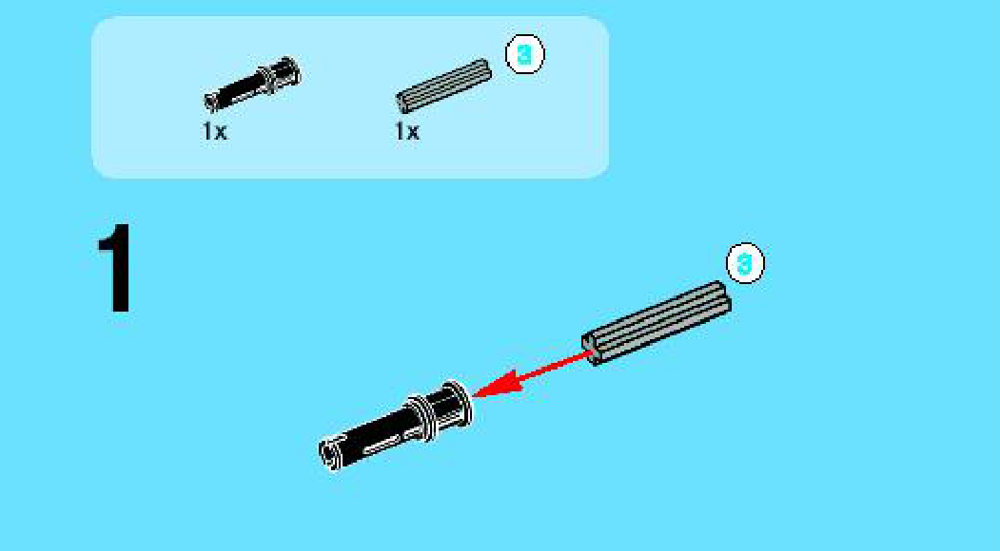

**New parts:** rod-A (32054, black) - first part; long pin lying left to right, ring (stop bush) end on the right; axle-A (4519, light bluish gray) - pushed into the axle hole in rod-A's ring end

**Touches:** axle-A goes into the axle hole in rod-A's ring end

**Exact joins:** axle-A.axle1 into rod-A.axlehole1 (1 hole deep, locked (turn together))

**Who does what:** rod-A holds axle-A

**After:** rod-A: start of the model; axle-A: sticking out of rod-A's ring end

**Why:** Starts a straight cross shaft for the middle of the undercarriage. A long pin with a stop ring has a pin on one end (to hang beams on) and an axle hole on the other (to join an axle). *Next:* rod-A's pin end will hold a bent beam (step 5) and a side rail (step 12). *Pattern:* pin-axle-pin shaft

**Big picture:**
- **rod-A** (Undercarriage frame): Left end of the back cross shaft; its pin end later carries the left bent beam (step 5) and the left side rail (step 12). Later: 8047-step-02 `DOES rod-A LOCKS beam-C`; 8047-step-05 `CONNECT rod-A.pin2 -> bentbeam-I.hole1 STIFF`; 8047-step-05 `DOES rod-A HOLDS bentbeam-I`; 8047-step-12 `CONNECT rod-A.pin2 -> beam9-X.hole?`; 8047-step-12 `DOES rod-A HOLDS beam9-X`.
- **axle-A** (Undercarriage frame): The spine of the cross shaft: carries beam-C in the middle and joins rod-A to rod-B. Later: 8047-step-02 `CONNECT axle-A.axle2 -> beam-C.axlehole1 LOCKED`; 8047-step-02 `CONNECT axle-A.axle3 -> rod-B.axlehole1 LOCKED`; 8047-step-02 `DOES axle-A CARRIES beam-C`; 8047-step-02 `DOES rod-B HOLDS axle-A`.

## 8047-step-02 (page 3) - high

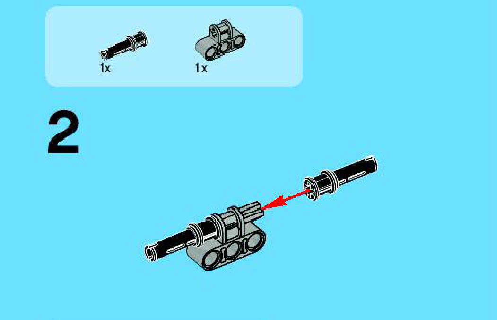

**New parts:** beam-C (63869, light bluish gray) - on axle-A next to rod-A's ring, three pin holes facing down; rod-B (32054, black) - on the free end of axle-A, ring end inward, pin end pointing out

**Touches:** beam-C slides onto axle-A through its top axle hole; rod-B's ring end pushes onto axle-A's free end

**Exact joins:** axle-A.axle2 into beam-C.axlehole1 (1 hole deep, locked (turn together)); axle-A.axle3 into rod-B.axlehole1 (1 hole deep, locked (turn together))

**Who does what:** axle-A carries beam-C; rod-B holds axle-A; rod-A and rod-B lock beam-C in place between their rings

**After:** rod-A, axle-A, rod-B: one straight shaft with a pin at each end; beam-C: in the middle of the shaft

**Why:** Finishes the cross shaft and gives it a mounting point in the middle. The triple connector turns one axle into three pin holes facing sideways; the two rings trap it so it can't slide. *Next:* beam-C's holes take the two pins that hold the turntable (steps 3 and 8). *Pattern:* trapped connector on a shaft

**Big picture:**
- **beam-C** (Undercarriage frame): Turns the cross shaft into pin holes facing back, so the turntable can be pinned to the frame (via pin-E, pin-F in step 8). Later: 8047-step-03 `CONNECT pin-E.pin1 -> beam-C.hole1 STIFF`; 8047-step-03 `CONNECT pin-F.pin1 -> beam-C.hole3 STIFF`; 8047-step-03 `DOES beam-C HOLDS pin-E`; 8047-step-03 `DOES beam-C HOLDS pin-F`.
- **rod-B** (Undercarriage frame): Right end of the cross shaft; carries the right bent beam (step 3) and right side rail (step 12). Later: 8047-step-03 `CONNECT rod-B.pin2 -> bentbeam-D.hole1 STIFF`; 8047-step-03 `DOES rod-B HOLDS bentbeam-D`; 8047-step-12 `CONNECT rod-B.pin2 -> beam9-Y.hole?`; 8047-step-12 `DOES rod-B HOLDS beam9-Y`.

## 8047-step-03 (page 3) - medium - NEEDS REVIEW

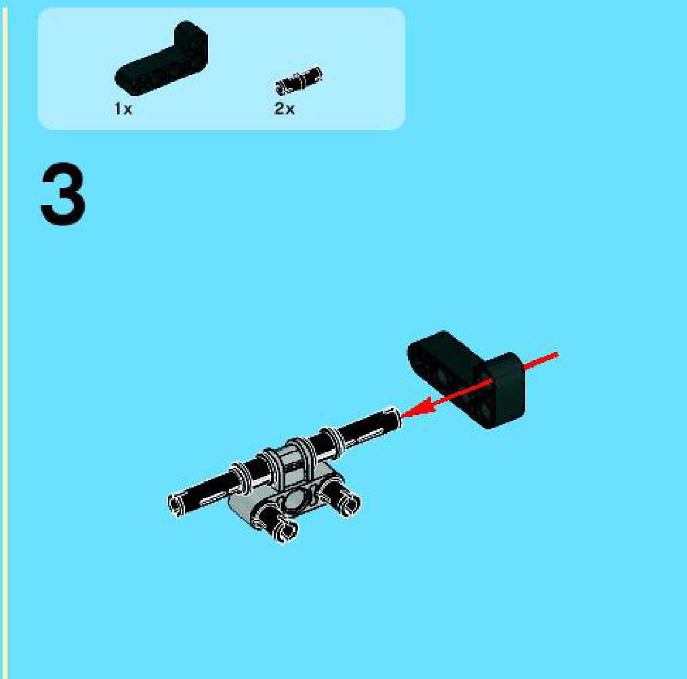

**New parts:** bentbeam-D (32140, black) - on rod-B's pin end, long arm pointing forward, short arm up at the shaft; pin-E (2780, black) - in one outer hole of beam-C, pointing backward; pin-F (2780, black) - in the other outer hole of beam-C, pointing backward

**Touches:** bentbeam-D's short-arm end hole slides over rod-B's pin end (red arrow); pin-E and pin-F go into beam-C's two outer pin holes

**Exact joins:** rod-B.pin2 into bentbeam-D.hole1 (0.9 hole deep, held stiff by friction); pin-E.pin1 into beam-C.hole1 (0.9 hole deep, held stiff by friction); pin-F.pin1 into beam-C.hole3 (0.9 hole deep, held stiff by friction)

**Who does what:** rod-B holds bentbeam-D; beam-C holds pin-E and pin-F

**After:** bentbeam-D: one side of the frame, pointing forward; pin-E, pin-F: sticking backward out of beam-C; everything else: no change

**Why:** Starts one side of the front frame and readies the turntable mount. An L-shaped beam goes up and over the shaft, then runs forward; two pins give a firm two-point grip. *Next:* pin-E and pin-F hold the turntable in step 8; bentbeam-D's front end takes a connector in step 4. *Pattern:* two-pin mount (stops twisting)

**Big picture:**
- **bentbeam-D** (Undercarriage frame): Right side of the front U; reaches forward to the front cross beam. Later: 8047-step-04 `CONNECT axle-red-G.axle1 -> bentbeam-D.hole?`; 8047-step-04 `DOES bentbeam-D HOLDS axle-red-G`; 8047-step-07 `DOES beam7-N SUPPORTS bentbeam-D`.
- **pin-E** (Undercarriage frame): One of the two pins the turntable's fixed half sits on (step 8). Later: 8047-step-08 `CONNECT pin-E.pin2 -> turntable-O.base.hole?`; 8047-step-08 `DOES pin-E HOLDS turntable-O`.
- **pin-F** (Undercarriage frame): The other turntable pin. Later: 8047-step-08 `CONNECT pin-F.pin2 -> turntable-O.base.hole?`; 8047-step-08 `DOES pin-F HOLDS turntable-O`.

**Review:** The two pins have no arrow; their holes are read from where they appear in the picture.

## 8047-step-04 (page 3) - high

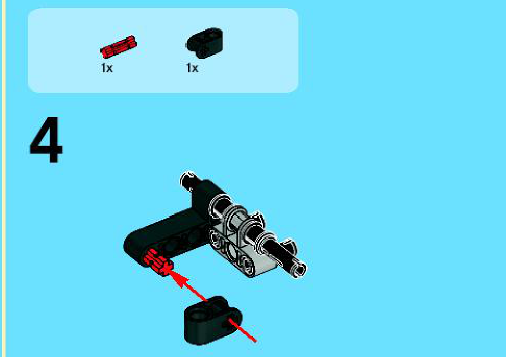

**New parts:** axle-red-G (32062, red) - in the axle hole at the front end of bentbeam-D (red + mark), pointing inward; connector-H (6536, black) - on the inner end of axle-red-G

**Touches:** axle-red-G goes into bentbeam-D's front axle hole; connector-H slides onto axle-red-G (red arrow)

**Exact joins:** axle-red-G.axle1 into bentbeam-D.hole? (not fully shown in booklet); connector-H.axlehole1 into axle-red-G.axle2 (1 hole deep, locked (turn together))

**Who does what:** bentbeam-D holds axle-red-G; axle-red-G carries connector-H

**After:** connector-H: at the front end of bentbeam-D; everything else: no change

**Why:** Gives the front corner a pin hole facing up. The connector has an axle hole and a pin hole at right angles, so it turns a sideways axle into an upward hole. *Next:* connector-H takes pin-L in step 6. *Pattern:* change direction with an axle-pin connector

**Big picture:**
- **axle-red-G** (Undercarriage frame): Short axle that fixes connector-H to bentbeam-D's front end without letting it turn.
- **connector-H** (Undercarriage frame): Turns the right front corner into an upward pin hole for pin-L. Later: 8047-step-06 `CONNECT pin-L.pin1 -> connector-H.hole1 STIFF`; 8047-step-06 `DOES connector-H HOLDS pin-L`.

## 8047-step-05 (page 4) - high

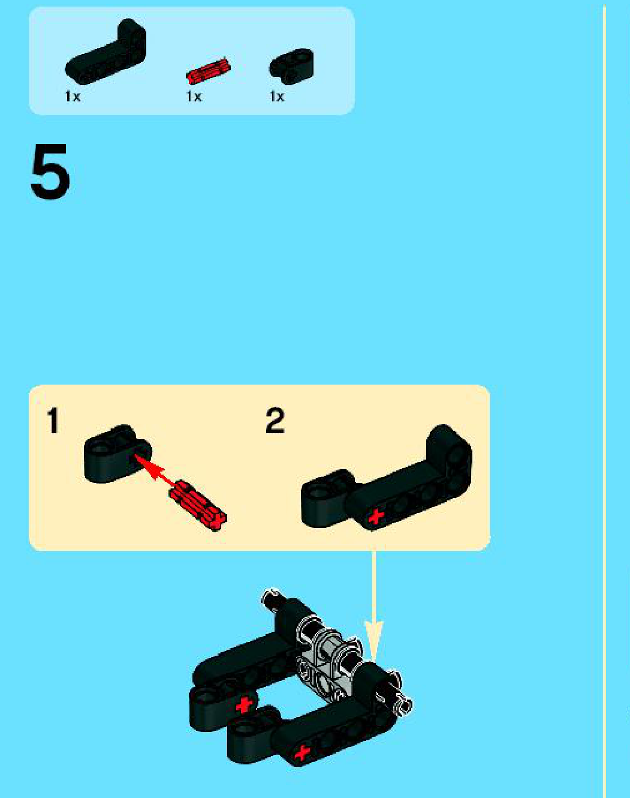

**New parts:** bentbeam-I (32140, black) - on rod-A's pin end, mirror of bentbeam-D, long arm pointing forward; axle-red-J (32062, red) - in bentbeam-I's front axle hole; connector-K (6536, black) - on axle-red-J, facing connector-H

**Touches:** side box: axle-red-J into connector-K (1), then into bentbeam-I's front axle hole (2); the finished mini build's short-arm hole goes over rod-A's pin end (cream arrow)

**Exact joins:** axle-red-J.axle1 into connector-K.axlehole1 (1 hole deep, locked (turn together)); axle-red-J.axle2 into bentbeam-I.hole? (not fully shown in booklet); rod-A.pin2 into bentbeam-I.hole1 (0.9 hole deep, held stiff by friction)

**Who does what:** connector-K holds axle-red-J; bentbeam-I holds axle-red-J; rod-A holds bentbeam-I

**After:** Model is a U: shaft at the back, bentbeam-D and bentbeam-I forward, a connector at each front corner; everything from steps 1-4: no change

**Why:** Builds the other side so the frame is the same on both sides. Same parts as steps 3-4, so the two sides match. *Next:* connector-K takes pin-M in step 6. *Pattern:* mirror the side (symmetry)

**Big picture:**
- **bentbeam-I** (Undercarriage frame): Left side of the front U, mirror of bentbeam-D. Later: 8047-step-07 `DOES beam7-N SUPPORTS bentbeam-I`.
- **axle-red-J** (Undercarriage frame): Mirror of axle-red-G on the left.
- **connector-K** (Undercarriage frame): Mirror of connector-H on the left, for pin-M. Later: 8047-step-06 `CONNECT pin-M.pin1 -> connector-K.hole1 STIFF`; 8047-step-06 `DOES connector-K HOLDS pin-M`.

## 8047-step-06 (page 4) - high

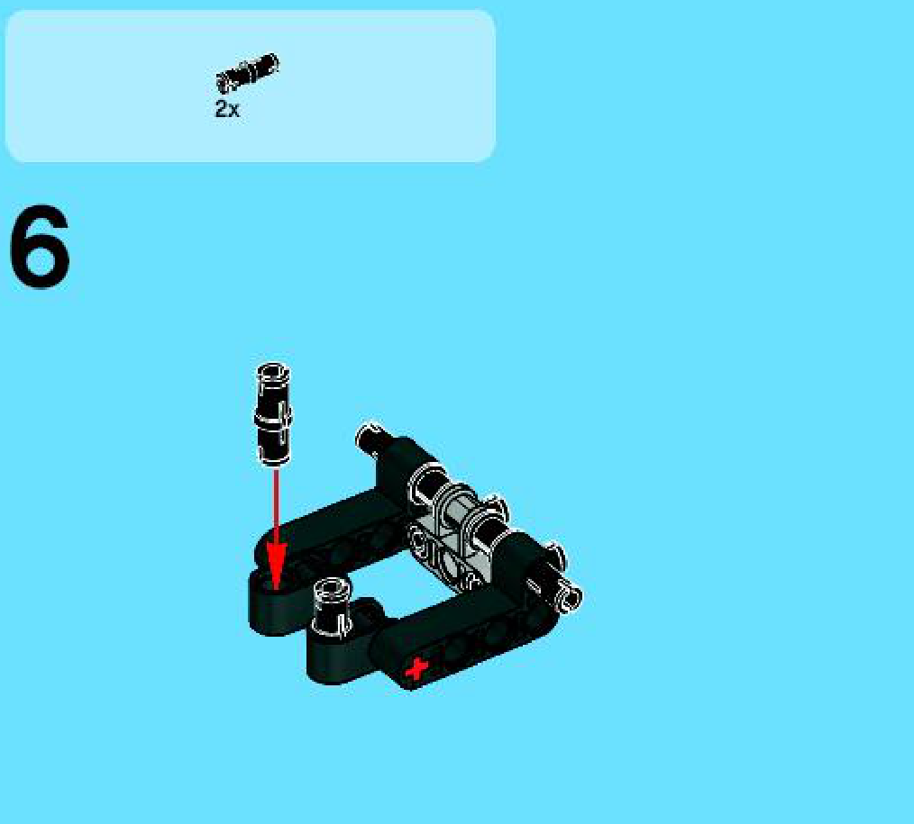

**New parts:** pin-L (2780, black) - pointing up out of connector-H; pin-M (2780, black) - pointing up out of connector-K

**Touches:** pin-L goes into connector-H's pin hole (red arrow); pin-M goes into connector-K's pin hole

**Exact joins:** pin-L.pin1 into connector-H.hole1 (0.9 hole deep, held stiff by friction); pin-M.pin1 into connector-K.hole1 (0.9 hole deep, held stiff by friction)

**Who does what:** connector-H holds pin-L; connector-K holds pin-M

**After:** two pins stick up from the front corners; everything else: no change

**Why:** Gives the front corners pegs to hang a crossbar on. Plain friction pins hold firmly without spinning loose. *Next:* beam7-N goes on these in step 7. *Pattern:* pegs for a crossbar

**Big picture:**
- **pin-L** (Undercarriage frame): Right front pin; holds the front cross beam beam7-N. Later: 8047-step-07 `CONNECT pin-L.pin2 -> beam7-N.hole?`; 8047-step-07 `DOES pin-L LOCKS beam7-N`.
- **pin-M** (Undercarriage frame): Left front pin; holds beam7-N. Later: 8047-step-07 `CONNECT pin-M.pin2 -> beam7-N.hole?`; 8047-step-07 `DOES pin-M LOCKS beam7-N`.

## 8047-step-07 (page 4) - high

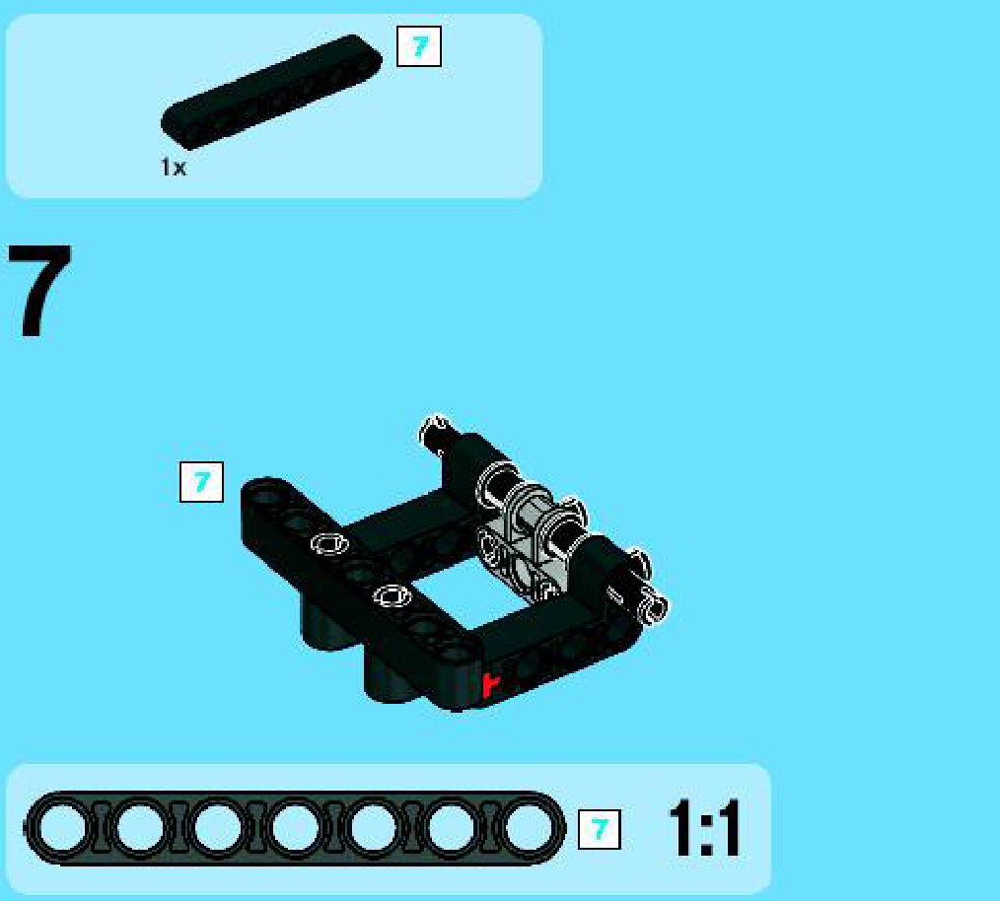

**New parts:** beam7-N (32524, black) - flat across the front, long side left to right, closing the U

**Touches:** two of beam7-N's holes slide down over pin-L and pin-M

**Exact joins:** pin-L.pin2 into beam7-N.hole? (not fully shown in booklet); pin-M.pin2 into beam7-N.hole? (not fully shown in booklet)

**Who does what:** pin-L and pin-M lock beam7-N in place; beam7-N supports bentbeam-D and bentbeam-I

**After:** the frame is now a closed rectangle; everything else: no change

**Why:** Closes the U so the two sides can't spread or twist. A 7-hole beam is long enough to span both front corners. *Next:* Its spare holes are free for later parts; not shown yet. *Pattern:* closed box frame

**Big picture:**
- **beam7-N** (Undercarriage frame): Front cross beam: closes the U into a rectangle so the frame can't spread under the turntable's weight.

## 8047-step-08 (page 5) - medium - NEEDS REVIEW

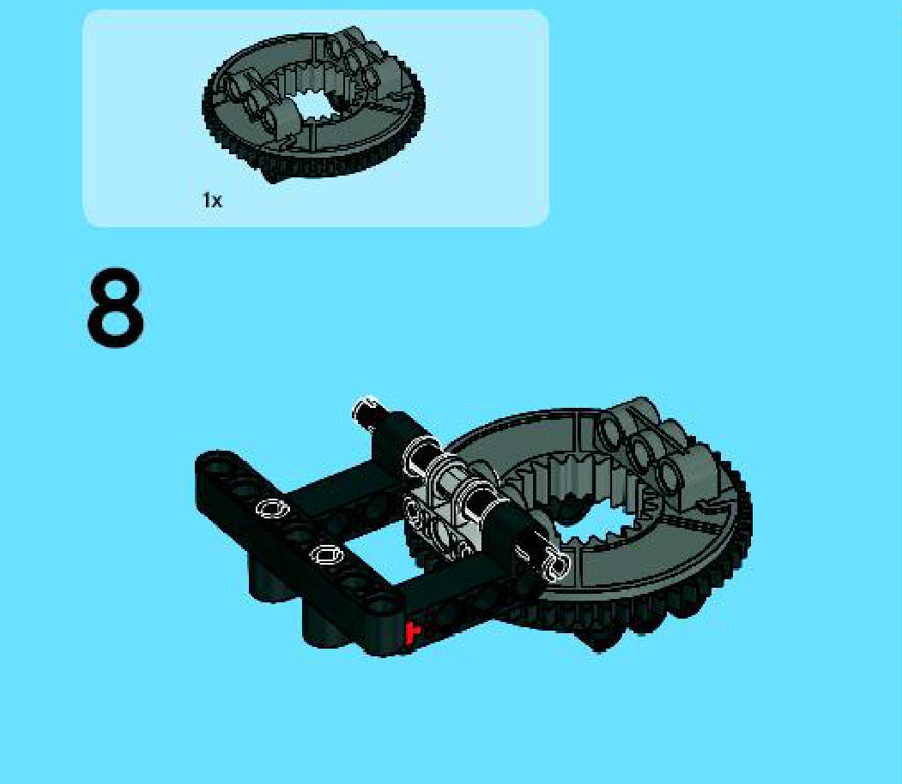

**New parts:** turntable-O (50163, dark bluish gray) - flat, just behind the shaft; grey half with the raised hole blocks toward the back, black-toothed half underneath

**Touches:** turntable-O's grey half pushes onto pin-E and pin-F

**Exact joins:** pin-E.pin2 into turntable-O.base.hole? (not fully shown in booklet); pin-F.pin2 into turntable-O.base.hole? (not fully shown in booklet)

**Who does what:** pin-E and pin-F hold turntable-O; turntable-O's black-toothed half spins on its grey half

**After:** turntable-O: behind the frame, grey half fixed to it; everything else: no change

**Why:** Adds the joint that lets the whole upper body turn all the way around. This big turntable has two halves that turn against each other, with 24 teeth inside and 56 outside for a gear to drive later. *Next:* The black-toothed half faces up once the model is flipped in step 16 and will carry the cab. *Pattern:* turntable joint between undercarriage and upper body

**Big picture:**
- **turntable-O** (Swing ring (turntable)): The joint between lower and upper machine: fixed half pinned to the chassis, turning half carries the whole upper body. Later: 8047-step-09 `CONNECT pin-P.pin1 -> turntable-O.base.hole?`; 8047-step-09 `CONNECT pin-Q.pin1 -> turntable-O.base.hole?`; 8047-step-09 `DOES turntable-O HOLDS pin-P`; 8047-step-09 `DOES turntable-O HOLDS pin-Q`; 8047-step-16 `CONNECT pinlong-1.pin1 -> turntable-O.top.hole?`; 8047-step-16 `CONNECT pinlong-2.pin1 -> turntable-O.top.hole?`; 8047-step-16 `DOES turntable-O HOLDS pinlong-1`; 8047-step-16 `DOES turntable-O HOLDS pinlong-2`; 8047-step-17 `DOES turntable-O SUPPORTS seat`.

**Review:** No arrow; the join to pin-E and pin-F is read from how the parts line up.

## 8047-step-09 (page 5) - high

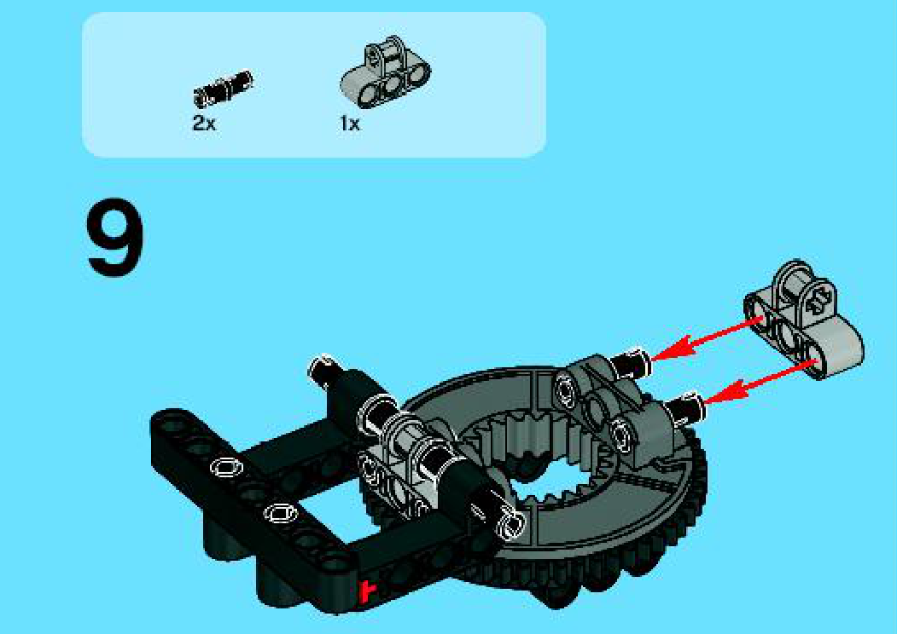

**New parts:** pin-P (2780, black) - in the turntable's raised hole block, pointing backward; pin-Q (2780, black) - next to pin-P in the same block; beam-R (63869, light bluish gray) - on pin-P and pin-Q at the back of the turntable, top axle hole facing sideways

**Touches:** pin-P and pin-Q go into the raised block's holes; beam-R's outer holes slide over pin-P and pin-Q (red arrows)

**Exact joins:** pin-P.pin1 into turntable-O.base.hole? (not fully shown in booklet); pin-Q.pin1 into turntable-O.base.hole? (not fully shown in booklet); pin-P.pin2 into beam-R.hole1 (0.9 hole deep, held stiff by friction); pin-Q.pin2 into beam-R.hole3 (0.9 hole deep, held stiff by friction)

**Who does what:** turntable-O holds pin-P and pin-Q; pin-P and pin-Q lock beam-R in place

**After:** beam-R: on the back of the turntable; everything else: no change

**Why:** Adds a back mounting point so the turntable is held at both front and back. The same triple connector as beam-C, now at the back, gives a matching axle hole for a back cross bar. *Next:* A cross axle goes through beam-R in step 10. *Pattern:* two-pin mount (stops twisting)

**Big picture:**
- **pin-P** (Undercarriage frame): Pins beam-R to the turntable's fixed half at the back.
- **pin-Q** (Undercarriage frame): Second pin for beam-R (two pins stop it twisting).
- **beam-R** (Undercarriage frame): Back mount: gives the back cross axle a hole and ties it to the turntable's fixed half. Later: 8047-step-10 `CONNECT axle-S.axle2 -> beam-R.axlehole1 LOCKED`; 8047-step-10 `DOES beam-R HOLDS axle-S`.

## 8047-step-10 (page 5) - high

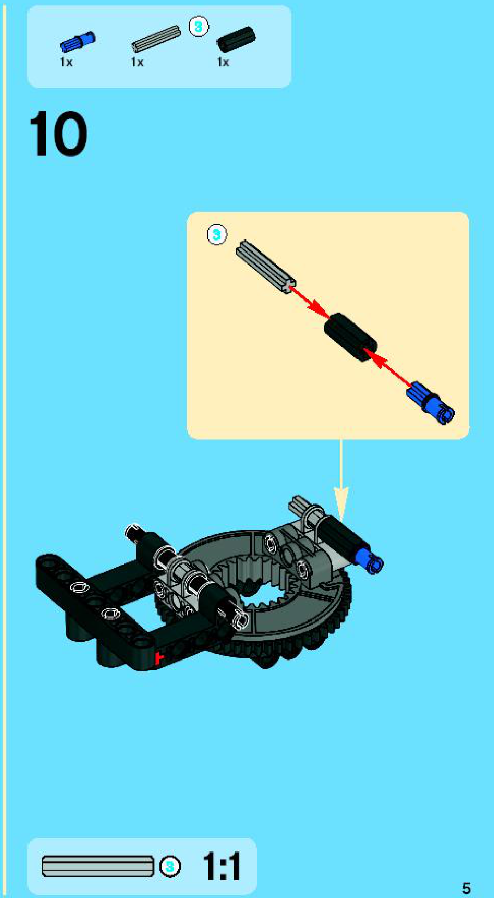

**New parts:** axle-S (4519, light bluish gray) - through beam-R's top axle hole, running left to right; connector-T (59443, black) - on axle-S's right end; pin-U (43093, blue) - in the outer end of connector-T, pin end pointing right

**Touches:** side box: axle-S into connector-T, then pin-U into connector-T's other end; the mini build's axle goes through beam-R's top hole (cream arrow)

**Exact joins:** axle-S.axle3 into connector-T.axlehole? (not fully shown in booklet); pin-U.axle1 into connector-T.axlehole? (not fully shown in booklet); axle-S.axle2 into beam-R.axlehole1 (1 hole deep, locked (turn together))

**Who does what:** beam-R holds axle-S; axle-S carries connector-T; connector-T holds pin-U

**After:** right half of the back cross bar done, blue pin pointing right; everything else: no change

**Why:** Starts a back cross bar reaching out to the right side rail. The axle connector extends the axle, and the blue axle pin turns its end into a pin for a beam to hang on. *Next:* pin-U holds the right side rail in step 12. *Pattern:* axle extended to a pin end

**Big picture:**
- **axle-S** (Undercarriage frame): Back cross axle; reaches out to both side rails. Later: 8047-step-11 `CONNECT axle-S.axle1 -> connector-W.axlehole?`; 8047-step-11 `DOES axle-S CARRIES connector-W`.
- **connector-T** (Undercarriage frame): Right end of the back cross axle; turns it into a pin end via pin-U.
- **pin-U** (Undercarriage frame): Right back pin; holds the right side rail beam9-Y. Later: 8047-step-12 `CONNECT pin-U.pin1 -> beam9-Y.hole?`; 8047-step-12 `DOES pin-U HOLDS beam9-Y`.

## 8047-step-11 (page 6) - high

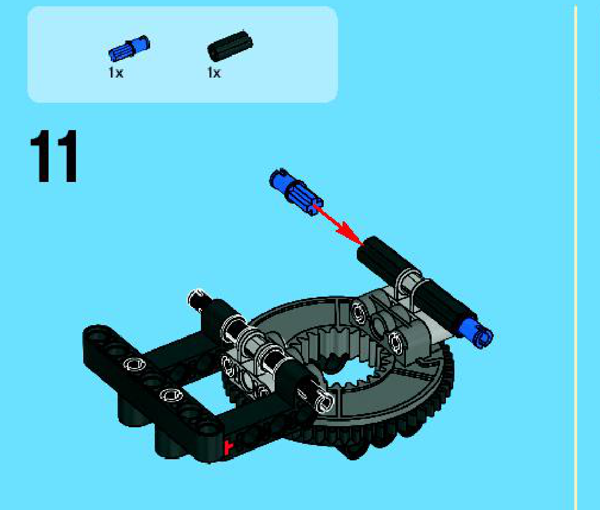

**New parts:** connector-W (59443, black) - on axle-S's left end; pin-V (43093, blue) - in the outer end of connector-W, pin end pointing left

**Touches:** connector-W slides onto axle-S's left end; pin-V goes into connector-W (red arrow)

**Exact joins:** axle-S.axle1 into connector-W.axlehole? (not fully shown in booklet); pin-V.axle1 into connector-W.axlehole? (not fully shown in booklet)

**Who does what:** axle-S carries connector-W; connector-W holds pin-V

**After:** back cross bar complete, a blue pin at each end; everything else: no change

**Why:** Finishes the back cross bar on the left side. Same parts as step 10, so both sides match. *Next:* pin-V holds the left side rail in step 12. *Pattern:* mirror the side (symmetry)

**Big picture:**
- **connector-W** (Undercarriage frame): Left end of the back cross axle; turns it into a pin end via pin-V.
- **pin-V** (Undercarriage frame): Left back pin; holds the left side rail beam9-X. Later: 8047-step-12 `CONNECT pin-V.pin1 -> beam9-X.hole?`; 8047-step-12 `DOES pin-V HOLDS beam9-X`.

## 8047-step-12 (page 6) - medium - NEEDS REVIEW

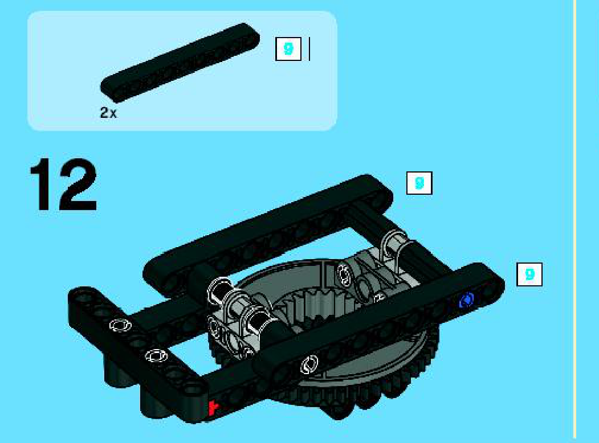

**New parts:** beam9-X (40490, black) - left side rail, front to back, over the shaft's left pin end and pin-V; beam9-Y (40490, black) - right side rail, front to back, over the shaft's right pin end and pin-U

**Touches:** each rail slides over one shaft pin end at the front and one blue pin at the back

**Exact joins:** rod-A.pin2 into beam9-X.hole? (not fully shown in booklet); pin-V.pin1 into beam9-X.hole? (not fully shown in booklet); rod-B.pin2 into beam9-Y.hole? (not fully shown in booklet); pin-U.pin1 into beam9-Y.hole? (not fully shown in booklet)

**Who does what:** the shaft's pin ends and pin-V hold beam9-X; the shaft's pin ends and pin-U hold beam9-Y; beam9-X and beam9-Y support the whole undercarriage

**After:** two long side rails tie the front frame, turntable and back cross bar together; everything else: no change

**Why:** Ties front and back into one stiff base and sets the track length. 9-hole beams reach from the shaft to the back cross bar with a hole left over at each end. *Next:* Their end holes take the four wheel axles in step 13. *Pattern:* side rails (track frame)

**Big picture:**
- **beam9-X** (Undercarriage frame): Left side rail: ties front and back of the frame together and carries the left track's two wheels. Later: 8047-step-13 `CONNECT tan-1.pin1 -> beam9-X.hole1 TURNS`; 8047-step-13 `CONNECT tan-2.pin1 -> beam9-X.hole9 TURNS`; 8047-step-13 `DOES tan-1 SPINS_ON beam9-X`; 8047-step-13 `DOES tan-2 SPINS_ON beam9-X`; 8047-step-15 `DOES beam9-X SUPPORTS track-left`.
- **beam9-Y** (Undercarriage frame): Right side rail, mirror of beam9-X. Later: 8047-step-13 `CONNECT tan-3.pin1 -> beam9-Y.hole1 TURNS`; 8047-step-13 `CONNECT tan-4.pin1 -> beam9-Y.hole9 TURNS`; 8047-step-13 `DOES tan-3 SPINS_ON beam9-Y`; 8047-step-13 `DOES tan-4 SPINS_ON beam9-Y`; 8047-step-15 `DOES beam9-Y SUPPORTS track-right`.

**Review:** Which rod (A or B) is on the left vs right is not clear from the angle change between steps 3 and 5.

## 8047-step-13 (page 6) - high

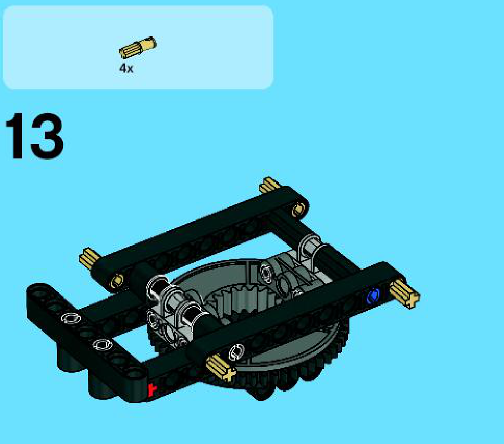

**New parts:** tan-1 (3749, tan) - front end hole of beam9-X, axle end pointing out; tan-2 (3749, tan) - back end hole of beam9-X, axle end pointing out; tan-3 (3749, tan) - front end hole of beam9-Y, axle end pointing out; tan-4 (3749, tan) - back end hole of beam9-Y, axle end pointing out

**Touches:** each tan pin's pin end goes into one end hole of a rail

**Exact joins:** tan-1.pin1 into beam9-X.hole1 (0.9 hole deep, turns freely); tan-2.pin1 into beam9-X.hole9 (0.9 hole deep, turns freely); tan-3.pin1 into beam9-Y.hole1 (0.9 hole deep, turns freely); tan-4.pin1 into beam9-Y.hole9 (0.9 hole deep, turns freely)

**Who does what:** tan-1 and tan-2 spin on beam9-X; tan-3 and tan-4 spin on beam9-Y

**After:** four axle ends stick out at the corners; everything else: no change

**Why:** Adds four wheel axles that turn freely. Tan pins have no friction ridges, so they spin easily; their axle ends will grip a gear. *Next:* Each takes a track wheel in step 14. *Pattern:* free-spinning axle (smooth pin)

**Big picture:**
- **tan-1** (Tracks): Frictionless axle pin: lets the front-left track wheel spin freely on the rail. Later: 8047-step-14 `CONNECT gear-1.axlehole1 -> tan-1.axle1 LOCKED`; 8047-step-14 `DOES tan-1 CARRIES gear-1`.
- **tan-2** (Tracks): Same, back-left wheel. Later: 8047-step-14 `CONNECT gear-2.axlehole1 -> tan-2.axle1 LOCKED`; 8047-step-14 `DOES tan-2 CARRIES gear-2`.
- **tan-3** (Tracks): Same, front-right wheel. Later: 8047-step-14 `CONNECT gear-3.axlehole1 -> tan-3.axle1 LOCKED`; 8047-step-14 `DOES tan-3 CARRIES gear-3`.
- **tan-4** (Tracks): Same, back-right wheel. Later: 8047-step-14 `CONNECT gear-4.axlehole1 -> tan-4.axle1 LOCKED`; 8047-step-14 `DOES tan-4 CARRIES gear-4`.

## 8047-step-14 (page 6) - high

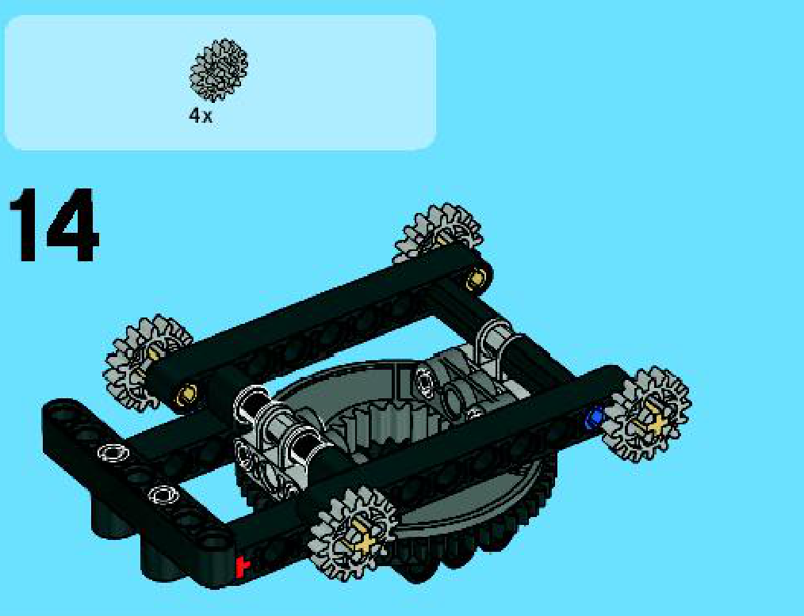

**New parts:** gear-1 (4019, light bluish gray) - on tan-1's axle end, outside the rail; gear-2 (4019, light bluish gray) - on tan-2's axle end, outside the rail; gear-3 (4019, light bluish gray) - on tan-3's axle end, outside the rail; gear-4 (4019, light bluish gray) - on tan-4's axle end, outside the rail

**Touches:** each gear's axle hole pushes onto one tan pin's axle end

**Exact joins:** gear-1.axlehole1 into tan-1.axle1 (1 hole deep, locked (turn together)); gear-2.axlehole1 into tan-2.axle1 (1 hole deep, locked (turn together)); gear-3.axlehole1 into tan-3.axle1 (1 hole deep, locked (turn together)); gear-4.axlehole1 into tan-4.axle1 (1 hole deep, locked (turn together))

**Who does what:** tan-1, tan-2, tan-3 and tan-4 each carry one gear

**After:** a 16-tooth gear at each corner; everything else: no change

**Why:** Adds the wheels the tracks run around. The tread links have teeth that mesh with a 16-tooth gear, so a gear works as a track wheel. *Next:* Step 15 wraps 28 track links around each pair of gears; nothing drives them, they roll when the model is pushed. *Pattern:* gears as track wheels (idlers)

**Big picture:**
- **gear-1** (Tracks): Front-left track wheel: its teeth sit in the tread links. Later: 8047-step-15 `MESH tread-?.teeth gear-1.teeth`; 8047-step-15 `DOES gear-1 HOLDS track-left`.
- **gear-2** (Tracks): Back-left track wheel. Later: 8047-step-15 `MESH tread-?.teeth gear-2.teeth`; 8047-step-15 `DOES gear-2 HOLDS track-left`.
- **gear-3** (Tracks): Front-right track wheel. Later: 8047-step-15 `MESH tread-?.teeth gear-3.teeth`; 8047-step-15 `DOES gear-3 HOLDS track-right`.
- **gear-4** (Tracks): Back-right track wheel. Later: 8047-step-15 `MESH tread-?.teeth gear-4.teeth`; 8047-step-15 `DOES gear-4 HOLDS track-right`.

## 8047-step-15 (page 7) - high

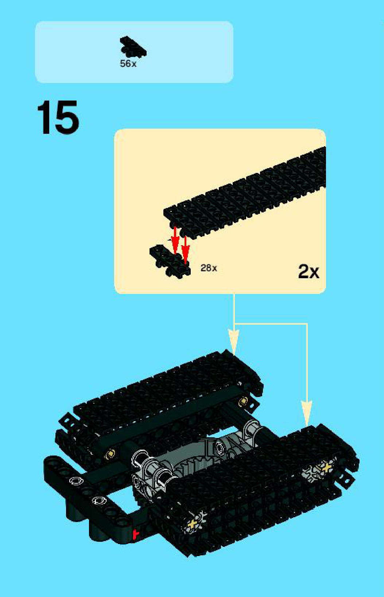

**New parts:** tread-1 (3873, black) - left track loop, link 1 of 28, around gear-1 and gear-2; tread-2 (3873, black) - left track loop, link 2 of 28, around gear-1 and gear-2; tread-3 (3873, black) - left track loop, link 3 of 28, around gear-1 and gear-2; tread-4 (3873, black) - left track loop, link 4 of 28, around gear-1 and gear-2; tread-5 (3873, black) - left track loop, link 5 of 28, around gear-1 and gear-2; tread-6 (3873, black) - left track loop, link 6 of 28, around gear-1 and gear-2; tread-7 (3873, black) - left track loop, link 7 of 28, around gear-1 and gear-2; tread-8 (3873, black) - left track loop, link 8 of 28, around gear-1 and gear-2; tread-9 (3873, black) - left track loop, link 9 of 28, around gear-1 and gear-2; tread-10 (3873, black) - left track loop, link 10 of 28, around gear-1 and gear-2; tread-11 (3873, black) - left track loop, link 11 of 28, around gear-1 and gear-2; tread-12 (3873, black) - left track loop, link 12 of 28, around gear-1 and gear-2; tread-13 (3873, black) - left track loop, link 13 of 28, around gear-1 and gear-2; tread-14 (3873, black) - left track loop, link 14 of 28, around gear-1 and gear-2; tread-15 (3873, black) - left track loop, link 15 of 28, around gear-1 and gear-2; tread-16 (3873, black) - left track loop, link 16 of 28, around gear-1 and gear-2; tread-17 (3873, black) - left track loop, link 17 of 28, around gear-1 and gear-2; tread-18 (3873, black) - left track loop, link 18 of 28, around gear-1 and gear-2; tread-19 (3873, black) - left track loop, link 19 of 28, around gear-1 and gear-2; tread-20 (3873, black) - left track loop, link 20 of 28, around gear-1 and gear-2; tread-21 (3873, black) - left track loop, link 21 of 28, around gear-1 and gear-2; tread-22 (3873, black) - left track loop, link 22 of 28, around gear-1 and gear-2; tread-23 (3873, black) - left track loop, link 23 of 28, around gear-1 and gear-2; tread-24 (3873, black) - left track loop, link 24 of 28, around gear-1 and gear-2; tread-25 (3873, black) - left track loop, link 25 of 28, around gear-1 and gear-2; tread-26 (3873, black) - left track loop, link 26 of 28, around gear-1 and gear-2; tread-27 (3873, black) - left track loop, link 27 of 28, around gear-1 and gear-2; tread-28 (3873, black) - left track loop, link 28 of 28, around gear-1 and gear-2; tread-29 (3873, black) - right track loop, link 1 of 28, around gear-3 and gear-4; tread-30 (3873, black) - right track loop, link 2 of 28, around gear-3 and gear-4; tread-31 (3873, black) - right track loop, link 3 of 28, around gear-3 and gear-4; tread-32 (3873, black) - right track loop, link 4 of 28, around gear-3 and gear-4; tread-33 (3873, black) - right track loop, link 5 of 28, around gear-3 and gear-4; tread-34 (3873, black) - right track loop, link 6 of 28, around gear-3 and gear-4; tread-35 (3873, black) - right track loop, link 7 of 28, around gear-3 and gear-4; tread-36 (3873, black) - right track loop, link 8 of 28, around gear-3 and gear-4; tread-37 (3873, black) - right track loop, link 9 of 28, around gear-3 and gear-4; tread-38 (3873, black) - right track loop, link 10 of 28, around gear-3 and gear-4; tread-39 (3873, black) - right track loop, link 11 of 28, around gear-3 and gear-4; tread-40 (3873, black) - right track loop, link 12 of 28, around gear-3 and gear-4; tread-41 (3873, black) - right track loop, link 13 of 28, around gear-3 and gear-4; tread-42 (3873, black) - right track loop, link 14 of 28, around gear-3 and gear-4; tread-43 (3873, black) - right track loop, link 15 of 28, around gear-3 and gear-4; tread-44 (3873, black) - right track loop, link 16 of 28, around gear-3 and gear-4; tread-45 (3873, black) - right track loop, link 17 of 28, around gear-3 and gear-4; tread-46 (3873, black) - right track loop, link 18 of 28, around gear-3 and gear-4; tread-47 (3873, black) - right track loop, link 19 of 28, around gear-3 and gear-4; tread-48 (3873, black) - right track loop, link 20 of 28, around gear-3 and gear-4; tread-49 (3873, black) - right track loop, link 21 of 28, around gear-3 and gear-4; tread-50 (3873, black) - right track loop, link 22 of 28, around gear-3 and gear-4; tread-51 (3873, black) - right track loop, link 23 of 28, around gear-3 and gear-4; tread-52 (3873, black) - right track loop, link 24 of 28, around gear-3 and gear-4; tread-53 (3873, black) - right track loop, link 25 of 28, around gear-3 and gear-4; tread-54 (3873, black) - right track loop, link 26 of 28, around gear-3 and gear-4; tread-55 (3873, black) - right track loop, link 27 of 28, around gear-3 and gear-4; tread-56 (3873, black) - right track loop, link 28 of 28, around gear-3 and gear-4

**Touches:** each link clips to the next (side box: 28 links per loop, make 2); the left loop wraps around gear-1 and gear-2, the right loop around gear-3 and gear-4; the gear teeth sit in the links

**Exact joins:** tread-1.end2? into tread-2.end1? (not fully shown in booklet); tread-2.end2? into tread-3.end1? (not fully shown in booklet); tread-3.end2? into tread-4.end1? (not fully shown in booklet); tread-4.end2? into tread-5.end1? (not fully shown in booklet); tread-5.end2? into tread-6.end1? (not fully shown in booklet); tread-6.end2? into tread-7.end1? (not fully shown in booklet); tread-7.end2? into tread-8.end1? (not fully shown in booklet); tread-8.end2? into tread-9.end1? (not fully shown in booklet); tread-9.end2? into tread-10.end1? (not fully shown in booklet); tread-10.end2? into tread-11.end1? (not fully shown in booklet); tread-11.end2? into tread-12.end1? (not fully shown in booklet); tread-12.end2? into tread-13.end1? (not fully shown in booklet); tread-13.end2? into tread-14.end1? (not fully shown in booklet); tread-14.end2? into tread-15.end1? (not fully shown in booklet); tread-15.end2? into tread-16.end1? (not fully shown in booklet); tread-16.end2? into tread-17.end1? (not fully shown in booklet); tread-17.end2? into tread-18.end1? (not fully shown in booklet); tread-18.end2? into tread-19.end1? (not fully shown in booklet); tread-19.end2? into tread-20.end1? (not fully shown in booklet); tread-20.end2? into tread-21.end1? (not fully shown in booklet); tread-21.end2? into tread-22.end1? (not fully shown in booklet); tread-22.end2? into tread-23.end1? (not fully shown in booklet); tread-23.end2? into tread-24.end1? (not fully shown in booklet); tread-24.end2? into tread-25.end1? (not fully shown in booklet); tread-25.end2? into tread-26.end1? (not fully shown in booklet); tread-26.end2? into tread-27.end1? (not fully shown in booklet); tread-27.end2? into tread-28.end1? (not fully shown in booklet); tread-28.end2? into tread-1.end1? (not fully shown in booklet); tread-29.end2? into tread-30.end1? (not fully shown in booklet); tread-30.end2? into tread-31.end1? (not fully shown in booklet); tread-31.end2? into tread-32.end1? (not fully shown in booklet); tread-32.end2? into tread-33.end1? (not fully shown in booklet); tread-33.end2? into tread-34.end1? (not fully shown in booklet); tread-34.end2? into tread-35.end1? (not fully shown in booklet); tread-35.end2? into tread-36.end1? (not fully shown in booklet); tread-36.end2? into tread-37.end1? (not fully shown in booklet); tread-37.end2? into tread-38.end1? (not fully shown in booklet); tread-38.end2? into tread-39.end1? (not fully shown in booklet); tread-39.end2? into tread-40.end1? (not fully shown in booklet); tread-40.end2? into tread-41.end1? (not fully shown in booklet); tread-41.end2? into tread-42.end1? (not fully shown in booklet); tread-42.end2? into tread-43.end1? (not fully shown in booklet); tread-43.end2? into tread-44.end1? (not fully shown in booklet); tread-44.end2? into tread-45.end1? (not fully shown in booklet); tread-45.end2? into tread-46.end1? (not fully shown in booklet); tread-46.end2? into tread-47.end1? (not fully shown in booklet); tread-47.end2? into tread-48.end1? (not fully shown in booklet); tread-48.end2? into tread-49.end1? (not fully shown in booklet); tread-49.end2? into tread-50.end1? (not fully shown in booklet); tread-50.end2? into tread-51.end1? (not fully shown in booklet); tread-51.end2? into tread-52.end1? (not fully shown in booklet); tread-52.end2? into tread-53.end1? (not fully shown in booklet); tread-53.end2? into tread-54.end1? (not fully shown in booklet); tread-54.end2? into tread-55.end1? (not fully shown in booklet); tread-55.end2? into tread-56.end1? (not fully shown in booklet); tread-56.end2? into tread-29.end1? (not fully shown in booklet)

**Who does what:** gear-1 and gear-2 hold the left loop tight; gear-3 and gear-4 hold the right loop tight; beam9-X supports the left loop through gear-1 and gear-2; beam9-Y supports the right loop through gear-3 and gear-4

**After:** a closed track loop on each side; everything else: no change

**Why:** Gives the excavator its tracks. Tread links clip into a loop of any length and their teeth fit a 16-tooth gear, so two gears per side make a track. *Next:* The undercarriage is finished; step 16 flips it over to build the top. *Pattern:* track loop around two idler gears

**Big picture:**
- **tread-1** (Tracks): One link of a track loop; 28 links make a loop just long enough to wrap two 16-tooth wheels tightly.
- **tread-29** (Tracks): One link of a track loop; 28 links make a loop just long enough to wrap two 16-tooth wheels tightly.

## 8047-step-16 (page 7) - medium - NEEDS REVIEW

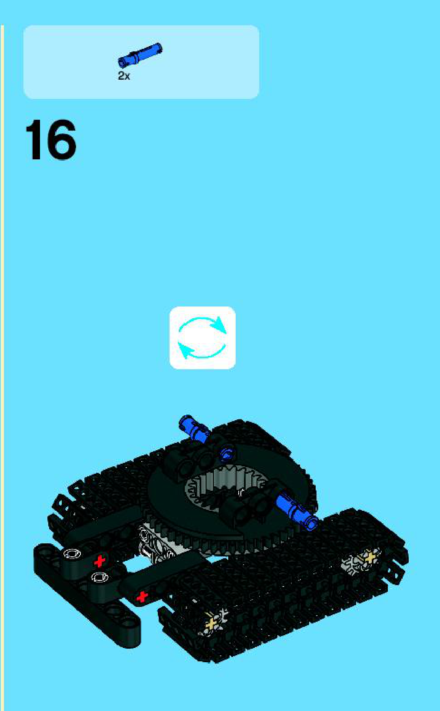

**New parts:** pinlong-1 (6558, blue) - back raised hole block on turntable-O's top half, pointing out to the side; pinlong-2 (6558, blue) - front raised hole block on turntable-O's top half, pointing out to the other side

**Touches:** the model is flipped over (turn-over symbol): turntable-O's black toothed half now faces up; pinlong-1 and pinlong-2 each push halfway into a hole block on turntable-O's top half

**Exact joins:** pinlong-1.pin1 into turntable-O.top.hole? (not fully shown in booklet); pinlong-2.pin1 into turntable-O.top.hole? (not fully shown in booklet)

**Who does what:** turntable-O holds pinlong-1 and pinlong-2

**After:** model right side up, tracks on the ground; turntable-O: the turning half is on top; everything else: no change

**Why:** Gives the turning half of the turntable two mounting pins. Long pins stick out far enough to take a beam on their free half. *Next:* The seat frame drops onto them in step 17. *Pattern:* pins as mounting posts

**Big picture:**
- **pinlong-1** (Swing ring (turntable)): Mounting post on the turning half: holds the seat frame (steps 17-18) and the left side frame (step 24). Later: 8047-step-17 `CONNECT pinlong-1.pin3 -> lbeam-s3.hole?`; 8047-step-17 `DOES pinlong-1 HOLDS seat`; 8047-step-18 `CONNECT pinlong-1.pin3 -> lbeam-s3.hole?`; 8047-step-18 `DOES pinlong-1 LOCKS seat`; 8047-step-24 `CONNECT pinlong-1.pin3 -> bent11-B.hole1 STIFF`; 8047-step-24 `DOES pinlong-1 HOLDS bent11-B`.
- **pinlong-2** (Swing ring (turntable)): Second mounting post on the turning half for the seat frame. Later: 8047-step-17 `CONNECT pinlong-2.pin3 -> lbeam-s4.hole?`; 8047-step-17 `DOES pinlong-2 HOLDS seat`; 8047-step-18 `CONNECT pinlong-2.pin3 -> lbeam-s4.hole?`; 8047-step-18 `DOES pinlong-2 LOCKS seat`.

**Review:** No arrows: which hole of each block the pins use is read from the picture only.

## 8047-seat-step-01 (page 8) - medium - NEEDS REVIEW

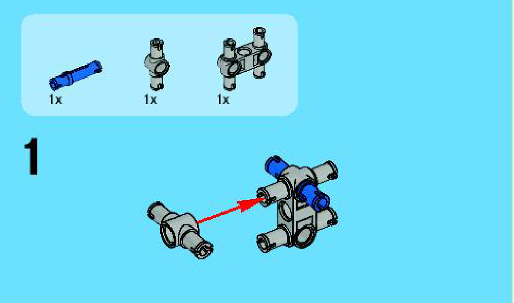

**New parts:** hub4-s (48989, light bluish gray) - first part of the seat build, four pins pointing out; pin-s1 (6558, blue) - in hub4-s's middle hole, sticking out the front; hub2-s (87082, light bluish gray) - pushed onto hub4-s's side pin (red arrow)

**Touches:** pin-s1 goes into the middle hole of hub4-s; hub2-s's hole slides over one side pin of hub4-s

**Exact joins:** pin-s1.pin1 into hub4-s.hole? (not fully shown in booklet); hub2-s.hole1 into hub4-s.pin? (not fully shown in booklet)

**Who does what:** hub4-s holds pin-s1; hub4-s holds hub2-s

**After:** hub4-s, pin-s1, hub2-s: a small block with pins pointing in several directions

**Why:** Starts the seat frame with a block that has pins pointing in many directions. Hub connectors turn one spot into pins facing three ways, so beams can be added at right angles. *Next:* The blue L-beams go on these pins in steps 2 and 4. *Pattern:* pin hub core

**Big picture:**
- **hub4-s** (Upper frame and seat): Core block of the seat: pins in many directions let the seat back and the axle holders join at right angles. Later: 8047-seat-step-02 `CONNECT lbeam-s1.hole? -> hub4-s.pin?`; 8047-seat-step-02 `DOES hub4-s HOLDS lbeam-s1`; 8047-seat-step-05 `CONNECT block-s.hole1 -> hub4-s.pin?`; 8047-seat-step-05 `CONNECT conn-s1.pinhole? -> hub4-s.pin?`; 8047-seat-step-05 `DOES hub4-s HOLDS block-s`; 8047-seat-step-05 `DOES hub4-s HOLDS conn-s1`.
- **pin-s1** (Upper frame and seat): Pin in the hub core; part of the seat's mounting.
- **hub2-s** (Upper frame and seat): Adds more pins to the core so the seat parts lock together.

**Review:** pin-s1 is already in hub4-s in the picture with no arrow; which hole it uses is a guess.

## 8047-seat-step-02 (page 8) - high

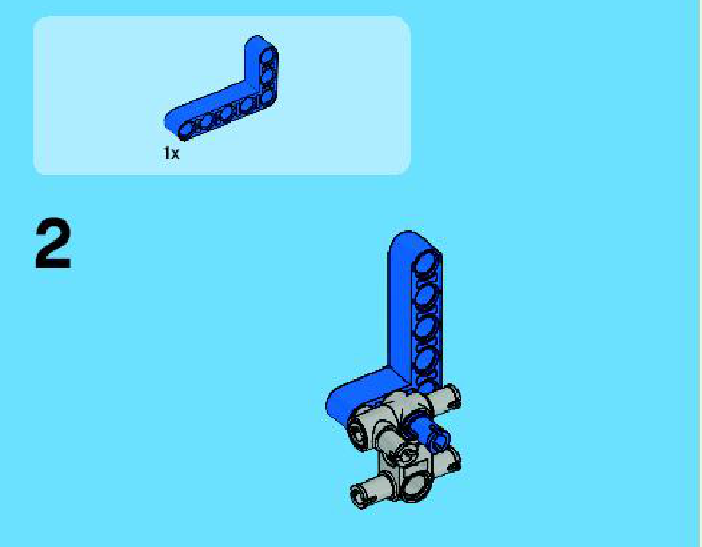

**New parts:** lbeam-s1 (32526, blue) - short arm flat at the bottom over the hub pins, long arm standing up

**Touches:** lbeam-s1's short-arm holes go over the hub pins

**Exact joins:** lbeam-s1.hole? into hub4-s.pin? (not fully shown in booklet)

**Who does what:** hub4-s holds lbeam-s1

**After:** lbeam-s1: upright, forms the back of the seat; everything else: no change

**Why:** Adds the seat back. An L-beam gives a seat and a back in one part. *Next:* Step 3 puts a beam beside its long arm. *Pattern:* L-beam as seat

**Big picture:**
- **lbeam-s1** (Upper frame and seat): Seat back and seat in one part. Later: 8047-seat-step-03 `CONNECT beam5-s.hole? -> lbeam-s1.hole?`; 8047-seat-step-03 `DOES lbeam-s1 SUPPORTS beam5-s`.

## 8047-seat-step-03 (page 8) - medium - NEEDS REVIEW

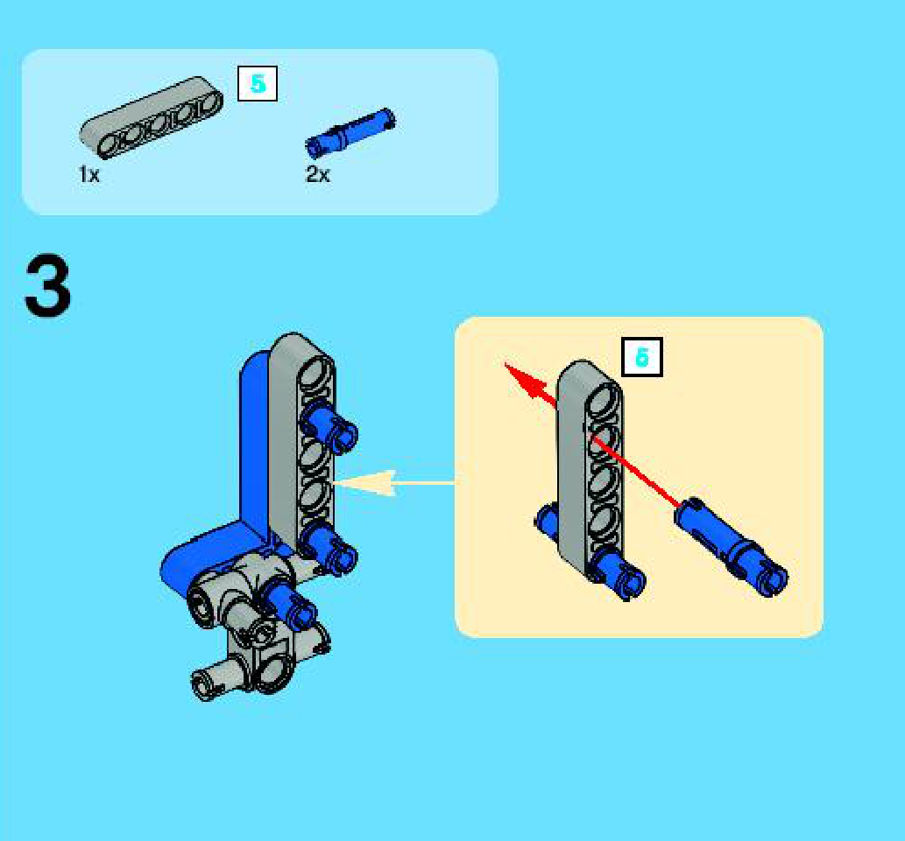

**New parts:** beam5-s (32316, light bluish gray) - standing up beside lbeam-s1's long arm; pin-s2 (6558, blue) - through a hole of beam5-s, half sticking out the front; pin-s3 (6558, blue) - through another hole of beam5-s, half sticking out the front

**Touches:** side box: pin-s2 and pin-s3 push through beam5-s; beam5-s goes against lbeam-s1's long arm

**Exact joins:** pin-s2.pin1 into beam5-s.hole2 (0.9 hole deep, held stiff by friction); pin-s3.pin1 into beam5-s.hole4 (0.9 hole deep, held stiff by friction); beam5-s.hole? into lbeam-s1.hole? (not fully shown in booklet)

**Who does what:** beam5-s holds pin-s2 and pin-s3; lbeam-s1 supports beam5-s

**After:** beam5-s: upright next to the seat back, two pins sticking forward; everything else: no change

**Why:** Thickens the seat back and gives it two forward pins. A straight 5-beam lines up with the L-beam's long arm. *Next:* The second blue L-beam goes on pin-s2 and pin-s3 in step 4. *Pattern:* doubled upright

**Big picture:**
- **beam5-s** (Upper frame and seat): Thickens the seat back and carries the two pins for the second blue L.
- **pin-s2** (Upper frame and seat): Holds the second seat L-beam. Later: 8047-seat-step-04 `CONNECT pin-s2.pin3 -> lbeam-s2.hole?`; 8047-seat-step-04 `DOES pin-s2 LOCKS lbeam-s2`.
- **pin-s3** (Upper frame and seat): Second pin for the second seat L-beam. Later: 8047-seat-step-04 `CONNECT pin-s3.pin3 -> lbeam-s2.hole?`; 8047-seat-step-04 `DOES pin-s3 LOCKS lbeam-s2`.

**Review:** Which holes of beam5-s the pins use, and how beam5-s is held to lbeam-s1, is not clear.

## 8047-seat-step-04 (page 8) - medium

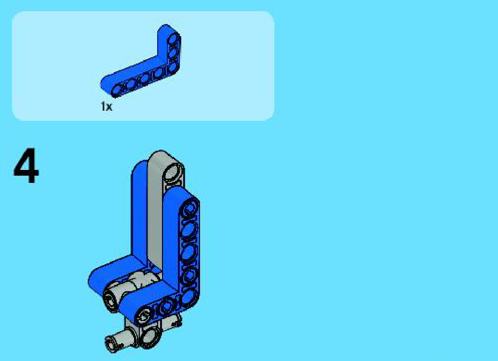

**New parts:** lbeam-s2 (32526, blue) - in front of beam5-s, same shape as lbeam-s1

**Touches:** lbeam-s2's long arm goes over pin-s2 and pin-s3; its short arm over the hub pin

**Exact joins:** pin-s2.pin3 into lbeam-s2.hole? (not fully shown in booklet); pin-s3.pin3 into lbeam-s2.hole? (not fully shown in booklet)

**Who does what:** pin-s2 and pin-s3 lock lbeam-s2 in place; hub4-s holds lbeam-s2

**After:** seat: two blue L-beams with the gray beam between them; everything else: no change

**Why:** Closes the seat into a solid block. Same L-beam as step 2, mirrored around the gray beam. *Next:* The seat sits on top of the frame built in steps 5-11. *Pattern:* mirror the side

**Big picture:**
- **lbeam-s2** (Upper frame and seat): Second seat L-beam; makes the seat a solid block.

## 8047-seat-step-05 (page 9) - medium - NEEDS REVIEW

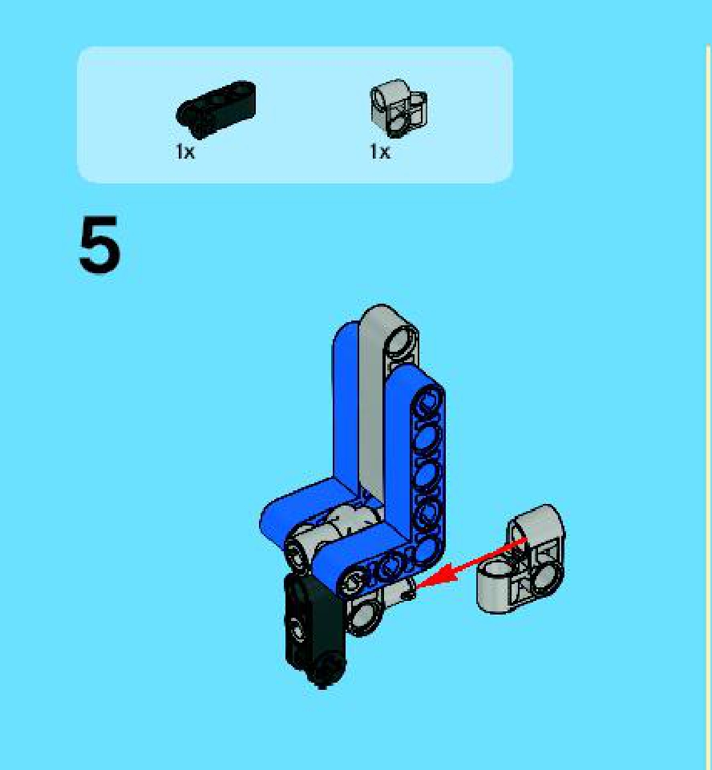

**New parts:** conn-s1 (42003, black) - under the seat, hanging down; block-s (60483, light bluish gray) - on the hub's pin sticking out the right side (red arrow)

**Touches:** block-s's pin hole slides onto a hub pin on the right; conn-s1 sits under the seat on a hub pin

**Exact joins:** block-s.hole1 into hub4-s.pin? (not fully shown in booklet); conn-s1.pinhole? into hub4-s.pin? (not fully shown in booklet)

**Who does what:** hub4-s holds block-s; hub4-s holds conn-s1

**After:** two axle holes now under the seat; everything else: no change

**Why:** Adds axle holes under the seat. These connectors change pins into axle holes. *Next:* Axles go through them in steps 6 and 10. *Pattern:* pin to axle-hole adapter

**Big picture:**
- **conn-s1** (Upper frame and seat): Gives the first cross axle axle9-s1 its hole under the seat. Later: 8047-seat-step-06 `CONNECT axle9-s1.axle5 -> conn-s1.axlehole1 LOCKED`; 8047-seat-step-06 `DOES conn-s1 HOLDS axle9-s1`.
- **block-s** (Upper frame and seat): Gives the gear shaft axle7-s its hole under the seat. Later: 8047-seat-step-07 `CONNECT axle7-s.axle4 -> block-s.axlehole1 LOCKED`.

**Review:** conn-s1 has no arrow; its place is read from the picture.

## 8047-seat-step-06 (page 9) - high

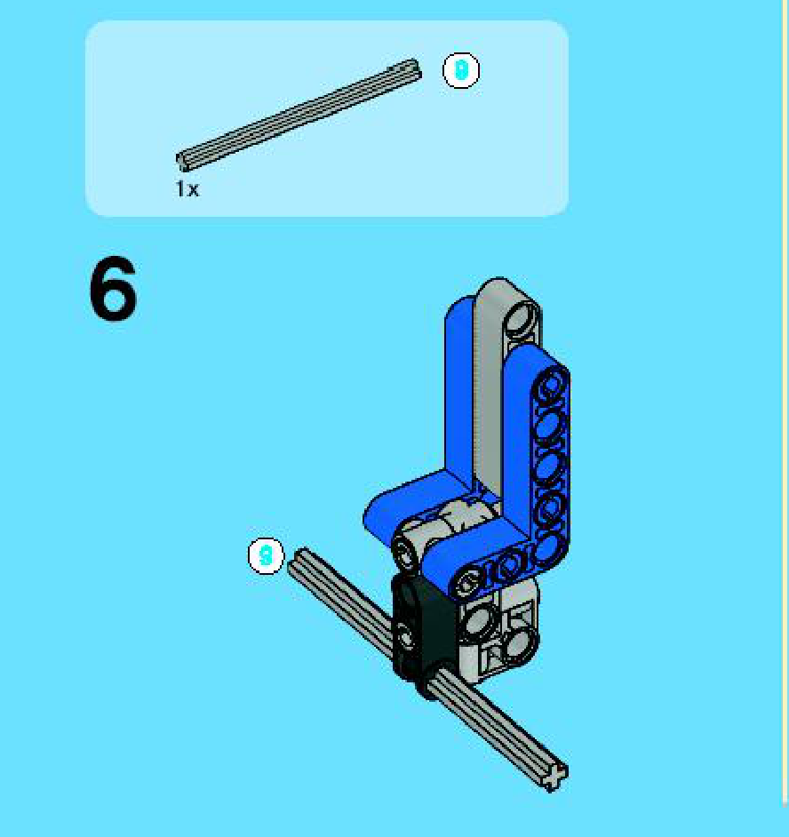

**New parts:** axle9-s1 (60485, light bluish gray) - under the seat, running front-left to back-right through conn-s1

**Touches:** axle9-s1 goes through conn-s1's axle hole

**Exact joins:** axle9-s1.axle5 into conn-s1.axlehole1 (1 hole deep, locked (turn together))

**Who does what:** conn-s1 holds axle9-s1

**After:** axle9-s1 sticks out both sides under the seat; everything else: no change

**Why:** Adds the first cross bar of the seat frame. A long axle reaches both side beams of the frame. *Next:* Its ends take the dark gray L-beams in steps 8 and 11. *Pattern:* axle as cross bar

**Big picture:**
- **axle9-s1** (Upper frame and seat): Cross bar of the upper frame: carries both side plates and later conn3c-1. Later: 8047-seat-step-08 `CONNECT axle9-s1.axle1 -> lbeam-s3.hole?`; 8047-seat-step-08 `DOES axle9-s1 CARRIES lbeam-s3`; 8047-seat-step-09 `CONNECT bush-s2.axlehole1 -> axle9-s1.axle1 LOCKED`; 8047-seat-step-11 `CONNECT axle9-s1.axle9 -> lbeam-s4.hole?`; 8047-seat-step-11 `DOES axle9-s1 CARRIES lbeam-s4`; 8047-step-22 `CONNECT conn3c-1.axlehole1 -> axle9-s1.axle9 LOCKED`; 8047-step-22 `DOES conn3c-1 HOLDS axle9-s1`.

## 8047-seat-step-07 (page 9) - medium - NEEDS REVIEW

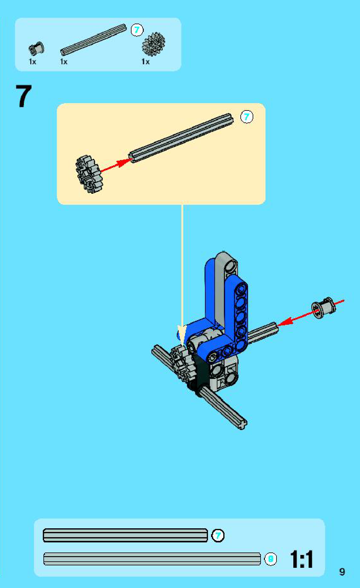

**New parts:** gear-5 (4019, light bluish gray) - on one end of axle7-s (side box), on the left side; axle7-s (44294, light bluish gray) - through the axle hole in block-s, running left to right; bush-s1 (3713, light bluish gray) - on axle7-s's right end (red arrow)

**Touches:** side box: gear-5 slides onto axle7-s; axle7-s goes through block-s; bush-s1 pushes onto axle7-s's right end

**Exact joins:** gear-5.axlehole1 into axle7-s.axle1 (1 hole deep, locked (turn together)); axle7-s.axle4 into block-s.axlehole1 (1 hole deep, locked (turn together)); bush-s1.axlehole1 into axle7-s.axle7 (1 hole deep, locked (turn together))

**Who does what:** axle7-s carries gear-5; bush-s1 locks axle7-s in place

**After:** a gear on the left, an axle running left to right under the seat; everything else: no change

**Why:** Adds a turning shaft with a gear. A bush keeps an axle from sliding out without stopping it from turning. *Next:* A 24-tooth crown gear goes on this shaft in step 11. *Pattern:* shaft with gear and stop bush

**Big picture:**
- **gear-5** (Front worm drive (knob-2)): Passes the shaft's turning to gear-6 (1:1). Later: 8047-step-22 `MESH gear-5.teeth gear-6.teeth`; 8047-step-22 `RATIO gear-5 gear-6 16/16`; 8047-step-22 `DOES gear-5 DRIVES gear-6`.
- **axle7-s** (Front worm drive (knob-2)): Shaft under the seat: carries crown-1 and gear-5, passing the worm's turning across to the left side. Later: 8047-seat-step-11 `CONNECT crown-1.axlehole1 -> axle7-s.axle7 LOCKED`; 8047-seat-step-11 `DOES axle7-s CARRIES crown-1`; 8047-step-28 `CONNECT bush-28.axlehole1 -> axle7-s.axle7 LOCKED`; 8047-step-28 `DOES bush-28 LOCKS axle7-s`.
- **bush-s1** (Front worm drive (knob-2)): Stops axle7-s sliding.

**Review:** Whether axle7-s turns freely in block-s depends on block-s's hole type; check in a 3D view.

## 8047-seat-step-08 (page 10) - medium - NEEDS REVIEW

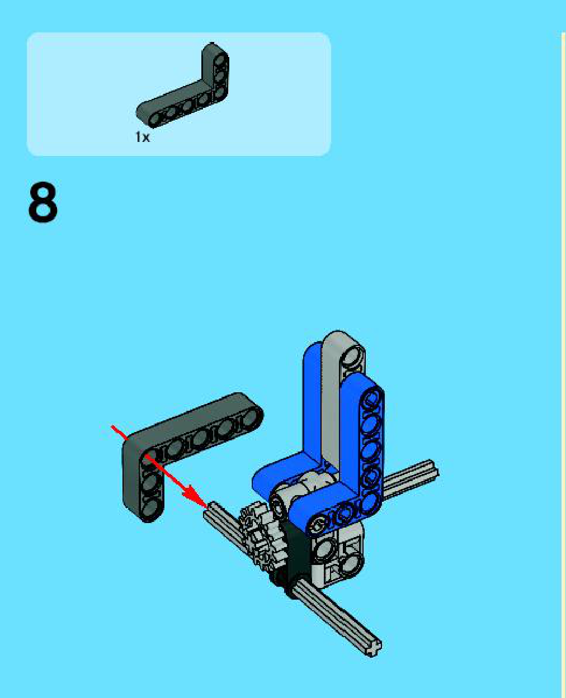

**New parts:** lbeam-s3 (32526, dark bluish gray) - on the left end of axle9-s1, short arm down, long arm running back

**Touches:** lbeam-s3's corner hole goes onto axle9-s1's left end (red arrow)

**Exact joins:** axle9-s1.axle1 into lbeam-s3.hole? (not fully shown in booklet)

**Who does what:** axle9-s1 carries lbeam-s3

**After:** lbeam-s3: left side of the seat frame; everything else: no change

**Why:** Adds the left side of the seat frame. An L-beam gives a side and a leg in one part. *Next:* Its leg rests on the turntable in step 17. *Pattern:* L-beam side plate

**Big picture:**
- **lbeam-s3** (Upper frame and seat): Left side plate of the upper frame; its leg goes on pinlong-1 to fix the frame to the turntable. Later: 8047-seat-step-09 `DOES bush-s2 LOCKS lbeam-s3`; 8047-seat-step-10 `CONNECT axle9-s2.axle1 -> lbeam-s3.hole?`; 8047-seat-step-10 `DOES lbeam-s3 HOLDS axle9-s2`; 8047-step-17 `CONNECT pinlong-1.pin3 -> lbeam-s3.hole?`; 8047-step-18 `CONNECT pinlong-1.pin3 -> lbeam-s3.hole?`.

**Review:** Which hole of lbeam-s3 takes the axle is not clear.

## 8047-seat-step-09 (page 10) - high

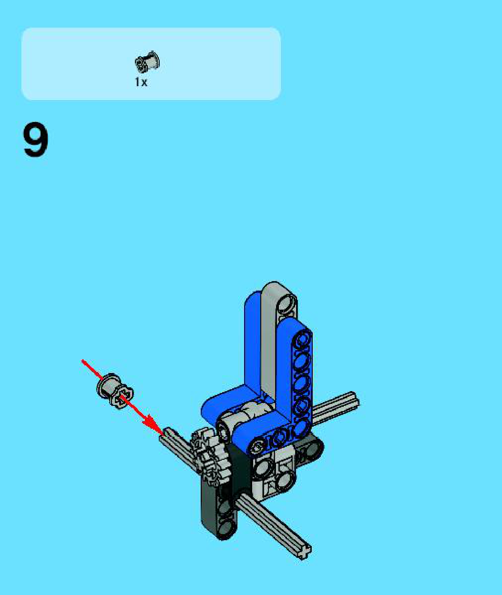

**New parts:** bush-s2 (3713, light bluish gray) - on the left end of axle9-s1, outside lbeam-s3

**Touches:** bush-s2 pushes onto axle9-s1's left end

**Exact joins:** bush-s2.axlehole1 into axle9-s1.axle1 (1 hole deep, locked (turn together))

**Who does what:** bush-s2 locks lbeam-s3 in place

**After:** everything: no change

**Why:** Stops lbeam-s3 sliding off. A bush grips the axle end. *Next:* Nothing else goes on this end. *Pattern:* bush as end stop

**Big picture:**
- **bush-s2** (Upper frame and seat): Stops lbeam-s3 sliding off axle9-s1.

## 8047-seat-step-10 (page 11) - medium - NEEDS REVIEW

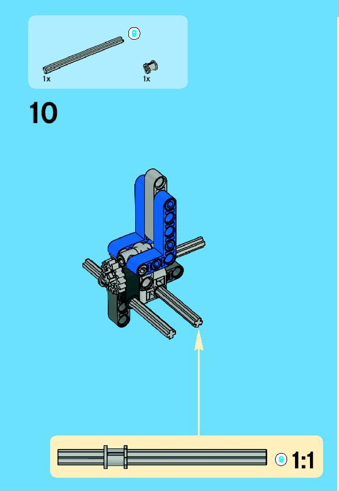

**New parts:** axle9-s2 (60485, light bluish gray) - under the seat, parallel to axle9-s1, through lbeam-s3; bush-s3 (3713, light bluish gray) - on axle9-s2, about a quarter of the way along (1:1 picture)

**Touches:** bush-s3 slides onto axle9-s2 first; axle9-s2 pushes in from the front through lbeam-s3 and the seat

**Exact joins:** bush-s3.axlehole1 into axle9-s2.axle5 (1 hole deep, locked (turn together)); axle9-s2.axle1 into lbeam-s3.hole? (not fully shown in booklet)

**Who does what:** lbeam-s3 holds axle9-s2; bush-s3 locks axle9-s2 in place

**After:** two parallel axles under the seat; everything else: no change

**Why:** Adds the second cross bar of the seat frame. Two axles keep the side beams from twisting. *Next:* Both axle ends take lbeam-s4 in step 11. *Pattern:* two-bar frame

**Big picture:**
- **axle9-s2** (Upper frame and seat): Second cross bar; with axle9-s1 it keeps the side plates square. Later: 8047-seat-step-11 `CONNECT axle9-s2.axle9 -> lbeam-s4.hole?`; 8047-seat-step-11 `DOES axle9-s2 CARRIES lbeam-s4`; 8047-step-22 `CONNECT conn3c-1.axlehole2 -> axle9-s2.axle9 LOCKED`.
- **bush-s3** (Upper frame and seat): Stops axle9-s2 sliding.

**Review:** Exact holes for axle9-s2 not visible.

## 8047-seat-step-11 (page 11) - medium - NEEDS REVIEW

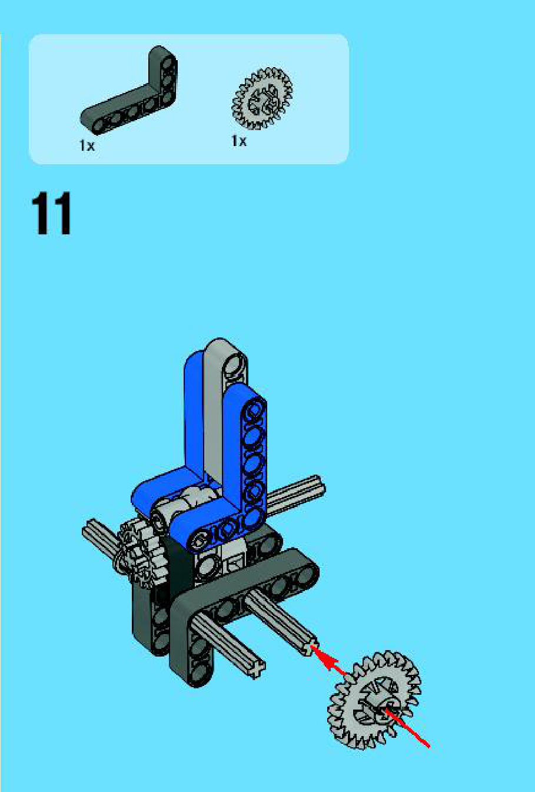

**New parts:** lbeam-s4 (32526, dark bluish gray) - right side of the seat frame, on the right ends of axle9-s1 and axle9-s2; crown-1 (3650c, light bluish gray) - on the right end of axle7-s, outside lbeam-s4 (red arrow)

**Touches:** lbeam-s4 goes over the right ends of axle9-s1 and axle9-s2; crown-1 pushes onto axle7-s's right end

**Exact joins:** axle9-s1.axle9 into lbeam-s4.hole? (not fully shown in booklet); axle9-s2.axle9 into lbeam-s4.hole? (not fully shown in booklet); crown-1.axlehole1 into axle7-s.axle7 (1 hole deep, locked (turn together))

**Who does what:** axle9-s1 and axle9-s2 carry lbeam-s4; axle7-s carries crown-1

**After:** seat build finished: seat on a frame of two L-beams, gear shaft with a gear at each end; everything else: no change

**Why:** Closes the seat frame and finishes the gear shaft. A crown gear can mesh with a gear at right angles. *Next:* The whole seat build goes on the turntable in step 17. *Pattern:* mirror the side

**Big picture:**
- **lbeam-s4** (Upper frame and seat): Right side plate; its leg goes on pinlong-2. Later: 8047-step-17 `CONNECT pinlong-2.pin3 -> lbeam-s4.hole?`; 8047-step-18 `CONNECT pinlong-2.pin3 -> lbeam-s4.hole?`.
- **crown-1** (Front worm drive (knob-2)): 24-tooth gear the worm turns; the 1:24 slow-down happens here. Later: 8047-step-26 `MESH worm-1.teeth crown-1.teeth`; 8047-step-26 `RATIO worm-1 crown-1 1/24`; 8047-step-26 `DOES worm-1 DRIVES crown-1`.

**Review:** Not confirmed what crown-1 meshes with; check in later steps.

## 8047-step-17 (page 12) - medium - NEEDS REVIEW

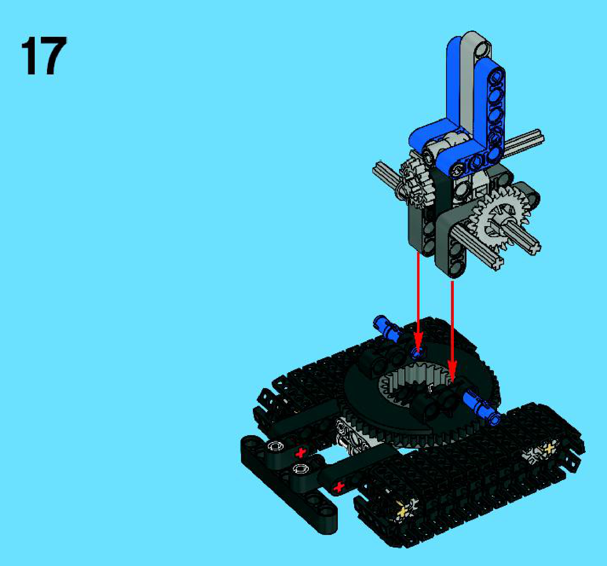

**New parts:** 

**Touches:** GROUP seat drops onto the turntable: the lower ends of lbeam-s3 and lbeam-s4 go over pinlong-1 and pinlong-2 (red arrows)

**Exact joins:** pinlong-1.pin3 into lbeam-s3.hole? (not fully shown in booklet); pinlong-2.pin3 into lbeam-s4.hole? (not fully shown in booklet)

**Who does what:** pinlong-1 and pinlong-2 hold the seat build; turntable-O supports the seat build

**After:** seat build: on top of the turntable, turns with it; everything else: no change

**Why:** Puts the seat on the turning half. Mounting on the turntable lets the whole upper body turn on the tracks. *Next:* Steps 18 onward build the drive around it. *Pattern:* upper body on turntable

**Big picture:**

**Review:** No new parts. Which leg goes on which pin is read from the arrows only.

## 8047-step-18 (page 13) - medium - NEEDS REVIEW

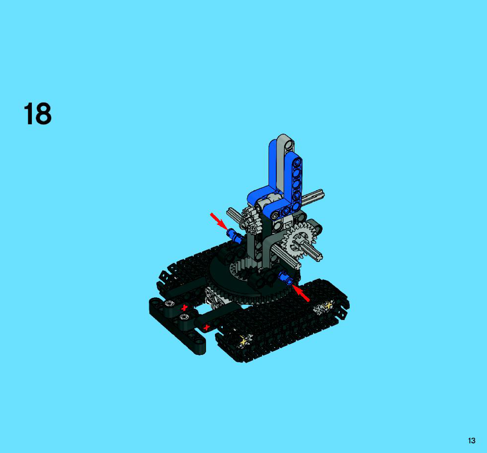

**New parts:** 

**Touches:** pinlong-1 and pinlong-2 are pushed further in (red arrows) so their free ends lock into the seat frame legs

**Exact joins:** pinlong-1.pin3 into lbeam-s3.hole? (not fully shown in booklet); pinlong-2.pin3 into lbeam-s4.hole? (not fully shown in booklet)

**Who does what:** pinlong-1 and pinlong-2 lock the seat build in place on turntable-O

**After:** seat build locked to the turntable; everything else: no change

**Why:** Locks the seat build down so it can't lift off. No new parts: pushing the long pins home is enough. *Next:* The drive parts in steps 19-28 are built around the locked seat. *Pattern:* push pins home to lock

**Big picture:**

**Review:** No parts box; reading the arrows as 'push the blue pins in'.

## 8047-step-19 (page 14) - medium - NEEDS REVIEW

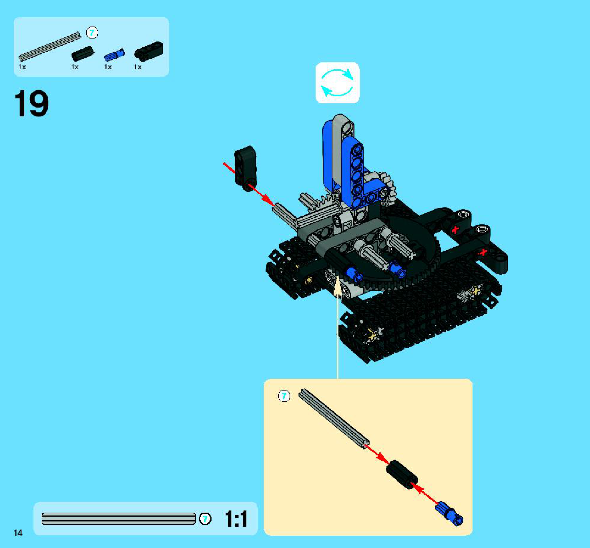

**New parts:** axle7-B (44294, light bluish gray) - long axle running from under the seat out the left side (side box); axcon-1 (59443, black) - on one end of axle7-B (side box); axpin-1 (43093, blue) - in the other end of axcon-1, pin end out (side box); conn3-1 (42003, black) - on the left end of axle7-B, standing up (red arrow)

**Touches:** side box: axle7-B -> axcon-1 -> axpin-1 make one long shaft; the shaft goes in from below/behind the seat (the model is turned around); conn3-1's axle hole goes onto the shaft's left end

**Exact joins:** axle7-B.axle1 into axcon-1.axlehole? (not fully shown in booklet); axpin-1.axle1 into axcon-1.axlehole? (not fully shown in booklet); axle7-B.axle4 into seat.hole? (not fully shown in booklet); conn3-1.axlehole1 into axle7-B.axle7 (1 hole deep, locked (turn together))

**Who does what:** axcon-1 holds axpin-1; axle7-B carries conn3-1

**After:** a long shaft under the seat with a pin end on one side and conn3-1 on the other; everything else: no change

**Why:** Adds a long cross shaft under the seat for the side frames to hang on. An axle connector plus axle pin turns an axle end into a pin, so a beam can swing on it. *Next:* The double-bent side beams go on its ends in steps 20 and 24. *Pattern:* axle-to-pin shaft

**Big picture:**
- **axle7-B** (Front worm drive (knob-2)): Long shaft that receives the turning from gear-6. Where it ends up is an open question. Later: 8047-step-22 `CONNECT gear-6.axlehole1 -> axle7-B.axle7 LOCKED`; 8047-step-22 `DOES axle7-B CARRIES gear-6`.
- **axcon-1** (Upper frame and seat): Joins axle7-B to axpin-1 so the shaft ends in a pin.
- **axpin-1** (Upper frame and seat): Pin end that carries bent11-A (step 20). Later: 8047-step-20 `CONNECT axpin-1.pin1 -> bent11-A.hole1 STIFF`; 8047-step-20 `DOES axpin-1 HOLDS bent11-A`.
- **conn3-1** (Upper frame and seat): Standing connector on axle7-B's other end.

**Review:** Model is turned around (turn symbol); which holes the shaft passes through is not visible.

## 8047-step-20 (page 15) - medium - NEEDS REVIEW

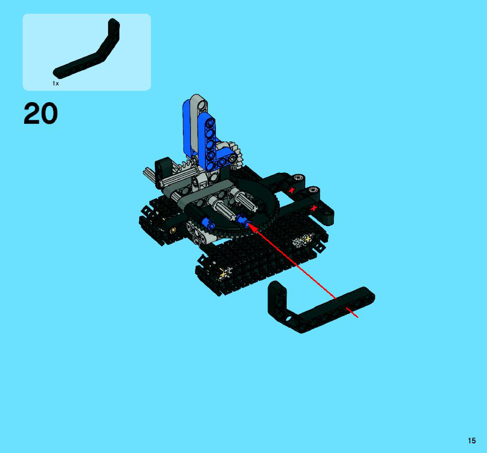

**New parts:** bent11-A (32009, black) - right side, along the frame, end hole on the blue pin (red arrow), bent end pointing up at the back

**Touches:** bent11-A's end hole goes over the blue pin sticking out under the seat

**Exact joins:** axpin-1.pin1 into bent11-A.hole1 (0.9 hole deep, held stiff by friction)

**Who does what:** the blue pin holds bent11-A

**After:** bent11-A: one side of the upper frame; everything else: no change

**Why:** Starts the side frame of the upper body. A double-bent beam goes round the turntable and rises at the back in one part. *Next:* Step 21 pins things into its bent end. *Pattern:* bent beam side frame

**Big picture:**
- **bent11-A** (Upper frame and seat): Right side frame: wraps round the turntable and rises at the back; carries the body, side covers and roof post. Later: 8047-step-21 `CONNECT pin-21a.pin1 -> bent11-A.hole?`; 8047-step-21 `CONNECT pin-21b.pin1 -> bent11-A.hole?`; 8047-step-21 `CONNECT axle3-21.axle1 -> bent11-A.hole?`; 8047-step-21 `DOES bent11-A HOLDS pin-21a`; 8047-step-21 `DOES bent11-A HOLDS pin-21b`; 8047-step-21 `DOES bent11-A HOLDS axle3-21`; 8047-step-30 `CONNECT pin-b2.pin3 -> bent11-A.hole?`; 8047-step-30 `DOES bent11-A SUPPORTS body`; 8047-step-48 `CONNECT pin-48.pin2 -> bent11-A.hole?`; 8047-step-49 `CONNECT beam9-49.hole? -> bent11-A.hole?`; 8047-step-49 `DOES bent11-A SUPPORTS beam9-49`.

**Review:** Which blue pin (axpin-1 or pinlong) takes bent11-A is read from the arrow only.

## 8047-step-21 (page 16) - medium - NEEDS REVIEW

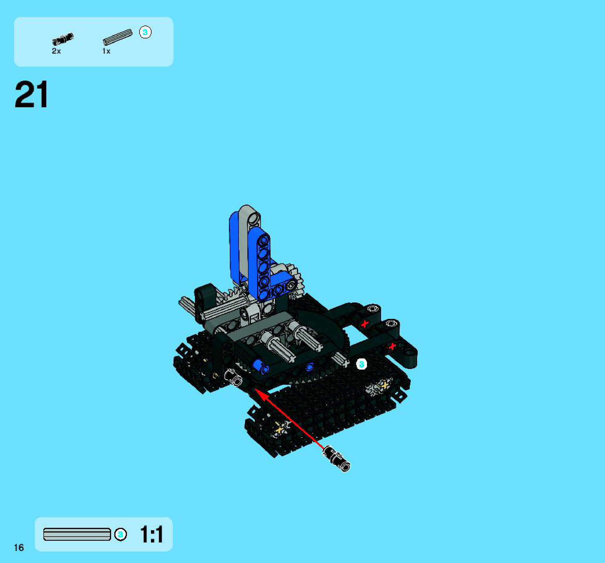

**New parts:** pin-21a (2780, black) - in a hole near bent11-A's front end; pin-21b (2780, black) - in the next hole of bent11-A; axle3-21 (4519, light bluish gray) - through bent11-A's axle hole, pointing in (1:1 picture)

**Touches:** pin-21a and pin-21b push into bent11-A (red arrow); axle3-21 goes into bent11-A's axle hole

**Exact joins:** pin-21a.pin1 into bent11-A.hole? (not fully shown in booklet); pin-21b.pin1 into bent11-A.hole? (not fully shown in booklet); axle3-21.axle1 into bent11-A.hole? (not fully shown in booklet)

**Who does what:** bent11-A holds pin-21a, pin-21b and axle3-21

**After:** two pins and a short axle stick out of bent11-A; everything else: no change

**Why:** Adds mounting points on the side frame. Friction pins and a short axle let the yellow body clip on later. *Next:* The yellow body build sits on these in step 30. *Pattern:* pins as mounting posts

**Big picture:**
- **pin-21a** (Upper frame and seat): Mount on bent11-A for the right side cover (step 37). Later: 8047-step-37 `CONNECT beam11-37.hole? -> pin-21a.pin2`; 8047-step-37 `DOES pin-21a HOLDS beam11-37`.
- **pin-21b** (Upper frame and seat): Second mount pin on bent11-A.
- **axle3-21** (Upper frame and seat): Short axle on bent11-A; end held by bush-27. Later: 8047-step-27 `CONNECT bush-27.axlehole1 -> axle3-21.axle3 LOCKED`; 8047-step-27 `DOES bush-27 LOCKS axle3-21`.

**Review:** Exact holes not visible.

## 8047-step-22 (page 17) - medium - NEEDS REVIEW

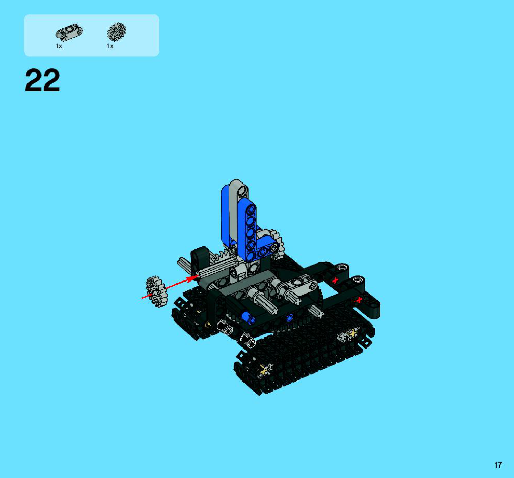

**New parts:** conn3c-1 (32184, light bluish gray) - across the two front axle ends under the seat; gear-6 (4019, light bluish gray) - on the left end of axle7-B, next to gear-5 (red arrow)

**Touches:** conn3c-1's end axle holes go over two front axle ends; gear-6 slides onto the shaft's left end

**Exact joins:** conn3c-1.axlehole1 into axle9-s1.axle9 (1 hole deep, locked (turn together)); conn3c-1.axlehole2 into axle9-s2.axle9 (1 hole deep, locked (turn together)); gear-6.axlehole1 into axle7-B.axle7 (1 hole deep, locked (turn together))

**Who does what:** axle7-B carries gear-6; gear-5 drives gear-6; conn3c-1 holds the two front axles together

**After:** gear-6 meshes with gear-5; everything else: no change

**Why:** Links the seat gear shaft to the long shaft. Two 16-tooth gears pass turning on at 1:1. *Next:* conn3c-1 carries the control lever in step 23. *Pattern:* gear pair 1:1

**Big picture:**
- **conn3c-1** (Upper frame and seat): Joins the two cross axles' ends and gives the control lever a pivot. Later: 8047-step-23 `CONNECT crank-1.axlehole? -> conn3c-1.hole1`.
- **gear-6** (Front worm drive (knob-2)): Receives the turning from gear-5.

**Review:** conn3c-1 has no arrow. That gear-5 meshes gear-6 is read from the picture.

## 8047-step-23 (page 18) - medium - NEEDS REVIEW

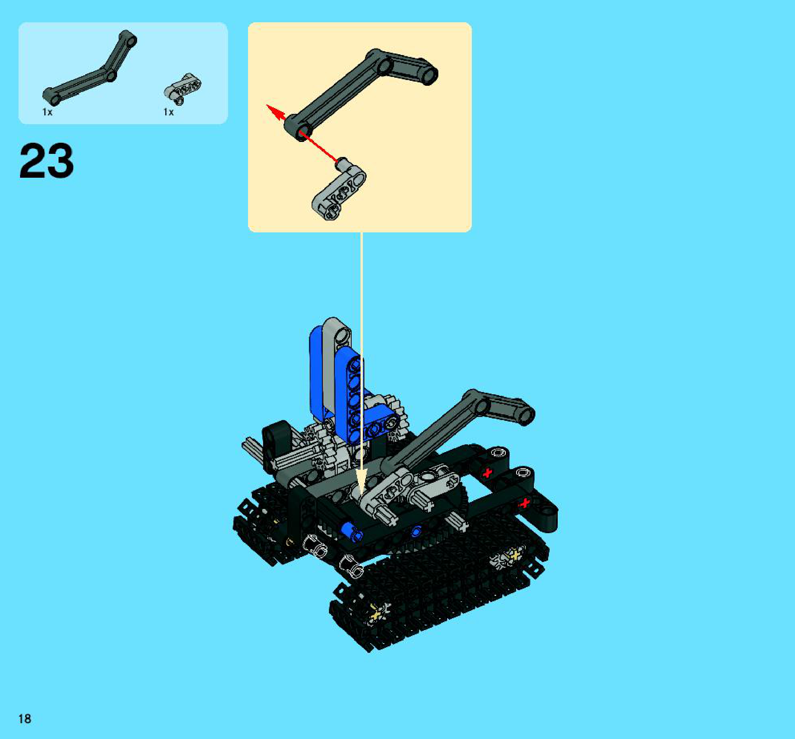

**New parts:** link9-1 (64451, dark bluish gray) - lever arm, bent, pointing up and back; crank-1 (33299a, light bluish gray) - its pin in link9-1's end hole, its axle hole on conn3c-1's center (side box)

**Touches:** side box: crank-1's pin goes into link9-1's end hole; crank-1 drops onto conn3c-1 (cream arrow)

**Exact joins:** crank-1.pin1 into link9-1.hole1 (0.9 hole deep, held stiff by friction); crank-1.axlehole? into conn3c-1.hole1 (not fully shown in booklet)

**Who does what:** crank-1 holds link9-1; link9-1 spins on crank-1

**After:** a lever sticks up in front of the seat; everything else: no change

**Why:** Adds a lever in front of the seat. A crank plus a bent link makes a lever that swings. *Next:* The lever works the arm via the push rod added later. *Pattern:* crank and link lever

**Big picture:**
- **link9-1** (Boom (arm) with worm drive): Bent link from the crank to the boom's base pivot (axle3-a4, step 38): holds the boom to the frame as part of its lift linkage. Exact motion not confirmed. Later: 8047-step-38 `CONNECT axle3-a4.axle3 -> link9-1.hole3 TURNS`; 8047-step-38 `DOES link9-1 HOLDS arm`.
- **crank-1** (Boom (arm) with worm drive): Crank on conn3c-1 in front of the seat: the fixed pivot the boom's lift link swings on.

**Review:** What the lever moves is not confirmed yet.

## 8047-step-24 (page 19) - medium - NEEDS REVIEW

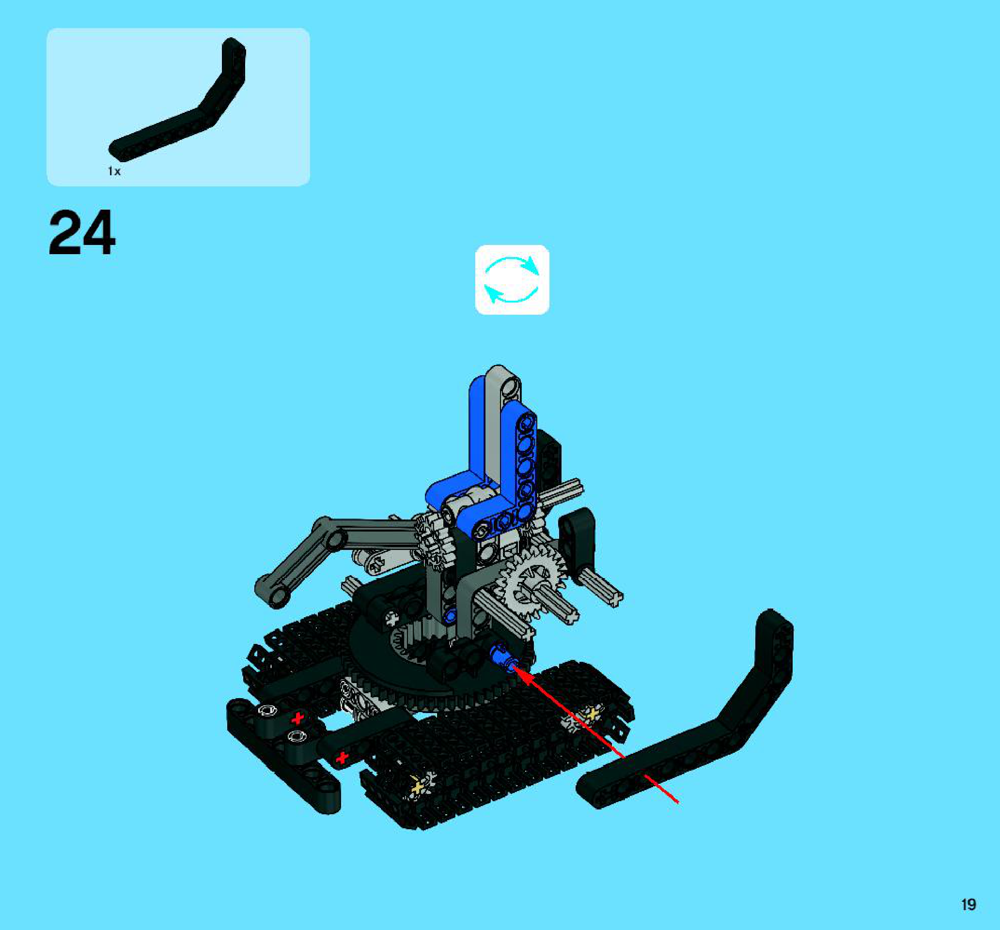

**New parts:** bent11-B (32009, black) - left side, mirror of bent11-A, end hole on the other blue pin (red arrow)

**Touches:** model turned around; bent11-B's end hole goes over the blue pin on this side

**Exact joins:** pinlong-1.pin3 into bent11-B.hole1 (0.9 hole deep, held stiff by friction)

**Who does what:** the blue pin holds bent11-B

**After:** both side frames in place; everything else: no change

**Why:** Adds the second side frame. Same part as step 20, mirrored. *Next:* Step 25 pins into it. *Pattern:* mirror the side

**Big picture:**
- **bent11-B** (Upper frame and seat): Left side frame, mirror of bent11-A. Later: 8047-step-25 `CONNECT pin-25a.pin1 -> bent11-B.hole?`; 8047-step-25 `CONNECT pin-25b.pin1 -> bent11-B.hole?`; 8047-step-25 `CONNECT axle3-25.axle1 -> bent11-B.hole?`; 8047-step-25 `DOES bent11-B HOLDS pin-25a`; 8047-step-25 `DOES bent11-B HOLDS pin-25b`; 8047-step-25 `DOES bent11-B HOLDS axle3-25`; 8047-step-30 `CONNECT pin-b1.pin3 -> bent11-B.hole?`; 8047-step-30 `DOES bent11-B SUPPORTS body`; 8047-step-35 `CONNECT beam9-35.hole? -> bent11-B.hole?`; 8047-step-35 `DOES bent11-B SUPPORTS beam9-35`.

**Review:** Which blue pin is used is read from the arrow only.

## 8047-step-25 (page 20) - medium - NEEDS REVIEW

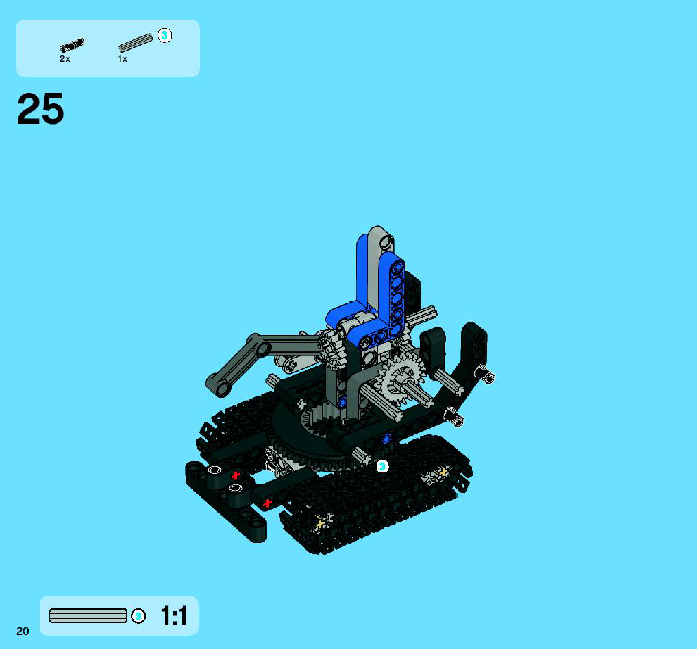

**New parts:** pin-25a (2780, black) - in bent11-B near its front; pin-25b (2780, black) - in the next hole of bent11-B; axle3-25 (4519, light bluish gray) - through bent11-B's axle hole

**Touches:** two pins and a short axle push into bent11-B

**Exact joins:** pin-25a.pin1 into bent11-B.hole? (not fully shown in booklet); pin-25b.pin1 into bent11-B.hole? (not fully shown in booklet); axle3-25.axle1 into bent11-B.hole? (not fully shown in booklet)

**Who does what:** bent11-B holds pin-25a, pin-25b and axle3-25

**After:** mounting pins on both side frames; everything else: no change

**Why:** Matches step 21 on this side. Same parts, mirrored. *Next:* The yellow body sits on these in step 30. *Pattern:* mirror the side

**Big picture:**
- **pin-25a** (Upper frame and seat): Mount on bent11-B; later holds the left roof post (step 51). Later: 8047-step-51 `CONNECT post-L.hole1 -> pin-25a.pin2 STIFF`; 8047-step-51 `DOES pin-25a HOLDS post-L`.
- **pin-25b** (Upper frame and seat): Second mount pin on bent11-B.
- **axle3-25** (Upper frame and seat): Short axle on bent11-B, matching axle3-21.

**Review:** Exact holes not visible.

## 8047-step-26 (page 21) - medium - NEEDS REVIEW

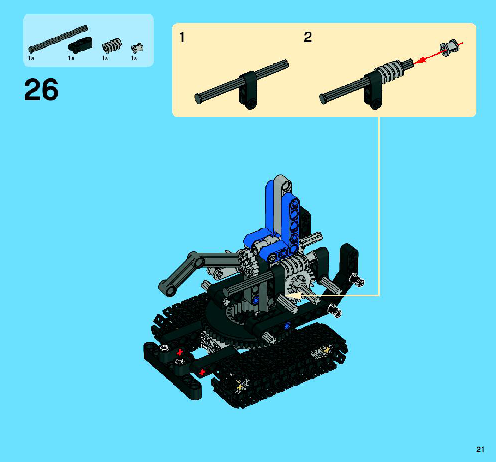

**New parts:** axle8s-1 (55013, dark bluish gray) - across the front of the seat, stop end on the left (side box); conn3-2 (42003, black) - on axle8s-1 near the stop end, standing up (side box 1); worm-1 (4716, light bluish gray) - on axle8s-1 over crown-1 (side box 2); bush-26 (3713, light bluish gray) - on axle8s-1's right end (side box 2)

**Touches:** side box: axle8s-1 through conn3-2, then worm-1, then bush-26; the shaft drops in so worm-1 sits on crown-1's teeth

**Exact joins:** axle8s-1.axle4 into conn3-2.axlehole1 (1 hole deep, locked (turn together)); worm-1.axlehole1 into axle8s-1.axle4 (1 hole deep, locked (turn together)); bush-26.axlehole1 into axle8s-1.axle8 (1 hole deep, locked (turn together))

**Who does what:** axle8s-1 carries worm-1; worm-1 drives crown-1; bush-26 locks axle8s-1 in place; conn3-2 holds axle8s-1

**After:** worm shaft across the front, meshing crown-1; everything else: no change

**Why:** Adds the slow drive for the gear train. A worm only turns the gear, never the other way, so the upper body stays where you leave it. *Next:* A knob goes on this shaft in step 34. *Pattern:* worm drive (self-locking)

**Big picture:**
- **axle8s-1** (Front worm drive (knob-2)): Worm shaft running to the back: knob-2 at one end, worm-1 in the middle. Later: 8047-step-32 `CONNECT bush-32.axlehole1 -> axle8s-1.axle1 LOCKED`; 8047-step-32 `DOES bush-32 LOCKS axle8s-1`; 8047-step-34 `CONNECT knob-2.axlehole1 -> axle8s-1.axle8 LOCKED`; 8047-step-34 `DOES axle8s-1 CARRIES knob-2`.
- **conn3-2** (Front worm drive (knob-2)): Holds the worm shaft in line.
- **worm-1** (Front worm drive (knob-2)): The self-locking slow-down: one knob turn = one tooth of crown-1.
- **bush-26** (Front worm drive (knob-2)): Keeps the worm in place over crown-1.

**Review:** The worm meshing crown-1 is read from the picture.

## 8047-step-27 (page 22) - medium - NEEDS REVIEW

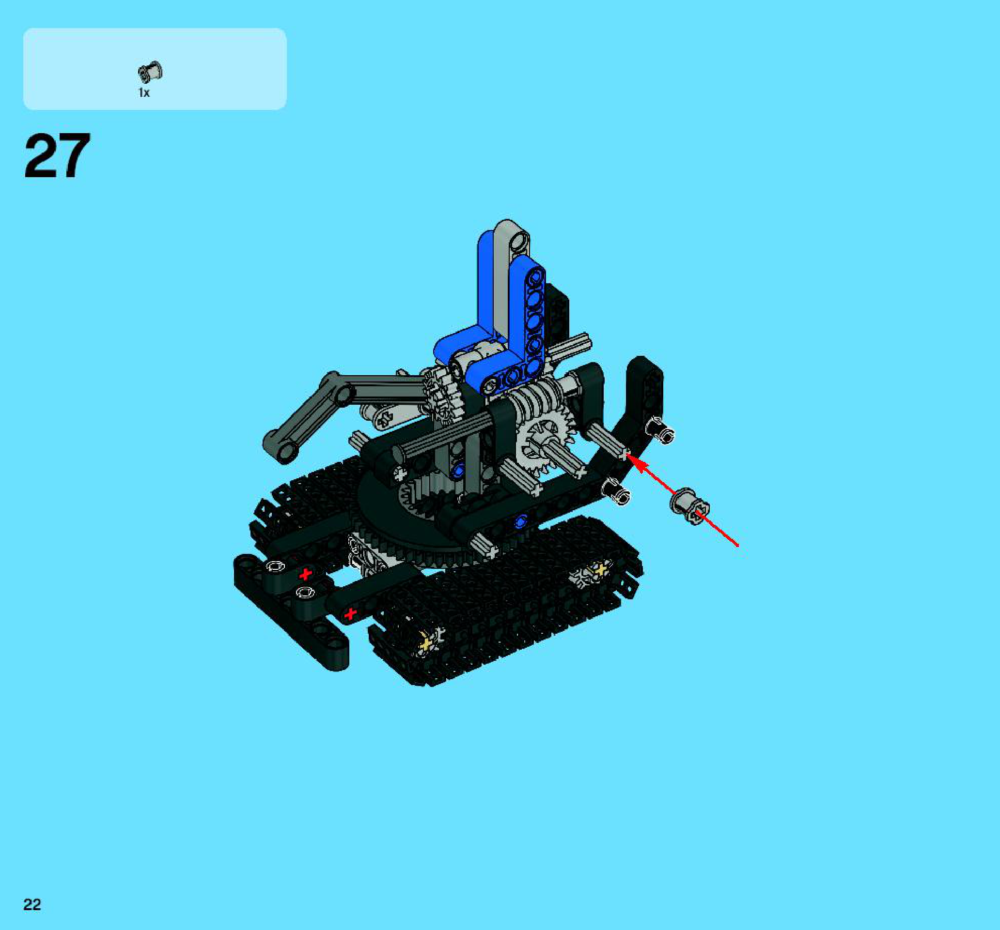

**New parts:** bush-27 (3713, light bluish gray) - on the right end of axle3-21's neighbour axle, outside bent11-A (red arrow)

**Touches:** bush-27 pushes onto the axle end sticking out of bent11-A

**Exact joins:** bush-27.axlehole1 into axle3-21.axle3 (1 hole deep, locked (turn together))

**Who does what:** bush-27 locks the axle in place

**After:** everything: no change

**Why:** Stops an axle sliding out. A bush grips the axle end. *Next:* Nothing more goes on this end. *Pattern:* bush as end stop

**Big picture:**
- **bush-27** (Upper frame and seat): Stops axle3-21 sliding out.

**Review:** Which axle gets the bush is read from the arrow only.

## 8047-step-28 (page 23) - medium - NEEDS REVIEW

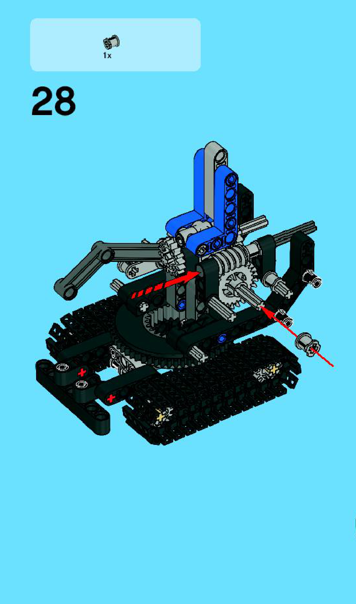

**New parts:** bush-28 (3713, light bluish gray) - on the front end of axle7-s, in front of crown-1 (red arrow)

**Touches:** bush-28 pushes onto axle7-s's end; the worm shaft is pushed fully home (dashed arrow)

**Exact joins:** bush-28.axlehole1 into axle7-s.axle7 (1 hole deep, locked (turn together))

**Who does what:** bush-28 locks axle7-s in place

**After:** gear train locked in place; everything else: no change

**Why:** Keeps the crown gear shaft from sliding. A bush lets the shaft spin but not slide. *Next:* The model is turned in step 29. *Pattern:* bush as end stop

**Big picture:**
- **bush-28** (Front worm drive (knob-2)): Stops axle7-s sliding at the crown-gear end.

**Review:** Dashed arrow read as 'push the worm shaft home'.

## 8047-step-29 (page 23) - high

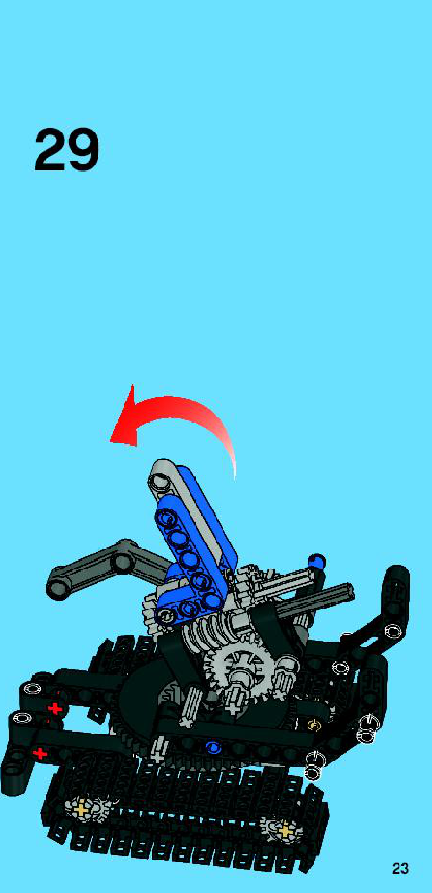

**New parts:** 

**Touches:** no new parts: turn the model round (red curved arrow)

**Exact joins:** none

**Who does what:** 

**After:** model turned to show the back; everything else: no change

**Why:** Shows the back so the yellow body can go on. View change only. *Next:* The body build attaches in step 30. *Pattern:* turn the model

**Big picture:**

## 8047-body-step-01 (page 24) - high

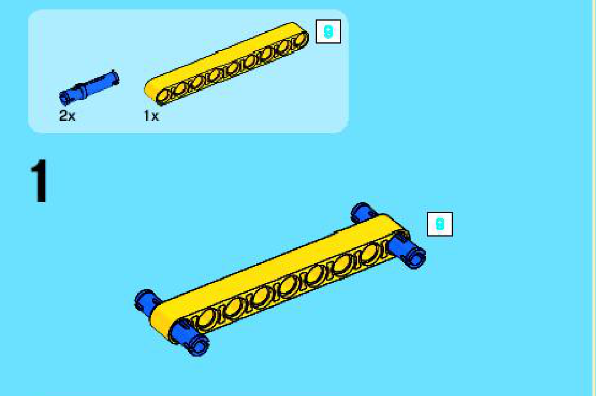

**New parts:** pin-b1 (6558, blue) - in one end hole of beam9-b, both ends sticking out; pin-b2 (6558, blue) - in the other end hole of beam9-b; beam9-b (40490, yellow) - first part of the body build, lying flat

**Touches:** pin-b1 and pin-b2 push into beam9-b's end holes

**Exact joins:** pin-b1.pin1 into beam9-b.hole1 (0.9 hole deep, held stiff by friction); pin-b2.pin1 into beam9-b.hole9 (0.9 hole deep, held stiff by friction)

**Who does what:** beam9-b holds pin-b1 and pin-b2

**After:** a yellow 9-beam with a long pin at each end

**Why:** Starts the yellow back body. Long pins leave a free half to hang the body on the frame. *Next:* The fairings go on in steps 3 and 5. *Pattern:* pins as mounting posts

**Big picture:**
- **pin-b1** (Engine cover and side covers): Holds fairing-2 and later the left bearing ycon-2. Later: 8047-body-step-05 `CONNECT pin-b1.pin3 -> fairing-2.hole?`; 8047-body-step-05 `DOES pin-b1 HOLDS fairing-2`; 8047-step-30 `CONNECT pin-b1.pin3 -> bent11-B.hole?`; 8047-step-32 `CONNECT ycon-2.hole1 -> pin-b1.pin3 STIFF`; 8047-step-32 `DOES pin-b1 HOLDS ycon-2`.
- **pin-b2** (Engine cover and side covers): Holds the right bearing ycon-1. Later: 8047-step-30 `CONNECT pin-b2.pin3 -> bent11-A.hole?`; 8047-step-32 `CONNECT ycon-1.hole1 -> pin-b2.pin3 STIFF`; 8047-step-32 `DOES pin-b2 HOLDS ycon-1`.
- **beam9-b** (Engine cover and side covers): Spine of the engine cover. Later: 8047-body-step-02 `CONNECT pin-b3.pin1 -> beam9-b.hole?`; 8047-body-step-02 `CONNECT pin-b4.pin1 -> beam9-b.hole?`; 8047-body-step-02 `CONNECT pin-b5.pin1 -> beam9-b.hole?`.

## 8047-body-step-02 (page 24) - medium - NEEDS REVIEW

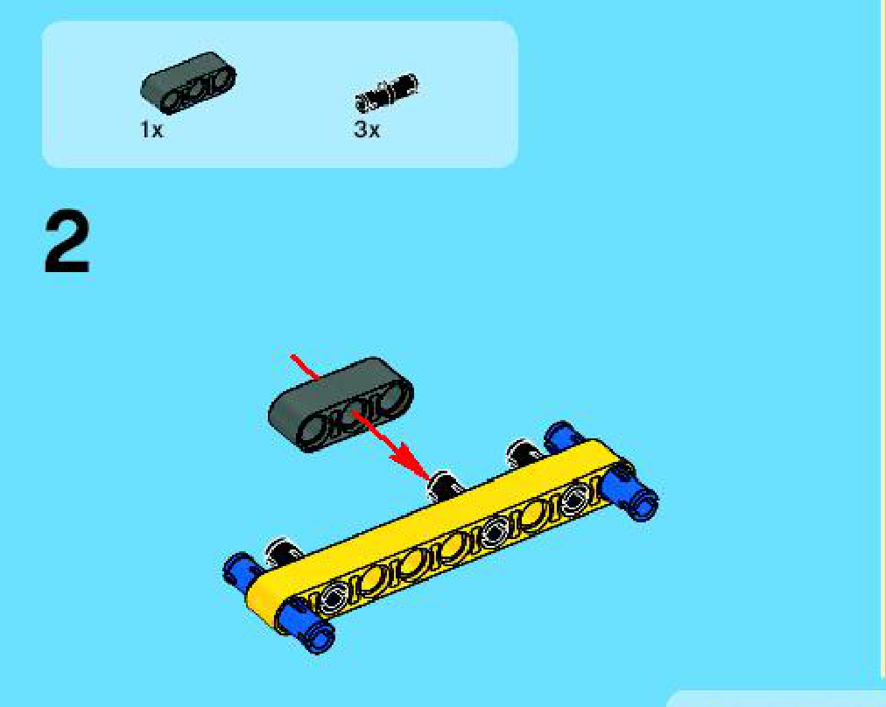

**New parts:** beam3-b (32523, dark bluish gray) - on top of beam9-b near its middle; pin-b3 (2780, black) - in beam9-b, under beam3-b; pin-b4 (2780, black) - in beam9-b; pin-b5 (2780, black) - in beam9-b

**Touches:** three pins go into beam9-b; beam3-b goes over one pin (red arrow)

**Exact joins:** pin-b3.pin1 into beam9-b.hole? (not fully shown in booklet); pin-b4.pin1 into beam9-b.hole? (not fully shown in booklet); pin-b5.pin1 into beam9-b.hole? (not fully shown in booklet); pin-b3.pin2 into beam3-b.hole? (not fully shown in booklet)

**Who does what:** pin-b3 holds beam3-b

**After:** beam3-b on top of beam9-b, two more pins sticking up

**Why:** Adds a block and extra pins to the body beam. A 3-beam stiffens and spaces the panel. *Next:* Fairing 1 goes on two pins in step 3. *Pattern:* pins as mounting posts

**Big picture:**
- **beam3-b** (Engine cover and side covers): Block that carries the body's gear shaft. Later: 8047-body-step-04 `CONNECT axle4s-b.axle2 -> beam3-b.hole?`; 8047-body-step-04 `DOES axle4s-b SPINS_ON beam3-b`.
- **pin-b3** (Engine cover and side covers): Holds beam3-b and fairing-2. Later: 8047-body-step-05 `CONNECT pin-b3.pin2 -> fairing-2.hole?`; 8047-body-step-05 `DOES pin-b3 HOLDS fairing-2`.
- **pin-b4** (Engine cover and side covers): Holds fairing-1. Later: 8047-body-step-03 `CONNECT pin-b4.pin2 -> fairing-1.hole?`; 8047-body-step-03 `DOES pin-b4 HOLDS fairing-1`.
- **pin-b5** (Engine cover and side covers): Holds fairing-1. Later: 8047-body-step-03 `CONNECT pin-b5.pin2 -> fairing-1.hole?`; 8047-body-step-03 `DOES pin-b5 HOLDS fairing-1`.

**Review:** Which pin holds beam3-b is read from the arrow only.

## 8047-body-step-03 (page 24) - high

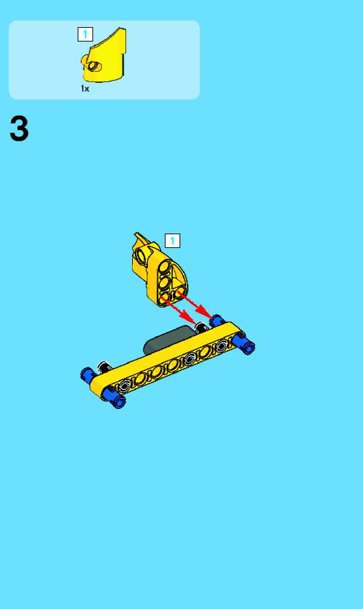

**New parts:** fairing-1 (87080, yellow) - standing up on the right end of beam9-b

**Touches:** fairing-1's two holes go over two pins in beam9-b (red arrows)

**Exact joins:** pin-b4.pin2 into fairing-1.hole? (not fully shown in booklet); pin-b5.pin2 into fairing-1.hole? (not fully shown in booklet)

**Who does what:** pin-b4 and pin-b5 hold fairing-1

**After:** fairing-1 standing at one end

**Why:** Adds the first side panel. Fairings give the smooth engine-cover look. *Next:* Its mirror goes on in step 5. *Pattern:* panel on pins

**Big picture:**
- **fairing-1** (Engine cover and side covers): Right engine-cover panel (looks).

## 8047-body-step-04 (page 25) - medium - NEEDS REVIEW

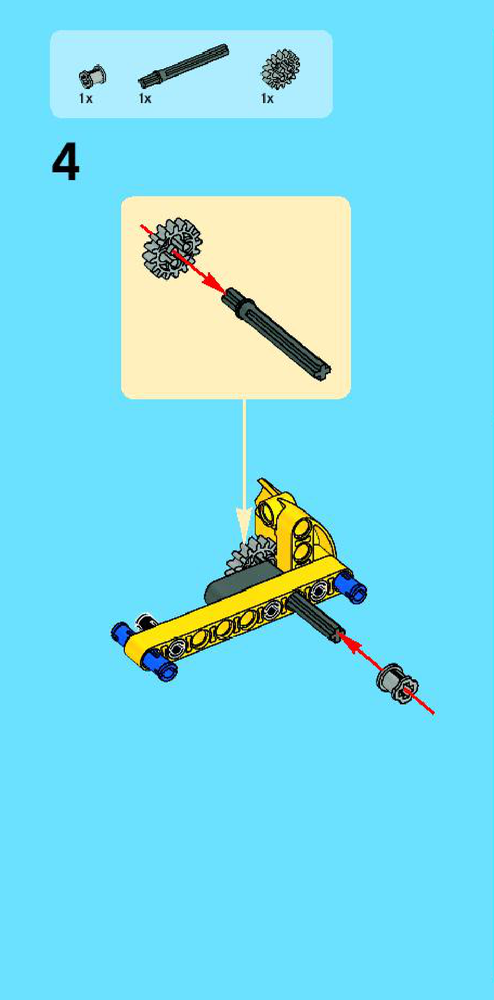

**New parts:** bush-b (3713, light bluish gray) - on the axle end sticking out the front (red arrow); axle4s-b (87083, dark bluish gray) - through beam3-b, stop end at the back (side box); gear-7 (4019, light bluish gray) - on axle4s-b's back end, against the stop (side box)

**Touches:** side box: gear-7 onto axle4s-b; axle4s-b goes through beam3-b; bush-b on the front end

**Exact joins:** gear-7.axlehole1 into axle4s-b.axle1 (1 hole deep, locked (turn together)); axle4s-b.axle2 into beam3-b.hole? (not fully shown in booklet); bush-b.axlehole1 into axle4s-b.axle4 (1 hole deep, locked (turn together))

**Who does what:** axle4s-b carries gear-7; bush-b locks axle4s-b in place; axle4s-b spins on beam3-b

**After:** a gear shaft through the body

**Why:** Adds a gear shaft inside the body. An axle with a stop holds the gear against one side. *Next:* gear-7 meshes the seat gears once the body is on (step 30). *Pattern:* shaft with gear and stop

**Big picture:**
- **bush-b** (Back shaft (knob-1)): Stops axle4s-b sliding.
- **axle4s-b** (Back shaft (knob-1)): Gear shaft inside the body; carries gear-7.
- **gear-7** (Back shaft (knob-1)): Gear inside the body; may take or pass drive from the back shaft (not confirmed).

**Review:** What gear-7 meshes is not confirmed.

## 8047-body-step-05 (page 25) - medium - NEEDS REVIEW

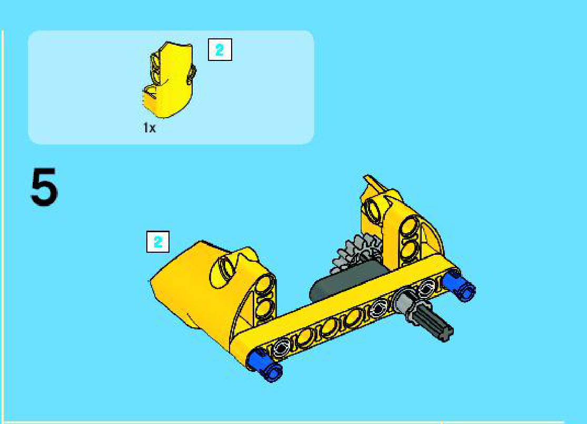

**New parts:** fairing-2 (87086, yellow) - standing up on the left end of beam9-b

**Touches:** fairing-2's holes go over the remaining pin and the pin end

**Exact joins:** pin-b1.pin3 into fairing-2.hole? (not fully shown in booklet); pin-b3.pin2 into fairing-2.hole? (not fully shown in booklet)

**Who does what:** pin-b1 and pin-b3 hold fairing-2

**After:** body build done: two fairings on a yellow beam with a gear shaft between

**Why:** Adds the second side panel. Mirror of fairing-1. *Next:* The whole body goes on in step 30. *Pattern:* mirror the side

**Big picture:**
- **fairing-2** (Engine cover and side covers): Left engine-cover panel (looks).

**Review:** Which pins fairing-2 uses is not visible.

## 8047-step-30 (page 25) - medium - NEEDS REVIEW

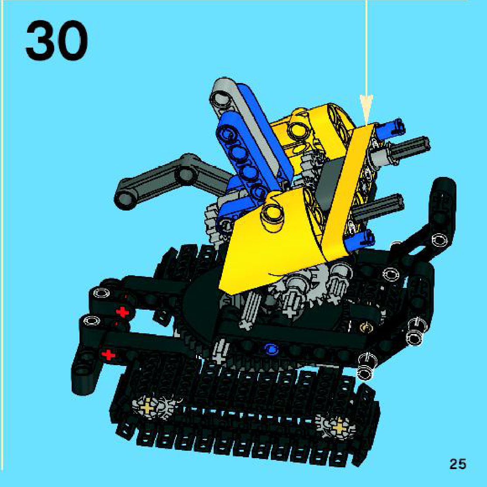

**New parts:** 

**Touches:** GROUP body drops onto the back of the upper frame (cream arrow): its pins go into the side frames' holes

**Exact joins:** pin-b2.pin3 into bent11-A.hole? (not fully shown in booklet); pin-b1.pin3 into bent11-B.hole? (not fully shown in booklet)

**Who does what:** bent11-A and bent11-B support the body build

**After:** yellow body on the back of the upper frame, turns with the turntable; everything else: no change

**Why:** Adds the back of the excavator body. Building it on the side keeps it easy to hold. *Next:* Steps 31-34 add the knobs at the back. *Pattern:* side build attached

**Big picture:**

**Review:** Exact holes for the body pins not visible.

## 8047-step-31 (page 26) - high

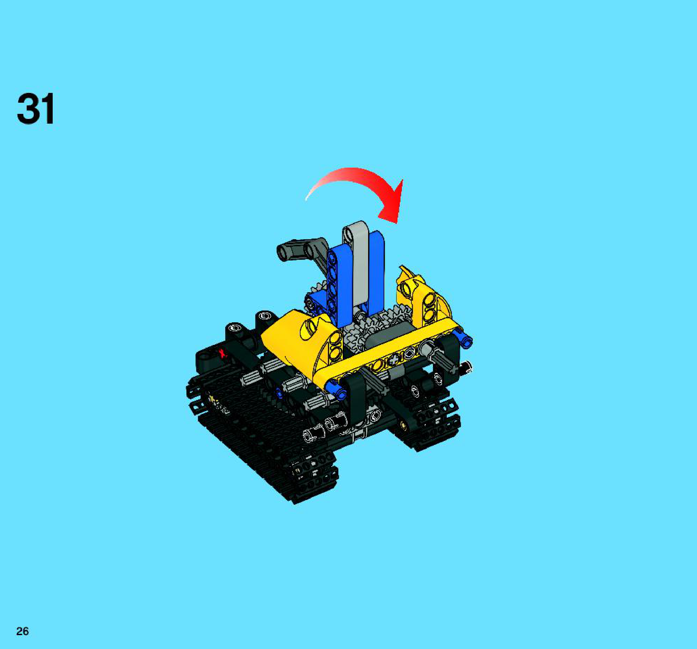

**New parts:** 

**Touches:** no new parts: turn the model (red curved arrow)

**Exact joins:** none

**Who does what:** 

**After:** back of the model facing you; everything else: no change

**Why:** Shows the back for the knob parts. View change only. *Next:* Step 32 adds parts here. *Pattern:* turn the model

**Big picture:**

## 8047-step-32 (page 27) - medium - NEEDS REVIEW

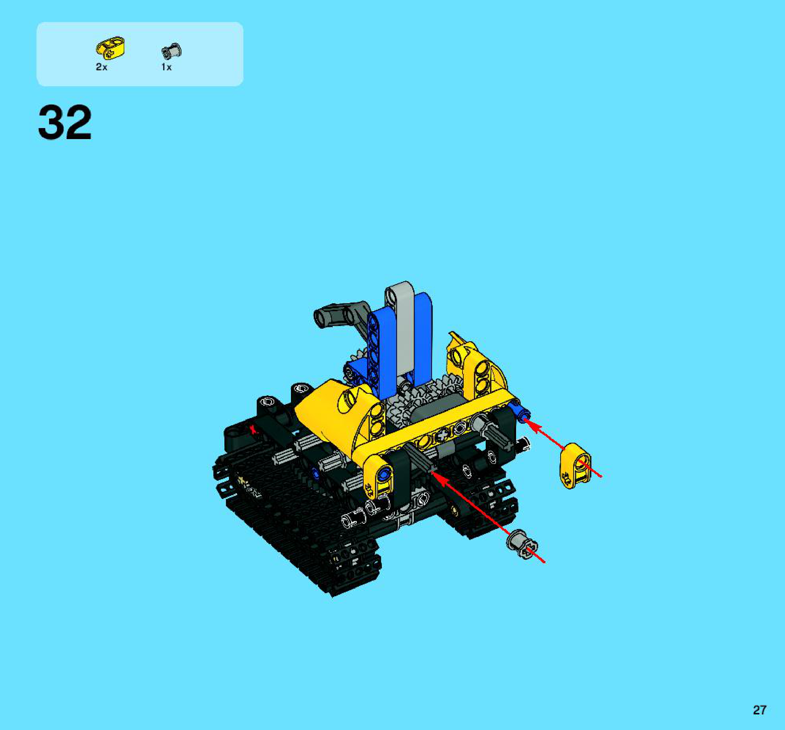

**New parts:** ycon-1 (6536, yellow) - on the blue pin end at the back right (red arrow); ycon-2 (6536, yellow) - on the blue pin end at the back left; bush-32 (3713, light bluish gray) - on the worm shaft's back end (red arrow)

**Touches:** ycon-1 and ycon-2's pin holes go over pin-b1 and pin-b2's ends; bush-32 pushes onto the shaft end

**Exact joins:** ycon-1.hole1 into pin-b2.pin3 (0.9 hole deep, held stiff by friction); ycon-2.hole1 into pin-b1.pin3 (0.9 hole deep, held stiff by friction); bush-32.axlehole1 into axle8s-1.axle1 (1 hole deep, locked (turn together))

**Who does what:** pin-b1 holds ycon-2; pin-b2 holds ycon-1; bush-32 locks axle8s-1 in place

**After:** two yellow connectors at the back with axle holes lined up; everything else: no change

**Why:** Gives the back two lined-up axle holes. These connectors turn a pin end into an axle hole. *Next:* A long axle goes through both in step 33. *Pattern:* pin to axle-hole adapter

**Big picture:**
- **ycon-1** (Back shaft (knob-1)): Bearing for the back shaft on the right body pin. Later: 8047-step-33 `CONNECT axle9-33.axle5 -> ycon-1.axlehole1 LOCKED`; 8047-step-33 `DOES ycon-1 HOLDS axle9-33`; 8047-step-50 `CONNECT pin-50a.pin1 -> ycon-1.hole?`.
- **ycon-2** (Back shaft (knob-1)): Bearing for the back shaft on the left body pin. Later: 8047-step-33 `CONNECT axle9-33.axle5 -> ycon-2.axlehole1 LOCKED`; 8047-step-33 `DOES axle9-33 SPINS_ON ycon-2`.
- **bush-32** (Front worm drive (knob-2)): Stops the worm shaft sliding at the back.

**Review:** Which shaft gets bush-32 is read from the arrow only.

## 8047-step-33 (page 28) - medium - NEEDS REVIEW

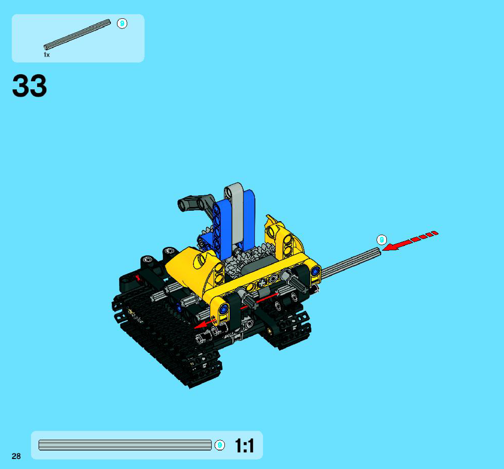

**New parts:** axle9-33 (60485, light bluish gray) - across the back, through ycon-1 and ycon-2 (dashed arrow)

**Touches:** axle9-33 slides through both yellow connectors and the body

**Exact joins:** axle9-33.axle5 into ycon-1.axlehole1 (1 hole deep, locked (turn together)); axle9-33.axle5 into ycon-2.axlehole1 (1 hole deep, locked (turn together))

**Who does what:** ycon-1 and ycon-2 hold axle9-33; axle9-33 spins on ycon-1

**After:** a long axle across the back, both ends sticking out; everything else: no change

**Why:** Adds the back control shaft. A 9-long axle reaches across the whole body. *Next:* A knob goes on its end in step 34. *Pattern:* long cross shaft

**Big picture:**
- **axle9-33** (Back shaft (knob-1)): The back shaft. Later: 8047-step-34 `CONNECT knob-1.axlehole1 -> axle9-33.axle9 LOCKED`; 8047-step-34 `DOES axle9-33 CARRIES knob-1`.

**Review:** Whether it engages gear-7 is not confirmed.

## 8047-step-34 (page 29) - medium - NEEDS REVIEW

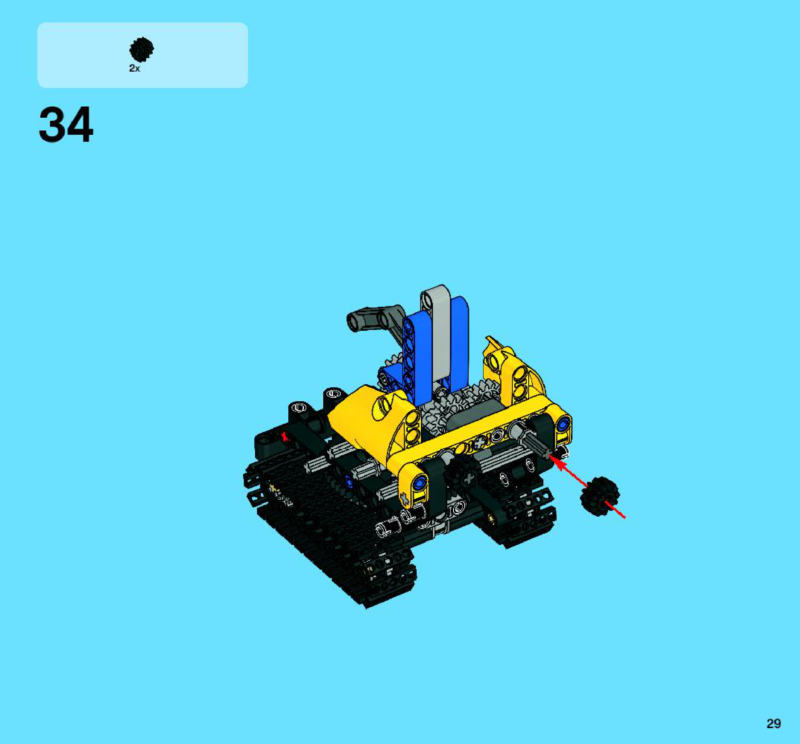

**New parts:** knob-1 (32270, black) - on the right end of axle9-33 (red arrow); knob-2 (32270, black) - on the end of the worm shaft axle8s-1

**Touches:** knob-1 and knob-2 push onto the two shaft ends at the back right

**Exact joins:** knob-1.axlehole1 into axle9-33.axle9 (1 hole deep, locked (turn together)); knob-2.axlehole1 into axle8s-1.axle8 (1 hole deep, locked (turn together))

**Who does what:** axle9-33 carries knob-1; axle8s-1 carries knob-2

**After:** two black knobs at the back: one turns the upper body, one works the arm; everything else: no change

**Why:** Adds the two control knobs. A small bevel gear is easy to grip and fits an axle end. *Next:* Turning them drives the worms. *Pattern:* gear as knob

**Big picture:**
- **knob-1** (Back shaft (knob-1)): The second control the operator turns.
- **knob-2** (Front worm drive (knob-2)): The control the operator turns.

**Review:** Only one arrow; the second knob's shaft is read from the picture. Which knob does what is a guess.

## 8047-step-35 (page 30) - medium - NEEDS REVIEW

**New parts:** hoseconn-1 (32013, dark bluish gray) - on the end of hose-1 (side box 1); beam9-35 (40490, yellow) - lower left side of the body, along the tracks; hose-1 (75c12, black) - standing up from hoseconn-1, curving over the body; pin-35 (2780, black) - in hoseconn-1's pin hole, into beam9-35's end (side box 2)

**Touches:** side box: hose-1 into hoseconn-1, then hoseconn-1 pins to beam9-35's end; beam9-35 goes onto the left side frame (cream arrow)

**Exact joins:** hose-1.end1 into hoseconn-1.axlehole1 (not fully shown in booklet); pin-35.pin1 into hoseconn-1.hole1 (0.9 hole deep, held stiff by friction); pin-35.pin2 into beam9-35.hole9 (0.9 hole deep, held stiff by friction); beam9-35.hole? into bent11-B.hole? (not fully shown in booklet)

**Who does what:** hoseconn-1 holds hose-1; pin-35 holds hoseconn-1 to beam9-35; bent11-B supports beam9-35

**After:** a yellow side beam with a black hose standing up; everything else: no change

**Why:** Adds the left side cover and a look-alike hydraulic hose. A rigid hose bends into a smooth curve; it is only for looks. *Next:* The hose top clips to the roof in step 55. *Pattern:* decorative hose

**Big picture:**
- **hoseconn-1** (Engine cover and side covers): Holder for the left hose.
- **beam9-35** (Engine cover and side covers): Lower left side cover.
- **hose-1** (Engine cover and side covers): Left 'hydraulic hose' (looks); later braces the roof (step 55). Later: 8047-step-55 `CONNECT hose-1.end2 -> angle5-1.axlehole?`; 8047-step-55 `DOES angle5-1 HOLDS hose-1`.
- **pin-35** (Engine cover and side covers): Pins the left hose holder to the side cover.

**Review:** Which holes beam9-35 uses is not visible.

## 8047-step-36 (page 31) - medium - NEEDS REVIEW

**New parts:** axle5-36 (32073, light bluish gray) - standing in the front right of the frame (side box 2); pin-36 (2780, black) - through beam3-36 (side box 1); rod-C (32054, black) - on axle5-36's top end; rod-D (32054, black) - on axle5-36's bottom end; beam3-36 (32523, dark bluish gray) - upright at the front right

**Touches:** side box 1: pin-36 through beam3-36; side box 2: rod-C/rod-D ring ends onto axle5-36, axle through beam3-36; the unit drops into the frame (cream arrow)

**Exact joins:** pin-36.pin1 into beam3-36.hole1 (0.9 hole deep, held stiff by friction); axle5-36.axle3 into beam3-36.hole? (not fully shown in booklet); rod-C.axlehole1 into axle5-36.axle1 (1 hole deep, locked (turn together)); rod-D.axlehole1 into axle5-36.axle5 (1 hole deep, locked (turn together))

**Who does what:** beam3-36 holds axle5-36; beam3-36 holds pin-36

**After:** an upright post at the front right with pin ends; everything else: no change

**Why:** Adds a front post for the boom mount. Long pins with stop rings turn an axle into a pin on each end. *Next:* The boom hangs from this area (step 38). *Pattern:* pin-axle-pin shaft

**Big picture:**
- **axle5-36** (Upper frame and seat): Axle through the front post; its ends are pin ends via rod-C, rod-D. Later: 8047-step-39 `CONNECT conn3c-39.axlehole2 -> axle5-36.axle1 LOCKED`.
- **pin-36** (Upper frame and seat): Pins beam3-36 to the frame.
- **rod-C** (Upper frame and seat): Pin end on top of axle5-36.
- **rod-D** (Upper frame and seat): Pin end under axle5-36.
- **beam3-36** (Upper frame and seat): Front post for the arm mount (arm attaches in step 38). Later: 8047-step-38 `CONNECT axle4-a1.axle4 -> beam3-36.hole?`; 8047-step-38 `DOES beam3-36 SUPPORTS arm`.

**Review:** Which end each long pin goes on is a guess.

## 8047-step-37 (page 32) - medium - NEEDS REVIEW

**New parts:** beam11-37 (32525, yellow) - on the left side, over beam9-35

**Touches:** beam11-37 pushes onto pins along the left side

**Exact joins:** beam11-37.hole? into pin-21a.pin2 (not fully shown in booklet)

**Who does what:** the side pins hold beam11-37

**After:** the left side cover is two yellow beams deep; everything else: no change

**Why:** Finishes the left side cover. An 11-long beam covers the whole side. *Next:* The arm goes on the other side in step 38. *Pattern:* doubled side beam

**Big picture:**
- **beam11-37** (Engine cover and side covers): Upper left side cover.

**Review:** Exact holes not shown.

## 8047-arm-step-01 (page 33) - high

**New parts:** beam3t-a1 (6632, yellow) - first part of the arm build; axle3-a1 (4519, light bluish gray) - in beam3t-a1's end axle hole, pointing down

**Touches:** axle3-a1 into beam3t-a1's axle hole

**Exact joins:** axle3-a1.axle1 into beam3t-a1.hole1 (0.5 hole deep, turns freely)

**Who does what:** beam3t-a1 holds axle3-a1

**After:** a thin yellow beam with an axle sticking down

**Why:** Starts the arm base. A thin beam keeps the arm narrow. *Next:* The curved plate goes on in step 2. *Pattern:* axle as post

**Big picture:**
- **beam3t-a1** (Boom (arm) with worm drive): Base plate of the boom.
- **axle3-a1** (Boom (arm) with worm drive): Ties both curved side plates together at the base. Later: 8047-arm-step-02 `CONNECT axle3-a1.axle2 -> curve-a1.hole1 TURNS`; 8047-arm-step-02 `DOES axle3-a1 HOLDS curve-a1`; 8047-arm-step-03 `CONNECT conn3c-a1.axlehole1 -> axle3-a1.axle3 LOCKED`; 8047-arm-step-06 `CONNECT axle3-a1.axle3 -> curve-a2.hole1 TURNS`; 8047-arm-step-06 `DOES axle3-a1 HOLDS curve-a2`; 8047-arm-step-07 `CONNECT beam3t-a2.hole? -> axle3-a1.axle1`.

## 8047-arm-step-02 (page 33) - high

**New parts:** curve-a1 (32250, yellow) - curved plate lying on beam3t-a1, the axle through its corner hole

**Touches:** curve-a1's corner hole goes over axle3-a1

**Exact joins:** axle3-a1.axle2 into curve-a1.hole1 (0.5 hole deep, turns freely)

**Who does what:** axle3-a1 holds curve-a1

**After:** curved plate on the base

**Why:** Gives the arm its curved side. The quarter-ellipse beam gives a strong, nice-looking corner. *Next:* Its mirror goes on in step 6. *Pattern:* curved side plate

**Big picture:**
- **curve-a1** (Boom (arm) with worm drive): Right curved side of the boom. Later: 8047-arm-step-03 `CONNECT pin34-a.pin1 -> curve-a1.hole?`; 8047-arm-step-07 `DOES beam3t-a2 LOCKS curve-a1`; 8047-step-39 `CONNECT axle3-39.axle1 -> curve-a1.hole?`.

## 8047-arm-step-03 (page 33) - medium - NEEDS REVIEW

**New parts:** pin34-a (32002, dark bluish gray) - in curve-a1 near its corner; conn3c-a1 (32184, light bluish gray) - on pin34-a and axle3-a1

**Touches:** pin34-a pushes into curve-a1; conn3c-a1 goes over pin34-a and axle3-a1

**Exact joins:** pin34-a.pin1 into curve-a1.hole? (not fully shown in booklet); conn3c-a1.hole1 into pin34-a.pin2 (0.9 hole deep, held stiff by friction); conn3c-a1.axlehole1 into axle3-a1.axle3 (1 hole deep, locked (turn together))

**Who does what:** pin34-a holds conn3c-a1; axle3-a1 holds conn3c-a1

**After:** a gray connector across the arm base

**Why:** Adds a cross piece to the arm base. A 3/4 pin is short enough not to stick out. *Next:* A shaft goes through it in step 4. *Pattern:* two-point mount

**Big picture:**
- **pin34-a** (Boom (arm) with worm drive): Short pin that fixes the cross piece without sticking out.
- **conn3c-a1** (Boom (arm) with worm drive): Cross piece in the boom base; holds the small gear shaft. Later: 8047-arm-step-04 `CONNECT axle3-a2.axle1 -> conn3c-a1.hole1 TURNS`; 8047-arm-step-04 `DOES axle3-a2 SPINS_ON conn3c-a1`.

**Review:** No arrows; places read from the picture.

## 8047-arm-step-04 (page 33) - medium - NEEDS REVIEW

**New parts:** axle3-a2 (4519, light bluish gray) - through conn3c-a1 (side box); gear8-a (3647, dark bluish gray) - on axle3-a2 (side box)

**Touches:** side box: gear8-a onto axle3-a2; axle3-a2 goes through conn3c-a1 (cream arrow)

**Exact joins:** gear8-a.axlehole1 into axle3-a2.axle2 (1 hole deep, locked (turn together)); axle3-a2.axle1 into conn3c-a1.hole1 (1 hole deep, turns freely)

**Who does what:** axle3-a2 carries gear8-a; axle3-a2 spins on conn3c-a1

**After:** an 8-tooth gear inside the arm base

**Why:** Adds a small gear in the arm base. An 8-tooth gear is the smallest; it fits in the tight space. *Next:* It meshes with the gear train in later steps. *Pattern:* small idler gear

**Big picture:**
- **axle3-a2** (Boom (arm) with worm drive): Shaft for gear8-a.
- **gear8-a** (Boom (arm) with worm drive): Small gear in the boom base; part of the drive into the boom (mesh not confirmed).

**Review:** What gear8-a meshes is not confirmed.

## 8047-arm-step-05 (page 34) - medium - NEEDS REVIEW

**New parts:** axle2-a (32062, red) - red axle in ycon-a's pin hole; ycon-a (6536, yellow) - at the end of axle4s-a (side box 1); worm-2 (4716, light bluish gray) - on axle4s-a (side box 2); axcon-a (59443, black) - on axle4s-a after the worm (side box 3); axle4s-a (87083, dark bluish gray) - lengthwise through the arm (side box); axle3-a3 (4519, light bluish gray) - into axcon-a's other end (side box 3)

**Touches:** side box: ycon-a onto axle4s-a, then worm-2, then axcon-a, then axle3-a3 into axcon-a; axle2-a in ycon-a's cross hole (red mark); the unit drops into the arm (cream arrow)

**Exact joins:** ycon-a.axlehole1 into axle4s-a.axle1 (1 hole deep, locked (turn together)); axle2-a.axle1 into ycon-a.hole1 (1 hole deep, turns freely); worm-2.axlehole1 into axle4s-a.axle2 (1 hole deep, locked (turn together)); axcon-a.axlehole? into axle4s-a.axle4 (not fully shown in booklet); axle3-a3.axle1 into axcon-a.axlehole? (not fully shown in booklet)

**Who does what:** axle4s-a carries worm-2; axcon-a holds axle3-a3; ycon-a holds axle4s-a

**After:** a worm shaft runs along the inside of the arm

**Why:** Adds the slow drive that raises the arm. A worm holds the arm up on its own when you let go. *Next:* The drive gears in steps 9-11 turn this shaft. *Pattern:* worm drive (self-locking)

**Big picture:**
- **axle2-a** (Boom (arm) with worm drive): Locks ycon-a in place.
- **ycon-a** (Boom (arm) with worm drive): Holds the end of the boom's worm shaft.
- **worm-2** (Boom (arm) with worm drive): Boom's self-locking drive.
- **axcon-a** (Boom (arm) with worm drive): Joins the worm shaft to the axle that carries the front bevel gear.
- **axle4s-a** (Boom (arm) with worm drive): Worm shaft along the boom.
- **axle3-a3** (Boom (arm) with worm drive): Extends the worm shaft to the holder at the front. Later: 8047-arm-step-07 `CONNECT holder-a.axlehole? -> axle3-a3.axle3`; 8047-arm-step-07 `DOES axle3-a3 HOLDS holder-a`; 8047-arm-step-09 `CONNECT bevel12-a1.axlehole1 -> axle3-a3.axle3 LOCKED`; 8047-arm-step-09 `DOES axle3-a3 CARRIES bevel12-a1`.

**Review:** Which arm holes take the unit is not visible.

## 8047-arm-step-06 (page 34) - medium - NEEDS REVIEW

**New parts:** curve-a2 (32250, yellow) - other side of the arm, mirror of curve-a1

**Touches:** curve-a2 goes over the axle ends on the other side

**Exact joins:** axle3-a1.axle3 into curve-a2.hole1 (0.5 hole deep, turns freely)

**Who does what:** axle3-a1 holds curve-a2

**After:** arm sides closed, worm inside

**Why:** Closes the arm box. Mirror of step 2. *Next:* The actuator holder clips on in step 7. *Pattern:* mirror the side

**Big picture:**
- **curve-a2** (Boom (arm) with worm drive): Left curved side of the boom.

**Review:** No arrow.

## 8047-arm-step-07 (page 34) - medium

**New parts:** beam3t-a2 (6632, yellow) - on the outside of the arm base; holder-a (61904, dark bluish gray) - on the end of the worm shaft (red arrow)

**Touches:** beam3t-a2 goes on the arm base; holder-a slides onto the shaft end at the front

**Exact joins:** beam3t-a2.hole? into axle3-a1.axle1 (not fully shown in booklet); holder-a.axlehole? into axle3-a3.axle3 (not fully shown in booklet)

**Who does what:** the arm holds holder-a; beam3t-a2 locks the arm sides in place

**After:** dark gray holder at the arm's front

**Why:** Gives the arm a hinge block at its front. The actuator holder has a round body and two hinge plates. *Next:* The gear head goes in it in steps 8-10. *Pattern:* hinge block

**Big picture:**
- **beam3t-a2** (Boom (arm) with worm drive): Outer plate at the boom base; holds the boom's pivot axle. Later: 8047-arm-step-08 `CONNECT axle3-a4.axle1 -> beam3t-a2.hole?`; 8047-arm-step-08 `DOES beam3t-a2 HOLDS axle3-a4`.
- **holder-a** (Boom (arm) with worm drive): Hinge block at the boom's front: the boom tip (boom build) mounts on it. Later: 8047-arm-step-09 `CONNECT pin-a9.pin1 -> holder-a.hole?`; 8047-arm-step-09 `DOES holder-a HOLDS pin-a9`; 8047-step-40 `CONNECT axle3-b.axle3 -> holder-a.hole?`; 8047-step-40 `DOES holder-a CARRIES boom`.

## 8047-arm-step-08 (page 35) - medium

**New parts:** axle3-a4 (4519, light bluish gray) - up through beam3t-a2 (red arrow)

**Touches:** axle3-a4 pushes up through beam3t-a2

**Exact joins:** axle3-a4.axle1 into beam3t-a2.hole? (not fully shown in booklet)

**Who does what:** beam3t-a2 holds axle3-a4

**After:** an axle end sticks up at the base

**Why:** Adds a pivot axle at the arm base. Short axle, short gap. *Next:* The arm hangs on the model by it in step 38. *Pattern:* axle as pivot

**Big picture:**
- **axle3-a4** (Boom (arm) with worm drive): Boom pivot: goes into the control lever link9-1 (step 38). Later: 8047-step-38 `CONNECT axle3-a4.axle3 -> link9-1.hole3 TURNS`.

## 8047-arm-step-09 (page 35) - medium - NEEDS REVIEW

**New parts:** pin-a9 (2780, black) - in holder-a's top hole (red arrow); bevel12-a1 (6589, tan) - on the shaft end inside holder-a (red arrow)

**Touches:** pin-a9 into holder-a; bevel12-a1 pushes onto the shaft end

**Exact joins:** pin-a9.pin1 into holder-a.hole? (not fully shown in booklet); bevel12-a1.axlehole1 into axle3-a3.axle3 (0.5 hole deep, locked (turn together))

**Who does what:** holder-a holds pin-a9; axle3-a3 carries bevel12-a1

**After:** a bevel gear at the arm's front

**Why:** Starts the right-angle drive at the arm's front. Bevel gears turn motion through 90 degrees. *Next:* bevel20-a meshes with it in step 10. *Pattern:* bevel right-angle drive

**Big picture:**
- **pin-a9** (Boom (arm) with worm drive): Pin the 20-tooth bevel turns on. Later: 8047-arm-step-10 `CONNECT bevel20-a.hole1 -> pin-a9.pin2 STIFF`; 8047-arm-step-10 `DOES bevel20-a SPINS_ON pin-a9`.
- **bevel12-a1** (Boom (arm) with worm drive): Turns the drive 90 degrees at the boom front. Later: 8047-arm-step-10 `MESH bevel12-a1.teeth bevel20-a.teeth`; 8047-arm-step-10 `RATIO bevel12-a1 bevel20-a 12/20`; 8047-arm-step-10 `DOES bevel12-a1 DRIVES bevel20-a`.

**Review:** pin-a9 looks long; matched to 2780 because both 32054s are used in step 36.

## 8047-arm-step-10 (page 35) - medium

**New parts:** conn3c-a2 (32184, light bluish gray) - on the end of axle5-a (side box); bevel20-a (87407, light bluish gray) - on pin-a9, meshing bevel12-a1; axle5-a (32073, light bluish gray) - through bevel20-a's hole and holder-a (red arrow)

**Touches:** side box: axle5-a into conn3c-a2; bevel20-a sits on holder-a's pin, axle5-a goes through

**Exact joins:** axle5-a.axle1 into conn3c-a2.axlehole1 (1 hole deep, locked (turn together)); bevel20-a.hole1 into pin-a9.pin2 (0.9 hole deep, held stiff by friction)

**Who does what:** bevel12-a1 drives bevel20-a; bevel20-a spins on pin-a9; axle5-a carries conn3c-a2

**After:** a 20-tooth bevel at the front meshes the 12-tooth bevel

**Why:** Finishes the right-angle drive. The 20-tooth bevel has a pin hole, so it can spin freely on a pin. *Next:* Step 11 adds the input gears. *Pattern:* bevel right-angle drive

**Big picture:**
- **conn3c-a2** (Boom (arm) with worm drive): End piece on axle5-a.
- **bevel20-a** (Boom (arm) with worm drive): Receives drive from both 12-tooth bevels. Later: 8047-arm-step-11 `MESH bevel12-a2.teeth bevel20-a.teeth`; 8047-arm-step-11 `DOES bevel12-a2 DRIVES bevel20-a`.
- **axle5-a** (Boom (arm) with worm drive): Shaft through the front bevel.

## 8047-arm-step-11 (page 36) - medium - NEEDS REVIEW

**New parts:** axle3-a5 (4519, light bluish gray) - through gear-8 and con180-a (side box 1); axle4-a1 (3705, black) - through con180-a (side box 3); bevel12-a2 (6589, tan) - on axle3-a5's end (side box 2); gear-8 (4019, light bluish gray) - on axle3-a5 (side box 1); con180-a (32034, black) - black straight connector joining the two axles (side box)

**Touches:** side box: gear-8 onto axle3-a5, axle into con180-a, bevel12-a2 on the end, axle4-a1 into con180-a; unit drops in beside bevel20-a (cream arrow)

**Exact joins:** gear-8.axlehole1 into axle3-a5.axle2 (1 hole deep, locked (turn together)); axle3-a5.axle1 into con180-a.axlehole1 (1 hole deep, locked (turn together)); bevel12-a2.axlehole1 into axle3-a5.axle3 (0.5 hole deep, locked (turn together)); axle4-a1.axle1 into con180-a.axlehole2 (1 hole deep, locked (turn together))

**Who does what:** axle3-a5 carries gear-8 and bevel12-a2; bevel12-a2 drives bevel20-a

**After:** input gears on the arm's side

**Why:** Brings the drive into the arm from the body. Gear and bevel on one shaft take turning from the body's gears into the arm. *Next:* Step 12 holds the shaft ends. *Pattern:* input shaft

**Big picture:**
- **axle3-a5** (Boom (arm) with worm drive): Input shaft at the boom side.
- **axle4-a1** (Boom (arm) with worm drive): Input axle; goes into the front post (step 38). Later: 8047-arm-step-12 `CONNECT conn3c-a3.axlehole1 -> axle4-a1.axle4 LOCKED`; 8047-arm-step-12 `DOES conn3c-a3 HOLDS axle4-a1`; 8047-step-38 `CONNECT axle4-a1.axle4 -> beam3-36.hole?`.
- **bevel12-a2** (Boom (arm) with worm drive): Second bevel feeding bevel20-a.
- **gear-8** (Boom (arm) with worm drive): Input gear: takes drive into the boom from the upper frame (mesh not confirmed).
- **con180-a** (Boom (arm) with worm drive): Joins the two input axles end to end.

**Review:** con180-a matched as 32034 by elimination (all 42003s used); what drives gear-8 is not confirmed.

## 8047-arm-step-12 (page 36) - medium

**New parts:** axle4-a2 (3705, black) - next to axle4-a1 (red arrow); conn3c-a3 (32184, light bluish gray) - across the two axle ends (red arrows)

**Touches:** axle4-a2 goes in; conn3c-a3 goes over both axle ends

**Exact joins:** conn3c-a3.axlehole1 into axle4-a1.axle4 (1 hole deep, locked (turn together)); conn3c-a3.axlehole2 into axle4-a2.axle1 (1 hole deep, locked (turn together))

**Who does what:** conn3c-a3 holds axle4-a1 and axle4-a2

**After:** arm build done

**Why:** Ties the input shafts together. One connector holds both axle ends square. *Next:* The whole arm goes on in step 38. *Pattern:* two-point mount

**Big picture:**
- **axle4-a2** (Boom (arm) with worm drive): Second input axle; held by conn3c-39 (step 39). Later: 8047-step-39 `CONNECT conn3c-39.axlehole1 -> axle4-a2.axle4 LOCKED`; 8047-step-39 `DOES conn3c-39 HOLDS axle4-a2`.
- **conn3c-a3** (Boom (arm) with worm drive): Ties the two input axle ends together.

## 8047-step-38 (page 37) - medium - NEEDS REVIEW

**New parts:** 

**Touches:** model turned; GROUP arm goes in from the front: its pivot axle into the dark gray lever's end, its input shaft into the front post (red arrows)

**Exact joins:** axle3-a4.axle3 into link9-1.hole3 (1 hole deep, turns freely); axle4-a1.axle4 into beam3-36.hole? (not fully shown in booklet)

**Who does what:** link9-1 holds the arm; the front post supports the arm

**After:** arm on the front of the upper body; everything else: no change

**Why:** Mounts the arm on the body. Building it as a side build keeps the gears easy to fit. *Next:* Step 39 locks the arm's shaft. *Pattern:* side build attached

**Big picture:**

**Review:** Joins read from the two arrows only.

## 8047-step-39 (page 38) - medium

**New parts:** conn3c-39 (32184, light bluish gray) - across two axle ends at the front right (red arrows); axle3-39 (4519, light bluish gray) - into the arm's top end

**Touches:** conn3c-39 goes over two front axle ends; axle3-39 pushes into the arm

**Exact joins:** conn3c-39.axlehole1 into axle4-a2.axle4 (1 hole deep, locked (turn together)); conn3c-39.axlehole2 into axle5-36.axle1 (1 hole deep, locked (turn together)); axle3-39.axle1 into curve-a1.hole? (not fully shown in booklet)

**Who does what:** conn3c-39 holds the arm's input shaft

**After:** arm locked on; everything else: no change

**Why:** Holds the arm's input shaft in line. Same connector trick as before. *Next:* The boom goes on the arm in step 40. *Pattern:* two-point mount

**Big picture:**
- **conn3c-39** (Boom (arm) with worm drive): Holds the boom's input shaft in line with the frame.
- **axle3-39** (Boom (arm) with worm drive): Extra axle at the boom's top.

## 8047-boom-step-01 (page 39) - high

**New parts:** lthin-1 (32056, yellow) - first part of the boom build; axle2-b1 (32062, red) - in lthin-1, standing up; axle2-b2 (32062, red) - in lthin-1, standing up; axle2-b3 (32062, red) - in lthin-1, standing up

**Touches:** three red axles push into lthin-1's axle holes

**Exact joins:** axle2-b1.axle1 into lthin-1.hole1 (0.5 hole deep, turns freely); axle2-b2.axle1 into lthin-1.hole? (not fully shown in booklet); axle2-b3.axle1 into lthin-1.hole? (not fully shown in booklet)

**Who does what:** lthin-1 holds axle2-b1, axle2-b2 and axle2-b3

**After:** a yellow L with three red axles up

**Why:** Starts the boom joint. Short red axles lock beams together without spinning. *Next:* Beams stack on them in step 2. *Pattern:* stacked beams on short axles

**Big picture:**
- **lthin-1** (Boom tip, stick and push rod): Bottom plate of the boom-tip joint.
- **axle2-b1** (Boom tip, stick and push rod): Locks the joint plates and is the pivot for link9-b. Later: 8047-boom-step-02 `CONNECT axle2-b1.axle2 -> bent9-b.hole1 TURNS`; 8047-boom-step-02 `DOES axle2-b1 LOCKS bent9-b`; 8047-boom-step-03 `CONNECT link9-b.hole1 -> axle2-b1.axle1 TURNS`; 8047-boom-step-03 `DOES link9-b SPINS_ON axle2-b1`; 8047-boom-step-04 `CONNECT lthin-2.hole1 -> axle2-b1.axle2 TURNS`; 8047-boom-step-04 `DOES axle2-b1 LOCKS lthin-2`.
- **axle2-b2** (Boom tip, stick and push rod): Locks the joint plates. Later: 8047-boom-step-02 `CONNECT axle2-b2.axle2 -> bent9-b.hole2 TURNS`.
- **axle2-b3** (Boom tip, stick and push rod): Locks beam3t-b1 to the joint. Later: 8047-boom-step-02 `CONNECT axle2-b3.axle2 -> beam3t-b1.hole1 TURNS`; 8047-boom-step-02 `DOES axle2-b3 HOLDS beam3t-b1`.

## 8047-boom-step-02 (page 39) - medium

**New parts:** beam3t-b1 (6632, yellow) - on two red axles; axle2-b4 (32062, red) - pushed down into the bent beam (green arrow); bent9-b (6629, yellow) - the long bent boom beam, on the red axles

**Touches:** beam3t-b1 and bent9-b go over the red axles; axle2-b4 pushes in (green arrow)

**Exact joins:** axle2-b1.axle2 into bent9-b.hole1 (1 hole deep, turns freely); axle2-b2.axle2 into bent9-b.hole2 (1 hole deep, turns freely); axle2-b3.axle2 into beam3t-b1.hole1 (0.5 hole deep, turns freely); axle2-b4.axle1 into bent9-b.hole? (not fully shown in booklet)

**Who does what:** axle2-b1 and axle2-b2 lock bent9-b in place; axle2-b3 holds beam3t-b1

**After:** the bent boom beam joined to the L

**Why:** Adds the main boom beam. A bent beam gives the classic excavator boom shape. *Next:* The link goes on in step 3. *Pattern:* stacked beams on short axles

**Big picture:**
- **beam3t-b1** (Boom tip, stick and push rod): Spacer in the joint stack.
- **axle2-b4** (Boom tip, stick and push rod): Locks beam3t-b2 to the bent beam. Later: 8047-boom-step-03 `CONNECT beam3t-b2.hole1 -> axle2-b4.axle2 TURNS`; 8047-boom-step-03 `DOES axle2-b4 HOLDS beam3t-b2`.
- **bent9-b** (Boom tip, stick and push rod): The bent boom-tip beam: gives the classic excavator angle.

## 8047-boom-step-03 (page 39) - medium

**New parts:** beam3t-b2 (6632, yellow) - on top of axle2-b4 (green arrow); link9-b (64451, dark bluish gray) - hanging under the joint, on a red axle

**Touches:** beam3t-b2 goes onto axle2-b4; link9-b's end hole goes over a red axle under the joint

**Exact joins:** beam3t-b2.hole1 into axle2-b4.axle2 (0.5 hole deep, turns freely); link9-b.hole1 into axle2-b1.axle1 (1 hole deep, turns freely)

**Who does what:** axle2-b4 holds beam3t-b2; link9-b spins on axle2-b1

**After:** a bent link hangs down from the boom joint

**Why:** Adds the bucket link. A bent link reaches round the arm. *Next:* It works the bucket (step 46). *Pattern:* link to the tool

**Big picture:**
- **beam3t-b2** (Boom tip, stick and push rod): Top spacer in the joint stack.
- **link9-b** (Bucket): Bucket link from the boom tip; tilts the bucket. Later: 8047-step-47 `CONNECT axle3-47.axle2 -> link9-b.hole3 TURNS`; 8047-step-47 `DOES axle3-47 HOLDS link9-b`.

## 8047-boom-step-04 (page 40) - medium

**New parts:** lthin-2 (32056, yellow) - on top of the joint, mirror of lthin-1; axle3-b (4519, light bluish gray) - standing up at the joint end

**Touches:** lthin-2 closes the stack; axle3-b pushes in at the end

**Exact joins:** lthin-2.hole1 into axle2-b1.axle2 (0.5 hole deep, turns freely); axle3-b.axle1 into lthin-2.hole? (not fully shown in booklet)

**Who does what:** axle2-b1, axle2-b2 and axle2-b3 lock lthin-2 in place; lthin-2 holds axle3-b

**After:** boom build done

**Why:** Closes the boom joint sandwich. Same L on both faces makes it strong. *Next:* The boom goes on the arm in step 40. *Pattern:* sandwich joint

**Big picture:**
- **lthin-2** (Boom tip, stick and push rod): Top plate of the boom-tip joint (sandwich).
- **axle3-b** (Boom tip, stick and push rod): Pivot the stick hangs on (step 44). Later: 8047-step-40 `CONNECT axle3-b.axle3 -> holder-a.hole?`; 8047-step-44 `CONNECT beam11-44.hole? -> axle3-b.axle3`; 8047-step-44 `DOES beam11-44 SPINS_ON axle3-b`.

## 8047-step-40 (page 40) - medium - NEEDS REVIEW

**New parts:** 

**Touches:** GROUP boom drops onto the arm's front (cream arrow); an axle is pushed through the joint (red arrow)

**Exact joins:** axle3-b.axle3 into holder-a.hole? (not fully shown in booklet)

**Who does what:** the arm carries the boom

**After:** boom on the arm's front; everything else: no change

**Why:** Adds the boom. Side build again. *Next:* Steps 41-45 add the stick and links. *Pattern:* side build attached

**Big picture:**

**Review:** Joins read from the arrows only.

## 8047-step-41 (page 41) - medium

**New parts:** thin4-1 (2825, black) - standing on the arm's side; axle3-41 (4519, light bluish gray) - through thin4-1 (red arrow)

**Touches:** thin4-1 goes on the arm side; axle3-41 pushes through it

**Exact joins:** thin4-1.hole? into arm.hole? (not fully shown in booklet); axle3-41.axle1 into thin4-1.hole? (not fully shown in booklet)

**Who does what:** thin4-1 holds axle3-41

**After:** a black plate on the arm with an axle; everything else: no change

**Why:** Adds a mount for the push rod. Thin beam keeps clear of the gears. *Next:* The push rod hinge goes here in step 42. *Pattern:* rod mount

**Big picture:**
- **thin4-1** (Boom tip, stick and push rod): Mount on the boom for the push-rod hinge.
- **axle3-41** (Boom tip, stick and push rod): Hinge axle for the push rod. Later: 8047-step-42 `CONNECT thin4-2.hole? -> axle3-41.axle3`; 8047-step-42 `CONNECT angle1-42.hole1 -> axle3-41.axle2 TURNS`; 8047-step-42 `DOES thin4-2 HOLDS axle3-41`; 8047-step-42 `DOES angle1-42 SPINS_ON axle3-41`.

## 8047-step-42 (page 42) - medium

**New parts:** thin4-2 (2825, black) - on the other side of the arm, matching thin4-1; angle1-42 (32013, dark bluish gray) - on axle3-42 (side box); axle3-42 (4519, light bluish gray) - into angle1-42 (side box)

**Touches:** side box: axle3-42 into angle1-42; the unit drops onto the axle end; thin4-2 closes it (red arrows)

**Exact joins:** thin4-2.hole? into axle3-41.axle3 (not fully shown in booklet); axle3-42.axle1 into angle1-42.axlehole1 (1 hole deep, locked (turn together)); angle1-42.hole1 into axle3-41.axle2 (1 hole deep, turns freely)

**Who does what:** thin4-1 and thin4-2 hold axle3-41; angle1-42 spins on axle3-41

**After:** a hinge on top of the arm; everything else: no change

**Why:** Adds the hinge for the push rod. An angle connector spins on an axle, a simple hinge. *Next:* The push rod goes on in step 43. *Pattern:* axle hinge

**Big picture:**
- **thin4-2** (Boom tip, stick and push rod): Second side of the push-rod mount.
- **angle1-42** (Boom tip, stick and push rod): Hinge that lets the push rod swing.
- **axle3-42** (Boom tip, stick and push rod): Short axle the push rod's back end hangs on. Later: 8047-step-43 `CONNECT angle1-43.hole1 -> axle3-42.axle3 TURNS`.

## 8047-step-43 (page 43) - medium

**New parts:** axle9-43 (60485, light bluish gray) - the push rod, from the hinge to the stick; tanpin-1 (32556, tan) - in angle4-43's hole at the rod's end; angle1-43 (32013, dark bluish gray) - on the rod's back end (side box 1); angle4-43 (32192, dark bluish gray) - on the rod's front end (side box 2)

**Touches:** side box: angle1-43 on one end of axle9-43, angle4-43 on the other, tanpin-1 in angle4-43; rod's back end hinges on axle3-42 (cream arrow)

**Exact joins:** angle1-43.axlehole1 into axle9-43.axle1 (1 hole deep, locked (turn together)); angle4-43.axlehole? into axle9-43.axle9 (not fully shown in booklet); tanpin-1.pin1 into angle4-43.hole1 (0.9 hole deep, turns freely); angle1-43.hole1 into axle3-42.axle3 (1 hole deep, turns freely)

**Who does what:** axle9-43 carries angle1-43 and angle4-43; tanpin-1 spins on angle4-43

**After:** a long push rod across the top of the boom; everything else: no change

**Why:** Adds the push rod that tips the stick. A smooth tan pin lets the rod end swing freely. *Next:* The stick hangs on its front end (step 44). *Pattern:* push rod linkage

**Big picture:**
- **axle9-43** (Boom tip, stick and push rod): Push rod: transfers the boom's motion to the stick.
- **tanpin-1** (Boom tip, stick and push rod): Frictionless pin: the stick swings freely on the push rod end. Later: 8047-step-44 `CONNECT beam11-44.hole1 -> tanpin-1.pin3 TURNS`; 8047-step-44 `DOES tanpin-1 HOLDS beam11-44`; 8047-step-45 `CONNECT beam11-45.hole1 -> tanpin-1.pin3 TURNS`.
- **angle1-43** (Boom tip, stick and push rod): Back end of the push rod.
- **angle4-43** (Boom tip, stick and push rod): Front end of the push rod.

## 8047-step-44 (page 44) - medium - NEEDS REVIEW

**New parts:** beam11-44 (32525, yellow) - the stick, hanging from the boom tip; bent2-44 (44809, light bluish gray) - at the stick's bottom end (side box 2); pin-44 (6558, blue) - in the stick's bottom hole (side box 1)

**Touches:** side box: pin-44 into beam11-44's end, bent2-44 onto it; stick hangs on tanpin-1 and the boom tip axle (red circle)

**Exact joins:** beam11-44.hole1 into tanpin-1.pin3 (0.9 hole deep, turns freely); beam11-44.hole? into axle3-b.axle3 (not fully shown in booklet); pin-44.pin1 into beam11-44.hole11 (0.9 hole deep, held stiff by friction); bent2-44.hole? into pin-44.pin3 (not fully shown in booklet)

**Who does what:** tanpin-1 holds beam11-44; beam11-44 spins on axle3-b; pin-44 holds bent2-44

**After:** the stick hangs from the boom; everything else: no change

**Why:** Adds the stick. A long beam gives reach. *Next:* Its pair goes on in step 45; the bucket in step 46. *Pattern:* stick on two pivots

**Big picture:**
- **beam11-44** (Boom tip, stick and push rod): Right stick beam: reach for the bucket. Later: 8047-step-46 `CONNECT axle55-46.pin1 -> beam11-44.hole?`.
- **bent2-44** (Boom tip, stick and push rod): Spacer/link at the stick's bottom end.
- **pin-44** (Boom tip, stick and push rod): Joins the two stick beams at the bottom. Later: 8047-step-45 `CONNECT beam11-45.hole11 -> pin-44.pin3 STIFF`; 8047-step-45 `DOES pin-44 LOCKS beam11-45`.

**Review:** bent2-44 matched as 44809 by elimination (87082s are used in step 54).

## 8047-step-45 (page 45) - medium

**New parts:** beam11-45 (32525, yellow) - second stick beam, matching beam11-44

**Touches:** beam11-45 goes on the other side over the same pins

**Exact joins:** beam11-45.hole1 into tanpin-1.pin3 (0.9 hole deep, turns freely); beam11-45.hole11 into pin-44.pin3 (0.9 hole deep, held stiff by friction)

**Who does what:** pin-44 and tanpin-1 lock beam11-45 in place

**After:** the stick is two beams thick; everything else: no change

**Why:** Doubles the stick. Two beams keep it from twisting. *Next:* The bucket fits between them in step 46. *Pattern:* doubled beam

**Big picture:**
- **beam11-45** (Boom tip, stick and push rod): Left stick beam; two beams stop the stick twisting.

## 8047-step-46 (page 46) - high

**New parts:** bucket-1 (2950, black) - between the stick ends; axle55-46 (59426, dark bluish gray) - through the stick ends and bucket (red arrow)

**Touches:** axle55-46 goes through beam11-44, bucket-1 and beam11-45

**Exact joins:** axle55-46.pin1 into bucket-1.hole? (not fully shown in booklet); axle55-46.pin1 into beam11-44.hole? (not fully shown in booklet)

**Who does what:** axle55-46 carries bucket-1; bucket-1 spins on axle55-46

**After:** bucket on the stick; everything else: no change

**Why:** Adds the bucket. An axle with a stop can't slide out the far side. *Next:* Step 47 links the bucket to link9-b. *Pattern:* bucket on a pivot axle

**Big picture:**
- **bucket-1** (Bucket): The bucket itself. Later: 8047-step-47 `CONNECT axle3-47.axle2 -> bucket-1.hole?`.
- **axle55-46** (Bucket): Bucket pivot; its stop end keeps it from sliding out.

## 8047-step-47 (page 47) - high

**New parts:** axle3-47 (4519, light bluish gray) - through link9-b's end and the bucket's second hole (side box); halfbush-1 (32123b, light bluish gray) - on one end of axle3-47; halfbush-2 (32123b, light bluish gray) - on the other end (red arrow)

**Touches:** side box: halfbush-1 onto axle3-47; axle3-47 goes through link9-b and bucket-1; halfbush-2 closes the other end

**Exact joins:** axle3-47.axle2 into link9-b.hole3 (1 hole deep, turns freely); axle3-47.axle2 into bucket-1.hole? (not fully shown in booklet); halfbush-1.axlehole1 into axle3-47.axle1 (0.5 hole deep, locked (turn together)); halfbush-2.axlehole1 into axle3-47.axle3 (0.5 hole deep, locked (turn together))

**Who does what:** axle3-47 holds link9-b to bucket-1; halfbush-1 and halfbush-2 lock axle3-47 in place

**After:** bucket linked: moving the link tips the bucket; everything else: no change

**Why:** Connects the bucket to its link. Half bushes are thin, so they fit in the tight bucket joint. *Next:* Bucket can now be tipped by hand. *Pattern:* two-bar linkage

**Big picture:**
- **axle3-47** (Bucket): Joins link9-b to the bucket.
- **halfbush-1** (Bucket): Thin stop on the bucket link axle.
- **halfbush-2** (Bucket): Second thin stop on the bucket link axle.

## 8047-step-48 (page 48) - medium

**New parts:** pin-48 (2780, black) - through beam3-48 into the frame (red arrow); beam3-48 (32523, dark bluish gray) - upright at the front right of the body

**Touches:** beam3-48 sits on the frame, pin-48 pushes through

**Exact joins:** pin-48.pin1 into beam3-48.hole? (not fully shown in booklet); pin-48.pin2 into bent11-A.hole? (not fully shown in booklet)

**Who does what:** pin-48 holds beam3-48

**After:** a short upright at the front right; everything else: no change

**Why:** Adds a post for the right side cover. A 3-beam is just tall enough. *Next:* The right side beams go on in steps 49-50. *Pattern:* short post

**Big picture:**
- **pin-48** (Upper frame and seat): Pins the right front post beam3-48.
- **beam3-48** (Upper frame and seat): Right front post for the right side covers.

## 8047-step-49 (page 49) - medium - NEEDS REVIEW

**New parts:** beam9-49 (40490, yellow) - right side, lower, along the tracks; hose-2 (75c12, black) - standing up from hoseconn-2; pin-49 (2780, black) - in hoseconn-2, into beam9-49's end (side box 2); hoseconn-2 (32013, dark bluish gray) - on the end of hose-2 (side box 1)

**Touches:** side box: hose-2 into hoseconn-2, pinned to beam9-49's end; beam9-49 goes on the right side (line to page 50)

**Exact joins:** hose-2.end1 into hoseconn-2.axlehole1 (not fully shown in booklet); pin-49.pin1 into hoseconn-2.hole1 (0.9 hole deep, held stiff by friction); pin-49.pin2 into beam9-49.hole9 (0.9 hole deep, held stiff by friction); beam9-49.hole? into bent11-A.hole? (not fully shown in booklet)

**Who does what:** hoseconn-2 holds hose-2; pin-49 holds hoseconn-2; bent11-A supports beam9-49

**After:** right side cover with the second hose; everything else: no change

**Why:** Mirrors step 35 on the right. Same parts, mirrored. *Next:* The hose top goes to the roof in step 55. *Pattern:* mirror the side

**Big picture:**
- **beam9-49** (Engine cover and side covers): Lower right side cover.
- **hose-2** (Engine cover and side covers): Right 'hydraulic hose' (looks); later braces the roof. Later: 8047-step-55 `CONNECT hose-2.end2 -> angle5-2.axlehole?`; 8047-step-55 `DOES angle5-2 HOLDS hose-2`.
- **pin-49** (Engine cover and side covers): Pins the right hose holder to the side cover.
- **hoseconn-2** (Engine cover and side covers): Holder for the right hose.

**Review:** The placement picture is on page 50.

## 8047-step-50 (page 51) - medium - NEEDS REVIEW

**New parts:** beam11-50 (32525, yellow) - right side, over beam9-49; pin-50a (2780, black) - into the back right corner (red arrow); pin-50b (2780, black) - side pin; pin-50c (2780, black) - side pin; pin-50d (2780, black) - side pin

**Touches:** four pins push into the right side; beam11-50 goes over them

**Exact joins:** pin-50a.pin1 into ycon-1.hole? (not fully shown in booklet); pin-50b.pin1 into beam11-50.hole? (not fully shown in booklet); pin-50c.pin1 into beam11-50.hole? (not fully shown in booklet); pin-50d.pin1 into beam11-50.hole? (not fully shown in booklet)

**Who does what:** pin-50b, pin-50c and pin-50d hold beam11-50

**After:** right side cover two beams deep; everything else: no change

**Why:** Finishes the right side cover. Mirror of step 37. *Next:* The roof posts go on in step 51. *Pattern:* doubled side beam

**Big picture:**
- **beam11-50** (Engine cover and side covers): Upper right side cover.
- **pin-50a** (Engine cover and side covers): Holds the right roof post (step 51). Later: 8047-step-51 `CONNECT post-R.hole1 -> pin-50a.pin2 STIFF`; 8047-step-51 `DOES pin-50a HOLDS post-R`.
- **pin-50b** (Engine cover and side covers): Holds beam11-50.
- **pin-50c** (Engine cover and side covers): Holds beam11-50.
- **pin-50d** (Engine cover and side covers): Holds beam11-50.

**Review:** Only one pin has an arrow.

## 8047-step-51 (page 52) - medium - NEEDS REVIEW

**New parts:** post-L (40490, black) - standing up at the back left; post-R (40490, black) - standing up at the back right

**Touches:** each post's bottom hole goes over a pin at the back corners

**Exact joins:** post-R.hole1 into pin-50a.pin2 (0.9 hole deep, held stiff by friction); post-L.hole1 into pin-25a.pin2 (0.9 hole deep, held stiff by friction)

**Who does what:** pin-50a holds post-R; the back left pin holds post-L

**After:** two black roof posts at the back; everything else: no change

**Why:** Starts the roof frame. 9-long beams give head room over the seat. *Next:* A cross beam joins them in step 52. *Pattern:* upright posts

**Big picture:**
- **post-L** (Cab roof and lights): Left roof post. Later: 8047-step-52 `CONNECT studaxle-1.pin1 -> post-L.hole9 STIFF`; 8047-step-52 `DOES beam7-52 LOCKS post-L`.
- **post-R** (Cab roof and lights): Right roof post. Later: 8047-step-52 `CONNECT studaxle-2.pin1 -> post-R.hole9 STIFF`.

**Review:** No arrows.

## 8047-step-52 (page 53) - medium

**New parts:** beam7-52 (32524, black) - across the top of the two posts; studaxle-1 (6587, dark tan) - in post-L's top hole, pointing forward; studaxle-2 (6587, dark tan) - in post-R's top hole, pointing forward

**Touches:** studaxle-1 and studaxle-2 go into the posts' top holes; beam7-52 goes over both (red arrows)

**Exact joins:** studaxle-1.pin1 into post-L.hole9 (0.2 hole deep, held stiff by friction); studaxle-2.pin1 into post-R.hole9 (0.2 hole deep, held stiff by friction); beam7-52.hole1 into studaxle-1.pin1 (0.2 hole deep, held stiff by friction); beam7-52.hole7 into studaxle-2.pin1 (0.2 hole deep, held stiff by friction)

**Who does what:** studaxle-1 and studaxle-2 hold beam7-52; beam7-52 locks post-L and post-R in place

**After:** the back roof frame is a closed square; everything else: no change

**Why:** Ties the two posts together. Axles with a stud end leave a stud for the lights. *Next:* Step 53 extends the roof forward. *Pattern:* closed frame

**Big picture:**
- **beam7-52** (Cab roof and lights): Back roof beam: ties the posts into a frame.
- **studaxle-1** (Cab roof and lights): Joins the back roof beam to post-L and carries a clear light. Later: 8047-step-53 `CONNECT axcon-53a.axlehole? -> studaxle-1.pin1`; 8047-step-54 `CONNECT light-c1.hole1 -> studaxle-1.pin1 STIFF`.
- **studaxle-2** (Cab roof and lights): Same on post-R. Later: 8047-step-53 `CONNECT axcon-53b.axlehole? -> studaxle-2.pin1`; 8047-step-54 `CONNECT light-c2.hole1 -> studaxle-2.pin1 STIFF`.

## 8047-step-53 (page 54) - medium

**New parts:** axle3-53a (4519, light bluish gray) - into the top of post-L, pointing forward (side box); axle3-53b (4519, light bluish gray) - into the top of post-R (side box); axcon-53a (59443, black) - on axle3-53a (side box); axcon-53b (59443, black) - on axle3-53b (side box)

**Touches:** side box (make 2): axle3 into an axle connector; each unit goes onto a roof post top (cream arrows)

**Exact joins:** axle3-53a.axle1 into axcon-53a.axlehole? (not fully shown in booklet); axle3-53b.axle1 into axcon-53b.axlehole? (not fully shown in booklet); axcon-53a.axlehole? into studaxle-1.pin1 (not fully shown in booklet); axcon-53b.axlehole? into studaxle-2.pin1 (not fully shown in booklet)

**Who does what:** axcon-53a holds axle3-53a; axcon-53b holds axle3-53b

**After:** two axle ends stick forward from the roof; everything else: no change

**Why:** Extends the roof forward. Axle connectors join two axles end to end. *Next:* The front roof piece goes on these in step 54. *Pattern:* axle extension

**Big picture:**
- **axle3-53a** (Cab roof and lights): Extends the roof forward from post-L. Later: 8047-step-54 `CONNECT beam7-54.hole? -> axle3-53a.axle3`; 8047-step-54 `DOES axle3-53a SUPPORTS beam7-54`.
- **axle3-53b** (Cab roof and lights): Extends the roof forward from post-R. Later: 8047-step-54 `CONNECT beam5-54.hole? -> axle3-53b.axle3`.
- **axcon-53a** (Cab roof and lights): Joins axle3-53a to the post's stud axle.
- **axcon-53b** (Cab roof and lights): Joins axle3-53b to the post's stud axle.

## 8047-step-54 (page 55) - medium - NEEDS REVIEW

**New parts:** light-o1 (6141, trans-orange) - orange light on hub-54a's top (side box 3); light-o2 (6141, trans-orange) - orange light on hub-54b's top; light-c1 (6141, trans-clear) - clear light on the front of the roof; light-c2 (6141, trans-clear) - clear light on the front of the roof; hub-54a (87082, light bluish gray) - on beam5-54's end (side box 1); hub-54b (87082, light bluish gray) - on beam5-54's other end (side box 1); beam7-54 (32524, black) - front roof beam (side box 2); beam5-54 (32316, black) - front roof beam (side box 1)

**Touches:** side box 1: hub-54a and hub-54b onto beam5-54's ends; side box 2: beam7-54 over the hubs' other pins; side box 3: lights on the hubs; the roof piece goes onto the forward axles (line to page 56)

**Exact joins:** hub-54a.pin1 into beam5-54.hole1 (0.9 hole deep, held stiff by friction); hub-54b.pin1 into beam5-54.hole5 (0.9 hole deep, held stiff by friction); hub-54a.pin2 into beam7-54.hole? (not fully shown in booklet); hub-54b.pin2 into beam7-54.hole? (not fully shown in booklet); light-o1.hole1 into hub-54a.pin? (not fully shown in booklet); light-o2.hole1 into hub-54b.pin? (not fully shown in booklet); light-c1.hole1 into studaxle-1.pin1 (0.2 hole deep, held stiff by friction); light-c2.hole1 into studaxle-2.pin1 (0.2 hole deep, held stiff by friction); beam7-54.hole? into axle3-53a.axle3 (not fully shown in booklet); beam5-54.hole? into axle3-53b.axle3 (not fully shown in booklet)

**Who does what:** hub-54a and hub-54b hold beam5-54 and beam7-54; axle3-53a and axle3-53b support the roof piece

**After:** roof finished with orange and clear lights; everything else: no change

**Why:** Adds the front of the roof and the lights. Round 1x1 plates in clear and orange look like work lights and beacons. *Next:* Step 55 clips the hoses to the roof. *Pattern:* roof with lights

**Big picture:**
- **light-o1** (Cab roof and lights): Orange beacon.
- **light-o2** (Cab roof and lights): Orange beacon.
- **light-c1** (Cab roof and lights): Clear work light.
- **light-c2** (Cab roof and lights): Clear work light.
- **hub-54a** (Cab roof and lights): Joins the two front roof beams; carries an orange beacon; hose-1 clips to it. Later: 8047-step-55 `CONNECT angle5-1.hole1 -> hub-54a.pin?`.
- **hub-54b** (Cab roof and lights): Same on the other side. Later: 8047-step-55 `CONNECT angle5-2.hole1 -> hub-54b.pin?`.
- **beam7-54** (Cab roof and lights): Front roof beam.
- **beam5-54** (Cab roof and lights): Front roof beam (shorter).

**Review:** Which hub stud takes which light is a guess; placement picture is on page 56.

## 8047-step-55 (page 57) - medium - NEEDS REVIEW

**New parts:** angle5-1 (32015, black) - on top of hose-1, clipped to the roof's front corner (red arrow); angle5-2 (32015, black) - on top of hose-2, clipped to the other front corner

**Touches:** angle5-1 and angle5-2 push onto the hose tops, then their holes clip over the roof hubs' pins

**Exact joins:** hose-1.end2 into angle5-1.axlehole? (not fully shown in booklet); hose-2.end2 into angle5-2.axlehole? (not fully shown in booklet); angle5-1.hole1 into hub-54a.pin? (not fully shown in booklet); angle5-2.hole1 into hub-54b.pin? (not fully shown in booklet)

**Who does what:** angle5-1 holds hose-1 to the roof; angle5-2 holds hose-2 to the roof

**After:** hoses run from the body up to the roof; everything else: no change

**Why:** Finishes the hoses and stiffens the roof. An angled connector turns the hose end toward the roof pin. *Next:* Step 56 is the finished model. *Pattern:* hose as brace

**Big picture:**
- **angle5-1** (Cab roof and lights): Clips hose-1 to the roof: the hose becomes a brace.
- **angle5-2** (Cab roof and lights): Clips hose-2 to the roof.

**Review:** Only one arrow shown.

## 8047-step-56 (page 58) - high

**New parts:** 

**Touches:** no new parts: finished model

**Exact joins:** none

**Who does what:** 

**After:** finished compact excavator: tracks, turning upper body, arm, boom, stick and bucket, roof with lights

**Why:** Shows the finished model. No new parts. *Next:* Nothing; build complete. *Pattern:* finished model

**Big picture:**

