# LEGO Technic MOC-183729 Compact 2-Speed Gearbox - 11 labeled steps

## MOC-183729-step-01 (page 1) - low - NEEDS REVIEW

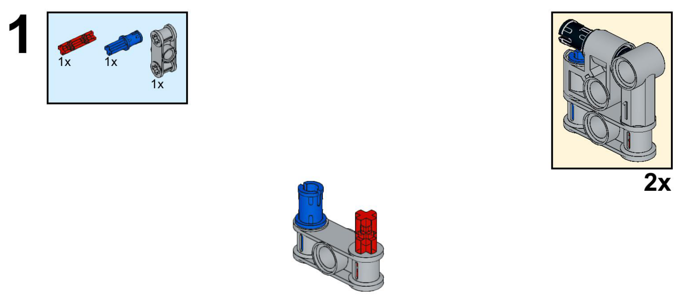

**New parts:** bracket-L (6536, light bluish gray) - first part; a small elbow with one round hole and one cross hole at right angles; pin-blue-A (43093, blue) - its axle end pushed into bracket-L's cross hole, sticking straight up; pin-red-A (11214, red) - its pin end pushed into bracket-L's round hole, sticking out to the side

**Touches:** pin-blue-A's axle end goes into bracket-L's cross hole; pin-red-A's pin end goes into bracket-L's round hole~

**Exact joins:** pin-blue-A.axle1 into bracket-L.axlehole1 (1 hole deep, locked (turn together)); pin-red-A.pin1 into bracket-L.hole1 (0.9 hole deep, held stiff by friction, estimated from the picture)

**Who does what:** bracket-L holds pin-blue-A; bracket-L holds pin-red-A

**After:** bracket-L: start of the model, one corner post; pin-blue-A: sticking up out of bracket-L, free end open; pin-red-A: sticking out to the side of bracket-L, free end open

**Why:** Starts the left corner post of the gearbox housing. The elbow bracket has only one round hole and one cross hole; a friction peg in each turns those into two usable mounting studs at right angles, so the beam and the frame's bottom corner can both attach here later. *Next:* pin-blue-A's free end takes the 7-hole beam in step 3; pin-red-A's free end is the frame's open bottom corner (not reached again in this 11-step booklet, so it stays as a stub in this model as built). *Pattern:* peg-in-elbow corner mount

**Big picture:**
- **bracket-L** (Frame / housing): Left corner post: anchors pin-blue-A (holds the beam) and pin-red-A (unused stub in this 11-step booklet).
- **pin-blue-A** (Frame / housing): Carries beam-C's left end. Later: MOC-183729-step-03 `CONNECT pin-blue-A.pin1 -> beam-C.hole1 STIFF`; MOC-183729-step-03 `DOES beam-C HOLDS pin-blue-A`.
- **pin-red-A** (Frame / housing): Free stub on the left corner; not reached again in this booklet.

**Mechanisms:**
- adds **bracket-L** to the gearbox housing (rigid_frame) as left corner post
- frame: 1/6 parts - still missing bracket-R, beam-C, bracket-G, bracket-H

**Review:** The parts box doesn't say which hole each peg goes in; bracket-L only has one of each hole type so the fit is forced, but hole1 is marked ~ since the round-hole/cross-hole split is read from the render, not confirmed by a close-up. The top-right '2x' callout on this booklet page shows a finished corner unit with a black axle sticking out, which looks like step 2's hub-B module, not this one -- it's read here as a forward preview of 'this general corner shape appears twice in the model' (once from this step, once from step 2's different parts), not a literal second build of this exact step. Worth Dennis double-checking against the PDF directly.

## MOC-183729-step-02 (page 2) - low - NEEDS REVIEW

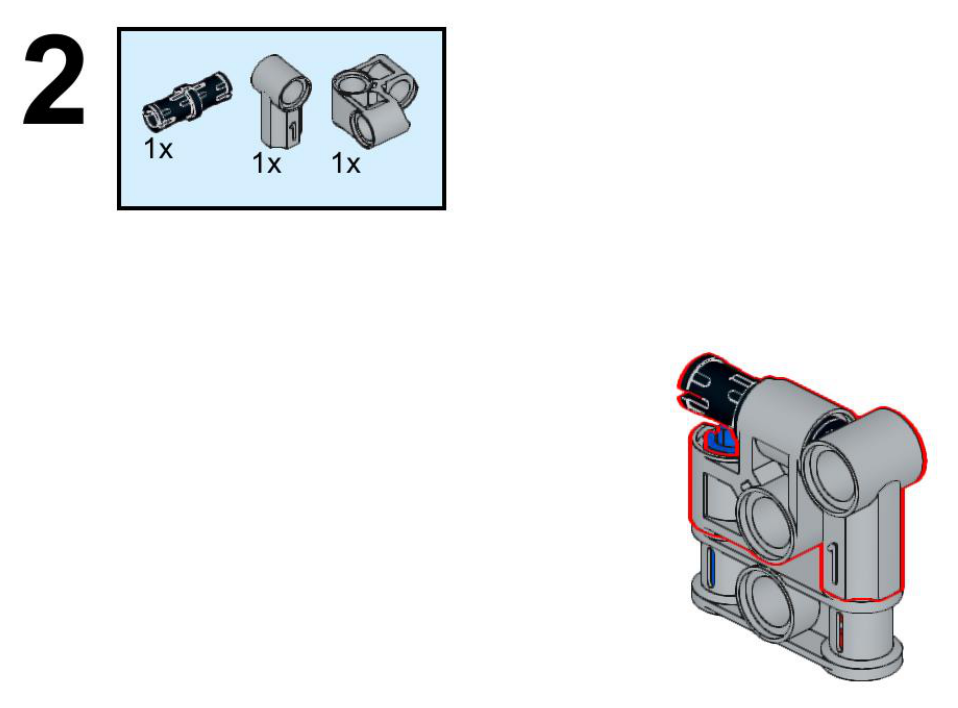

**New parts:** bracket-R (6536, light bluish gray) - a second elbow bracket, free-standing -- the right corner post; peg-black-B (43093, black) - its axle end pushed into bracket-R's cross hole; fork-R (32291, light bluish gray) - set next to bracket-R, not yet joined to anything -- it has no peg of its own

**Touches:** peg-black-B's axle end goes into bracket-R's cross hole

**Exact joins:** peg-black-B.axle1 into bracket-R.axlehole1 (1 hole deep, locked (turn together))

**Who does what:** bracket-R holds peg-black-B

**After:** bracket-R: free-standing, the right corner post, now carrying peg-black-B; fork-R: sitting with bracket-R but not yet attached to anything; bracket-L, pin-blue-A, pin-red-A: no change

**Why:** Starts the right corner post, mirroring the left one from step 1 so the beam in step 3 has a matching peg to land on at both ends. A friction peg with a stop on both ends bridges the elbow bracket's cross hole now and the beam's round hole in step 3, same trick as pin-blue-A on the left. *Next:* peg-black-B's free pin end takes the 7-hole beam in step 3. fork-R's holes take the long shaft's gray gear and right-hand bearing in step 7. *Pattern:* peg-in-elbow corner mount, bearing block added alongside

**Big picture:**
- **bracket-R** (Frame / housing): Right corner post: anchors peg-black-B (holds the beam).
- **peg-black-B** (Frame / housing): Carries beam-C's right end. Later: MOC-183729-step-03 `CONNECT peg-black-B.pin1 -> beam-C.hole7 STIFF`; MOC-183729-step-03 `DOES beam-C HOLDS peg-black-B`.
- **fork-R** (Frame / housing): Right-hand bearing block: its round hole is where the main shaft axle-N spins free and exits the frame. Later: MOC-183729-step-07 `CONNECT axle-N.axle8 -> fork-R.hole1~ TURNS`; MOC-183729-step-07 `DOES axle-N SPINS_ON fork-R`.

**Mechanisms:**
- adds **bracket-R** to the gearbox housing (rigid_frame) as right corner post
- adds **fork-R** to the gearbox housing (rigid_frame) as right-hand main shaft bearing *(not confirmed)*
- adds **fork-R** to the output shaft (shaft_with_stops) as bearing, lets axle-N spin free *(not confirmed)*
- frame: 3/6 parts - still missing beam-C, bracket-G, bracket-H
- output: 1/3 parts - still missing gear-tan-M, ext-W

**Review:** Item 1 in this step's parts box is read as 43093 (axle pin, friction, both ends are stops) rather than a hub-style part, because nothing else in the box has a stop to offer fork-R or the beam later -- a hub-with-one-hole part would leave this corner with no free peg for step 3. fork-R (32291) is hole-only in the catalog with no pin or axle stop, so it isn't connected to anything in this step; it's read as a bearing block positioned here and only joined when the main shaft threads through it in step 7. Worth Dennis checking the PDF for an arrow connecting fork-R that this crop doesn't show.

## MOC-183729-step-03 (page 3) - medium - NEEDS REVIEW

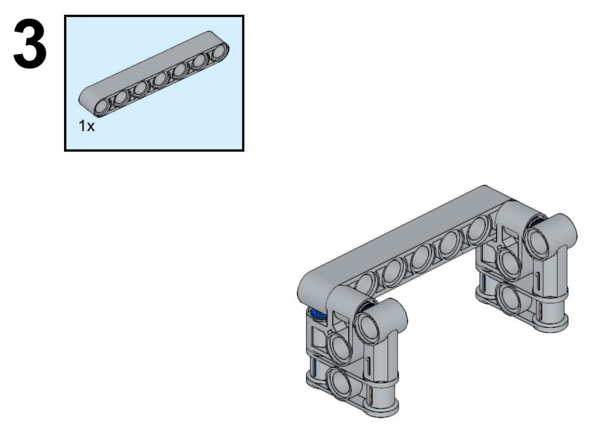

**New parts:** beam-C (32524, light bluish gray) - spans the top, end holes land on pin-blue-A's and peg-black-B's free pegs

**Touches:** pin-blue-A's free pin end goes into beam-C's hole1 (left end); peg-black-B's free pin end goes into beam-C's hole7 (right end)

**Exact joins:** pin-blue-A.pin1 into beam-C.hole1 (0.9 hole deep, held stiff by friction); peg-black-B.pin1 into beam-C.hole7 (0.9 hole deep, held stiff by friction)

**Who does what:** beam-C holds pin-blue-A; beam-C holds peg-black-B

**After:** beam-C: new top bar, joining the two corner posts into a U shape; bracket-L, pin-blue-A, pin-red-A, bracket-R, peg-black-B, fork-R: no change in position, now connected via beam-C

**Why:** Closes the two separate corner posts into one U-shaped frame. A single 7-hole beam is long enough to reach both corners, with 5 spare holes in the middle for the shift mechanism (steps 4-6). *Next:* beam-C's middle holes take 3 more friction pegs in step 4, which carry the shift-fork housing and two more corner brackets. *Pattern:* close the U into a frame

**Big picture:**
- **beam-C** (Frame / housing): Top bar: closes the frame into a U and carries the shift mechanism's mounting pegs. Later: MOC-183729-step-04 `CONNECT pin-blue-D.pin1 -> beam-C.hole3 STIFF`; MOC-183729-step-04 `CONNECT pin-blue-E.pin1 -> beam-C.hole4 STIFF`; MOC-183729-step-04 `CONNECT pin-blue-F.pin1 -> beam-C.hole5 STIFF`; MOC-183729-step-04 `DOES beam-C HOLDS pin-blue-D`; MOC-183729-step-04 `DOES beam-C HOLDS pin-blue-E`; MOC-183729-step-04 `DOES beam-C HOLDS pin-blue-F`.

**Mechanisms:**
- adds **beam-C** to the gearbox housing (rigid_frame) as top bar, closes the U
- frame: 4/6 parts - still missing bracket-G, bracket-H
- **beam-C** builds on pin-blue-A (MOC-183729-step-01), which rests on bracket-L (MOC-183729-step-01); peg-black-B (MOC-183729-step-02), which rests on bracket-R (MOC-183729-step-02)

**Review:** Exactly which of beam-C's 7 holes line up with the two corner pegs isn't shown close-up; hole1 and hole7 (the two ends) are the natural reading since the corners sit at the beam's extremes in the picture, and the middle 5 holes are confirmed empty here by comparing against step 4's picture, where 3 of those middle holes get new pegs.

## MOC-183729-step-04 (page 4) - medium - NEEDS REVIEW

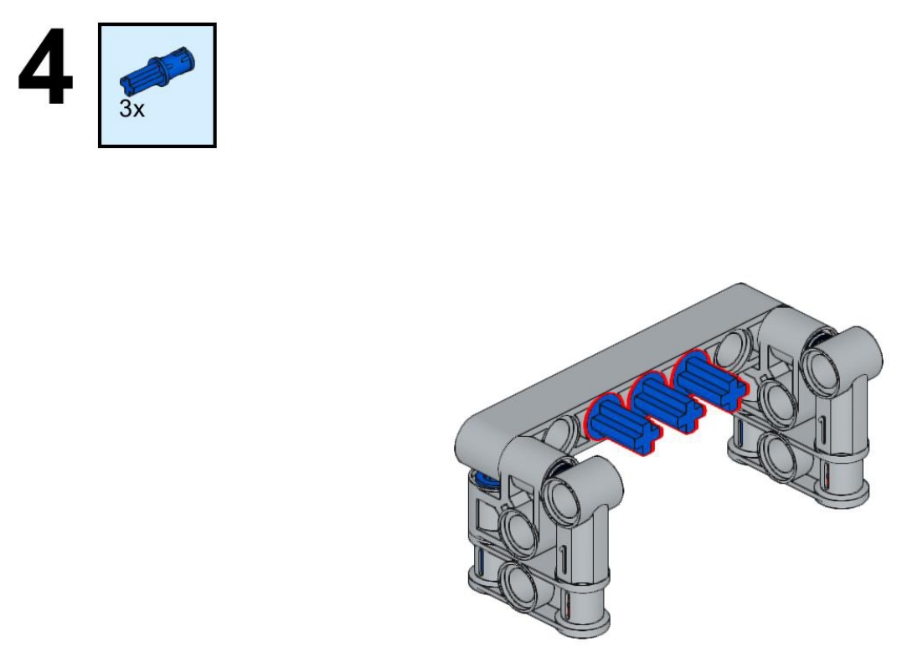

**New parts:** pin-blue-D (43093, blue) - pin end into beam-C's 3rd hole, axle end hanging free below the beam; pin-blue-E (43093, blue) - pin end into beam-C's 4th (middle) hole, axle end hanging free; pin-blue-F (43093, blue) - pin end into beam-C's 5th hole, axle end hanging free

**Touches:** pin-blue-D's pin end goes into beam-C's hole3; pin-blue-E's pin end goes into beam-C's hole4; pin-blue-F's pin end goes into beam-C's hole5

**Exact joins:** pin-blue-D.pin1 into beam-C.hole3 (0.9 hole deep, held stiff by friction); pin-blue-E.pin1 into beam-C.hole4 (0.9 hole deep, held stiff by friction); pin-blue-F.pin1 into beam-C.hole5 (0.9 hole deep, held stiff by friction)

**Who does what:** beam-C holds pin-blue-D; beam-C holds pin-blue-E; beam-C holds pin-blue-F

**After:** pin-blue-D, pin-blue-E, pin-blue-F: three new pegs hanging down from beam-C's middle, axle ends open; everything else: no change

**Why:** Turns three of the beam's middle holes into mounting studs, ready for the shift mechanism's housing and two more corner brackets. Same friction peg as pin-blue-A: a cross-hole axle end hanging free is exactly what a bracket's cross hole needs next. *Next:* pin-blue-D and pin-blue-F each take a bracket in step 5; pin-blue-E (the middle one) takes the shift-fork housing in step 6. *Pattern:* three pegs in a row

**Big picture:**
- **pin-blue-D** (Frame / housing): Carries bracket-G, the input shaft's bearing post. Later: MOC-183729-step-05 `CONNECT pin-blue-D.axle1 -> bracket-G.axlehole1 LOCKED`; MOC-183729-step-05 `DOES pin-blue-D CARRIES bracket-G`.
- **pin-blue-E** (Frame / housing): Carries fork-J, the shift-fork housing, in the middle of the frame. Later: MOC-183729-step-06 `CONNECT pin-blue-E.axle1 -> fork-J.axlehole1 LOCKED`; MOC-183729-step-06 `DOES pin-blue-E CARRIES fork-J`.
- **pin-blue-F** (Frame / housing): Carries bracket-H, a second bearing post next to the output side. Later: MOC-183729-step-05 `CONNECT pin-blue-F.axle1 -> bracket-H.axlehole1 LOCKED`; MOC-183729-step-05 `DOES pin-blue-F CARRIES bracket-H`.

**Mechanisms:**
- adds **pin-blue-E** to the shift lever mount (hinge) as frame mount
- shift_fork: 1/3 parts - still missing fork-J, knob-I
- **pin-blue-D** builds on beam-C (MOC-183729-step-03, top bar, closes the U in the gearbox housing), which rests on pin-blue-A (MOC-183729-step-01), peg-black-B (MOC-183729-step-02)
- **pin-blue-E** builds on beam-C (MOC-183729-step-03, top bar, closes the U in the gearbox housing), which rests on pin-blue-A (MOC-183729-step-01), peg-black-B (MOC-183729-step-02)
- **pin-blue-F** builds on beam-C (MOC-183729-step-03, top bar, closes the U in the gearbox housing), which rests on pin-blue-A (MOC-183729-step-01), peg-black-B (MOC-183729-step-02)

**Review:** Which three of beam-C's 5 empty middle holes (2,3,4,5,6) these pegs use isn't marked with arrows in the crop; read as the center 3 (3,4,5) by eye since the picture shows them roughly centered with one empty hole free on each side next to the corner posts. Confirmed by step 5: two of these three take brackets at the outer two positions, and step 6 confirms the middle one takes the shift housing.

## MOC-183729-step-05 (page 5) - medium

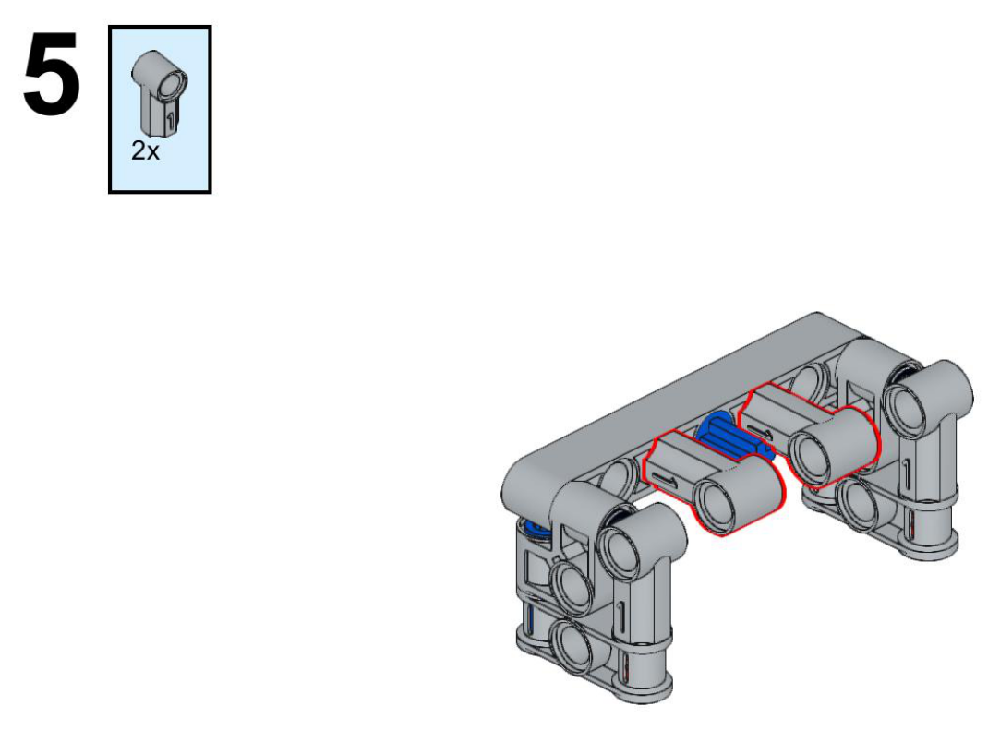

**New parts:** bracket-G (6536, light bluish gray) - cross hole onto pin-blue-D's free axle end; bracket-H (6536, light bluish gray) - cross hole onto pin-blue-F's free axle end

**Touches:** bracket-G's cross hole goes onto pin-blue-D's free axle end; bracket-H's cross hole goes onto pin-blue-F's free axle end

**Exact joins:** pin-blue-D.axle1 into bracket-G.axlehole1 (1 hole deep, locked (turn together)); pin-blue-F.axle1 into bracket-H.axlehole1 (1 hole deep, locked (turn together))

**Who does what:** pin-blue-D carries bracket-G; pin-blue-F carries bracket-H

**After:** bracket-G, bracket-H: new, hanging below beam-C on the outer two of the three middle pegs; pin-blue-E: still bare, the only middle peg without a bracket; everything else: no change

**Why:** Turns the outer two middle pegs into another pair of round-hole mounts, matching the corner brackets' shape. Locking a bracket onto each axle end fixes it so it can't spin loose; leaving the middle peg bare keeps it free for the shift housing's cross hole next. *Next:* bracket-G and bracket-H's round holes are the bearing points the long gear shaft (step 7) passes between. *Pattern:* mirror the side (two identical brackets added together)

**Big picture:**
- **bracket-G** (Frame / housing): Bearing post for axle-input-T, the input shaft. Later: MOC-183729-step-10 `CONNECT axle-input-T.axle1 -> bracket-G.hole1~ TURNS`.
- **bracket-H** (Frame / housing): Bearing post next to gear-tan-M / the output end.

**Mechanisms:**
- adds **bracket-G** to the gearbox housing (rigid_frame) as input shaft bearing post
- adds **bracket-H** to the gearbox housing (rigid_frame) as second bearing post
- frame: 6/6 parts - complete
- **bracket-G** builds on pin-blue-D (MOC-183729-step-04), which rests on beam-C (MOC-183729-step-03)
- **bracket-H** builds on pin-blue-F (MOC-183729-step-04), which rests on beam-C (MOC-183729-step-03)

**Review:** The two brackets in this step's picture are read as going on the outer two pegs (pin-blue-D, pin-blue-F) rather than the middle one, because step 6 shows the middle peg (pin-blue-E) taking the shift housing instead, and step 7's shaft needs a bearing hole on each side of the housing -- exactly where these two brackets end up.

## MOC-183729-step-06 (page 6) - low - NEEDS REVIEW

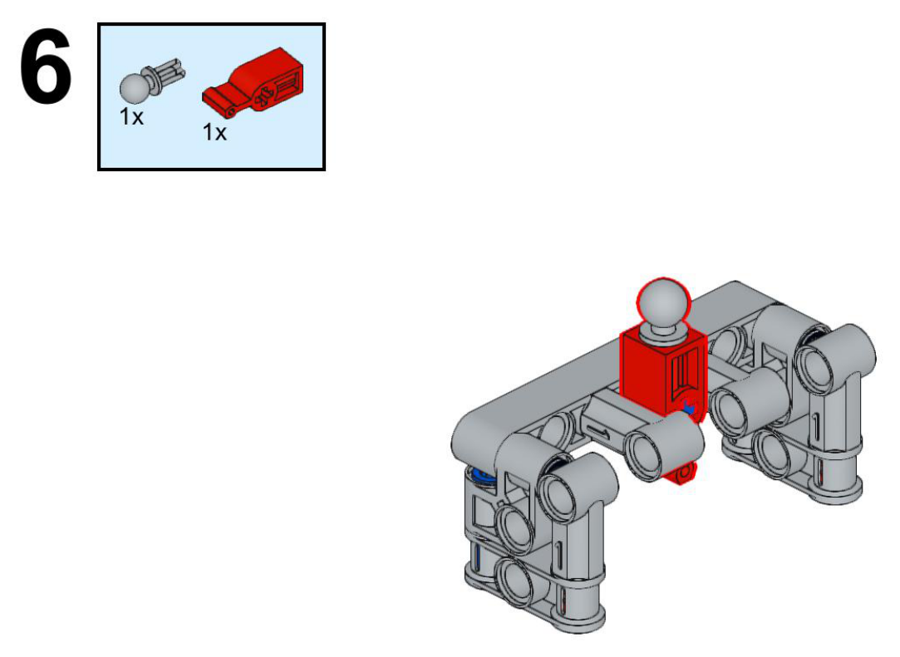

**New parts:** fork-J (32172, red) - cross hole onto pin-blue-E's free axle end, hanging down between bracket-G and bracket-H; knob-I (6628, light bluish gray) - pin end into fork-J's top hole, ball sticking straight up above the beam

**Touches:** fork-J's cross hole goes onto pin-blue-E's free axle end; knob-I's pin end goes into fork-J's top hole

**Exact joins:** pin-blue-E.axle1 into fork-J.axlehole1 (1 hole deep, locked (turn together)); knob-I.pin1 into fork-J.hole1 (0.7 hole deep, held stiff by friction)

**Who does what:** pin-blue-E carries fork-J; fork-J holds knob-I

**After:** fork-J: new, hanging between bracket-G and bracket-H, straddling the gap where the gear shaft will run; knob-I: new, sticking up out of the top of fork-J as a lever stud; everything else: no change

**Why:** Adds the gear-shift fork and its lever stud, so a shift lever (not in this model) can push the fork sideways to change gear. fork-J's slot is sized to sit in the groove of the sliding clutch sleeve built in step 9, without turning with the shaft itself. *Next:* fork-J's slot will straddle the dog-clutch sleeve added in step 9, so sliding fork-J (by pushing knob-I) slides the clutch between the two gears. *Pattern:* lever on a slider

**Big picture:**
- **fork-J** (Gear-shift lever and fork): Housing with a slot that straddles the sliding clutch sleeve; a ball stud on top takes a lever.
- **knob-I** (Gear-shift lever and fork): Ball-stud lever attachment point on top of fork-J.

**Mechanisms:**
- adds **fork-J** to the shift lever mount (hinge) as slotted housing, straddles the clutch sleeve
- adds **fork-J** to the two-position gear clutch (sliding_dog_clutch) as pushes the sleeve
- adds **knob-I** to the shift lever mount (hinge) as ball-stud lever point
- shift_fork: 3/3 parts - complete
- clutch_select: 1/4 parts - still missing sleeve-wht-Q, sleeve-blk-S, gear-red-P
- **fork-J** builds on pin-blue-E (MOC-183729-step-04, frame mount in the shift lever mount), which rests on beam-C (MOC-183729-step-03)

**Review:** fork-J's part number is a low-confidence guess -- the catalog search didn't turn up an exact match for a small red block with a vertical pin hole on top and a horizontal slot on the side; 32172 is the closest shape found (a small connector block), not a confirmed fit. Its real-machine job (gear-shift fork, straddling the clutch sleeve from step 9) is inferred from its position between bracket-G and bracket-H, exactly where the main shaft's clutch will run, and from the ball-stud on top being a standard lever-attachment point. Worth Dennis identifying the exact part from the PDF or BrickLink.

## MOC-183729-step-07 (page 7) - low - NEEDS REVIEW

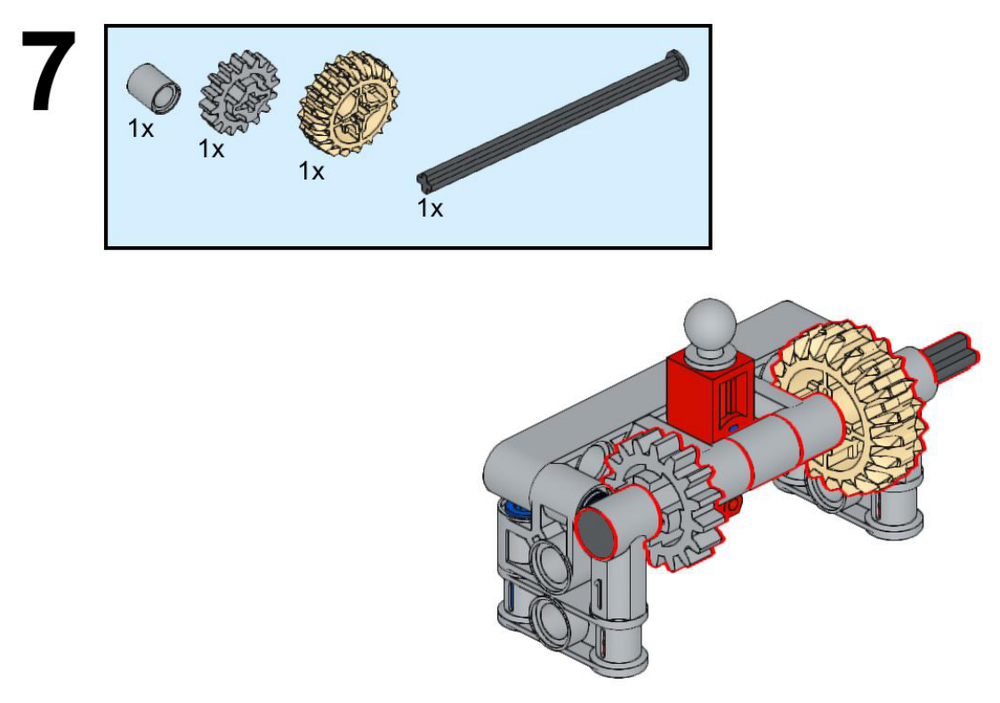

**New parts:** bush-K (3713, light bluish gray) - near the left end of axle-N, against the frame; gear-gray-L (4019, light bluish gray) - on axle-N, just right of bush-K; gear-tan-M (32269, tan) - on axle-N, near the right end, inside fork-R; axle-N (3707, black) - the main gear shaft, running the length of the frame through bush-K, gear-gray-L and gear-tan-M, and out through fork-R's bearing hole on the right

**Touches:** axle-N's 1st cross point locks into bush-K's cross hole; axle-N's 3rd cross point locks into gear-gray-L's cross hole; axle-N's 7th cross point locks into gear-tan-M's cross hole; axle-N's far end turns freely in fork-R's round hole~

**Exact joins:** axle-N.axle1 into bush-K.axlehole1 (1 hole deep, locked (turn together)); axle-N.axle3 into gear-gray-L.axlehole1 (1 hole deep, locked (turn together)); axle-N.axle7 into gear-tan-M.axlehole1 (1 hole deep, locked (turn together)); axle-N.axle8 into fork-R.hole1 (1 hole deep, turns freely, estimated from the picture)

**Who does what:** axle-N carries bush-K; axle-N carries gear-gray-L; axle-N carries gear-tan-M; axle-N spins on fork-R

**After:** axle-N: new main shaft, running the length of the frame; bush-K, gear-gray-L, gear-tan-M: fixed to axle-N, turning with it; fork-R: now holding the shaft's right-hand bearing; everything else: no change

**Why:** Builds the main gear shaft that will carry the clutch mechanism and drive the output. gear-gray-L and gear-tan-M are locked to the shaft (cross-hole gears) so they always turn with it; bush-K keeps the shaft from sliding left; fork-R's round hole lets the shaft spin free on the right. *Next:* gear-gray-L will mesh with the input gear added in step 10. The dog-clutch sleeve (step 9) and the second clutch gear (step 8) go on this same shaft, between gear-gray-L and gear-tan-M. The shaft's right end takes an output extension in step 11. *Pattern:* shaft with stops

**Big picture:**
- **bush-K** (Gear shaft and clutch): Spacer/stop near the main shaft's left end, locked to axle-N.
- **gear-gray-L** (Gear shaft and clutch): Gear locked to axle-N; meshes with the input gear gear-blue-U. Later: MOC-183729-step-10 `MESH gear-blue-U.teeth gear-gray-L.teeth`; MOC-183729-step-10 `DOES gear-blue-U DRIVES gear-gray-L`; MOC-183729-step-10 `RATIO gear-blue-U gear-gray-L 20/16`.
- **gear-tan-M** (Gear shaft and clutch): Gear locked to axle-N near the output end; always turns with the main shaft.
- **axle-N** (Gear shaft and clutch): The main shaft: carries bush-K, gear-gray-L, the clutch sleeve, gear-red-P (free) and gear-tan-M, and exits through fork-R and ext-W as the output. Later: MOC-183729-step-09 `CONNECT axle-N.axle5 -> sleeve-wht-Q.axlehole1~ LOCKED`; MOC-183729-step-09 `CONNECT axle-N.axle6 -> sleeve-blk-S.axlehole1~ LOCKED`; MOC-183729-step-09 `DOES axle-N CARRIES sleeve-wht-Q`; MOC-183729-step-09 `DOES axle-N CARRIES sleeve-blk-S`; MOC-183729-step-11 `CONNECT axle-N.axle8 -> ext-W.axlehole1~ LOCKED`; MOC-183729-step-11 `DOES axle-N CARRIES ext-W`.

**Mechanisms:**
- adds **gear-gray-L** to the input to main shaft (gear_pair) as driven gear
- adds **gear-tan-M** to the output shaft (shaft_with_stops) as always-locked output gear
- adds **axle-N** to the input to main shaft (gear_pair) as main shaft, carries the clutch and both output gears
- input_mesh: 2/4 parts - still missing axle-input-T, gear-blue-U
- output: 2/3 parts - still missing ext-W
- motion: Turn axle-N once: gear-tan-M turns 1 turn
- **axle-N** builds on fork-R (MOC-183729-step-02, right-hand main shaft bearing in the gearbox housing)

**Review:** Exactly which numbered cross-point of axle-N each part sits at isn't shown with hole markers -- read left to right in the order bush-K, gear-gray-L, (gap for steps 8-9's clutch), gear-tan-M, matching their left-to-right order in the picture, with axle-N's far tip sitting in fork-R's hole (marked ~, estimated). gear-gray-L and gear-tan-M are locked (cross-hole) parts in the catalog, so they always turn with the shaft; whether that's mechanically correct for how the gearbox actually shifts speed is an open question -- see systems.json.

## MOC-183729-step-08 (page 8) - low - NEEDS REVIEW

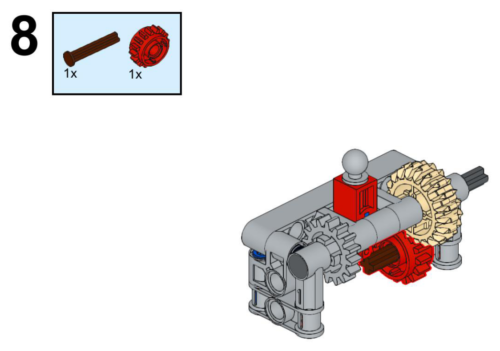

**New parts:** axle-brown-O (3705, brown) - short axle, positioned between gear-gray-L and gear-tan-M on the main shaft line; gear-red-P (18946, red) - on axle-brown-O, free to turn

**Touches:** gear-red-P's round hole goes onto axle-brown-O

**Exact joins:** axle-brown-O.axle2 into gear-red-P.hole1 (1 hole deep, turns freely)

**Who does what:** gear-red-P spins on axle-brown-O

**After:** axle-brown-O, gear-red-P: new, sitting between gear-gray-L and gear-tan-M, free to turn independently of the main shaft's own rotation; everything else: no change

**Why:** Adds the second of the two clutch gears -- one side of the gear choice the shift fork will select between. gear-red-P has clutch (dog-tooth) faces on both sides and a plain round hole, so by design it never locks to a shaft on its own -- only the sliding clutch sleeve from step 9 can lock it in. *Next:* The dog-clutch sleeve in step 9 sits right next to gear-red-P and can slide onto its clutch face to lock it to the main shaft, giving one of the two gear speeds. *Pattern:* free clutch gear on a stub shaft

**Big picture:**
- **axle-brown-O** (Gear shaft and clutch): Short axle gear-red-P free-spins on, positioned in line with the main shaft.
- **gear-red-P** (Gear shaft and clutch): Free clutch gear between gear-gray-L and gear-tan-M; the dog-clutch sleeve can lock it to the shaft.

**Mechanisms:**
- adds **gear-red-P** to the two-position gear clutch (sliding_dog_clutch) as free gear the sleeve can lock to the shaft
- clutch_select: 2/4 parts - still missing sleeve-wht-Q, sleeve-blk-S

**Review:** How axle-brown-O itself relates to the main shaft axle-N isn't shown clearly enough to notate with confidence -- it may be a short separate axle sitting end-to-end in line with axle-N, or it may represent axle-N's own middle section as drawn in this crop (the picture shows them close together, hard to tell apart at this zoom). Read here as functionally in-line with the main shaft either way, since gear-red-P's job (free clutch gear between gear-gray-L and gear-tan-M) is the same regardless. Worth Dennis confirming against the PDF whether this is really a separate axle part.

## MOC-183729-step-09 (page 9) - low - NEEDS REVIEW

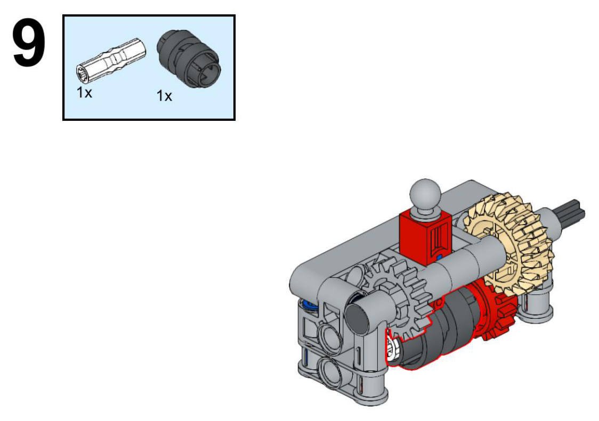

**New parts:** sleeve-wht-Q (6538b, white) - locked onto axle-N, sitting inside fork-J's shift slot; sleeve-blk-S (6538b, black) - locked onto axle-N next to sleeve-wht-Q, forming one combined sliding sleeve

**Touches:** sleeve-wht-Q's cross hole locks onto axle-N; sleeve-blk-S's cross hole locks onto axle-N, next to sleeve-wht-Q

**Exact joins:** axle-N.axle5 into sleeve-wht-Q.axlehole1 (1 hole deep, locked (turn together), estimated from the picture); axle-N.axle6 into sleeve-blk-S.axlehole1 (1 hole deep, locked (turn together), estimated from the picture)

**Who does what:** axle-N carries sleeve-wht-Q; axle-N carries sleeve-blk-S

**After:** sleeve-wht-Q, sleeve-blk-S: new, locked to the main shaft between gear-gray-L and gear-red-P, sitting inside fork-J's slot; everything else: no change

**Why:** Adds the sliding dog-clutch collar that fork-J (step 6) will push back and forth to choose a gear. A cross-hole connector locked to the shaft always turns with it (unlike gear-red-P's free hole), but can still slide along the shaft's length -- that sliding motion, guided by fork-J's slot, is what engages or disengages gear-red-P's clutch face. *Next:* Sliding this collar toward gear-red-P locks that gear to the shaft for one output speed; sliding it the other way disengages it. Exactly what the other position connects to is not confirmed -- see systems.json. *Pattern:* sliding dog clutch

**Big picture:**
- **sleeve-wht-Q** (Gear shaft and clutch): Half of the sliding dog-clutch collar, locked to axle-N, slides in fork-J's slot.
- **sleeve-blk-S** (Gear shaft and clutch): Other half of the sliding dog-clutch collar, locked to axle-N next to sleeve-wht-Q.

**Mechanisms:**
- adds **sleeve-wht-Q** to the two-position gear clutch (sliding_dog_clutch) as half of the sliding collar, locked to axle-N
- adds **sleeve-blk-S** to the two-position gear clutch (sliding_dog_clutch) as other half of the sliding collar, locked to axle-N
- clutch_select: 4/4 parts - complete
- **sleeve-wht-Q** builds on axle-N (MOC-183729-step-07, main shaft, carries the clutch and both output gears in the input to main shaft), which rests on bush-K (MOC-183729-step-07), gear-gray-L (MOC-183729-step-07)
- **sleeve-blk-S** builds on axle-N (MOC-183729-step-07, main shaft, carries the clutch and both output gears in the input to main shaft), which rests on bush-K (MOC-183729-step-07), gear-gray-L (MOC-183729-step-07)

**Review:** Not in catalog/mechanisms.json as a named type -- written here as 'sliding_dog_clutch', a part locked to a shaft (so it always turns with it) but free to slide along the shaft's length inside a fork's slot, engaging a neighboring free gear's clutch face when pushed against it. The exact two shaft positions fork-J selects between, and what the second position (away from gear-red-P) actually engages, isn't shown clearly enough in the booklet to confirm -- flagged in sets/MOC-183729/systems.json open_questions.

## MOC-183729-step-10 (page 10) - low - NEEDS REVIEW

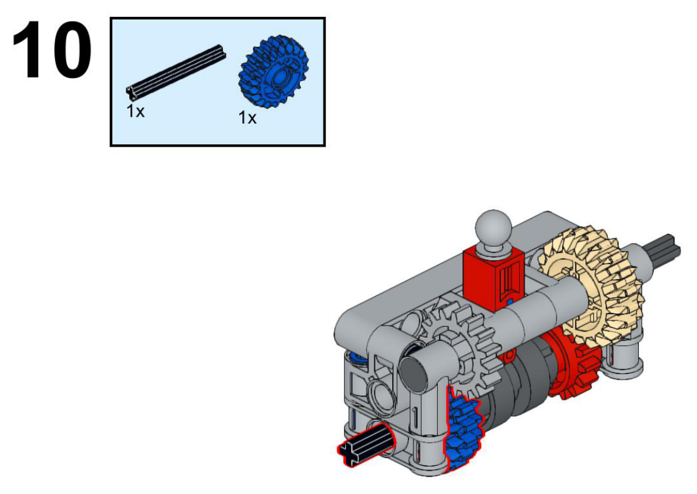

**New parts:** axle-input-T (3705, black) - a short shaft below and parallel to the main shaft, through bracket-G's round hole, sticking out the bottom of the frame; gear-blue-U (35185, blue) - on axle-input-T, meshing upward with gear-gray-L

**Touches:** axle-input-T turns in bracket-G's round hole~; gear-blue-U's round hole goes onto axle-input-T~; gear-blue-U's teeth mesh with gear-gray-L's teeth

**Exact joins:** axle-input-T.axle1 into bracket-G.hole1 (1 hole deep, turns freely, estimated from the picture); axle-input-T.axle2 into gear-blue-U.hole1 (1 hole deep, turns freely, estimated from the picture)

**Who does what:** gear-blue-U drives gear-gray-L (ratio 20/16)

**After:** axle-input-T, gear-blue-U: new, a second shaft below the main one, meshing into it; everything else: no change

**Why:** Adds the input: a hand- or motor-turned shaft that drives the main gear shaft through gear-gray-L. A double-bevel gear meshes cleanly with gear-gray-L's plain teeth at this close spacing; its own clutch faces aren't used here, just its teeth. *Next:* axle-input-T's free end takes an output-style extension in step 11, making it an external handle. This is the gearbox's drive input. *Pattern:* input gear mesh

**Big picture:**
- **axle-input-T** (Gear shaft and clutch): Input shaft, turned by hand or motor at ext-V; meshes gear-blue-U into gear-gray-L. Later: MOC-183729-step-11 `CONNECT axle-input-T.axle3 -> ext-V.axlehole1~ LOCKED`; MOC-183729-step-11 `DOES axle-input-T CARRIES ext-V`.
- **gear-blue-U** (Gear shaft and clutch): Input gear on axle-input-T; drives gear-gray-L.

**Mechanisms:**
- adds **axle-input-T** to the input to main shaft (gear_pair) as input shaft
- adds **gear-blue-U** to the input to main shaft (gear_pair) as driver gear
- input_mesh: 4/4 parts - complete
- **axle-input-T** builds on bracket-G (MOC-183729-step-05, input shaft bearing post in the gearbox housing), which rests on pin-blue-D (MOC-183729-step-04)
- **gear-blue-U** builds on gear-gray-L (MOC-183729-step-07, driven gear in the input to main shaft), which rests on axle-N (MOC-183729-step-07)

**Review:** Read as meshing with gear-gray-L specifically (not gear-red-P) because gear-blue-U sits lower and further left in the picture, closer to gear-gray-L's position near the frame. Whether gear-blue-U actually reaches gear-red-P's teeth too (both are 16-tooth, so a wide double-bevel gear spanning the gap between them is plausible) is not confirmed -- if it does, the clutch selects between two gears that are both already being turned by the same input, which would change the design from 'speed select' to 'engage/disengage'. This is the open mechanism question in systems.json.

## MOC-183729-step-11 (page 11) - medium

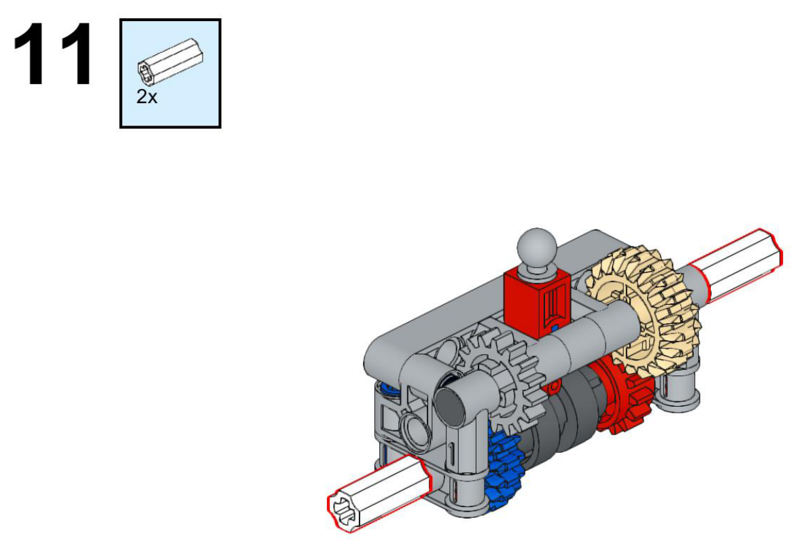

**New parts:** ext-V (6538b, white) - on axle-input-T's free end, sticking out the bottom of the frame as a handle; ext-W (6538b, white) - on axle-N's free end, sticking out the top-right of the frame as the output

**Touches:** ext-V's cross hole locks onto axle-input-T's free end; ext-W's cross hole locks onto axle-N's free end~

**Exact joins:** axle-input-T.axle3 into ext-V.axlehole1 (1 hole deep, locked (turn together), estimated from the picture); axle-N.axle8 into ext-W.axlehole1 (1 hole deep, locked (turn together), estimated from the picture)

**Who does what:** axle-input-T carries ext-V; axle-N carries ext-W

**After:** ext-V: new, the input handle, sticking out the bottom; ext-W: new, the output handle, sticking out the top-right; everything else: no change -- model complete

**Why:** Finishes both shaft ends as external handles a motor or another model can plug into. A ridged axle connector gives a longer, grippable stub with a cross hole on its far end, so the shaft can reach past the frame and still take another axle. *Next:* Nothing further in this 11-step booklet -- this is the last step. ext-V is where you'd turn the gearbox by hand or motor; ext-W is where the selected speed comes out. *Pattern:* axle extension handle

**Big picture:**
- **ext-V** (Gear shaft and clutch): Input handle, the exposed end of axle-input-T.
- **ext-W** (Gear shaft and clutch): Output handle, the exposed end of axle-N.

**Mechanisms:**
- adds **ext-W** to the output shaft (shaft_with_stops) as output handle
- output: 3/3 parts - complete
- motion: Turn axle-N once: gear-tan-M turns 1 turn, ext-W turns 1 turn
- **ext-V** builds on axle-input-T (MOC-183729-step-10, input shaft in the input to main shaft), which rests on bracket-G (MOC-183729-step-05), gear-blue-U (MOC-183729-step-10)
- **ext-W** builds on axle-N (MOC-183729-step-07, main shaft, carries the clutch and both output gears in the input to main shaft), which rests on bush-K (MOC-183729-step-07), gear-gray-L (MOC-183729-step-07)

**Review:** The '2x' callout matches the count directly here (one extension added to each of the two exposed shaft ends in the same picture), unlike the forward-preview '2x' in step 1.
